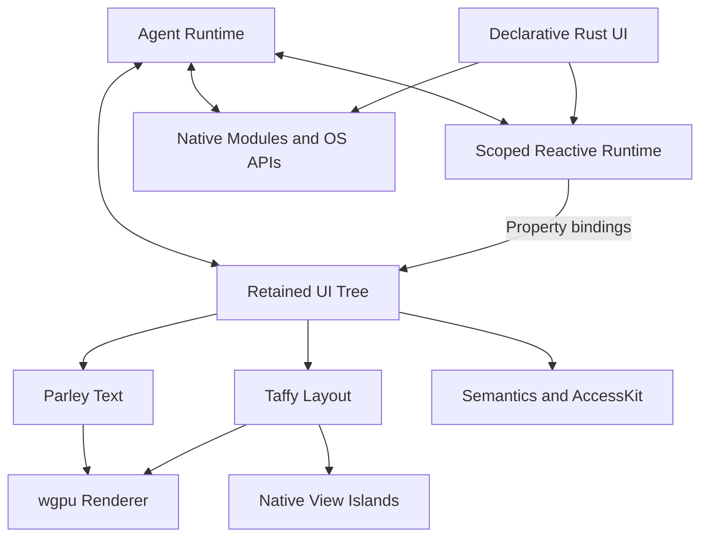

# Octara

**Agent-first native apps. Built with Rust.**

[octara.dev](https://octara.dev)

Octara is an Agent-Native Application Platform being designed for AI agents to
build, inspect, test, and ship cross-platform native applications using Rust.
It combines fine-grained reactivity, a retained UI tree, GPU rendering, and native
platform capabilities with inspection and testing built into the runtime.

**Status:** early development. The reactive core, incremental collections, virtualization,
the retained node tree and a headless runtime exist in `crates/octara`; components, windowed
GPU rendering, the native SDK and the CLI are planned.

```sh
cargo test                                            # everything, headless
cargo run --release -p octara-examples --bin bench    # benchmark tables
```

```rust
use octara::prelude::*;
use octara_kit::{button, switch};

fn counter() -> View {
    let count = state("count", || 0);
    let fast = state("fast", || false);
    col()
        .child(text(move || format!("Count: {}", count.get())).id("count").text_lg())
        .child(
            row()
                .child(button("+1").id("inc").on_press(move || count.update(|n| *n += if fast.get() { 10 } else { 1 })))
                .child(switch(fast).id("fast").label("Count by ten"))
                .items_center()
                .gap_2(),
        )
        .p_4()
        .gap_3()
        .into()
}
```

## Principles

- **Agent first:** make UI structure, actions, updates, and diagnostics observable.
- **Rust only:** expose Rust APIs for applications and the framework, without
  requiring a JavaScript runtime.
- **Fine-grained reactivity:** use scoped Signals, Memos, and Effects to update
  individual UI properties.
- **GPU first:** render the default UI with wgpu.
- **Native extensibility:** treat native views and operating system modules as
  first-class capabilities.
- **Cross-platform:** deliver desktop support first while preserving architectural
  boundaries for iOS and Android.

## Architecture



The default update path is:

**Signal → Reactive Effect → UI Property → Incremental Layout / Scene Update.**

Ordinary property updates should preserve component instances and UI node identity.
Structural changes such as conditional views and keyed lists require explicit
scope and child-lifecycle handling.

## Four product layers

| Layer | Planned responsibility |
| --- | --- |
| UI Framework | Rust components, Signals, retained UI, layout, text, GPU rendering |
| Native SDK | Operating system capabilities and native view integration |
| Development Toolchain | Project creation, builds, preview, debugging, packaging |
| Agent Runtime | Semantic inspection, typed interaction, causal traces, replay, verification |

## Platform targets

| Platform | Planned GPU backend | Native integration | Delivery target |
| --- | --- | --- | --- |
| macOS | Metal | AppKit | Initial desktop release |
| Windows | D3D12 | Win32 / WinUI | Initial desktop release |
| Linux | Vulkan / GLES | GTK4 | Initial desktop release |
| iOS | Metal | UIKit | Later mobile phase |
| Android | Vulkan / GLES | JNI / Android Views | Later mobile phase |

These are architectural targets, not a current support matrix.

## Design documents

- [Architecture](docs/ARCHITECTURE.md)
- [Roadmap](docs/ROADMAP.md)
- [TODO](docs/TODO.md)
- [Reactive core](docs/design/reactive-core.md)
- [UI primitives and component layering](docs/design/ui-primitives.md)
- [Research](docs/research/): Rune, Exact, prior art, signals implementations, papers

## Repository

| Path | Contents |
| --- | --- |
| `crates/octara` | `kernel`, `reactive`, `view`, `app`, `testing` |
| `crates/octara-kit` | Components (in progress) |
| `examples` | Example apps, shared scenarios, tests and the benchmark |

The first milestone pairs the reactive core with a minimal semantic inspector and
headless tests. Agent capabilities are part of the initial design.
