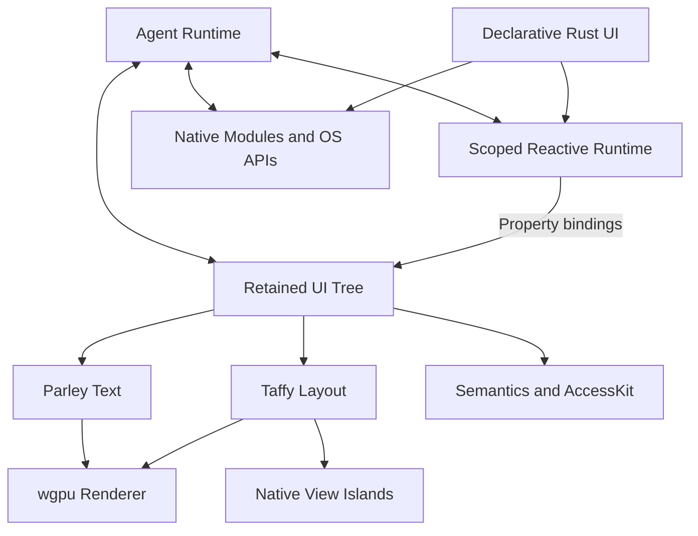

# Octara

**Agent-first native apps. Built with Rust.**

[octara.dev](https://octara.dev)

Octara is an Agent-Native Application Platform being designed for AI agents to
build, inspect, test, and ship cross-platform native applications using Rust.
It combines fine-grained reactivity, a retained UI tree, GPU rendering, and native
platform capabilities with inspection and testing built into the runtime.

**Status:** early development. The reactive core, incremental collections, virtualization,
retained UI tree, headless runtime, component kit, CPU/GPU renderers and CLI are implemented.
The winit desktop shell supports multiple windows, with deeper native integration on macOS
(web views, maps, menus and alerts). The AI chat reference app exercises streaming Markdown,
tasks and conversation storage with an offline scripted model or a configured HTTP streaming
model. Mobile shells, packaging and
the broader native SDK remain future work; see [Architecture](docs/ARCHITECTURE.md) and
[TODO](docs/TODO.md) for the current boundaries.

```sh
cargo test                                            # workspace tests; GPU checks where available
cargo run --release -p octara-examples --bin bench    # benchmark tables
cargo run -p octara-chat                              # the AI chat reference app
```

```rust
use octara::prelude::*;
use octara_kit::{button, switch};

fn counter() -> View {
    let count = state("count", || 0);
    let fast = state("fast", || false);
    col()
        .child(text(move || format!("Count: {}", count.get())).id("count").text_lg())
        .child(
            row()
                .child(button("+1").id("inc").on_press(move || count.update(|n| *n += if fast.get() { 10 } else { 1 })))
                .child(switch(fast).id("fast").label("Count by ten"))
                .items_center()
                .gap_2(),
        )
        .p_4()
        .gap_3()
        .into()
}
```

## Principles

- **Agent first:** make UI structure, actions, updates, and diagnostics observable.
- **Rust only:** expose Rust APIs for applications and the framework, without
  requiring a JavaScript runtime.
- **Fine-grained reactivity:** use scoped Signals, Memos, and Effects to update
  individual UI properties.
- **GPU first:** render the default UI with wgpu.
- **Native extensibility:** treat native views and operating system modules as
  first-class capabilities.
- **Cross-platform:** deliver desktop support first while preserving architectural
  boundaries for iOS and Android.

## Architecture



The default update path is:

**Signal → Reactive Effect → UI Property → Incremental Layout / Scene Update.**

Ordinary property updates should preserve component instances and UI node identity.
Structural changes such as conditional views and keyed lists require explicit
scope and child-lifecycle handling.

## Four product layers

| Layer | Planned responsibility |
| --- | --- |
| UI Framework | Rust components, Signals, retained UI, layout, text, GPU rendering |
| Native SDK | Operating system capabilities and native view integration |
| Development Toolchain | Project creation, builds, preview, debugging, packaging |
| Agent Runtime | Semantic inspection, typed interaction, causal traces, replay, verification |

## Platform targets

| Platform | Planned GPU backend | Native integration | Delivery target |
| --- | --- | --- | --- |
| macOS | Metal | AppKit | Initial desktop release |
| Windows | D3D12 | Win32 / WinUI | Initial desktop release |
| Linux | Vulkan / GLES | Texture islands (WPE WebKit) | Initial desktop release |
| iOS | Metal | UIKit | Later mobile phase |
| Android | Vulkan / GLES | JNI / Android Views | Later mobile phase |

These are architectural targets, not a current support matrix.

## Design documents

- [Architecture](docs/ARCHITECTURE.md)
- [Roadmap](docs/ROADMAP.md)
- [TODO](docs/TODO.md)
- [Reactive core](docs/design/reactive-core.md)
- [UI primitives and component layering](docs/design/ui-primitives.md)
- [Research](docs/research/): Rune, Exact, prior art, signals implementations, papers

## Rust toolchain

Octara follows the latest stable Rust, with Rust 1.100 as its minimum and Edition 2024.
`rust-toolchain.toml` selects `stable`; run `rustup update stable` to refresh an installed
local toolchain. CI updates stable before every build. The Rust version floor is declared
once in the workspace and inherited by every package; it does not pin the development compiler.

### Local build cache

Reuse the workspace's ignored `target/` for development and tests. Keep the profile, features,
target architecture and compiler settings consistent for repeat work. Desktop verification
scripts find executables in `target/debug` by default. After a run, remove its temporary outputs
such as screenshots, logs and sockets. Cargo can reuse its compiled artifacts and Octara's
generated headless harness on the next run.

If disk space is tight, inspect usage with `du -sh target`. Preview targeted cleanup with
`cargo clean --release --dry-run` for an unused release build or
`cargo clean --workspace --dry-run` for workspace members while keeping compiled dependencies.
If DWARF size is the main cost, a consistent `CARGO_PROFILE_DEV_DEBUG=line-tables-only`
retains file and line information for backtraces with less debug data. Changing the setting
builds a different set of artifacts. [Cargo clean](https://doc.rust-lang.org/cargo/commands/cargo-clean.html) ·
[Cargo profiles](https://doc.rust-lang.org/cargo/reference/profiles.html#debug)

Cargo's `build.build-dir` or `CARGO_BUILD_BUILD_DIR` can relocate intermediate artifacts
while keeping the final executable paths. A full `cargo clean` clears both configured
directories. Rust 1.100's layout reduces cache collisions. Cross-workspace deduplication and
automatic cleanup of compiled artifacts are future Cargo work. [Cargo build cache](https://doc.rust-lang.org/cargo/reference/build-cache.html) ·
[Rust 1.100 release](https://blog.rust-lang.org/2026/11/12/Rust-1.100.0/#reducing-cargo-cache-collisions)

## Repository

| Path | Contents |
| --- | --- |
| `crates/octara` | `reactive`, `kernel`, `view`, `app`, `platform`, `inspect`, `capture` |
| `crates/octara-primitives` | Window-independent drawing, geometry, theme values, motion and presentation protocols |
| `crates/octara-text` | Text shaping, line breaking, font management and text geometry |
| `crates/octara-macros` | `#[component]` |
| `crates/octara-kit` | Components and streaming Markdown |
| `crates/octara-render` | CPU reference and wgpu renderers |
| `crates/octara-shell` | Desktop windows, input, accessibility and native integration |
| `crates/octara-cli` | Checks, semantic inspection, scripted driving, API lookup and agent skill installation |
| `crates/octara-icons` | Lucide icons as path data |
| `crates/octara-fonts` | Bundled CJK subset for deterministic tests and screenshots |
| `examples` | Example apps, shared scenarios, tests and the benchmark |
| `apps/chat` | The AI chat reference app, with offline and HTTP streaming models |

Production dependencies point downwards: core and the renderers consume `octara-primitives`;
core also consumes `octara-text`, which depends only on primitives within the workspace.
Renderers and icons do not depend on the App runtime or text engine. `octara::prelude` provides convenient
type imports; canonical drawing/value APIs live in `octara_primitives`. Run
`python3 tools/check_layers.py` to check package boundaries (also enforced in CI).
The implemented split and remaining work are recorded in [package boundaries](docs/design/package-boundaries.md).

The core and agent tooling are exercised through headless interaction tests, incremental
consistency checks, input replay and CPU/GPU rendering comparisons. CI is configured to build
and test on macOS, Windows and Linux, with real-window platform conformance checks on macOS
and Windows. These checks do not establish complete platform support.

## License

Octara is licensed under either of [Apache License, Version 2.0](LICENSE-APACHE) or
[MIT license](LICENSE-MIT), at your option. Bundled assets keep their own licenses: the Lucide
icons ([ISC](crates/octara-icons/LICENSE-LUCIDE)), and the Inter and IBM Plex Mono fonts
([SIL Open Font License](crates/octara-text/assets/fonts/)).

Unless you explicitly state otherwise, any contribution intentionally submitted for inclusion
in Octara by you, as defined in the Apache-2.0 license, shall be dual licensed as above,
without any additional terms or conditions.
