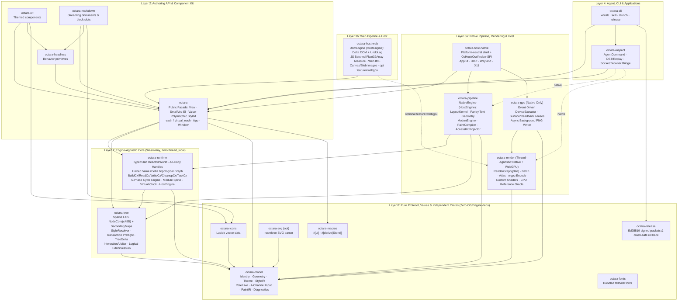

# Octara v2 Clean-Sheet Architecture

> **Design premise**: Zero historical baggage, zero backwards compatibility with v1.  
> **North star**: Combine the **author ergonomics of fine-grained Signals**, the **compile-time safety of Rust's borrow checker**, the **memory density of a data-oriented ECS**, the **fidelity of native GPU rendering, OS sessions, and the browser DOM**, and the **deterministic simulation testability of TigerBeetle/FoundationDB**.

## Detailed Specification Suite

This document is the architectural overview. Exact crate layouts, naming conventions, data structures, wire protocols, algorithms, and phase gates are specified in:

1. [01 — Workspace Topology, Naming Conventions & `octara-model`](v2/01-crates-and-model.md)
2. [02 — Reactive Runtime, Capability Contexts & Cycle Engine (`octara-runtime` + `octara`)](v2/02-reactive-runtime.md)
3. [03 — Sparse ECS Micro-Kernel (`octara-tree`)](v2/03-tree-microkernel.md)
4. [04 — Native Pipeline, Rendering, Event-Driven GPU & OS Host](v2/04-native-pipeline-render-host.md)
5. [05 — Delta-First Web/Wasm Host (`octara-host-web`)](v2/05-web-host.md)
6. [06 — Agent Protocol, DST, Signed Delivery & Zero-Baggage Migration Plan](v2/06-inspect-dst-release-migration.md)
7. [07 — Application Primitives, `octara-headless`, and Redesigned `octara-kit` (`0.0.2`)](v2/07-app-primitives-and-headless-kit.md)
8. [08 — Native Window Chrome, Rich Text Pills & Code Highlighting, Upgraded `WKWebView`, and Multi-Window Geometry (`0.0.3`)](v2/08-native-chrome-rich-text-webview-windows.md)
9. [09 — Core Defaults, Semantic Design System, Markdown Architecture & Builder Slimming (`0.0.4`)](v2/09-editor-pointer-layout-anchor-ergonomics.md)
10. [10 — Core Architecture Review, Unified Media / Inline Primitives & `octara-markdown` (`0.0.5`)](v2/10-ai-document-media-and-markdown.md)
11. [11 — Core Performance Architecture: CPU Cache, Algorithms, Modern GPU Micro-Pipelines & Inspect SPI (`0.0.6`)](v2/11-extreme-engine-cpu-gpu-and-ai-dx.md)
12. [12 — Pluggable SPI Architecture: Modular Extension Boundaries](v2/12-pluggable-spi-architecture.md)
13. [13 — Window Presentation, Dual-Parent Inheritance, Multimodal Input & Real-Metric Inline Primitives (`0.0.7`)](v2/13-window-presentation-multimodal-input-and-inline-primitives.md)
14. [14 — Cycle Terminology Cleanup & `octara::module` Platform Extension Architecture (`0.0.8`)](v2/14-octara-module-architecture.md)
15. [15 — Tier-1 Core Interaction, Accessibility, Forms, RTL & Airspace Closure (`0.0.9`–`0.0.10`)](v2/15-four-platform-core-polish.md)
16. [16 — High-Frequency System Modules & WebView Depth (`0.0.11`)](v2/16-high-frequency-modules.md)
17. [17 — Direct Native Platform Hosts (Zero `winit` Architecture) (`0.0.10`)](v2/17-native-platform-hosts-without-winit.md)
18. [18 — Native ECS Layout & Spatial Kernel (Zero-`TaffyTree` Architecture) (`0.0.10`)](v2/18-native-layout-and-spatial-kernel.md)
19. [19 — Unified Native IME, Text Editing & Clipboard Hygiene (`0.0.10`)](v2/19-unified-native-ime-and-text-editing.md)
20. [20 — Zero-Bloat Core Dependencies & Native OS Primitives (`0.0.10`)](v2/20-zero-bloat-core-dependencies.md)
21. [21 — Direct Apple Metal Renderer (`octara-render-metal`), Ultra-Low-Latency Presentation & 2.5D / Zero-Copy 3D Compositor (`0.0.11`)](v2/21-direct-metal-renderer-and-25d-compositor.md)

See also: [Octara Master Roadmap (`0.0.8` → `0.1.0` → `0.2.0`)](roadmap.md).

---

## 1. Six Architectural Pillars (First Principles)

1. **Compile-Time Capability Contexts (`BuildCx` / `ReadCx` / `WriteCx` / `CleanupCx` / `TaskCx`)**:
   - Zero `thread_local!` ambient runtime state.
   - Zero per-signal `Rc<RefCell<Box<dyn Any>>>` heap allocations.
   - Six entire classes of v1 runtime diagnostics (`WRITE_IN_DERIVE`, `WRITE_IN_BUILD`, `STRICT_READ_UNTRACKED`, `SIGNAL_BORROW`, `VIEW_READS_STATE`, `REGISTER_IN_CLEANUP`) become **Rust compile errors**.
2. **Every Reactive Handle is `Copy` (Arena-Backed World)**:
   - Signals, bindings, stores and store fields, lists and row handles, text buffers, triggers, watches and scope IDs are lightweight `Copy` handles into `ReactiveWorld`.
   - Domain controllers can derive `Clone, Copy` and expose capability-typed methods such as `chat.active_thread(r)` and `chat.send(w, message)`. Value reads and writes share the context methods `r.get(handle)`, `r.with(handle, f)` and `w.set(handle, value)`.
3. **Sparse Data-Oriented Micro-Kernel (`octara-tree`)**:
   - Hot `NodeCore` (**≤ 48 bytes**) + typed sparse `SecondaryMap<NodeId, T>` side tables (12–20× denser than v1's ~1 KB flat `Node`).
   - Strictly **two** write gates: `Tree::apply(Transaction)` (authored structure/props) and `Tree::apply_runtime(RuntimeOp)` (transient interaction/scroll/editor/exit state).
   - Emits first-class structured **`TreeDelta`** consumed incrementally by every downstream engine.
   - Zero layout engine (Taffy), zero text shaping (Parley), zero AccessKit, zero wgpu, zero DOM, zero animation interpolation inside `octara-tree`.
4. **Five-Phase Cycle Engine + Single-Transaction Subtree Commit**:
   - `Ingress → React → Commit → Project (bounded ≤16 rounds) → Publish`.
   - During `React`, user code and view builders never hold `&mut Tree`; all creates, static props, styles, policies, and placements stream into one `TransactionBuilder` using `NodeRef::Pending` and commit as **one atomic `Transaction`**.
5. **Strict Target Isolation & Pluggable `HostEngine`**:
   - **Native pipeline** (`octara-pipeline` + `octara-render` + `octara-gpu` + `octara-host-native`) uses `LayoutKernel`, Parley, `MotionEngine`, an incremental `PaintCompiler`, and AccessKit. A pure `RenderGraph` and event-driven `DeviceExecutor` drive rendering. The `OsHost` and `OsWindow` traits isolate the direct AppKit, UIKit, Wayland, and X11 backends from shared orchestration.
   - **Web pipeline** (`octara-host-web`): Pure `TreeDelta` DOM Patcher + lightweight Undo-Log atomic rollback + `moveBefore` editor parking + **single-crossing JS batched `Float32Array` geometry bridge** + zero-PNG/Base64 `<canvas>`/`Blob` images + zero heavy native crates in default `.wasm` (WebGPU strictly opt-in via `feature = "webgpu"`).
6. **Deterministic Simulation Testing (DST) & Agent Verifiability by Construction**:
   - Because there is zero `thread_local!`, explicit virtual clock, serializable 4-channel input, and pluggable `HostEngine` + CPU Reference Renderer oracle, any multi-window app can be fuzz-tested deterministically across parallel test threads and replayed from a seed.
   - Every host action produces structured causal receipts (`delivered`, `settled`, `committed`, `presented`) via standalone `octara-inspect`.

---

## 2. Crate Topology & Strict Dependency DAG

**12 focused core crates** (plus macros/assets/apps/examples), enforced by `tools/check_layers.py`:



### Hard Dependency Guarantees
- **`octara-model`**: Only `slotmap`, `bitflags`, `color`, `kurbo`, `serde`, `serde_json`, `unicode-segmentation`. **Forbidden**: `taffy`, `parley`, `accesskit`, `wgpu`, `swash`, `zeno`, `png`, `roxmltree`.
- **`octara-tree`** resolves locale direction with a compact BCP-47 script and language table, with an explicit script taking precedence.
- **`octara-render`**: Zero `std::thread`, zero windowing, zero OS FFI — compiles cleanly for both Native and `wasm32` WebGPU.
- **`octara-host-web` (default)**: Links **only** `octara` + `wasm-bindgen`/`web-sys`/`js-sys` — **zero** `taffy`, `parley`, `accesskit`, `wgpu`, `swash`, `zeno`, `png`, `roxmltree`.

---

## 3. Capability-Separated Reactive Runtime (`octara-runtime`)

### 3.1 Five Explicit Capability Contexts

| Context | Provided To | Allowed Operations | Statically Prevented (Compile Error) |
| --- | --- | --- | --- |
| `BuildCx<'_>` | `#[ui]` builders, `show` / `each` factories | `signal`, `persisted`, `store`, `memo`, `memo_with`, `trigger`, `watch`, `list`, `derive_list`, `row_signal`, `binding`, `text_buffer`, `provide`, `context`, untracked `read` / `sample`, `menus`, `on_chord`, `on_cleanup`, emit nodes into `TxBuilder` | `set`, `update`, tracked `get`, `shutdown` |
| `ReadCx<'_>` | `memo(\|r\| ...)`, dynamic prop/style closures, `watch` source | `get`, `with`, `with2`, `try_get`, `try_with`, `track`, list reads, `untrack` | `set`, `update`, `signal`, `watch`, `spawn`, `provide`, `shutdown` |
| `WriteCx<'_>` | Event handlers, `watch` callbacks, `TaskCx::write`, `App::update` | Untracked reads, `set`, `update`, `mutate`, `notify`, list mutations, `spawn`, `focus`, `request_command`, `open_window`, `close_window`, `ask`, `service` | Re-entrant borrow conflicts (`SIGNAL_BORROW`), direct `&mut Tree` mutation |
| `CleanupCx<'_>` | `on_cleanup(\|c\| ...)` | `sample(sig)`, drop/release external handles | `set`, `update`, `register`, `spawn`, `shutdown` |
| `TaskCx` | `cx.spawn(name, async move \|task\| ...)` | `task.write(\|w\| ...)`, `task.sleep(d)`, `task.recv(rx)`, `task.background(f)` | Holding `&mut WriteCx` across `.await` |
| *Pure* (no `Cx`) | `StateList` pure closures (`map`, `filter_with`, `sort_by_with`, `group_by`) | Pure Rust function of `(&Item)` or `(&Item, &Param)` | Reading/writing ambient signals (`VIEW_READS_STATE`) |

### 3.2 Authoring Ergonomics

1. **Leaf / presentational components remain `cx`-free**:
   ```rust
   fn badge(label: &str) -> El {
       el().px(sp(2)).py(sp(1)).rounded(Radius::Full).bg(ColorToken::Surface).child(label)
   }
   ```
2. **All-`Copy` domain controllers eliminate `.clone()` boilerplate**:
   ```rust
   #[derive(Clone, Copy)]
   pub struct ChatModel {
       pub threads: StateList<ThreadId, Thread>,
       pub query: Signal<String>,
       pub current: Signal<Option<ThreadId>>,
   }

   impl ChatModel {
       pub fn visible_threads(self, cx: &mut BuildCx) -> ReadList<ThreadId, Thread> {
           self.threads.read_only().filter_with(cx, self.query, |t, q| t.title.contains(q.as_str()))
       }
       pub fn select(self, w: &mut WriteCx, id: ThreadId) {
           w.set(self.current, Some(id));
       }
   }
   ```
3. **Anonymous vs Persisted State**:
   - `cx.signal(init)` — anonymous local UI state, lifetime bound to current scope.
   - `cx.persisted("sidebar_width", || 260.0f32)` — explicit schema-tracked state preserved across hot reload, process restart (`RestartState`), and signed release handoff.
4. **Struct Field Projections (`#[derive(Store)]`)**
   - `cx.store(init)` holds the whole model. `store.field()` gives the author a read-write handle with an independent revision.
   - `#[store(nested)]` enables chained accessors such as `store.settings().title()`. The context can also read and write the entire store.

### 3.3 Type-Partitioned Slab Storage (`TypedSlab<T>`)

```rust
#[derive(Clone, Copy, PartialEq, Eq, Hash, PartialOrd, Ord)]
#[repr(transparent)]
pub struct ReactiveId(u64);
```

- `ReactiveId` packs runtime, node index and generation into eight bytes. `ReactiveHot` holds the slab bucket and slot for each node. A `Signal<T>` is also eight bytes.
- Every value type `T` lives contiguously in its own `TypedSlab<T>` (`Vec<Slot<T>>`) inside `ReactiveWorld` — **zero `Rc`**, **zero per-signal `Box<dyn Any>`**, **zero `RefCell`** in value storage.
- `ReadCx<'_>` takes `&mut self` internally so `r.get(memo)` / `r.with(memo, f)` lazily recomputes dirty upstream memos and records dependency edges with plain Rust `&mut` borrows.
- `WriteCx<'_>` takes `&mut self` for writes and memo-aware reads, making nested conflicting access (`w.update(a, |_| w.set(a, ...))`) a **compile-time borrow error**.

### 3.4 Unified Topological Value + Delta Graph (Pull-on-Demand)

Signals (`Value`) and Collections/TextBuffers (`Delta`) live in **one unified depth-ordered topological DAG** with a single `Clean | Check | Dirty` state machine, a single `ensure_clean(id)` pull engine, and zero separate `CollectionQueue`:

- **Two Node Payloads in One Graph**:
  - **Value Node** (`Signal<T>`, `Memo<T>`): stores `T` in `TypedSlab<T>` + `rev: u64` (`PartialEq` early cutoff). Mathematically the degenerate case `Delta = Replace(T)`.
  - **Delta Node** (`StateList<K, T>`, `ListView<K, T>`, `TextBuffer`): stores current state + bounded key-only ring buffer `DeltaLog` + `rev: u64`. Each downstream operator keeps a `last_seen_rev` cursor.
- **Zero-`T`-Clone Key-Only `ListDelta<K>`**:
  ```rust
  pub enum ListDelta<K> {
      Insert(K),
      Remove(K),
      Move { key: K, to: usize },
      Update(K),
      Reset, // fallback if a consumer falls behind the ring-buffer capacity
  }
  ```
  Downstream operators (`filter`, `sort_by`, `group_by`, `map`, `join`) already maintain their own live key/sort/group indices; on `Update(k)` they borrow the current `&T` directly from upstream's `HashMap<K, T>`, and on `Remove(k)` they evict `k` from their own index — **zero `T::clone()` in the delta log**.
- **Synchronous Freshness + Automatic Batch Coalescing**:
  - Writing to a `StateList` mutates its local index (`O(log n)`), appends a `ListDelta<K>`, and push-marks downstream nodes `Dirty` without eagerly running downstream operators.
  - Reading a derived `ReadList` mid-handler calls `ensure_clean(id)` (identical to `Memo`), catching up from `last_seen_rev` in `O(k log n)` — preserving the strict synchronous freshness contract.
  - Burst writes (e.g., 100 pushes in a loop) coalesce into a single catch-up pass when first read or flushed.
- **Cross-Channel Composition & O(1) Row Updates**:
  - Parameterized operators (`filter_with(cx, sig, ...)`, `sort_by_with(cx, sig, ...)`, `map_with(cx, sig, ...)`) have both Delta and Value upstream edges in the same DAG: list-only edits run in `O(k log n)`; signal-param edits emit only minimal flipped `Insert`/`Remove`/`Move` deltas so surviving UI rows keep `NodeId`, focus, IME, and selection.
  - `join` maintains a reverse index `HashMap<JoinKey, SmallVec<[K; 2]>>` driven by both left and right `last_seen_rev` cursors (`O(fanout)`).
  - Mounted rows in `each` / `virtual_each` subscribe per-key `(list_id, key)` so `Update(k)` dirties only row `k`'s property bindings in `O(1)`, without waking sibling rows or list structure.
- **Flush Order inside `React`**:
  - **Phase 2a (Derivations)**: Recompute dirty `Memo`s and `ListView`s in ascending `depth` order.
  - **Phase 2b (Structure)**: Run dirty `Structure` regions (`show`, `each`, `virtual_each`) → emit creates/places/retires into `TxBuilder`.
  - **Phase 2c (Bindings)**: Run dirty property/style bindings only on surviving nodes → emit changes into the **same** `TxBuilder`.
  - **Phase 2d (Watch Sources)**: Evaluate dirty `Watch` sources with `&mut ReadCx`; enqueue changed callbacks into the post-commit effect queue (bounded cycle budget, zero mid-flush re-entrancy).

Modularized `reactive/list/` split into `state_list.rs`, `seq.rs`, `filter.rs`, `map.rs`, `sort.rs`, `group.rs`, `join.rs`, `flatten.rs`.

---

## 4. Sparse ECS Micro-Kernel (`octara-tree`)

### 4.1 Hot/Cold Memory Layout (`NodeCore ≤ 48 bytes`)

```rust
pub struct NodeCore {
    pub parent: Option<NodeId>,   // 8B
    pub kind: NodeKind,           // 1B
    pub state: State,             // 2B  (HOVER | PRESSED | FOCUSED | FOCUS_VISIBLE | DISABLED | SELECTED | DRAG_OVER)
    pub flags: NodeFlags,         // 4B  (ATTACHED | EXITING | HIDDEN | FOCUSABLE | INERT | AUTOFOCUS | PRESERVE_FOCUS | ...)
    pub style_rev: u32,           // 4B
    pub layout_rev: u32,          // 4B
    pub paint_rev: u32,           // 4B
    pub semantics_rev: u32,       // 4B
} // 32 bytes (≤ 48B budget)
```

Sparse `SecondaryMap<NodeId, T>` side tables (allocated strictly on demand):
- `children: SecondaryMap<NodeId, Vec<NodeId>>` — only for container `Box`es with children (`O(1)` indexed ops, 0 bytes on leaf nodes).
- `styles: SecondaryMap<NodeId, StyleSlot>` — authored `StyleProp`s, `When` overrides, resolved `LayoutStyle` + `Visual`, inherited text props.
- `texts: SecondaryMap<NodeId, TextSlot>` — `Arc<str>` + rich spans + internal link ranges (zero-copy sharing with Native & Web hosts).
- `editors: SecondaryMap<NodeId, EditorSlot>` — logical UTF-8 value (volatile-wiped on drop if secure), `document_rev`, `EditorSession`, composition, selection, undo stack, multiline/rows/secure flags. *(Zero Parley or physical line-wrap data!)*
- `semantics: SecondaryMap<NodeId, SemanticsSlot>` — `Role`, `label: Option<Arc<str>>`, `description`, `tooltip`, `a11y_value`, `Relations<Arc<str>>`, `NumericRange`, `checked`, `required`, `invalid`, `expanded`, `level`, `Live`.
- `handlers: SecondaryMap<NodeId, SmallVec<[(HandlerKind, HandlerId); 2]>>` — replaces `[Option<HandlerId>; 17]`.
- `commands: SecondaryMap<NodeId, SmallVec<[(Arc<str>, HandlerId); 2]>>`.
- `overlays: SecondaryMap<NodeId, OverlaySlot>` — anchor `(NodeId, Placement)`, `LayerPolicy`, `OverlayMount`.
- `scrolls: SecondaryMap<NodeId, ScrollSlot>` — offset, requested target, `follow_tail`.
- `natives: SecondaryMap<NodeId, NativeSlot>` — kind, slot, JSON props, version, `live`.
- `paints: SecondaryMap<NodeId, CustomPaintSlot>` — `PaintProgram`, `PaintInput`, transition key/curve.
- `provenance: SecondaryMap<NodeId, Provenance>` — `test_id`, `RowKey`, `Component`, `Location`.

### 4.2 Exactly Two Write Gates + First-Class `TreeDelta`

```rust
impl Tree {
    /// Gate 1: Authored tree mutations (atomic Preflight -> TreeDelta).
    /// Also used directly by signed declarative UI packets from `octara-release`.
    pub fn apply(&mut self, tx: Transaction) -> Result<(TreeReceipt, TreeDelta), RejectedTransaction>;

    /// Gate 2: Runtime transient state (interaction flags, focus, scroll, editor session, native live, exit completion).
    pub fn apply_runtime(&mut self, op: RuntimeOp) -> TreeDelta;
}
```

Every mutation produces a compact **`TreeDelta`**:
- `created`, `retired` (distinguishing logical `Exiting` vs `Destroyed`), `topology_dirty`, `layout_dirty`, `paint_dirty`, `semantics_dirty`, `scroll_dirty`, `editor_dirty`, `overlay_dirty`, `geometry_demands`.

### 4.3 Logical vs Physical Separation
- **Exit lifecycle**: `octara-tree` transitions the subtree and its owned portals to logical `Exiting`, immediately excluding them from focus, hit testing, Agent targets, modal scope, and accessibility. The host paints each participating visual and reports `HostReply::ExitFinished(ExitTicket)`. Tree destroys the retained branch when every ticket completes. Reopening a portal cancels the old branch's tickets.
- **Text geometry**: `octara-tree` owns logical UTF-8 strings, spans, selection byte ranges, and controlled edit acceptance. `octara-pipeline` owns Parley shaping, soft-wrap, visual caret/selection rects, and AccessKit text runs; `octara-host-web` delegates physical text geometry to browser DOM.

---

## 5. Five-Phase Cycle Engine & Atomic Command-Stream Mounting

```text
[1. Ingress]  Validate TargetGuard / EditorSession against settled state.
              Route to InteractionArbiter or enqueue Handler invocation.
      │
      ▼
[2. React]    Run Handlers / Watch callbacks (&mut WriteCx),
              flush unified topological graph (Derivations -> Structure -> Bindings),
              run View builders (&mut BuildCx) with SmallVec El -> stream directly into TxBuilder.
              ★ Tree is NEVER mutably borrowed here.
              ★ Entire mounted subtree + static props + styles + policies = ONE Transaction!
      │
      ▼
[3. Commit]   Flush ONE atomic Transaction per dirty window via Tree::apply().
              Resolve Pending -> NodeId from TreeReceipt; activate dynamic bindings & handlers.
              Drop retired author assets AFTER Tree borrow ends. Accumulate TreeDelta.
      │
      ▼
[4. Project]  (Bounded causal loop, max 16 rounds across windows)
              HostEngine::project(&Tree, &TreeDelta, viewport, now) -> Result<ProjectFeedback, ProjectError>.
              Apply versioned geometry -> run layout feedback (size_of, virtual_each windowing,
              scroll reveal, focus settle). If feedback dirtied Signals -> loop to [2. React].
      │
      ▼
[5. Publish]  Converged: HostEngine::commit() -> Native WindowCommit or Web DOM commit;
              update menus; advance Agent ObservationReceipt.
              Aborted/failed: HostEngine::rollback(), keeping last settled UI intact.
```

Panic escaping a cycle latches one-way `App` failure (`failed = true`) so corrupted state is never published.

---

## 6. Unified 4-Channel Input Protocol

Replaces v1's 25-variant flat `InputEvent` and eliminates the Native vs Hosted pointer fork:

1. **`InteractionEvent`**:
   - `PointerDown { id, kind, target: ContactTarget, pos, button, mods }`
   - `PointerMove { id, pos, mods }`
   - `PointerUp { id, target: Option<ContactTarget>, pos, mods }`
   - `PointerCancel { id }` / `PointerLeave`
   - `Wheel { pos, delta, phase, mods }` / `Key(KeyEvent)` / `BackGesture { id, phase }` / `WindowActive(bool)`
   - *Native hit-test and Web `WeakMap` lookup both emit `ContactTarget { hit: TargetGuard, action: Option<TargetGuard> }`. `InteractionArbiter` is the single state machine for press capture, outside-dismiss, modal scope, iOS keyboard-dismiss re-verification, and focus handoff.*
2. **`EditorEvent`**:
   - `Edit`, `Select`, `Command`, and `KeyIntercept` carry a session and expected revision across native, Web, and deterministic hosts. `Command` wraps a semantic `EditorCommand`. Native adapters use `HostTextBridge` to reconcile synchronous IME queries and platform text offsets with the retained UTF-8 editor state. The input method receives composition keys first, and focused key handlers and shortcuts can intercept other keys before default editing.
3. **`HostReply`**:
   - `ViewportChanged`, `ChromeChanged`, `GeometryChanged`, `MenuCommand`, `AskAnswer`, `ServiceReply`, `NativeEvent`, `NativeMeasurement`, `NativeSnapshot`, `ExitFinished(ExitTicket)`, `AccessibilityAction`.
4. **`AgentCommand`** (isolated in `octara-inspect`):
   - `Observe`, `Act`, `Capture`, `AdvanceClock`, `Replay`.

---

## 7. Pluggable `HostEngine`: Native vs Web

```rust
pub trait HostEngine {
    fn project(&mut self, tree: &Tree, delta: &TreeDelta, viewport: WindowViewport, now: f64)
        -> Result<ProjectFeedback, ProjectError>;
    fn commit(&mut self) -> CommitOutput;
    fn rollback(&mut self);
    fn hit_test(&self, tree: &Tree, pos: Point) -> Option<ContactTarget>;
    fn geometry(&self, node: NodeId) -> Option<LayoutBox>;
    fn text_geometry(&self, tree: &Tree, node: NodeId) -> Option<TextGeometry>;
    fn clipped_text(&self, tree: &Tree) -> Vec<(NodeId, TextClip)>;
}
```

### 7.1 Native Stack (`octara-pipeline` + `octara-render` + `octara-gpu` + `octara-host-native`)
- **`octara-pipeline::NativeEngine`**:
  - `layout/` stores hot layout metadata and projection caches by ECS node ID. `LayoutKernel` calls Taffy’s stateless flex and grid algorithms directly on the retained tree, and relayout boundaries limit recomputation when a subtree’s external size stays stable.
  - `flat_tree.rs` indexes geometry on demand for exact hit testing in scroll space. The layout projection tracks local geometry changes and changes in viewport position separately.
  - `projected.rs` provides shared dense rollback journals for layout, text, paint, and accessibility. `NativeEngineConfig::check_layout_cache` compares incremental layout with a cold projection.
  - `text/`: Parley shaping, font registry, incremental paragraph cache keyed by `Arc<str>`, caret/selection/soft-wrap geometry, AccessKit text runs.
  - `motion/`: `MotionEngine` (analytic spring/fade tracks, exit ghosts, scroll glides, caret blink, password reveal).
  - `paint/`: Incremental `PaintCompiler` → frozen `PaintScene` (pure paint animations sampled at display timestamp; debug uncached self-check controlled by explicit `check_paint_cache: bool`).
  - `a11y/`: Incremental `AccessKitProjector` translating `octara_model::{Role, Live}` + `delta.semantics_dirty` + moved bounds.
- **`octara-render` (Thread-Agnostic — Native & WebGPU)**:
  - `plan.rs` (pure functional `RenderGraph` planner, unit-testable with zero GPU device), `batch.rs`, `atlas.rs`, `pipeline.rs`, `encode.rs`, `custom.rs`, `cpu.rs` (deterministic CPU Reference Oracle).
- **`octara-gpu` (Native Only)**:
  - Per-generation `DeviceExecutor`, surface reconfiguration barrier, readback leases, async background PNG encoding.
  - **Event-driven GPU completion**: `queue.on_submitted_work_done` and buffer-map callbacks actively wake the executor thread (adaptive backoff fallback only if a backend lacks prompt callback delivery), eliminating the constant `1ms` polling loop.
- **`octara-host-native`**:
  - The platform-neutral shell consumes `PlatformEvent` and manages `HostWindow` without OS-specific branching. Each `OsHost` owns its event loop and supplies raw surface handles through `OsWindow`.
  - Apple hosts share a `CADisplayLink` driver with on-demand drawable acquisition. URLSession and ImageIO handle image transfers and decoding on Apple. The native media loader uses a bounded worker pool and accepts a `MediaTransport` override. Linux apps supply a transport for HTTP image fetches.
  - `os/macos/` uses AppKit application and window delegates, `NSWindow` and `NSPanel`, an `NSView` implementing `NSTextInputClient`, direct AccessKit, and AppKit menus and asks.
  - `os/ios/` uses UIKit application and scene delegates, a `UIViewController` for presentation, and a `UIView` implementing `UITextInput` with VoiceOver support.
  - `os/linux/` selects Wayland for a configured Wayland session and X11 otherwise. It uses Smithay Client Toolkit for Wayland, `x11rb` for X11, XDG Portal preferences, and demand-driven AT-SPI accessibility.
  - Clipboard services use `NSPasteboard`, `UIPasteboard`, Wayland data devices, and X11 selections. The platform-neutral `ServiceRequest::WriteClipboard` carries the same typed payload across hosts.

### 7.2 Web Stack (`octara-host-web`)
- **`DomEngine`**:
  - **Pure `TreeDelta` DOM Patcher**: Applies only changed nodes/attributes; records reversible edits in a lightweight **Undo-Log** for atomic `rollback()` (plus `moveBefore` editor parking to preserve CJK IME & reverse selection) — no dual full-tree `Document` snapshot cloning.
  - **Shared-Memory JS Batched Geometry Bridge**: Tiny (~40-line) JS helper measures all demanded/dirty DOM nodes into one `Float32Array` in a **single Wasm↔JS call per round**.
  - **Demand-Driven Measurement**: Measures `delta.geometry_demands` + dirty layout subtrees (`O(dirty + observed)`), with an explicit `VerifyFullCssom` mode for tests asserting external CSSOM drift detection.
  - **Zero PNG/Base64 Images**: Direct `<canvas>` `ImageData` copy or cached `Blob` + `ObjectURL` (revoked on node retirement).
  - **Optional WebGPU**: Strictly behind `#[cfg(feature = "webgpu")]`, sharing `octara-render`'s `plan`/`batch`/`encode` with zero OS threading code.

---

## 8. Authoring API & Component Kit (`octara` + `octara-kit`)

- **Minimal Value-Polymorphic `Styled`**: Drop Tailwind scale-method explosion; keep concise orthogonal methods (`.p()`, `.px()`, `.w()`, `.h()`, `.gap()`, `.bg()`, `.rounded()`, `.shadow()`, `.text_size()`, `.when(State::HOVER, |s| ...)`) accepting typed units/tokens (`sp(4)`, `px(12)`, `rel(0.5)`, `ColorToken::Surface`, `Radius::Lg`).
- **Containment and platform presentation** use typed APIs. `Styled::contain` configures native layout containment and Web CSS `contain`. `El::on_drag_start` provides a batch of `DragItem` values for the platform drag session. `WindowPresentation` carries window level and status bar style, which also support reactive bindings on `WindowDefinition`. `NativeViewFactory::airspace_policy` can opt into snapshots for occluded overlay views.
- **Declarative Release Bridge**: Signed UI packets (`octara-release`) compile directly to `octara_tree::Transaction` + bound `ReadSignal` / `Command` references, sharing 100% of the runtime & security boundary.
- **`octara-kit`**: Pure public-API components & streaming Markdown, with zero framework backdoors.

---

## 9. Phased Execution & Verification Plan

The original `arch-v2` implementation phases established these verification gates.

| Phase | Deliverables | Mandatory Exit Gate |
| --- | --- | --- |
| **Phase 0** | Lock `docs/design/architecture-v2.md` & update `tools/check_layers.py` target DAG | Layer checker enforces v2 DAG |
| **Phase 1** | `octara-model` + `octara-tree` (sparse ECS `NodeCore ≤ 48B`, `TreeDelta`, `InteractionArbiter`, logical `EditorSession`) | Unit + property tests pass; `size_of::<NodeCore>() <= 48` asserted; zero heavy deps |
| **Phase 2** | `octara-runtime` (`TypedSlab`, All-`Copy` handles, `BuildCx`/`ReadCx`/`WriteCx`/`CleanupCx`/`TaskCx`, unified Value+Delta topological graph, 5-phase Cycle Engine, `HostEngine`) + `octara` facade | Compile-fail doctests verify capability isolation (`WRITE_IN_DERIVE`, `WRITE_IN_BUILD`, `STRICT_READ_UNTRACKED`, `SIGNAL_BORROW`, `VIEW_READS_STATE`); 200-node mount = 1 `Transaction`; zero `thread_local!` |
| **Phase 3** | `octara-pipeline` (LayoutKernel/Parley/Motion/Paint/AccessKit) + modular thread-agnostic `octara-render` + native `octara-gpu` (event-driven `DeviceExecutor`) + `octara-inspect` (with parallel DST fuzz tests) | Headless deterministic suite & DST fuzzing pass (rename, nested scroll, modal focus, virtual lists, selection, replay, CPU/GPU parity) |
| **Phase 4** | `octara-host-native` (`OsHost`/`OsWindow` on macOS, iOS, and Linux) + `octara-host-web` (Delta DOM, UndoLog, JS batch measure, Canvas/Blob images, opt WebGPU) | `cargo check --target wasm32-unknown-unknown -p octara-host-web` passes with zero forbidden deps; native builds & macOS/Chromium checks pass |
| **Phase 5** | Migrate `octara-kit`, `octara-cli`, `apps/chat`, `examples`, docs, skills; delete all v1 legacy crates/shims | `python3 tools/check_layers.py`, `cargo test --workspace`, `cargo test -p octara-cli --doc`, `cargo clippy --workspace --all-targets`, skill export fresh, measurable metrics report |
