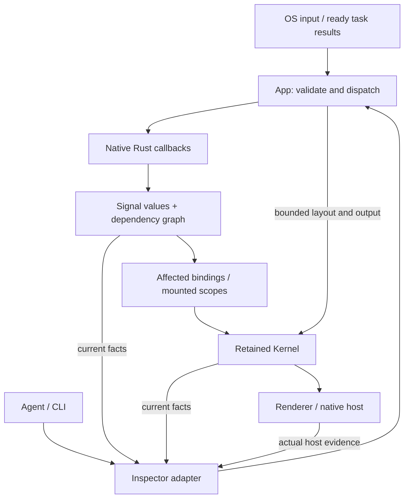

# Runtime and Signals consolidation

Status: selected target architecture, 2026-11-15; first correctness and second Signals API slices
implemented, broader consolidation pending. This is the complete target inventory, not a claim that every target has
shipped. No compatibility layer, deprecated aliases or
parallel old/new execution modes will be retained.

This document owns scope, source inventory and delivery gates. [Runtime contract](runtime-contract.md)
defines execution/lifetime semantics; [Signals redesign](signals-redesign.md) defines the replacement
reactive API. Those target contracts supersede conflicting API/lifetime descriptions in
[reactive core](reactive-core.md) and [async](async.md), which describe the current implementation.
[Architecture](../ARCHITECTURE.md) remains the implementation overview until each slice lands.

## Scope and necessity

This is a complete target inventory, not a requirement to build every mechanism before the core
is useful. Correctness contracts are mandatory; their implementation must be the smallest one
that satisfies a concrete regression. The first round is limited to four obligations:

1. Correct value access: non-Clone borrowing, in-place mutation, permission checks before callbacks,
   safe borrow/context restoration and rejection of foreign or disposed handles.
2. Correct dependencies: conditional edge replacement, memo cutoff, consistent diamond reads,
   and untrack that cannot relax write restrictions.
3. Correct lifetime: callbacks/tasks know their owner; disposal and request replacement prevent
   obsolete work from publishing results.
4. Reliable propagation: changes reach affected bindings/windows, pending work is not lost,
   and cycles/runaway feedback are diagnosed.

| Category | Examples | Treatment |
| --- | --- | --- |
| Required semantics | Pure computation restrictions, lifetime validation, stale-result rejection, input correctness | Fix demonstrated violations; do not prescribe a larger mechanism than necessary |
| Workload-specific cost | Reload value retention, incremental lists/text, multi-window coordination | Preserve existing supported behavior; keep machinery local to the workload |
| Revisable design choices | ReadSignal-returning memo, Watch stop handle, removing detach, module visibility, exclusive content enum | Preferred targets below, not unique correctness solutions or first-round prerequisites |

Do not expand the first round into generalized reload migration, a recovery state machine, broad
module extraction, style/content restructuring, property convenience APIs or access-control cleanup.
Preserve the current native protocols and verify affected behavior; redesign them only for a
reproduced defect. Existing stale-target reload checks remain required, but a new system that
transfers every named payload into fresh handles is not a prerequisite.

No compatibility commitment remains in force: when an API is actually replaced, migrate its
consumers and remove the old path in that slice. Leaving an unrelated API untouched while its
redesign is deferred is not maintaining a compatibility layer.

## Decisions

1. Keep native Rust execution, Signals, retained nodes, the existing executor, GPU rendering and
   narrow native adapters. No VM, bytecode, Plan interpreter or new UI DSL.
2. App coordinates the existing reactive runtime, scheduler and windows. There is no second public
   execution engine or new crate per responsibility.
3. Signal owns a value; the graph owns dependencies; Scope owns lifetime; App owns update boundaries.
   Keep phase, tracking and ownership independent internally.
4. Support ordinary non-Clone Rust values. Keep specialized incremental list/text protocols where
   their workloads require them.
5. Retire obsolete work before accepting results. Native interaction has explicit ownership protocols.
6. Agent reads authoritative runtime/host facts and uses the same action paths. No duplicate app
   model, permanent causal graph or framework-managed self-improvement service.
7. Replace APIs and in-repository consumers together. Keep useful mechanisms by design, never solely
   for compatibility. Pause component-catalog expansion during consolidation.

## Responsibilities and dependencies

| Part | Owns | Must not own |
| --- | --- | --- |
| Application | Rust business structs, services, domain commands and request policy | Automatic reactivity for arbitrary field writes |
| Reactive value/graph | Signal storage, memo, dependency edges, observer scheduling and diagnostics | Windows, OS calls or Inspector wire types |
| Scope | State/computation lifetime, contexts, cleanup and captured execution ownership | Rendering or global request history |
| View/primitives | Mounting, bindings, keyed regions, input/focus/overlay behavior | Business state machines or theme-specific control policy |
| App | UI-thread entry, ready tasks, time, dirty windows and safe update/output scheduling | Bytecode execution or rollback of arbitrary Rust effects |
| Window/Kernel | Window lifetime; retained nodes, styles, text, layout, motion and semantics | Inspector transport/schema dependencies |
| Host/renderer | OS input, IME, native controls, pixels, pacing and presentation evidence | Independent application state |
| Kit | Styled controls composed from public primitives; local getter/setter adapters | Private Kernel mutation or another state engine |
| Inspector/CLI | Current facts, source explanation, operations and truthful outcomes | Reconstructing missing facts or automatically replaying uncertain actions |

Keep existing crates. Within reactive/, separate private value/handle storage, graph computation,
execution context guards and scope/store management as implementation size warrants. Expose the
supported API from reactive and the prelude; make graph storage and sequence-tree implementation
paths private. Module extraction follows semantic changes, not a standalone rewrite.

## Public programming model

| Need | Selected API or mechanism |
| --- | --- |
| Owned state | state(key, init) -> Signal<T>, in a mounted or App root scope |
| Read | get() when T: Clone; with(f) for borrowed access |
| Write | set(value); in-place update(f) without Clone |
| Read-only capability | Signal::read_only() -> ReadSignal<T> |
| Derived value | memo(f) -> ReadSignal<T>; PartialEq cutoff, no Clone bound on construction |
| Side effect | watch(source, callback) -> Watch; explicit stop(), scope-owned lifetime |
| Intentional sample | One untrack(f) utility; no duplicate untracked read methods |
| Shared dependencies | Existing provide / use_context; values can be handles or Rc services |
| Async UI work | spawn, resource, channels and timers, under the captured scope |
| App-lifetime work | Explicit App::run root entry, then spawn; no task promotion via detach |
| Large changing lists/text | StateList/Source and TextBuffer; preserve incremental changes |
| Control inputs | Static values, tracked closures or matching Signal/ReadSignal property inputs |

Existing Kit Model<T> remains a small Kit-local getter/setter trait for Signal or a callback pair.
It is not the application's domain model and is not promoted into reactive core. Do not replace
it with a mandatory concrete Model, field-path system or derived-store framework. Read-only
controls accept property sources; writable controls require explicit write capability.

#[component] remains source provenance. component / component_keyed establish mounted stateful
instances; plain helpers remain ordinary Rust functions. Do not silently give every annotated
helper a new lifetime. Names locate state for an explicit reload; generations identify live instances.

## Source audit and refactor candidates

These are pre-refactor source observations. The first slice now has regressions and fixes for
value borrowing/permissions, runtime identity, captured owners, task/ask retirement and window
propagation. The remaining candidates still need a concrete regression or API justification.
The four first-round obligations above determine priority. The proposed changes below are not
all mandatory implementations: style slots, content representation, module/dependency cleanup
and broad dispatch consolidation are separate follow-ups unless a core regression requires them.

| Current source and observation | Required change | Acceptance |
| --- | --- | --- |
| [graph.rs](../../crates/octara/src/reactive/graph.rs): untrack replaces Ctx with Untracked; with_frame restores only on normal return | Independent phase, collector and owner guards | Pure writes remain rejected through untrack/initializers/helpers; unwind restores context |
| [graph.rs](../../crates/octara/src/reactive/graph.rs): update_value clones T and calls user code before write checks | Value-local storage; validate identity, phase and borrow before mutation | Non-Clone structs work; rejected update never runs its closure; no graph-table borrow across user code |
| [graph.rs](../../crates/octara/src/reactive/graph.rs): handles identify slot/generation in the current runtime | Include runtime identity in validation and handle equality | App A's handle cannot read, write or dispose the matching slot in App B |
| [graph.rs](../../crates/octara/src/reactive/graph.rs): Node retains window Owner but run_node does not restore captured ScopeId | Record complete execution ownership; give App a root scope | Watches, context reads, cleanup and tasks use registration scope regardless of triggering window |
| [app/input.rs](../../crates/octara/src/app/input.rs): several callbacks explicitly clear scope | Store mount-time ownership with handlers, re-enter it on all routes | Row handler tasks retire with the row; commands/native callbacks follow the same rule |
| [task.rs](../../crates/octara/src/task.rs): detach clears scope but retains owner; poll context restores only on return | Remove detach; explicit App root entry; guarded polling/cancellation | App work cannot implicitly inherit a dead window; failed polls cannot leave scheduler context stuck |
| [app/asks.rs](../../crates/octara/src/app/asks.rs): Pending lacks scope/task ownership | Track interest plus host window; retire on cancellation/replacement/close | Live waiters receive dismissal; late replies cannot revive UI; withdraw native requests where supported |
| [app.rs](../../crates/octara/src/app.rs): frame_except walks windows once, repeating for open/close work | Dirty-window work set with bounded drain; requeue later invalidations | B changing shared state updates A even after A was processed; unfinished work is preserved |
| [view/element.rs](../../crates/octara/src/view/element.rs): static styles precede dynamic styles, which then win | Stable declaration slots; updates change values, not precedence | Later static declarations still win after earlier dynamic declarations update |
| [view/element.rs](../../crates/octara/src/view/element.rs): optional content fields alongside Kind | Exclusive builder content representation aligned with Kernel | Remove impossible content combinations; preserve valid children and input configuration |
| [kernel.rs](../../crates/octara/src/kernel.rs): target_scope uses inspect::TargetScope | Move neutral identity below adapters; convert to Inspector wire fields | Remove Kernel-to-Inspector dependency without weakening stale-target checks |
| View, input and Inspector action routes | Shared eligibility and explicit handler composition; distinguish activation from lifecycle | Disabled/modal activation agrees; blur/dismissal/cleanup run; user handlers preserve primitive invariants |

## Remove, retain and decline

This is a target inventory; the first correctness slice does not implement all these removals. API removals
are simplification choices, not proof that every existing API causes a correctness bug. In
particular, task ownership must be fixed; deleting detach is the preferred later API direction,
not the only way to prevent a task from using a retired window.

| Remove or narrow | Replacement / reason |
| --- | --- |
| Public Memo<T> wrapper and exports | memo returns ReadSignal; keep the internal memo node kind |
| get_untracked / with_untracked | untrack composed with ordinary reads |
| Public Signal::new | Named state in an explicit scope; private scoped/value-owned allocation remains |
| Blanket Clone bounds and clone-before-update | Method-local bounds and in-place mutation |
| Ctx::Untracked and phase helpers acting as permission escapes | Independent guards and narrow internal transitions |
| Task::detach | Choose App ownership at creation; migrate intentional Chat background work |
| StateList::all synonym | Keep source() as the projection name; preserve Source and incremental operators |
| Public graph/sequence implementation paths | Supported reactive exports, no old-path aliases |
| Public Window::kernel_mut and unrestricted platform mutable-borrow access | Narrow host operations and internal test access, installed before removing callers |
| Duplicated activation checks, Inspector dispatch and content representations | One owner per policy, adapters at boundaries |
| Obsolete diagnostic fixes, examples and migration shims | Migrate docs, CLI vocabulary expectations, generated skill and callers with each API slice |

Retain generation checks, source locations, named state, context provision, resources, incremental
list operators, TextBuffer, bounded logs, reference renderers, consistency checks, native text
mirrors and target/presented geometry. Their purposes are distinct. Keep read-only Kernel access
used for inspection/testing until a concrete replacement warrants narrowing it.

Decline VM/Plan/checkpoints, arbitrary Rust rollback, root-view reruns, a second Tracked engine,
automatic deep field tracking, a mandatory Store/Model/lens DSL, universal resource IDs, global
convergence over network/native work and permanent causal history. No public batch/transaction API
initially: App/event/task boundaries batch ordinary work. Do not delete working Kit controls.

## Workload boundaries

| Workload | Keep / change |
| --- | --- |
| Small state/forms | Whole-value Signals, direct bindings; memo field selection where useful |
| Expensive derived values | Lazy memo and equality cutoff |
| Large keyed lists | StateList, incremental operators, virtual_each and local measurement validity |
| Streaming text | TextBuffer edits; long-paragraph layout is a separate cost |
| Motion | Existing dirty categories, clock sampling and caches |
| Native interaction | Per-protocol owner, synchronous adapter state, deferred app callbacks |

Chat's manually mirrored Message.parts is a later measured adapter candidate, not a prerequisite.
A read-only keyed projection must preserve row identity/removal/reorder and avoid full-message
updates for TextBuffer appends. Arbitrarily replacing a Vec still requires examining its contents;
never promise sublinear work without an incremental input protocol.

## Delivery gates

The first round consists only of A-D below, followed by validation of the affected paths. It is
complete when those four contracts pass; it does not wait for the later API/primitive inventory.
Each implementation slice migrates any APIs it actually changes, without compatibility aliases.

| First-round obligation | Changes | Required evidence |
| --- | --- | --- |
| A. Value access | Value-local borrows, in-place update, method-local bounds, pre-callback checks, runtime identity and guards | Non-Clone struct, rejected callback, foreign/disposed handles, borrow conflict and unwind |
| B. Dependencies | Separate tracking from phase; correct conditional edges, lazy memo/cutoff and queued invalidations | Pure-write bypass regression, conditional/diamond dependencies, equal memo cutoff, invalidation during execution |
| C. Lifetime | Capture and validate callback/task owners; retire obsolete task/request interest; fix unsafe owner transitions | Row removal, window close, replacement and same-name recreation; preserve existing reload target checks; local HTTP stop/regenerate regression |
| D. Propagation | Preserve/requeue affected window work; bounded propagation with truthful remaining-work reporting | Two-window invalidation, self-updating watch, runaway diagnostics, no dropped work; affected real-window interaction |

After A-D, reassess independent follow-ups against real application needs:

- API simplification: two handle types, Watch stop capability, explicit App-task creation instead
  of detach, direct Signal properties, list aliases and module visibility.
- Primitive correctness/representation: style precedence, exclusive content, callback/default
  ordering and shared activation rules. Each starts from its own concrete case.
- Stronger reload value transfer, neutral identity extraction and narrow raw access only when
  their benefits justify the migration. No general migration or automatic recovery subsystem.

Documentation, CLI/generated skill updates and relevant checks accompany every landed slice;
they are not a final phase that blocks first-round completion on unrelated features. Verify
representative Chat work counts/performance when the affected path changes, rather than launch
a separate optimization program.

Use unit tests for graph/ownership, existing headless/consistency checks for retained UI, local HTTP
for request ordering, and real OS input for native interaction. Headless/framework dispatch is not
IME/candidate-window qualification. Reuse active caches/fixtures; no extreme benchmark program.
Record work counts (closures, affected nodes, text bytes, mounted rows) alongside timings, comparing
equal profiles/workloads. Preserve CPU/GPU reference and incremental/from-scratch checks.

When an API slice changes docs/start-here.md or the CLI skill body, export the skill in that slice
and run its doctests. New diagnostics require registry entries and doc anchors. This architecture
contract does not make the later API removals a prerequisite for the first slice.

## First-round implementation evidence (2026-11-15)

- Signal values now have independent borrow cells. `with` and `update` accept non-Clone values;
  only copying reads require Clone. Runtime identity, live ownership, phase and borrow permission
  are checked before an update callback runs. Panic guards restore execution context and preserve
  unexecuted queued work.
- `untrack` changes dependency collection only. Initializers, derived expressions and collection
  projections cannot use it to gain write/effect permission. Existing conditional dependency and
  memo cutoff tests remain in force.
- Mounted handlers, computations and tasks restore their recorded scope/window. Cancelled or
  disposed requests withdraw interest; late answers cannot revive them. `App::current().run(..)`
  offers an explicit window-independent entry without introducing another executor.
- Window propagation revisits windows invalidated by later work. Reactive/window feedback is
  bounded; exhausted work remains observable and can resume at a later outer entry.

The live Chat test caught a migration missed by the earlier headless assertions: Regenerate
removed the row that had just started the replacement receiver. Model work now starts at App
scope, with cancellation still owned by Chat's request map and root cleanup. Strengthened UI tests
require replacement content and a terminal state; seeing two messages is insufficient evidence.
Prompts and focus tasks retain mounted ownership.

The real forms resize also exposed a drawing-cache dependency: text wraps at target layout
width while a layout animation initially still shows the old width. Drawing keys now include
target size, padding and border as well as shown size. A deterministic first-animation-frame
test reproduces the stale line breaks; existing drawing reuse and reference-render checks remain.

Validation passed `cargo test --offline --workspace` (624 passed, 3 ignored), workspace Clippy
with warnings denied, format and diff checks. The workspace tests include local HTTP cancellation/regeneration and existing
Chat streaming/work-count regressions. `examples/live_inspect.py` passed counter, gesture, search,
Todo and multi-window scenarios. `apps/chat/live_lifecycle.py` passed stop, replacement, queue,
regeneration, deletion, restart and GPU captures after the ownership migration.
`examples/live_forms.py` passed field validation, retained editing/selection, keyboard radio
navigation, native window resize and GPU captures after the drawing-cache fix.

These desktop scripts use framework/semantic input in real windows. They do not qualify OS
keyboard input, Chinese IME or system candidate windows. Broader API removals in the inventory
above remain a subsequent slice; this round does not add compatibility aliases.

## Second-round Signals API consolidation

The supported graph API is exported from `octara::reactive` and the prelude. `Signal<T>` and
`ReadSignal<T>` are the two value handles; `memo` returns ReadSignal. The public Memo wrapper,
get_untracked/with_untracked methods (including TextBuffer's duplicate snapshot method), and
public graph/seq implementation paths are removed without aliases. One explicit untrack wraps
ordinary reads; migrated consumers keep their previous sampling boundaries.

`watch` now returns a scope-owned, non-generic Watch stop handle. Source results require
PartialEq but not Clone; callbacks borrow new/old results. Ignoring the handle keeps watching,
while stop retires the graph node and queued invocations. Stop during the callback takes effect
after that Rust invocation finishes; scope disposal and repeated stops are safe. No extra
subscription engine or queue is added.

Signal and ReadSignal can feed ordinary text, semantic and style properties through the same
bindings as closures. Formatting/combining values still uses closures. TextBuffer retains its
incremental edit channel. The CLI vocabulary follows the supported exports and omits removed
methods and implementation modules; the generated skill and compiled guide use the new API.

Validation on 2026-11-15: workspace tests passed (634 passed, 3 ignored), including the new
non-Clone watch/stop regressions, direct-property binding test, public API inventory checks and
compiled struct example. Workspace Clippy with warnings denied, formatting and diff checks passed.
The rebuilt real-window fixtures passed `live_inspect.py` (all five scenarios), `live_forms.py`,
and Chat's `live_lifecycle.py`; these use framework input, not OS input or native IME qualification.

Remaining independent work includes explicit App root scope/named state, removal of Signal::new
and Task::detach, collection aliases, and primitive representation/ordering. No compatibility
layer or parallel reactive implementation is introduced in this slice.

## References

- [Signals contract](signals-redesign.md), [runtime contract](runtime-contract.md),
  [primitive layering](ui-primitives.md), [Agent context](agent-context.md).
- [Solid boundary](../research/solid-signal-boundary.md): small value primitive, separate Store.
- [Rune research](../research/rune.md): ordinary Rust and workload-specific optimization. Local
  baseline 3686e94; later Tracked/region evidence is separately pinned there.
- [Exact review](../research/exact-runtime-simplicity.md): explicit owners, controlled updates,
  stale-result rejection and direct inspection. Local baseline 08c889a9; source comparison does
  not establish platform qualification or justify importing its VM.
