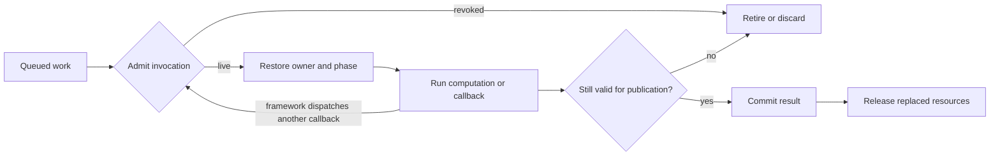

# Kernel execution architecture review

Date: 2026-11-16. Reviewed baseline: `28ef75e` (846 tests passed, 3 ignored).
Status: bounded convergence plan; slices A and B are now implemented in the working
tree, with records below. Slice C and final product acceptance remain pending.
The original review was documentation-only; its implementation follows the bounded
plan below rather than authorizing unrelated incremental fixes.

## Decision and scope

Keep native Rust, Signals, the existing scheduler, scoped ownership, retained UI,
and the current host/Inspector paths. The problem is not a missing engine. It is
that callers assemble execution eligibility, permissions, ownership restoration,
tracking and failure checks separately, and can omit a required part.

Converge those rules into one internal execution protocol. Do not put all work
into a universal executor, transaction, lifecycle enum or command buffer. A
protocol is a set of obligations at existing boundaries, not a new public object.

This document owns the scope and completion gates for this convergence round.
The broader inventory in [core consolidation](core-consolidation.md) is background,
not a prerequisite backlog. [Runtime contract](runtime-contract.md) remains the
general contract; recommendations below are targets until implemented and tested.

## Findings from the whole execution path

| Area | Existing mechanism | Architectural assessment |
| --- | --- | --- |
| App entry | `app.rs::enter_app`, `enter_app_context`, depth and failure guards | Correct outer coordinator; normal admission and teardown entry must remain distinct |
| Permissions | `graph.rs::write_allowed`, `effect_allowed`, health and scope checks at callers | Policies overlap but have different obligations; callers must currently compose them correctly |
| Captured ownership | `ScopedHandler`, graph Node and task Entry each retain scope/window | Necessary ownership, but restoration is repeated via `with_owner` + `with_frame`; no single documented admission contract |
| Tracking | `with_frame`, `sample`, memo/watch wrappers and `run_node` | Recent fixes establish the right separation; preserve it and stop treating collector state as permission |
| Task execution | polling guard, full TaskId, ready admission and cancellation | Poll lifecycle is soundly separated from Future ownership; poll eligibility does not cover multiple callbacks inside that poll |
| Framework subscriptions | `Receiver::on`, `interval` callback loops | Proven gap: cancellation is not rechecked between ready callbacks in the same poll |
| Publication | AsyncMemo rechecks request/task; graph and frame paths validate their own state | Same obligation at different boundaries, with different domain-specific validity predicates |
| Failure | shared App/Runtime flag, collection unwind guard, completion failure inbox | Keep one ordinary-execution failure fact; external failure transport and resource retirement are different responsibilities |
| Release | scope progress, App teardown, task Polling/Cancelled | Existing separate states represent different facts; collapsing them would lose necessary information |
| Output and Agent | target identity, window completion, submission evidence | These are not substitutes for callback eligibility or dependency validity; preserve their distinct meanings |

The channel audit queued three messages, then cancelled the task or disposed its
scope in the first callback: both delivered three callbacks instead of one.
An interval probe that directly advanced the internal scheduler clock to five
overdue ticks likewise delivered five after cancellation. Ordinary App clock
advancement passed the first interval probe. These establish a dispatch-boundary
gap, not a claim that every native timer currently duplicates callbacks.
Temporary probes were removed; evidence is in `/tmp/octara-subscription-audit.log`
and `/tmp/octara-subscription-audit.probe.rs`. No new runtime fix is included here.

## Mechanisms to borrow selectively

Inspected local snapshots, not latest-upstream claims:

- Rune: `3686e94ae09545fd5f2a61e22aabfbeba1cd896f`, under
  `/Users/devxiyang/code/archive/reference/rune`.
- Exact: `08c889a9de21a30b7c3b308422fc588cf1a480d3`, under
  `/Users/devxiyang/code/archive/reference/exact`.

| Reference evidence | Useful mechanism | Octara application / limit |
| --- | --- | --- |
| Rune `crates/rune/src/states.rs`: mutable `States`, read-only `StatesRef` | Execution capabilities are explicit at the call boundary | Centralize our phase permissions; retain ordinary Signal handles rather than rewrite apps around mutable root state |
| Rune `memo.rs`, `runtime/commit/memo_reuse.rs` | Identity is not validity: environment, inputs and inherited state constrain reuse | Preserve separate identity and publication checks; do not add manual version arguments to Signals |
| Rune `memo/snapshot.rs` | Logical commit history survives measurement retries | Internal retries must not become extra business events; do not snapshot arbitrary Rust application state |
| Rune `runtime/motion/timer_wake.rs` | Timer poll and frame consumption have distinct states | Keep pending work separate from presentation; do not copy this window-specific state machine into our scheduler |
| Exact `runner/src/vm.rs::Env` / `Outcome` | Evaluation inputs and effects are distinct | Keep pure computation and effect dispatch separate; no VM, bytecode or deferred write journal |
| Exact `kernel/src/kernel/document.rs` | Failed commit cannot finish; previous writes are not rolled back | Local structural interruption marks shared failure; reject publication while preserving teardown |
| Exact `runner/src/runner/advance.rs::set_live_clock` | Cancellation/rekeying during a callback affects subsequent scheduling | Check eligibility at the next actual dispatch; do not adopt Exact's missed-tick dropping policy silently |

These references support design principles, not an assertion that either framework
solves every Rust panic, destructor or Waker case we have encountered. Neither
reference runtime was executed for this review.

## Unified execution protocol

There are three checks, separated by work that can invalidate earlier decisions:

1. **Registration admission:** may this operation create or change owned work here?
2. **Invocation admission:** may this particular callback/computation/poll run now?
3. **Publication admission:** may its result still affect the graph/UI now?

No persistent permit is created by an earlier check. A wake is a notification,
an ID identifies an allocation, and a cached result is data; none grants execution.

This is a schematic protocol, not a requirement that event handlers return a
buffered result. Handler Signal writes stay immediate. Async results, memo values
and prepared output have explicit publication points; they retain their existing
specific checks. Deleting one's own button is a successful handler action, not a
reason to retroactively classify the delivered input as refused.

Each boundary answers four independent questions:

- **Owner:** which runtime, scope and optional window owns this work?
- **Eligibility:** is the App usable, owner live, and task/target/request current?
- **Phase:** what framework-visible operations may this code perform?
- **Tracking:** which collector, if any, receives reads?

Restore the captured owner, never the triggering window. Explicit no-window clears
the ambient window. Nested App::run changes ownership intentionally but preserves
phase; it cannot upgrade a pure caller. Context guards restore state on return and
unwind. Merely entering a frame is not proof that admission succeeded.

Represent captured scope/window consistently in a small private value if that
removes the repeated pairing in handlers, nodes and tasks. Do not duplicate runtime
identity where the owning runtime and qualified scope already establish it. Keep
target/task/request validity beside its owning subsystem.

## Permission policy

Keep the existing Ctx distinctions for diagnostics and execution behavior. Use one
operation-aware policy to define permissions, instead of manually combining broad
boolean gates at every call site. Plain enum matching is sufficient; no bitset
capability framework, new public token, or heap-allocated execution session.

All ordinary operations additionally require a healthy App and the appropriate
live owner. The table describes operations on existing state and registration;
it is not a redesign of local Rust allocation or nested memo construction.

| Phase | Read | Write existing Signal/list state | Register provider / watch / task / cleanup | Collect dependencies |
| --- | --- | --- | --- | --- |
| App entry / Handler / task body | Yes | Yes | Yes, with a live registration scope | No by default |
| Build | Yes; accidental snapshot reads diagnosed | No | Yes | Only explicit bindings/observers |
| Init | Sample | No | No | No |
| Derive / Observe | Yes | No | No | Source computation only |
| Collection View projection | Explicit row inputs; other reads retain existing diagnostic contract | No | No | Not a second Signal collector |
| Result comparison / retirement | Sample, retaining surrounding permissions | No upgrade from Derive/Observe | No upgrade | No |
| Cleanup | Existing values/context needed for release | Healthy App: only still-live writable targets, never retiring targets | No | No |
| Cleanup after App failure | Existing source values/context only; no derived/list recomputation | No | No | No |

Comparison/retirement is a tracking boundary, not a new Ctx variant. Untrack changes
tracking only. Registry borrows must be released before user code, including Clone,
PartialEq, Drop and Waker hooks. Intentional value borrows in Signal::with/update
are retained; their conflict diagnostics are not redundant checks to delete.

Release operations have a separate policy: explicit Task::cancel and Watch::stop
are permitted from Build, Handler, ordinary external entry and Cleanup, but not
from Derive, Observe, View or Init. They are not new registrations. Preserve
Task::cancel outside App::run: a handle already identifies its scheduler. When a
caller is inside a pure context, switching to the target owner must not erase that
restriction. Failed/closed owners still permit resource revocation; an already
retired handle remains an idempotent no-op and cannot affect a reused slot.

Internal owner retirement and RAII resource release always retain their ability
to revoke work, including on unwind; they do not route through the public business
operation gate. This is a correction to the currently unconditional Task::cancel
entry, not a claim that Rust Drop can be prevented from doing arbitrary work.
Preserve Watch::stop's existing requirement to use its owning runtime. No new
ambient-App requirement or public release token is introduced.

Provider replacement retains the contract selected in `28ef75e`: current scope,
subsequent lookups only, no invalidation of earlier consumers. Dynamic contents
travel through Signal/ReadSignal. Do not introduce reactive context bindings.

## Lifecycle protocol

Separate **may execute**, **may publish**, and **resources still owned**. They are
related facts, not aliases. The existing concrete state machines remain:

| Owner | States / facts to retain | Meaning |
| --- | --- | --- |
| Scope | Live, Disposing, Retiring, Disposed | Disposing blocks new work; Retiring preserves interrupted teardown; only Disposed is reusable |
| Task | Suspended(Future), Polling, Cancelled; absent slot | Poll guard owns the active Future; cancellation revokes the next invocation/publication, physical drop waits for poll exit |
| App | shared failed flag, shutdown gate, Pending/Running/Complete teardown | Failed and closed are independent of how much cleanup completed |
| One-shot | Waiting, Ready, Closed | Delivery interest and committed result; not worker execution status |
| Worker | physical in-flight count | Cancellation does not kill blocking work or reverse its effects |
| Window | live identity, preparation validity, submission/presentation facts | Allocated, prepared, submitted and visibly presented are distinct |

Retirement order: revoke execution first; detach pending interest/queues; consume
each cleanup before invoking it; release resources outside table borrows; make
storage reusable only when its lifecycle contract permits. Preserve checked
generations. A resumed teardown never repeats a callback that already started.

Already-running arbitrary Rust code completes its stack. At the next framework
controlled callback, poll or publication point, recheck eligibility. Channel and
interval loops therefore need the same invocation protocol as top-level dispatch,
not a special cancellation token or a change to the Future trait.

## Failure and borrowing protocol

For bookkeeping: validate -> transition/extract -> release borrow -> invoke/drop.
For publication: compute -> revalidate -> commit -> retire old value.

Use the existing shared failure flag for loss of framework consistency. Keep the
App unwind boundary, local guards around interrupted incremental structures, and
external completion failure transport. They protect different locations; one
catch_unwind around every callback would neither roll back state nor replace them.

Refusal before mutation, ordinary pending/budget yield, and interrupted consistency
must remain distinct. Fail closed after the last category; teardown remains
available. Do not replay input, restarted computations or begun cleanup to create
the appearance of recovery. Arbitrary application catches and Rust interior state
are not a general rollback/resumption guarantee.

## Merge, refactor, delete, retain

| Existing area | Action in this round | Removal / constraint |
| --- | --- | --- |
| `write_allowed` / `effect_allowed` and caller combinations | Replace their overlapping permission decisions with one explicit operation policy; keep target liveness checks local | Remove old independently maintained permission matches after all callers migrate; no parallel compatibility path |
| Repeated scope/window restoration in ScopedHandler, run_node and task poll | Share a small private captured-owner/entry pattern with an explicit admission obligation | Remove duplicated restoration sequences where equivalent; retain low-level RAII guards |
| Invocation checks in dispatch and subscriptions | Apply the protocol to every framework-started callback, not only the containing task poll | Remove implicit assumption that an admitted poll authorizes its entire callback batch |
| Memo/AsyncMemo/output publication | Document and use the shared protocol, retain local dependency/request/frame checks | Do not replace these with a universal epoch or delete checks separated by user code |
| Failure guards and teardown | Align entry policy and failure ownership; preserve distinct progress states | Remove redundant ad hoc booleans only if a specific existing state already proves the same fact |
| Context and effect registration | Route through the same operation policy and owner checks | No independent context permissions system |
| Task cancellation documentation | Distinguish immediate revocation from deferred drop during an active poll | Delete unconditional “future dropped at once” claim |
| Design documents | This bounded round has one scope/acceptance inventory; general contract links here | Stop appending a new permanent architecture layer for each regression |
| Graph, queues, IDs, host boundaries | Retain | No new VM, executor crate, public primitive, universal lifecycle enum, public revision, or wake/message conflation |

`sampling` and `observer` are not proven redundant: sampling suppresses accidental-read
diagnostics as well as tracking. `scope` and `owner` represent different lifetimes.
TaskId, ScopeId, node identity and window generations are not interchangeable.
Do not delete these merely to reduce field count. Likewise a queue membership bit
and an actual queue entry can differ while a batch is detached; preserve that invariant.

## Bounded implementation and exit criteria

Implement in three reviewable slices, all governed by this document:

**A. Permission and ownership entry.** Inventory and migrate existing normal entry,
registration, mutation and explicit release entry points. Apply the public
cancellation/stop classification described above. Establish one permission table,
explicit captured-owner restoration, and normal-versus-teardown entry. Preserve
public behavior unless the table explicitly records a justified correction.

**B. Dispatch, publication and release.** Route existing callback families through
the protocol, including channel/interval inner loops. Preserve callback ordering,
FIFO, generation checks, result interest, equality cutoff and bounded scheduling.
Keep cancellation and eligibility separate from budgets and timer missed-tick
policy. No timer scheduling redesign is required by this round.

**C. Conformance and deletion.** Remove superseded checks/helpers, reconcile docs,
and run the finite acceptance matrix below. Do not open a fourth generic-hardening
slice without a demonstrated violation of these agreed contracts.

| Required evidence | Acceptance |
| --- | --- |
| Entry coverage | Named source locations for App entry, input handlers, graph compute/watch, task poll, subscription callback, async publication, cleanup and host handoff; each maps to admission, owner, phase and result policy |
| Permission matrix | Representative allowed/refused operation for each phase; untrack and nested App::run cannot increase authority; refusal occurs before mutation/user initializer where promised |
| Ownership | Cross-window trigger restores registration owner; explicit absent window clears ambient owner; child provider replacement cannot change parent |
| Tracking | Dynamic dependency switch and cutoff remain correct; equality/destruction neither subscribe the current observer nor its caller |
| Cancellation | First callback cancels/disposes: no second framework callback; already-running arbitrary poll may finish; stale result is not published; ordinary live FIFO/timer behavior unchanged |
| Borrow/re-entry | Callback, value destruction and Waker execution occur outside bookkeeping borrows; explicit Signal value-borrow semantics remain tested |
| Failure/release | Interrupted framework state cannot publish; teardown resumes remaining work without replay; worker completion after shutdown cannot reopen execution |
| Bounded progress/output | Wake coalescing and deferred work survive cancellation/budget yield; unfinished preparation is not reported as a completed frame; submission is not called OS presentation |
| Product validation | Existing Chat streaming/stop/regenerate/local-HTTP and scoped control tests pass; one representative Chat real-window smoke before final convergence sign-off, with route/evidence recorded |
| Repository quality | Workspace tests, Clippy all-targets with warnings denied, formatting and diagnostic registry checks pass; no parallel legacy entry policy remains |

The baseline's tests are reusable evidence, not permission to skip tests affected
by migration. Add tests for uncovered protocol obligations, not every imaginable
combination of destructor behavior. Native IME, rendering and platform protocols
need targeted native revalidation only if their paths change; lack of desktop
access must be reported as pending evidence rather than expanded into new kernel work.

Completion means all rows have evidence or an explicitly accepted deferral. Then
return to Chat and core components. New speculative performance tuning, exhaustive
panic containment, a collection engine replacement, OS protocol expansion, and
generalized hot-reload migration are outside this round. A new finding reopens it
only if it breaks an agreed contract in a supported path; record other ideas for
later rather than turning this review into an endless prerequisite list.

## Review conclusion

The current architecture is viable. Its repeated defects point to distributed
execution-policy enforcement, not a need to replace Signals or introduce a VM.
Converge the entry and dispatch rules, preserve the lifecycle distinctions already
earned, and stop once the bounded conformance and product evidence is complete.

## Slice A implementation record

Implemented after review commit `3afb9d1`; slice B is recorded below. The private
`reactive/graph/execution.rs` now owns Ctx, the Write/Register/Release/Shutdown
permission match and owner restoration. Old `write_allowed` / `effect_allowed`
methods and their callers have been removed, not retained as forwarding aliases.

| Entry family | Policy / owner treatment |
| --- | --- |
| Signal and collection writes | Write; existing value/collection target validity remains local |
| watch, task spawn, cleanup, context, channel naming, prompts and command registration | Register; existing API-specific required-scope and scheduler-closed checks remain local |
| Task::cancel / Watch::stop | Release; caller phase checked without granting permissions by switching owners |
| App::shutdown | Shutdown; failure does not block resource teardown, pure/Build/Cleanup calls are refused |
| App::run | Root scope, no window; preserves caller phase/collector, including phase inheritance across different runtimes |
| ScopedHandler | Captured ExecutionOwner, live-scope check, shared owner/Handler restoration |
| Graph compute | Shared owner/Derive-or-Observe restoration; existing source collector and publication/retirement boundaries retained |
| Task poll | Shared scope/window/Handler restoration; scheduler keeps its typed task identity and required scope |
| Scope cleanup | Shared owner/Cleanup restoration, deliberately allowed for retiring scopes |
| Window entry / internal phase transitions | Keep narrow low-level guards where no captured callback owner is being dispatched |

Task::cancel now documents immediate revocation versus physical Future drop at an
active poll's exit. A private owner-release path is used by framework clock cleanup
and window closure; scheduler cancellation and RAII cleanup registration remain
independent of the public business-operation permission gate.

Six added regressions exercise same/cross-App pure cancellation, cancellation from
Init versus Build/Cleanup, failed-runtime registration versus release, internal
owner release, owner/phase/collector restoration after unwind, and cross-runtime
entry refusing state writes/cancellation. Existing context phase, callback owner,
watch stopping, active-poll shutdown and stale identity tests remain in the suite.

This slice does not fix the subscription dispatch finding or claim full kernel
convergence. Per-callback admission and publication review belong to slice B;
the final representative native Chat smoke belongs to the overall exit gates.

Slice A validation: `cargo test --workspace` passed (852 passed, 3 ignored),
including Chat lifecycle, model selection and local HTTP tests. Workspace Clippy
with all targets and warnings denied, formatting and diff checks passed. Logs:
`/tmp/octara-entry-full.log`, `/tmp/octara-entry-clippy.log`. No native window
verification was performed for this slice; that is not evidence of full-round
completion.

## Slice B implementation record

Runtime invocation admission now combines shared health with captured scope
liveness. Scoped handlers, graph invocation and composed event chains use it.
Scheduler admission adds full TaskId eligibility and the closed-scheduler gate;
both task poll and framework-owned subscription callbacks use that same check.
Channel FIFO, the 64-message cooperative yield, and interval catch-up policy are
unchanged. Cancellation does not interrupt the active callback but prevents the
next callback even when its input is already ready in the same poll.

After-layout registrations capture their execution owner and restore it through
the shared entry. Detached hook batches recheck registration identity before each
call, so an earlier hook can remove a later one without that callback running.
Window closure ends the hook batch. No scope-table borrow is held across a hook.

AsyncMemo checks task/owner eligibility before comparing its request and again
afterwards: user-defined key comparison can revoke execution. Graph publication
retains health/node identity checks; output retains existing preparation validity
and successful-host-handoff accounting. These domain checks are intentionally not
replaced by one global generation. No new public primitive or timer policy was added.

Five new regressions cover channel self-cancellation/scope disposal/App shutdown,
overdue interval cancellation, failed-App refusal before the next subscription
callback, removal of a later after-layout hook, and AsyncMemo key comparison closing
the App before publication. Existing FIFO, fairness, stale result, owner, frame and
host-panic tests remain required. Final native Chat smoke and the full convergence
sign-off remain in slice C; deterministic test success alone does not complete it.

Slice B validation: workspace tests passed (857 passed, 3 ignored), including Chat
and local HTTP regressions. Workspace Clippy/all-targets with warnings denied,
formatting and diff checks passed. Logs: `/tmp/octara-dispatch-full.log` and
`/tmp/octara-dispatch-clippy.log`. No native window validation was run in this slice.
