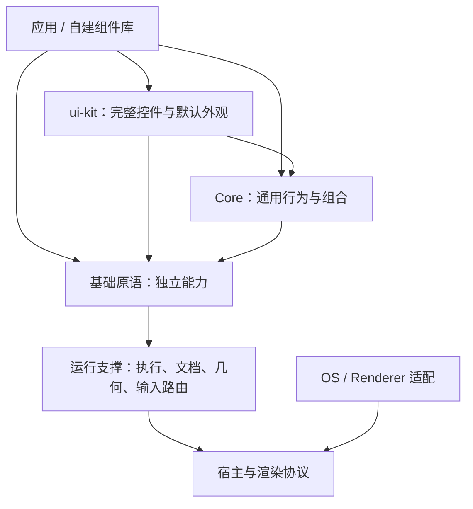

# 基础原语、Core 与 ui-kit 的边界

日期：2026-11-17。状态：分层目标；[第一轮包边界](package-boundaries.md)已开始落地。
本文件收敛[总方案](layered-architecture-redesign.md)的层次术语，
不新增运行时、crate 或已确定的公开类型。

## 1. 先拆开此前混用的 core

此前 core 同时指“不依赖 kit 的框架能力全集”和“比原语更高的通用能力”。
现在在职责讨论中区分：

- **基础原语层**：独立的状态、内容、几何、输入与语义能力，能用于多种不同组合。
- **Core 通用能力层**：在原语上复用有意义的行为和协调规则，不绑定组件外观。
- **ui-kit**：完整控件的具体组合、交互约定、变体与默认外观。

第一轮将独立数据/计算/协议抽为 `octara-primitives`；`octara` 暂时承载其余有生命周期的原语和 Core。
后续拆分以消除实际反向依赖为门槛，不要求立即拆成与职责数量相同的包。
“不用 ui-kit 也能写 UI”仍然成立。应用可以使用基础原语和 Core 通用能力，
也可以自行组合原语；不因此要求应用重写平台编辑协议和执行系统。

## 2. 分层与支撑

箭头表示使用或实现协议的依赖，不是事件流；实际宿主输入经协议回到运行支撑，
输出通过协议交给适配器。运行支撑不依赖 ui-kit 或具体 OS 实现。
原语是公开能力边界，不是复制一份内部状态或每帧串行执行的一层。
App/Window 协调和 Inspector 横跨相关能力，通过既有所有者与协议工作，不再增加流水线层级。

## 3. 每一层具体放什么

| 位置 | 职责与候选能力 | 不放什么 |
| --- | --- | --- |
| 运行支撑 | 响应式图、执行与释放、保留文档、编辑状态、布局/文本计算、路由与输出 | 组件外观、产品校验；不全部公开内部结构 |
| 基础原语 | Signal/派生与作用域接口；内容构造/结构组合；布局/样式/滚动；指针捕获、焦点、文本编辑协议；语义属性与关系 | Button/Menu 的全部约定、全局表单政策 |
| Core 通用能力 | 基本激活、焦点范围管理、锚定展示的组合、可复用的选项导航等候选能力 | 某款按钮的尺寸颜色、某个 Combobox 的业务接受规则 |
| ui-kit | Button、Field、Dialog、Menu、Combobox 等完整装配、具体交互政策和外观 | 第二份焦点/编辑真相、普通组件作者无法使用的私有特权 |
| 应用 | 业务值、异步请求相关性、提交校验、页面与自定义设计 | 为普通输入自行适配各平台 IME |

表中 Core 能力是候选集合，不要求全部新增公开对象。
例如基础焦点操作与范围成员资格由底层表达，进入/循环/恢复的组合可由 Core 提供，
Dialog 再选择初始焦点与关闭政策。运行时执行已声明规则，不自行读取 kit 状态。

“编辑协议是原语”不表示把它拆到每个字符操作都让应用协调。
它以一个稳定领域契约封装真实复杂度，内部复用原生输入、选择和历史管理。
同理，状态原语内部拥有依赖图，不因此失去原子性。

## 4. 用例检验层次，避免按名称机械分配

| 用例 | 原语 | Core 组合 | kit / 应用选择 |
| --- | --- | --- | --- |
| 自绘按钮 | 内容、焦点资格、输入与语义动作 | 多输入方式的基本激活、取消与禁用协调 | Button 的布局、名称装配、外观 |
| 数字输入 | 文本编辑、选择、composition、文本几何 | 所需的共享编辑适配，若普通原语已足够则不另设一层 | NumberField 的草稿解析/步进/提交政策 |
| 锚定建议面板 | 目标关系、位置约束、展示与焦点能力 | 锚定展示协调；无抢焦点的选项导航 | Combobox 的筛选、选择和关闭政策 |

锚定的相对几何约束归原语；多个约束、展示存活和边界策略的便利装配才可能归 Core。
不要在上下层各维护一个 anchor、焦点或 selection 状态。
Core 如果只是没有额外语义的透传函数，可以省掉，kit 直接使用原语。
真正通用的 Core 能力应公开可用，不因暂时只有官方 kit 使用就成为私有特权。

## 5. 约束与完成标准

1. 原语向下依赖运行支撑，不向上依赖 Core 控件政策或 kit。
2. Core 组合使用同一套原语；kit 使用公开原语/Core，应用可走相同路径。
3. 所有层共享原语背后的权威状态，不新增镜像运行时。
4. 不强制每个功能经过所有层；已有能力充分时直接组合。
5. 独立原语须职责明确、组合有意义；Core 抽象须减少真实重复和调用成本。
6. 后续用无 kit 的按钮、输入和锚定面板检验充分性；本轮不声称已通过验证。

W3C 提供能力划分参考，Rune/Exact 提供实现与取舍参考；
这些证据见 [W3C 原语审查](../research/w3c-core-primitives.md)和[原语推演](core-primitives-derivation.md)。
下一步逐项核对现有公开面属于原语、Core 组合还是组件政策，再推演最小签名。
