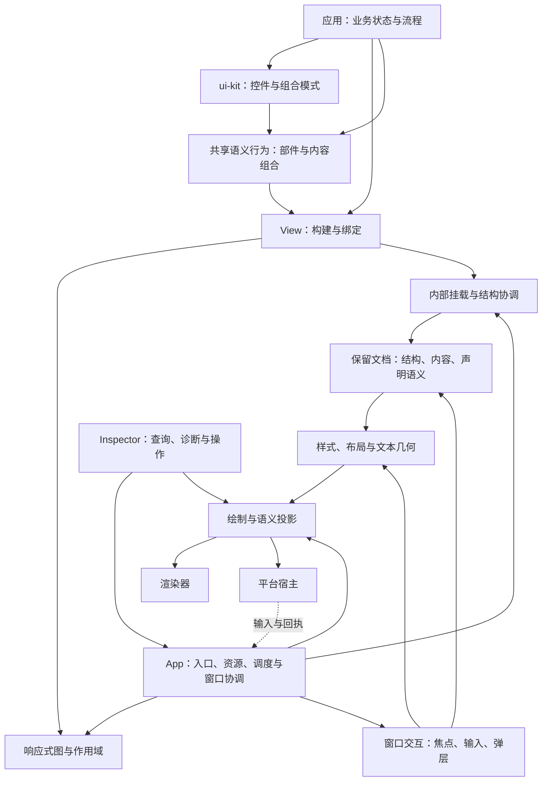

# Octara 分层架构重设计

日期：2026-11-17。源码基线：`b117aeea644d2480ff62be0c4a004ac7c7ed0fbc`。
状态：**整体设计提案；第一轮包边界已开始实施**。允许打破现有 API、删除和合并实现。
已落地范围与尚未实施项见[包边界记录](package-boundaries.md)，不表示本文全部契约已实现。

本文接续[基础能力审查](ui-foundation-review.md)，重新规定各层的目标职责，
不以逐项修复 F1–F8 作为架构终点。[框架调研](../research/ui-composition-frameworks.md)
记录 SwiftUI、Rune、Exact 的机制与证据。具体 Rust 类型名和方法签名在实施切片前定稿。
下文“删除”“迁移”均指目标，不表示已经发生。
React/Base UI/Tailwind 的组件语义已与 Rune/Exact 做[交叉审查](../research/frontend-native-cross-review.md)。
由此修订的行为/外观边界和部件组合见第 8 节；它们是目标职责，不意味着新增独立运行层或 crate。
三路独立评审及主线程采纳记录见[独立审查汇总](../research/frontend-native-cross-review.md#10-独立子-agent-审查与采纳记录)。
下一步先按[核心原语推演](core-primitives-derivation.md)确定最小能力与公开边界，
再用组件案例反证；不从组件 API 外形直接倒推内核实现。
最新层次术语见[基础原语、Core 与 ui-kit](layer-boundaries.md)：基础原语位于 Core 通用组合之下，
现有 octara crate 可同时承载两者；本文较早的 core 泛称不意味着这两个职责合并。

## 1. 总体决定

保留原生 Rust、Signals、作用域所有权和保留式 UI，是因为它们适合产品目标；
现有文件、公开类型、函数签名和组件返回类型不受保护。
重新设计的单位是职责和契约，而不是 crate 数量或导出名称数量。
core 的公开能力必须足够独立构建 UI；ui-kit 是同一套公开能力的组合与默认外观，
不能独占编辑、语义、焦点或定位机制。依据见 [W3C 原语审查](../research/w3c-core-primitives.md)。

目标架构以四类事实组织：

1. **应用状态**：普通 Rust 数据和 Signals，决定产品要显示什么。
2. **已挂载文档**：节点、内容、结构身份、编辑状态和声明属性，决定窗口当前有什么。
3. **派生结果**：样式、布局、文本几何、绘制与语义输出，由前两者及环境计算。
4. **执行和交互状态**：作用域、任务、输入目标、焦点、模态栈和输出进度，由各自唯一所有者管理。

“唯一所有者”不要求一切存在一个大结构体里，也不禁止缓存。缓存必须说明来源、失效条件和释放者，
不能成为第二个可独立修改的业务模型。**共享规则，保留不同事实；合并入口，收窄写权限。**

## 2. 全局结构与依赖

架构不是一条把所有东西顺次堆叠的链。App 协调执行；文档和计算服务提供事实；
View 与 kit 描述 UI；宿主、渲染器、Inspector 消费结果或输入事件。

图中实线表示调用/数据依赖，虚线表示通过协议返回的事件，不表示 Rust 模块可任意相互引用。
跨边界使用小的领域数据类型；不建立包罗所有类型的公共 `protocol` 框架。

| 层/边界 | 唯一职责 | 明确不拥有 | 主要变化 |
| --- | --- | --- | --- |
| 基础领域协议 | 身份、几何值、文本编辑操作、输入与输出数据 | 调度、挂载、业务闭包 | 共享数据脱离 App 实现模块 |
| 响应式与执行 | 值、依赖、作用域、任务资格与释放 | 控件、布局和主题策略 | 保留图；统一准入，不建立第二个执行器 |
| App 与资源 | UI 线程入口、初始资源、运行中资源变更、窗口协调 | 每个控件的状态机 | 收拢共享资源修改，区分初始化与运行 |
| 保留文档 | 内容、结构、节点身份、编辑文档、声明属性 | 执行业务回调、调用 OS | 重做内容/子节点所有权契约 |
| 样式与几何 | 继承、测量、布局、文本、坐标变换和缓存有效性 | 业务校验、焦点决策 | 共用几何，显式失效依赖 |
| 窗口交互与语义 | 输入路由、焦点、选择协调、模态与动作资格；语义投影 | 第二份模型值、重复标签推断 | 交互所有者与声明语义分开，投影规则共享 |
| View | 一次构建、属性绑定、结构区域、组件作用域 | 全量应用更新引擎、产品外观 | 容器与原子内容分开，隐藏挂载表示 |
| ui-kit 的语义行为与默认外观 | 共享控件契约、部件/内容组合、受控值；默认外观应用其上 | Kernel 私有入口、新编辑器/调度器 | 先在 kit 内分工，按实际需求开放无样式组合 |
| Renderer / Host | 绘制、OS 适配、原生视图、呈现证据 | 重算业务状态、另造控件语义 | 保留接口隔离，明确一致输出与能力差异 |
| Inspector / CLI | 读取权威事实、提交操作、解释失败 | 第二棵应用状态树、自定义完成定义 | 与语义/诊断规则共用来源 |

现有 `kernel.rs` 使用 `app::Composition`、`TextEdit`、`TextDocument`，
`kernel/edit.rs` 实现平台文本布局数据的方法；`view/mod.rs` 则实现部分 WindowState 的布局回报。
这些是代码组织的反向依赖，不等于运行时已有错误；应把纯编辑协议放回文本领域，
把窗口协调移回 App/Window，View 只注册所需工作。不要只移动文件却保留原有责任混合。

## 3. 响应式、执行与生命周期

### 3.1 小的状态语言继续成立

`Signal` / `ReadSignal` 表达读写能力，`state` 表达受作用域管理的状态，
`memo` 表达纯派生，`watch` 表达来源与副作用分离。结构体和集合仍是普通 Rust 值。
`untrack` 只改变依赖收集，不改变权限和生命周期。

`StateList`、`ReadList`、`TextBuffer` 保留为按负载选择的增量工具。
普通有限列表可以直接由 keyed Vec 驱动；流式长文本不退化为每次替换完整 String。
`AsyncMemo` 留在任务工具层，`Model<T>` 留在 kit 值适配层，不合并进 Signal。

### 3.2 一套执行政策，多个具体边界

统一回答：当前属于哪个 App/scope/window、能做什么、是否还活着、读取是否收集依赖。
注册、执行、发布分别检查；前一次检查不生成永久许可。所有者恢复不提升调用阶段权限。

业务写入和框架提交必须区分：绑定来源在 Observe 中计算，不能调用 `set_theme` 等副作用；
框架随后可把计算值提交到仍然存活的目标属性。Build 中挂载新节点也不是用户修改已有 Signal。
因此不能把每次 Kernel 内部写入都机械套用“Observe 禁止写”的用户操作规则。

内部入口以小的普通函数和现有枚举表达，不引入公开 Executor、Permit、Transaction。
执行前取出必要数据并释放内部借用；执行用户闭包、比较器或析构后重新检查相关资格。
任务完成、回调取消、热重载、关闭窗口沿用同一义务，但各自保留自己的有效性判断。

失败撤销普通执行资格；框架资源释放仍可推进。已中断的用户 cleanup 不重放。
不把 scope、task、window、App 的状态合为一个生命周期枚举：它们关闭的时点和持有资源不同。
不承诺回滚任意 Rust 副作用，也不能中断任意同步 Rust 回调。

## 4. App、环境与共享资源

### 4.1 资源只有一个修改所有者

主题、字体目录、文本引擎和宿主配置由 App 管理。Kernel 消费资源及其有效性信息，
只处理本窗口的失效，不对共享资源另设公共修改规则。

当前 `Kernel::set_theme` / `register_font` / `set_text_engine` 修改共享资源后，
文档要求调用者另行通知其他 standalone Kernel。目标删除这一公开双重职责。
独立 Kernel 测试使用私有资源或测试装配入口；共享窗口统一经过 App。
`Window::kernel()` 当前已经只读，**本提案不声称存在公开的活动窗口可变 Kernel 入口**。

初始化流程调整为：宿主配置 → 创建 App 及资源 → 创建窗口 → 挂载首个 View → 首帧。
主题和字体无需借助 `spawn` 在首次构建后补设。运行期间主题切换、字体加入等变更，
在资源写入前执行准入，并统一通知受影响窗口。

建议将文本引擎选择和目标平台约定收为初始化配置，移除其普通运行中切换入口；
基准测试改为创建明确配置的 App。落地前逐一核对调用者；若确有运行中替换引擎的产品需求，
必须设计资源退役与全窗口失效，而不是保留当前绕过政策的便捷入口。
窗口缩放、系统主题、输入设备变化和 reduced motion 仍是合法动态环境，不随此项删除。

### 4.2 三种环境不要合成一个大字典

| 内容 | 目标归属 |
| --- | --- |
| App 主题、字体、系统设置 | App 资源及受控变更 |
| 子树字体、颜色、方向等展示继承 | 文档样式继承 |
| 业务服务和依赖注入 | 作用域 context；动态值通过 Signal |

可以借鉴 SwiftUI 的局部作用范围，不能因此把时钟、几何和全部状态塞进全局环境对象。
现阶段不新增通用 Environment 原语；若需要局部主题，先证明现有样式继承/context 无法自然表达。

## 5. 保留文档与内容组合

### 5.1 采用容器和原子内容的结构区分

目标选择：容器拥有应用布局子节点；文本、输入、图标、图片、Canvas、原生视图是原子内容。
原子内容仍有盒模型、样式、语义和事件，但不接受任意应用 `.child()`。
图片上的 badge、Canvas 上的按钮、输入框前后缀由外部容器/叠层组合。
原生视图的覆盖效果仍受宿主 stacking 能力约束，不能承诺所有平台任意覆盖。

必须区分应用 children、内容内部结构、测量来源和语义后代；“测量叶子”不自动等于“没有任何子对象”。
公开 builder 如何表达这一契约仍是候选实现：可以采用窄的容器/内容类型能力，
也可以保留简洁 builder 并在构造时明确拒绝非法组合。先比较实际 Rust 调用体验、转换与诊断成本。
转换成 `View` 后隐藏底层表示，挂载/直接内核入口仍检查结构有效性。
不因参考框架使用不同内容种类，就推导出必须公开一套状态泛型；也不能复制两套样式代码。

### 5.2 文本内部结构不再占用应用子节点接口

Span、链接范围、文本 run 由文本内容拥有。富文本链接作为可命中/可访问的内部对象，
不能在应用 children 列表里通过位置猜测所有权。
实现可保留私有节点表示，但它必须由文本所有者显式持有，不能进入应用结构协调接口。
链接增删要释放对应交互/语义身份；旧目标不能因范围位置相同而误操作新链接。

不新增一套通用子树分区系统。应用树是一份结构事实；绘制树与无障碍树可以是不同投影，
不必强迫每个内部链接都成为应用布局节点。

### 5.3 身份按用途划分

作用域/列表 key 决定状态连续性；节点分配身份决定当前操作是否仍指向原对象；
开发者 id 和可访问名称用于查找。名称相同不代表同一个对象，身份相同不代表缓存仍有效。
沿用现有代次和过期目标机制，不为了统一术语新增全局 Revision 或 UUID 协议。

## 6. 样式、文本、布局与动画

一条计算关系：声明属性 + 继承 + 资源 → 有效样式 → 测量/布局 → 展示坐标 → 各输出。
不同阶段可缓存、可增量更新；每个缓存的失效条件由拥有它的子系统负责。

文本布局提供字形、行、caret stop、范围和链接几何。对齐、换行、方向、截断与缩放进入同一布局契约；
绘制、选择、命中、IME 和 AX 不分别补偏移。自然测量宽度与约束宽度内的对齐分开处理。

输入文档拥有真实值、selection、composition 和编辑历史；prompt 是展示属性，label 是语义属性。
三者不能互相替代。外部受控值更新、原生编辑和预编辑也要有明确优先规则，不能靠重新挂载消解冲突。
具体包括同值回写、不同值回写、组合提交/取消、业务拒绝和替换字段后的迟到编辑。
保留 Octara 文档拥有编辑状态的方向，不照搬 Rune 应用拥有 TextEdit、每次构建克隆再回写的协议。

测量重试只修正几何与必要的驻留计算，不能重复提交业务动作或反复启动动画。
Octara 当前有受控布局反馈；目标保留有界反馈，并明确它何时触发下一轮更新，
不宣称把现有所有 after-layout 工作立即改成纯函数。

动画的目标布局和当前展示位置分别有定义；命中、绘制、原生 placement 与相关语义几何
必须使用可解释的展示时刻。资源或状态未变时复用结果，而不是为统一接口每帧复制整棵树。

## 7. 窗口交互、语义和输出

### 7.1 控件不拥有另一套窗口系统

Window 管理焦点、pointer capture、手势、模态顺序和输入优先级。
kit 声明行为和交互需求，使用现有事件层；不自己监听 OS，也不另存可独立修改的焦点真相。
弹层 open 可以是业务 Signal，模态栈是其已挂载交互结果；两者不是重复状态。
定位、点击外部关闭、模态隔离、焦点进入/恢复是分别可定义的策略；Popup/Popover 的名称
不意味着一定 modal。共享窗口机制承载这些策略，不为非模态建议列表再建一套窗口系统。
逻辑 owner/anchor 还决定展示在 overlay 层的后代是否属于当前交互边界；不能只沿布局父链判断。
关闭、anchor 移除、应用主动转移焦点、指针或键盘打开时的 focus-visible，分别规定结果。

IME 优先级、组件行为先于应用通知、回调之间的存活检查继续是统一契约。
低层文本操作、控件选择意图和最终业务接受值不能混成一个事件：
例如 NumberField 可建议数值，Model setter 可拒绝或变换，通知应明确提议值与接受值。
行为后的通知不具有事后撤销能力；若未来需要可取消意图，必须另定发生时点与可阻止的步骤。
读取模型只是当时的接受值，不表示异步业务检查完成。选择被拒绝时 popup 是否关闭、草稿是否保留，
也由组件契约明确，不由 setter 的返回形状暗示。

disabled 的动作资格、是否进入 Tab、程序聚焦、AX 可发现性和按下后取消分别规定。
readonly、loading、inert 不自动等价；视觉覆盖不能重新启用被拒绝的动作。
应用仍能合法更新被禁用控件的模型。

### 7.2 声明语义与语义投影共享一份规则

文档存声明的角色、名称、状态和关系；窗口提供当前焦点/交互事实。
Inspector、按名称查找、AccessKit 从同一套语义解析规则读取，不各自猜测标题。
这是共用解析，不要求增加一棵持久的可修改语义模型。

文本按钮的名称来自同一个动态标签值；复合标签有显式名称规则。装饰图标被排除，
独立有意义的后代按控件规则暴露；不能统一隐藏所有后代，也不能统一拼接子树文字。
`text_of` 仍表示节点自身文本；语义名称查询不伪装成文本查询。

### 7.3 输出就绪不是已经上屏

沿用一次 App 更新内的任务、响应式传播、结构、布局、交互修复和输出准备边界。
相容的几何/时间用于 display list、AX、原生 placement 与 IME；提交后由宿主给出它实际具备的证据。
保留“已接收输入、框架就绪、已提交、已呈现”的区别，不将它们合并为一个 done。

这不要求全 App 原子快照或每帧拷贝文档。平台同步文本查询继续使用受限的已准备编辑数据；
需要暂时计算新原生文本几何时，必须明确它是待应用编辑的投影，不能重入任意业务回调。

## 8. View 与 ui-kit 重新划界

### 8.1 View 的责任

只暴露内容构造、属性绑定、结构区域和生命周期组合。容器拥有 children；
`show`、`keyed`、`each`、虚拟驻留共享既有结构协调，不各写资源释放逻辑。
保留一次构建加细粒度绑定；不因借鉴 SwiftUI/Rune 而改成每次输入重跑所有组件。

移除公开 `View` 的可构造内部变体和挂载钩子，保留受控的转换/组合接口。
宏支持入口另列为文档隐藏的基础设施，不混进普通 prelude。
`#[component]` 的源码归属和 `component` 的状态作用域仍是不同事实；不为少一个名字偷偷改变生命周期。

公共操作按职责归属：主题和资源归 App，文本协议归文本，样式归样式，窗口操作归 Window。
允许重排模块路径和 prelude，但不另保留历史路径来维持兼容。

### 8.2 kit 不再保证所有组件都返回同一种裸 El

行为与外观形成明确责任边界：基本焦点、输入和模态机制由窗口提供；
kit 组合出 Button/Field/Dialog 等语义行为，默认外观与自定义外观复用这份实现。
先在现有 kit 内合并重复逻辑；第二套颜色或尺寸通常只需要 token/variant。
公开无样式能力的更强依据是有实际用途的另一种布局/内容组合复用相同行为，
且其身份、关系、焦点、禁用、事件顺序和必要结构条件均可说明并验收。
不预先建立完整公开 headless crate，也不让应用为了换颜色重写交互。

单根控件：交互根负责角色、名称、禁用、焦点和动作；标签内容负责视觉组合。
button、icon_button、不同按钮外观共用一个内部控制根与外观机制，保留有意义的便捷构造。
颜色和边框变体不应该创建新的行为状态机。

多节点组合：Field、Dialog、Combobox 等必须明确外层布局与实际控件的配置位置。
按需要提供 Label、Control、Description、Error、Trigger 等命名部件或明确的控制项参数；
简单场景仍有短 builder，默认组件和部件组合共用行为。返回的 View 不再假装是所有内部节点。
禁止 `.disabled()` 或 `.on_input()` 静默落在一个无关包装容器上。
不引入所有组件都必须实现的庞大 Widget trait。

组件关系沿用既有作用域和结构身份，自动维护必要的标签/描述/控制关系；
外部开发者 id 不成为内部关系的手写拼接协议。缺失必需部件、重复唯一部件或错误嵌套可诊断。
部件的基数逐组件定义；Trigger 不能统一规定为只能一个。动态部件完整性在规定稳定边界检查，
不能在逐项挂载的中途误报缺失。Root 是否产生布局节点由组件契约决定，
不要求所有 Root 都增加一个盒子。逻辑所属关系不能单靠视觉祖先查找；overlay 展示位置改变
不能改变原有生命周期和回调所有者。多触发器场景记录实际打开者，关闭时验证恢复目标仍存活。
脱离普通子树的显式关联仅在实际用例需要时增加，不预建通用部件关系引擎。

更换 Trigger 视觉仍保留同一个交互根；相互冲突的角色或主动作不能靠属性覆盖隐式解决。
继续沿用组件 Behavior 与应用通知的顺序，不照搬 Base UI 的 props/ref 合并与处理器优先级。

Field 负责标签关系、帮助和错误展示；业务产生校验结果，NumberField 负责草稿编辑与提交策略。
草稿能否解析、当前业务值能否提交、是否展示/播报错误分别定义，再由明确政策派生字段语义和 Save 资格。
当前 Field 会覆盖控件 invalid；NumberField 的默认 invalid 包含空串，Chat 则明确允许空串作为模型默认值。
因此不能无条件 OR 所有 invalid，也不能为了删除重复写法删掉合法业务策略。
明确可选空值、未完成草稿、范围约束和校验展示时机，不建立全局校验运行时。
规范化、clamp 和拒绝超界必须是可解释的策略，不能只因失焦先于 Save 就意外改变用户提交的值。

选择类控件共享内部选项身份、有效项导航、active/selected 区分和 keyed 行协调。
Select、搜索 Combobox、编辑器建议、Menu 可保留不同公开语义，
不合成几十个布尔参数的通用控件；它们的焦点策略和提交含义确实不同。
目前 Combobox/PopupList 仍有 Vec → watch → StateList 的镜像，目标改用已有 keyed Vec 路径，
先验证筛选、顺序、重复 key、IME 和目标连续性，再删除镜像。

### 8.3 熟悉词汇与明确差异

采用 value、checked、open、disabled、label、description 等熟悉概念，但逐项规定所有权和更新时机。
React 的 onChange 与 Exact 的 change 就有不同文本输入时机；不能借一个名字让应用猜测行为。
Octara 明确编辑提议、实际接受值、提交与组合输入的关系；保留一次构建和 Signals 绑定，
不让 API 暗示组件会按 React 的模型重新执行。controlled/uncontrolled 不作为所有属性必备的对称功能。

样式继续采用类型化 Rust 与熟悉的布局/状态词汇。默认外观、变体、调用者样式、条件与继承
使用一套可解释的优先规则，不各组件分别实现；不复制完整 CSS 或 Tailwind class 字符串解析。
现有 base 声明顺序、动态 patch 撤回、screen/touch/state/group 阶段已有规则，先核对复用；
不能同时承诺“调用者后写总赢”和“状态总在 base 之后生效”。默认外观与变体也遵守明确阶段。
状态样式由真实交互/语义状态驱动，不能多出另一套视觉 checked/open。
当前 invalid 语义已经存在，但尚无 State::INVALID；今后增加只读条件投影并不构成第二个状态源，
新增独立可写的 visual_invalid 才会产生这类问题。
内核负责资源和尺度解析；kit 定义组件设计语义，品牌提供值。现有 token 按用途审计，
组件专属 token 不继续加入内核；这一分工不引入第二套主题系统。
内核富文本链接、code 背景和基础系统提示目前也消费主题槽位，通用默认值可以留在底层。
不能为迁移 token 而令 core 反向依赖 kit，或使基础文本在没有 kit 时丢失可用默认值。
token/schema 迁层仍须保留动态主题失效：一次 build 中把所有 token 提前解析成 Color 快照会失去更新。
沿用符号解析或明确的响应式外观绑定，不为新主题结构强制重建业务 scope。

“更熟悉所以 Agent 更易用”仍需验证：对候选 API 和现有 API 用同一模型、上下文与工具完成
相同组件任务，记录多次尝试的语义遗漏、诊断修复和真实窗口结果，不以代码相似度作为正确性标准。

## 9. Renderer、Host 与 Agent

Renderer 只消费绘制数据并管理派生 GPU/CPU 资源；Host 负责真实输入、原生窗口、系统服务与呈现。
原生控件能力不同必须显式报告，不用 headless 成功推导平台能力。
Host 兑现共同规则所需的 OS 适配，并非不含任何行为实现；能共享的纯控件规则只维护一份。
若未来同一控件选择 native/painted 路径，必须明确资格与限制；样式切换不能暗中改变输入和语义契约。
不把 Exact 的自动 native/bare 选择机制引入为当前 GPU 优先架构的前置条件。
保留确定字体/时钟的 headless 验证和真实窗口验证，两者证明不同事情。

Agent 是框架的观察者和操作者，直接读取语义、源码位置、诊断、工作计数和输出证据。
语义操作通过 App 执行资格和目标校验；OS 输入通过宿主适配。记录中明确是哪条路线。
诊断严重性和 clean 判定共用标准；删掉 Chat 脚本中替代标准的局部规则。
有界的原因记录用于解释为什么更新/为什么拒绝，不建立自动 self-improve 引擎或第二份应用状态。

## 10. 具体合并、重构与删除清单

| 当前对象/路径 | 决定 | 替代及必须保留的性质 |
| --- | --- | --- |
| Signal / memo / watch / scope | 保留机制，审查入口覆盖 | 既有执行政策；不回退已验证的追踪与释放语义 |
| App 与 Kernel 的共享资源修改入口 | 合并到 App 所有者 | 初始化配置 + 合法运行中变更；Kernel 只消费/失效 |
| 运行中替换文本引擎、目标平台约定 | 建议移出普通运行 API | 初始化与测试装配；先核对实际调用需求 |
| 任意内容都可 `.child()` 的 El | 删除该能力假设，重构 builder | 容器/原子结构类别；公共转换后仍验证 |
| 文本 children 同时容纳应用节点和内部链接 | 删除混用 | 文本拥有链接，应用组合在外部容器 |
| Kernel 引用 App 编辑数据类型 | 重排依赖 | 文本领域的纯协议；公共签名随迁移调整 |
| View 内的窗口布局回报协调 | 移回 Window 协调层 | View 注册绑定/结构反馈，不管理帧推进 |
| 多处 label/text 兜底推断 | 合并规则 | 共享语义解析，保留不同输出格式 |
| 对齐仅作为 kit 绘制技巧的方向 | 拒绝 | 文本共享几何及缓存契约 |
| 裸 El 代表复合组件全部能力 | 删除统一返回类型承诺 | 命名部件/明确参数，简短构造复用相同行为 |
| 按钮变体重复根与交互构造 | 合并内部机制 | 内容/行为/外观分开，方便函数可保留 |
| 控件外观与交互实现耦合 | 提取有实际复用需求的行为组合 | 先在 kit 内共享，不先建通用 headless 框架 |
| 内核承担组件专属 token 定义 | 按用途收拢到 kit | 内核解析资源/尺度；通用槽位逐项审计，品牌提供值 |
| Combobox/PopupList 选项镜像 | 删除候选，须通过迁移验证 | keyed Vec；保留增量大列表原语 |
| 选择控件的重复导航算法 | 合并可共享的纯逻辑 | 保留 Menu/建议/选择的焦点与提交差异 |
| Chat 静态主题异步设置、字段重复校验 | 删除被新契约实际替代的绕行 | 首屏配置、Field 和明确校验策略；保留可选空值、整数等业务规则 |
| Inspector/脚本自建 clean 规则 | 合并 | 注册诊断严重性 + 明确的产品断言 |
| 公开挂载表示、偶然泄露的辅助类型 | 收窄/隐藏 | 公开组合与宏所需最小支持入口 |

不要删除：释放进度、request/task/target 资格、结构身份、缓存有效性、提交/呈现区别。
不要新增：VM、全局事务、第二个响应式系统、全量帧快照、通用权限 token、全局表单引擎。
每个新增内部抽象必须指出它替代的重复逻辑；不能只新增文件后把原路径完整留下。

## 11. 文件和 crate 组织

先在现有 crate 内按职责收拢，不按此表机械新增十个 crate。

| 现有位置 | 目标组织 |
| --- | --- |
| `reactive/graph/*`、`task/*` | 值/依赖、作用域/执行、调度分工保留；共享执行政策仍只有一处 |
| `app.rs`、`app/*` | App/Window 协调、资源入口、输入路由、输出提交；迁回 View 中的窗口协调 |
| `kernel.rs`、`kernel/*` | 文档结构、原子内容、样式、文本、几何与投影；收窄共享资源修改职责 |
| App 内纯编辑协议与平台文本数据 | 移到明确的文本/输入领域模块，供 Kernel、App、Host 依赖 |
| `view/*` | 面向应用的 builder/结构组合；挂载实现私有、表示隐藏 |
| `octara-kit` | 按交互模式组织，共用控制根与选择逻辑；业务校验不进入内核 |
| render/shell/inspect/cli | 保持适配与工具边界，共用权威几何、语义和诊断定义 |

保持大体路径可辨认不是兼容要求；最终拆文件依据依赖和可测试性，而不是行数配额。
既有架构文档对 Kernel“不依赖 app”的描述，应在对应迁移完成时与真实依赖重新核对。

## 12. 迁移切片与完成标准

整体方案先确定，再分切片替换；切片不是对旧架构继续打补丁。
每个切片包含新契约、调用者迁移、旧路径删除和验证，不留永久双轨。

| 切片 | 范围 | 必须关闭的验收问题 |
| --- | --- | --- |
| A | 基础领域依赖、资源所有权、初始化 | App 资源只经统一入口；非法调用无部分写入；首帧主题/字体正确；多窗口失效一致 |
| B | 文档/原子内容/内部链接、View builder 边界 | 非法 children 无法正常构造或被明确拒绝；链接增删不侵犯应用节点；旧目标被拒绝；普通组合无需内部技巧 |
| C | 文本几何、prompt、共享语义解析 | 对齐后的字形/选择/链接/AX 一致；prompt 不污染编辑；复合控件名称一致；更新保留编辑身份 |
| D | 控件根、字段与选项组合、公共 API 收窄 | 图标文字、动态标签、禁用、Tab、IME、字段提交正确；镜像和重复算法实际删除 |
| E | Chat、Host/Agent 对照、文档统一 | Chat 绕行减少；真实窗口/原生输入有证据；性能不退化；vocab/skill/当前架构与源码一致 |

最小横向验收：双窗口共享资源变更；动态图标/文字按钮；中文输入加错误提示；
流式 Chat 的选取、滚动与停止；搜索结果重排；嵌套弹层关闭；热重载与窗口重开后的旧目标；
字体/缩放变化下的绘制、命中和 IME 位置。
不能等 E 才验证平台：涉及编辑、语义和输出的切片各自附上对应真实窗口证据。
候选 API 先用普通 Field、前后缀输入、复合 Button 和带 IME 的弹层选择器贯穿验证；
比较简短 builder 与命名部件的关系成本，再扩大公开面。
具体校验、禁用、编辑冲突与组合案例见[前端独立报告](../research/agent-frontend-contract-review.md#10-最小验收案例)。

性能验收沿用现有 Chat 和框架基线，测量受影响的绑定、重排、文本布局与响应时间。
新方案没有证据前不宣称更快，也不以极端吞吐微优化作为全层重设计的前置条件。
布局重试的退化路径也保留虚拟列表驻留/资源边界，不能因重试到上限就静默挂载全部数据。

收敛完成意味着：每种状态有明确所有者，每次写入有明确入口，每种输出有明确来源，
常见组件可用公开原语实现且身份/交互不丢失，已列旧路径删除，真实窗口与现有契约验证通过。
不以“层数漂亮”或“API 名字少了”作为完成依据。

## 13. 提案的验证边界

本轮进一步阅读了 App/Kernel 的资源入口、执行政策、View 窗口协调、kit 选项实现和参考框架源码；
没有新增复现、没有修改实现或测试，也没有执行参考框架。
前一轮 65 项集成测试通过是当前基线证据，不是本提案已经成立的证明。
本方案的类型能力、资源入口删减和语义投影还需在上述切片中验证 Rust 使用体验与运行行为。

本文件是本轮重设计的总纲；原审查保留现状证据，既有实现文档继续描述现状。
实施时按已完成切片更新当前架构和 API 文档，不把提案提前写成“已实现”。
