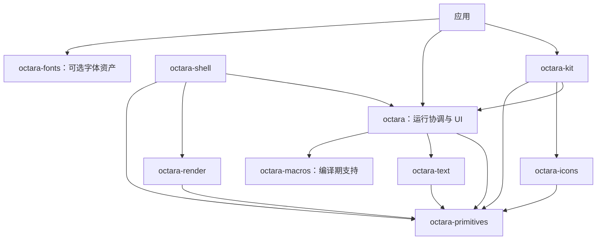

# 包边界落地

日期：2026-11-17。本文记录实现范围；完整目标见[分层边界](layer-boundaries.md)。
这次拆包不实施先前候选的 IME 重置政策、控件行为变化或新的 Signals API。

## 已建立的生产依赖方向

箭头表示 Cargo 生产依赖。原语包没有任何 Octara 工作区依赖。
绘制协议直接使用既有 `linebender_resource_handle::FontData`，不为字体句柄依赖完整 Parley 排版引擎。
渲染器、图标库不再依赖 core；`octara`、kit 与 shell 可使用相同的底层类型。
下层定义协议，上层实现和调用它；输入回传不是反向源码依赖。
字体资产包不依赖运行时或排版引擎；图略去 CLI，完整允许边在 `tools/check_layers.py`。
脚本检查普通、build、optional 和 target-specific 工作区边；dev 依赖可以用上层框架承载集成验证。

## 原语包的本轮内容

| 模块 | 内容 | 移除的耦合 |
| --- | --- | --- |
| `identity` | 不透明 NodeId 类型 | 绘制来源标记不依赖 Kernel 实现 |
| `layout` | Align、Side、Placement、Placed 的纯定位计算 | 定位数据与算法不依赖挂载窗口 |
| `theme` | 颜色、符号 token、尺度、Theme 值、BoxShadow、填充与解析 | 通用值不反向依赖 Kernel 样式执行 |
| `paint` | 绘制列表、glyph、clip、图片和路径输出数据 | 渲染器不需要整个 App |
| `path` / `icon` / `image` | 路径及栅格化辅助、图标数据与可选 SVG 解析、图片 | 图标库直接使用原语 |
| `canvas` | 局部绘制命令记录 | 记录与响应式重算/窗口大小来源分开 |
| `motion` | 弹簧、曲线与轨道计算 | 时间采样不需要 App 时钟所有者 |
| `native` | 原生视图身份、placement、变更与事件数据 | 协议数据与平台窗口实例分开 |
| `capture` | Painter 协议、Picture 像素结果及统一 PNG 编码 | CPU/GPU 直接返回同一底层结果，截图协调留在 core |
| `text` / `input` | 平台文本编辑操作、光标类型 | 纯输入数据不属于 App 或平台适配模块 |

`Picture` 是直通 alpha、sRGB RGBA8 像素结果；`encode_png` 与 `save_png` 共用编码路径并返回 `io::Result`。
渲染后端私有处理预乘/读回格式，不再维护 `Bitmap` 或第二套 PNG 编码。可变 `Image` 资源和 core 的
`Capture` 窗口/原生覆盖报告仍是不同事实，不因字段相似而合并。

Theme 的共享写权限仍归 App；移动 Theme 值不意味着允许绕过执行准入修改活动窗口资源。
Canvas 回调何时执行仍归 core 的绑定机制，原语记录器不建立自己的调度。
NodeId 的声明下移不转移节点分配所有权，也不把 key/name/缓存版本合成一种身份。

## API 与调用方迁移

直接模块访问改用 `octara_primitives::paint`、`path`、`theme` 等规范路径。
不保留旧公开模块或 Kernel 类型别名作为兼容层；`octara::prelude` 继续直接导出常用类型，
它是应用的便利入口而非第二份实现。CLI 跟踪跨包导出，返回实际定义、方法和源码位置。

删除渲染器中接收 Window 的 `screenshot`：上层先准备 `window.display_list()`，
再交给 `CpuRenderer::render`。需要原生快照/完成报告时继续使用 core 的 capture 工作流；
两者证据范围不混淆。CPU/GPU Renderer 只实现底层 Painter，不负责窗口是否已稳定。

原始编辑文档从 App 下移到 Kernel，保留内部 Composition 和字段权限；
公共协议操作属于原语包。TextInputLayout 和 TextGeometry 也由 Kernel 文本领域拥有，
platform 只消费这些类型。此次只改变归属，不实现新编辑仲裁政策。

## 第二轮：独立文本排版

`octara-text` 从 Kernel 中提取已有排版实现，拥有 TextEngine、TextLayout、TextStyle、
Wrap、字形与视觉行结果、Parley/MonoEngine、排版缓存和内置字体。其唯一工作区依赖是
`octara-primitives`，不依赖 App、Signals、节点树或窗口。没有扩大内部字段和方法的可见性。

公开路径由 `octara::kernel::text::*` 改为 `octara_text::*`，不保留旧公开别名；
CLI 直接索引新包。core 的 `system-fonts` feature 转发到新包，默认仍只用内置字体。
字体文件与许可证随实现迁移，字形输出的字体句柄仍使用 `linebender_resource_handle::FontData`。
原语包与渲染器均不依赖排版引擎。

节点文本缓存的归属、编辑历史、IME 组合状态以及选择到绘制的协调仍属于 Kernel；
此次只提取已有独立计算服务，不增加第二套文本状态或调度机制。`octara-fonts` 只提供可选 CJK
字体字节、family 和 scripts；不再包含运行期 installer 或依赖 core。调用方在 AppConfig.text_engine
注册初始字体，确保首帧使用目标资源。集成测试通过 dev 依赖验证排版与截图，不进入生产依赖图。

## 本轮没有假装完成的边界

Signals、任务、挂载、焦点与窗口仍在 `octara` 内，存在生命周期相关的同包耦合。
完整的“运行支撑 → 状态原语 → 通用行为”物理拆分还需要收拢所有者与桥接入口；
不能通过公开 Runtime 内部字段或新建相互引用的 crate 来制造已经分层的外观。
`octara-primitives` 是原语层已独立的部分，不是全部原语都已迁完的声明。
内容约束、公共 View 收窄及 kit 配置目标仍按各自契约后续实施。

## 验证门槛

- 原语、无 GPU 渲染器、图标库可独立构建；生产依赖图不得包含 core/kit 的反向边。
- 原有原语单元测试随代码迁移；core、kit、编辑、渲染和示例回归继续运行。
- CLI vocab/生成参考可穿过 prelude 导出找到规范定义；skill 导出与 start-here 同步。
- 检查默认 feature 与关闭 SVG 的构建，不依赖工作区 feature 合并掩盖缺失配置。
- 包迁移不代表真实 OS 行为重新验收；没有本轮窗口记录时不宣称通过真实窗口验证。

## 第一轮执行结果

在 macOS、Rust 1.100.0 下执行：

- `cargo check --workspace --all-targets --offline`：通过。
- `cargo test --workspace --offline`：864 通过、0 失败、3 个原有 ignored doctest；
  首次沙箱运行禁止本地监听，解除测试沙箱限制后完整运行通过，包含 Chat HTTP 与 CLI socket 回归。
- `cargo clippy --workspace --all-targets --offline -- -D warnings`：通过。
- `cargo fmt --all --check`、`git diff --check`：通过。
- `RUSTDOCFLAGS='-D warnings' cargo doc --workspace --lib --no-deps --offline`：通过；
  修正一个下移后的 MISSING 文档链接。仅生成库文档，避免 CLI 二进制与 core 同名的输出目录冲突。
- 无 SVG 原语、无 GPU 渲染器和图标库的独立构建：通过；CPU renderer 的生产依赖不含 core/kit/shell/Parley。
- `tools/check_layers.py`：通过；额外模拟的 optional/target-specific 向上 normal/build 边均被拒绝。
- CLI 跨包别名测试与 skill 同步验证通过；已重新导出 `skills/octara`。

本轮未新增真实窗口/OS 输入验证，不以源码迁移和 headless 测试代替这类证据。

## 第二轮执行结果

文本排版拆包后，在 macOS、Rust 1.100.0 下执行：

- 工作区 `check --all-targets`、`test`、`clippy --all-targets -- -D warnings` 均通过；
  完整回归仍为 864 通过、0 失败、3 个原有 ignored doctest。
- `octara-text --no-default-features --lib` 的 6 项排版测试通过；
  core 关闭默认 feature 的独立库构建通过，未依赖工作区系统字体 feature 合并。
- 工作区库文档及 `octara-text --no-default-features` 独立文档均以 `-D warnings` 通过。
  独立文档检查发现并修复两处指向可选 `system` 方法的失效链接。
- 原语、CPU renderer、排版包的生产依赖树检查通过；前两者不包含 core 或 Parley，
  排版包不包含 core、kit、shell。`tools/check_layers.py` 已约束新增包的允许方向。
- CLI canonical-path 回归与实际 `vocab octara_text::TextEngine` 查询通过，定义指向新包。
  start-here 与 skill 副本已同步。
- 字体二进制逐字节一致，许可证文本内容一致（既有 CRLF/LF 工作树规范化除外）。
- 格式和 diff 空白检查通过。本轮不涉及行为变更，未新增真实窗口验证。
