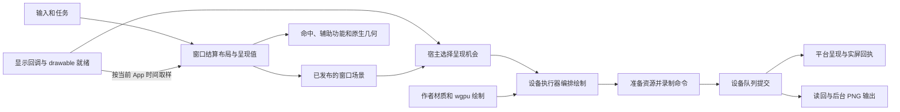

# Octara GPU 渲染架构

已确定的架构是单 App 所有者结算 UI、按窗口发布不可变场景、按设备执行渲染、按表面协调呈现。截图经过独立的读回和输出流程。宿主调度以通过双窗对照的版本为基线，调度试验沿用同一交付协议。当前实现与实测记录见[验收基线](#验收基线)。

**常用 UI 走可合批的直接绘制，作者的自定义材质与任意 wgpu pass 都能进入同一个窗口帧。** 一棵保留树管理布局和交互。窗口发布已结算的画面，绘制器编排批次、合成目标和纹理依赖，宿主持有窗口表面和呈现。作者可以替换普通组件的背景、描边和焦点环，也可以给一块视口接完整的 GPU 渲染器，或用画面的纹理定义自己的转场。

## 分层与所有权

| 层 | 拥有的状态与资源 |
| --- | --- |
| `octara-primitives` | 坐标、颜色、图元、裁剪及可交付的绘制数据。绘制记录表达位置、像素来源和作用范围，供不同绘制后端使用。 |
| `octara` | Signals、保留树、Taffy 布局、命中和辅助功能。单一 App 所有者结算窗口状态，按窗口发布含绘制顺序和挂载身份的 `PublishedFrame`，有序交付原生操作。 |
| `octara-render` | CPU 参考绘制和 wgpu 绘制。设备执行器独占录制、图集、管线、输出历史与队列提交。作者的材质和 GPU pass 按场景中的位置编排。 |
| `octara-shell` 与平台适配器 | 原生输入、视图及设备和每窗表面的生命周期。宿主协调显示机会与表面就绪，校验窗口、表面和设备代次后完成呈现。截图在后台读回并压缩写盘，宿主核验后提交文件。 |
| 应用与 Kit | 普通视图和组件的外观、状态与交互。作者可选用 wgpu 适配接口为组件提供绘制，Kit 通过相同的组合与样式机制提供默认实现。 |

依赖边界沿用现有方向。内核和基础包传递后端中立的绘制数据，绘制器消费这些数据。连接视图与设备的作者接口放在依赖两者的宿主侧，复用 `octara_render::wgpu` 的版本和宿主共享的设备。一个窗口移到不同显示器时，尺寸、缩放、可用区和像素格式由宿主报告。不同窗口可以共享设备资源，各自持有表面与呈现状态。[包边界](../ARCHITECTURE.md#从底层到应用) · [依赖检查](../../tools/check_layers.py) · [wgpu 再导出](../../crates/octara-render/src/lib.rs)

## 从 CPU 更新到 GPU 执行

窗口沿用现有的准备与提交协议。输入、任务和跨窗口反馈结清后，在实际 App 时间采样呈现值。发布时固定窗口身份、绘制修订、采样时刻、逻辑尺寸、比例和输入资源版本。绘制、命中和原生适配从同一次已结算的呈现几何取值。渲染阶段消费这份画面，后续事件可以独立推进窗口。需要保存旧画面时，保留其绘制数据或 GPU 输出及相应版本。[窗口准备](core.md) · [现有修订与提交](../../crates/octara/src/app/frame.rs#L121) · [应用时钟](../../crates/octara/src/app/time.rs)

`DisplayList` 保留绘制顺序和范围。相同节点的文字、图标或几何可保留局部绘制记录，帧只改变它们的位置、裁剪或者合成值。GPU 绘制器据此准备实例和资源，按需要生成帧内的渲染计划。计划记录 pass 的输入版本、写入目标、像素范围和其在绘制顺序中的位置。普通帧能合到一个直接写入窗口目标的 UI pass，附加 pass 由隔离层、纹理依赖和作者绘制产生。基于固定绘制顺序排定执行。跨帧效果选择已发布的历史纹理，GPU 队列保证生产命令先于读取命令执行。[绘制列表的数据](../../crates/octara-primitives/src/paint.rs#L280) · [当前 pass 边界](../../crates/octara-render/src/gpu.rs#L111)

准备阶段创建或复用管线，填写图集和实例数据。需要 compute、上传或复制的操作在合适的 pass 外录制。作者和默认绘制可以生成有顺序的命令缓冲，由宿主安排窗口帧的提交。一次绘制机会可以消费多个有依赖关系的命令缓冲，GPU 上的结果按队列顺序交给后续 pass。WebGPU 描述了内容、设备和队列的操作顺序。wgpu 跟踪资源用法并转到 Metal、Vulkan、DX12 等后端。[WebGPU 时间线](https://www.w3.org/TR/2026/CRD-webgpu-20261116/#timelines) · [wgpu 提交实现](https://github.com/gfx-rs/wgpu/blob/v30.0.2/wgpu-core/src/device/queue.rs#L1348-L1541)

`Queue::write_buffer` 的上传在下一次提交的绘制和计算命令前执行。多个 pass 依赖不同参数时，各自使用独立的缓冲区范围，或将按序的复制记录进 encoder。共享队列统一协调上传和提交，第三方渲染器使用该队列产生输出时也要明确提交顺序。这样多窗口可以共享图集和管线，同时保持各自的可见状态。中间纹理在 GPU 上直接传递。截图和反馈读取通过单独的捕获或异步回读操作安排。[wgpu 上传顺序](https://docs.rs/wgpu/30.0.2/wgpu/struct.Queue.html#method.write_buffer)

## 直接绘制的性能

常驻的矩形、图像、文字和材质使用同一绘制顺序。GPU 保留可复用的几何、实例布局、图集和管线。只有与当前绘制相关的资源参与准备。渲染器在布局裁剪和效果外扩范围内做可见性判断，先裁掉画面以外的绘制，再准备相应的 GPU 数据。

绘制器合并相容的实例。管线、纹理绑定、目标格式、混合、裁剪和前后顺序决定合批是否合法。同一材质的颜色、圆角和动画进度可以作为实例数据变化。重叠的透明内容按画家顺序合成，作者内联命令在所声明的位置中插入。运行时按设备、管线配置和着色器版本缓存管线，常用材质可在进入交互前准备。[Qt 的批处理与几何保留](https://doc.qt.io/qt-6/qtquick-visualcanvas-scenegraph-renderer.html#batching) · [Unity UI 材质的顶点参数](https://docs.unity.com/en-us/engine/6000.6/manual/whats-new/unity66) · [Impeller 的管线准备](https://docs.flutter.dev/perf/impeller)

| 变化 | 需要的工作 |
| --- | --- |
| 颜色、焦点或材质进度变化 | 更新对应绘制数据与 GPU 参数。依赖这些数据的效果重新录制或合成。 |
| 位置、透明度或滚动变化 | 保留有效的局部几何与绘制记录，更新呈现变换和裁剪。已缓存且有效的像素可以直接合成。 |
| 图片和作者输出换帧 | 使用新内容版本。固有尺寸、布局输入或裁剪范围变化时才重新准备对应阶段。 |
| 缩放、像素格式或设备变化 | 复核与目标相关的字形、纹理和管线。设备重建时重新初始化 GPU 资源，并接续已结算的画面。 |

绘制记录缓存、GPU 纹理池和像素缓存拥有各自的寿命。保留绘制记录可以减少 CPU 构建和上传。纹理池复用分配，像素缓存复用内容。合成静态像素时验证尺寸、比例、格式、内容和已经烘焙的裁剪版本。包含 GPU 回调的内容使用实际输入与输出版本判断复用条件。[Flutter 的重绘边界](https://api.flutter.dev/flutter/widgets/RepaintBoundary-class.html) · [Chromium 合成架构](https://developer.chrome.com/docs/chromium/renderingng-architecture) · [Rune 效果缓存回归](https://github.com/anomalyco/rune/blob/3686e94ae09545fd5f2a61e22aabfbeba1cd896f/crates/rune/tests/effect_slot.rs#L475-L510)

## 作者的 wgpu 绘制入口

背景、边框、轮廓、内容和子树效果沿用同一种组件绘制协议。作者指定绘制位置、局部范围和呈现参数，Octara 提供布局结果、裁剪和动作语义。绘制资源由现有节点挂载身份与其绘制位置关联，退出和重开可以同时持有不同版本。公开签名从普通组件和复杂画布的使用场景收敛。

| 作者需要 | 执行位置和获得的能力 |
| --- | --- |
| 背景、描边或焦点环的自定义材质 | 用 WGSL 定义像素，由常规绘制路径供应组件几何、混合、裁剪和各自参数。材质保持在其对应的绘制位置，相容的材质绘制进入同一批次。 |
| 在组件区域绘制 2D、3D 或运行 compute | 初始化使用框架提供的 `wgpu::Device`，作者可创建着色器、管线、顶点缓冲、存储纹理、深度与 MSAA 目标。帧回调借用 encoder 和输出目标，可录制多 pass，并将已解析的颜色结果交给框架合成。 |
| 使用已能画到纹理的第三方渲染器 | 在同一设备上交付带尺寸、颜色、alpha 约定、版本和队列顺序的 GPU 纹理。宿主协调写入提交与采样时序。一次已发布的结果在所有读取完成前保持可用。 |
| 在已有 UI pass 中插入自定义绘制 | 对适合当前附件和裁剪状态的高级绘制，可在指定位置借用 `RenderPass`。所需上传、compute 或其他 pass 在准备阶段记录。独立画布支持作者自有的附件和深度语义。 |

作者代码的资源工厂跟随设备，帧回调消费窗口已结算的数据。应用在共享设备创建前声明所需的 `Features` 和 `Limits`，宿主核对适配器能力，向作者提供实际启用的设备能力。作者可为 CPU 参考绘制、GPU 特性不足或设备恢复提供现有视图或绘制回退。着色器和资源验证按绘制位置报告，绘制失败时可选择该位置的回退内容。捕获记录实际像素来源。[wgpu 设备描述](https://docs.rs/wgpu/latest/wgpu/type.DeviceDescriptor.html) · [egui 自定义录制](https://docs.rs/egui-wgpu/latest/egui_wgpu/trait.CallbackTrait.html#command-submission) · [Vello 纹理入口](https://docs.rs/vello/latest/vello/struct.Renderer.html#method.render_to_texture)

独立目标的结果在合成时接受裁剪和组透明度。内联回调使用当前 pass 的目标、viewport、scissor 和裁剪数据，框架在回调之后恢复继续绘制所需的状态。需要额外遮罩或隔离的效果用局部目标合成。外伸光晕用绘制范围声明，需要改变命中形状或呈现位置时由视图树提供对应几何。[Qt 内联裁剪和状态](https://doc.qt.io/qt-6/qsgrendernode.html#render) · [Rune 内联裁剪](https://github.com/anomalyco/rune/blob/3686e94ae09545fd5f2a61e22aabfbeba1cd896f/crates/rune/src/render.rs#L884-L914)

### 组件材质与自定义效果

效果可以采样自己的子树、同一合成组中先前画好的内容，或者转场的新旧画面。申请时说明读取来源、顺序、区域和采样外延，输出按声明的绘制范围交还给窗口。宿主根据依赖准备纹理。羽化、卷页、折射等效果可以串联作者自己的 render、compute 和 copy 命令。

Rune 的 `effect` 提供了绘制位置、比例、裁剪和参数。普通回调借用已打开的 render pass。背景采样会结束 pass、复制已绘制内容并重开，作者在两次 pass 中间可以处理纹理。Octara 采用同样明确的执行时机，把挂载身份、裁剪和像素范围带进帧计划。Unity 的常规 UI 绘制也允许自定义着色器，背景滤镜则使用额外的合成路径。Unreal RDG 的资源读写和生命周期提供帧内编排参考。[Rune effect 源码](https://github.com/anomalyco/rune/blob/dev/crates/rune/src/el/effect.rs) · [Rune 背景阶段](https://github.com/anomalyco/rune/blob/3686e94ae09545fd5f2a61e22aabfbeba1cd896f/crates/rune/src/render/pass.rs#L99-L144) · [Unity UI pass 源码](https://github.com/Unity-Technologies/Graphics/blob/master/Packages/com.unity.render-pipelines.universal/Runtime/Passes/DrawScreenSpaceUIPass.cs) · [Unreal RDG](https://dev.epicgames.com/documentation/unreal-engine/render-dependency-graph-in-unreal-engine)

## 离屏纹理与合成

直接绘制时最终 pass 使用窗口表面。需要隔离组透明度或采样子树像素时，纹理尺寸按设备像素和实际绘制范围计算，包含抗锯齿、阴影及滤镜所需的外延。嵌套组的结果按原位置合成。颜色、目标格式和预乘 alpha 约定随目标提供，作者可以在自有 pass 内使用支持的格式，在交付边界转换到合成格式。已有 GPU 实现按有界尺寸复用纹理。[当前组透明度](../../crates/octara/src/kernel/paint.rs#L259) · [当前 pass 边界](../../crates/octara-render/src/gpu.rs#L123) · [Metal 附件读写成本](https://developer.apple.com/documentation/metal/setting-load-and-store-actions/)

背景采样读取所在合成组截至当前绘制位置的像素，分配时区分写入区域和采样范围。宿主为需要读取的目标安排可采样或可复制的纹理，并按设备能力选择表面路径。窗口表面在适配器支持时启用源复制。原生视图的独立表面、系统层和候选窗由平台适配器持有，它们的像素只有在宿主明确提供同版本输入时才参加相关效果。[Surface 配置](../../crates/octara-shell/src/platform.rs#L154) · [原生视图](native-island.md) · [WebGPU 资源用法](https://www.w3.org/TR/webgpu/#synchronization)

结构退场可以按原坐标重放保留的绘制，作者背景效果可沿用最后一次被宿主接纳的有效输出。局部转场需要冻结该区域实际被接纳的像素，再与新分支的当前画面组合。新分支在自己的挂载身份下绘制，输入、焦点和辅助功能按当前生效的结构结算。旧画面随使用它的转场帧和绘制捕获完成而释放。[内核动画](../../crates/octara/src/kernel/anim.rs) · [Rune 退场回归](https://github.com/anomalyco/rune/blob/3686e94ae09545fd5f2a61e22aabfbeba1cd896f/crates/rune/tests/effect_data.rs#L126-L161) · [Web View Transitions](https://www.w3.org/TR/css-view-transitions-1/#rendering-model)

每次窗口重绘按当前输出目标计算正确的完整画面。划区更新若能减少实际 GPU 成本，可以使用具有已知内容版本的保留目标，连同透明混合与滤镜读取范围一起验证。纹理池按尺寸、格式和用法管理，区域失效或内存压力时可回收未使用的分配与缓存。

## 真实窗口的等待与帧率

App 的单调时钟用于任务、输入和动画。每个窗口由所在屏幕提供呈现机会。窗口有两种出帧需求。一次性的画面变更要求提交最新内容，持续的动画、滚动惯性或 GPU 画布要求跟随显示回调。一次呈现可以消化多次已结算的更新。共享 Signal 可以更新多个窗口，各窗口在自己的呈现机会消费准备好的版本。可见内容静止时停掉持续回调，任务和资源到期仍由相应的截止时间处理。缺少显示回调的宿主使用定时路径，无窗口测试可以明确推进采样时间。[现有期限](../../crates/octara/src/app/time.rs#L262) · [窗口帧时钟](../../crates/octara-shell/src/platform.rs#L438) · [ProMotion](https://developer.apple.com/documentation/quartzcore/optimizing-iphone-and-ipad-apps-to-support-promotion-displays)

App 更新、渲染执行和平台呈现各自推进。窗口发布可跨线程共享的 `PublishedFrame`，保留未变的局部绘制段及已采样的资源。每个设备的渲染执行器串行拥有录制、上传、输出历史和队列提交。捕获使用该执行器的渲染资源，GPU 像素读回通过完成事件返回。平台负责屏幕节奏、窗口表面的取得和重配，以及带原生视图的呈现事务。[帧数据](../../crates/octara-primitives/src/paint.rs) · [录制与提交](../../crates/octara-shell/src/gpu.rs)

每窗保有最新待绘制版本和有界的在途工作。尚未开始的画面可以合并。录制完成的画面在几何、原生位置、表面和设备仍匹配时可按顺序呈现，较新的绘制需求继续保留。窗口关闭、表面重配或设备失效使旧工作退役。能异步提供 drawable 的平台交付已就绪的资源。获取会阻塞的后端把等待交给工作线程，归还前保持单次获取的所有权。跨线程传递固定场景和版本化结果，原生操作及资源退休继续有序执行。[核心帧契约](core.md#窗口结算与实际呈现) · [Exact 后台获取](https://github.com/expo/exact/blob/08c889a9de21a30b7c3b308422fc588cf1a480d3/gpu/src/acquire.rs) · [Rune 提交线程](https://github.com/anomalyco/rune/blob/3686e94ae09545fd5f2a61e22aabfbeba1cd896f/crates/rune/src/overlay/frame.rs#L100-L140)

### 窗口帧准入

每窗保存绘制需求、最近的可用显示机会和 drawable 获取状态。显示回调更新机会，drawable 回执只交付资源，系统重绘和定时回退也进入同一轮窗口选择。每轮先收集所有窗口已到达的机会，再轮转安排绘制。窗口唤醒只负责驱动这一轮，取走时间样本后已有唤醒仍可交付更新的 tick。一次录制消耗一次机会。短暂的空 tick 保留到目标时刻，允许紧随其后的画面发布使用。连续两个无需求的 tick 会停掉显示时钟。过期或重复的目标退出准入，新的需求和兼容的 drawable 留给下一次机会。[窗口呈现状态](../../crates/octara-shell/src/presentation.rs) · [显示链接](../../crates/octara-shell/src/pace_mac.rs)

后台获取路径先检查表面，再等待 drawable。资源就绪后才构建最新已结算修订的绘制列表。录制开始后新来的重绘请求继续有效，录制失败也会恢复绘制需求。共享执行器按窗口轮转，优先使用已经持有 drawable 且有有效机会的窗口。缩放、关闭和设备失效仍按表面和设备身份处理资源。[窗口调度](../../crates/octara-shell/src/lib.rs) · [表面与提交](../../crates/octara-shell/src/platform.rs)

窗口帧和绘制截图从同一个入口取得绘制器。截图在原生快照就绪后开始等待准入，并保留原捕获会话直到获准提交。有有效显示机会的窗口通常先绘制，截图的等待期限早于该显示机会，或已等待 50 ms 时，截图获得下一个可用的录制位置。若窗口仍需等待 drawable，截图可以用空闲绘制器。开始读回后，图像整理和 PNG 输出独立推进，窗口可以继续出帧。`device_admission` 记录两者争用时的选择和时限。[等待策略](../../crates/octara-shell/src/presentation.rs) · [截图会话](../../crates/octara-shell/src/capture.rs)

macOS 普通窗口可以在有效显示机会的目标时刻采样颜色、透明度和阴影等解析式绘制动效。几何、滚动、输入和定时器继续在实际 App 时钟结算。带原生视图的事务帧和无窗口录制采用已结算时刻。上屏回执携带实际采用的绘制采样时间。[发布与采样](../../crates/octara/src/app/frame.rs) · [Rune 的目标时钟](https://github.com/anomalyco/rune/blob/3686e94ae09545fd5f2a61e22aabfbeba1cd896f/crates/rune/src/frame/clock.rs#L96-L106)

渲染调度以直接交互的反馈为首要目标。按键、输入法、指针按下和释放保留交付顺序。宿主完成相应状态和布局结算后，下一次可用的绘制机会消费最新画面。drawable 获取、GPU 读回等待、PNG 编码与写盘在各自的后台路径推进。用真实输入的到屏 P95、P99 和滚动、拖动期间的上屏间隔约束调度。背景动画的吞吐量也要记录，以便判断它和直接交互争用的资源。[窗口输入迹线](../../crates/octara-shell/src/trace.rs) · [帧选择](../../crates/octara-shell/src/lib.rs)

获取协议和回执检查在各宿主上使用相同规则。先用可暂停的测试宿主核对多窗口进度、当前画面选择、旧请求返回及重配代次，再验证平台执行位置。wgpu 的 Metal 获取同时涉及 drawable 池和 AppKit 遮挡查询。让获取在后台运行之前，需要验证 AppKit 线程边界、表面锁和关闭期间的回收。若帧需要原生事务，纹理获取时采用的事务模式也必须与最终呈现一致。[核心帧契约](core.md#窗口结算与实际呈现) · [Metal 获取与事务模式](https://github.com/gfx-rs/wgpu/blob/v30.0.2/wgpu-hal/src/metal/surface.rs#L348-L400) · [原生事务](../../crates/octara-shell/src/native_mac.rs)

窗口尺寸、比例或表面发生变化时，宿主只提交匹配当前目标的帧。`Occluded` 等待再次可见，`Timeout` 让出本次机会，`Outdated` 重配，`Lost` 重新创建表面。设备丢失时重建设备及依赖资源，并用当前已结算帧恢复绘制。关闭时先结束该窗口的出帧需求，交还在用表面，回收剩余资源。跨设备或已过期的作者结果随原版本退休。[wgpu 状态契约](https://github.com/gfx-rs/wgpu/blob/v30.0.2/wgpu/src/api/surface_texture.rs#L44-L79) · [当前窗口处理](../../crates/octara-shell/src/platform.rs#L493)

开窗、缩放和表面恢复都提交一份最新的窗口配置。窗口先交还旧 drawable，再参与设备准入。设备工作线程占用共享绘制器并等待 wgpu 队列清空，窗口的输入与布局在此期间继续处理。宿主收到回执后重新采样窗口尺寸，只对仍存活的窗口应用最新请求，再允许绘制和截图提交。宿主负责原生表面配置，`surface_drain` 和 `surface_trace` 分别记录等待区间与宿主操作耗时。[设备等待](../../crates/octara-shell/src/gpu.rs) · [宿主准入](../../crates/octara-shell/src/lib.rs) · [双窗口回归](../../examples/live_inspect.py)

wgpu 的提交队列清空后，某些后端在换链时还会等待系统呈现。Vulkan 释放旧交换链资源时调用 `vkDeviceWaitIdle`。DX12 在调整缓冲区前等待单独的呈现队列。这部分时间计入宿主配置，并按各后端实测。[Vulkan](https://github.com/gfx-rs/wgpu/blob/v30.0.2/wgpu-hal/src/vulkan/swapchain/native.rs#L379-L391) · [DX12](https://github.com/gfx-rs/wgpu/blob/v30.0.2/wgpu-hal/src/dx12/mod.rs#L1488-L1490)

## 帧证据与 Agent 反馈

观察接口分别报告应用布局和命中的准备版本、GPU 队列的提交、GPU 完成以及实际呈现。只有平台提供可对照的时间戳或像素时才报告实屏证据。捕获以一次已结算的画面为依据。绘制捕获可复用相符的 GPU 输出，或重录可重放的固定数据。显示捕获核对目标窗口、尺寸和提交版本。作者纹理、原生快照与备用内容报告各自的像素来源。[现有回执](agent-knowledge.md#inspector-protocol-and-checks) · [捕获协议](capture.md#捕获对应的帧)

每个实窗用例记录 UI 更新、绘制编排、录制、drawable 等待、GPU 耗时和实屏间隔。要定位重渲染，额外记录相关材质与绘制批次、离屏纹理尺寸、发生的背景复制和复用范围。在设备支持时，以 `wgpu::Features::TIMESTAMP_QUERY` 和异步读回观察 GPU pass。120 Hz 代表约 8.33 ms 的呈现机会，验收用可见窗口的 `presentedTime` 或对应平台的呈现回执，报告稳定段的帧间隔和漏刷情况。[当前 CPU trace](../../crates/octara-shell/src/trace.rs) · [wgpu GPU 时间戳](https://docs.rs/wgpu/30.0.2/wgpu/struct.Features.html#associatedconstant.TIMESTAMP_QUERY) · [Metal 上屏时间](https://developer.apple.com/documentation/metal/mtldrawable/presentedtime)

## 验收基线

当前 wgpu 基线为 `30.0.2`，官方提交 `2b38d994b38dd001157d31fd3321111103a8dd80`。本地参考源码在 `~/code/archive/reference/wgpu`，工作区锁定的 wgpu 后端组件和 Naga 同为该版本。[官方发布](https://github.com/gfx-rs/wgpu/releases/tag/v30.0.2) · [Cargo.lock](../../Cargo.lock)

- 组透明度已按绘制边界分配纹理。在 `1600×1200` 的嵌套层回归中，两块中间目标各分配 `64×64`。RGBA8 裸像素容量约为每块 16 KiB，之前窗口尺寸的单块容量约为 7.3 MiB。[有界层回归](../../crates/octara-render/src/gpu.rs)
- Metal 下通过 22 项渲染测试。CPU 和 GPU 像素对照覆盖 1×、2×、阴影、圆角裁剪、分数坐标和嵌套透明组，最大预乘通道偏差为两个级别。关闭 GPU feature 后的 12 项 CPU 测试通过。macOS 实窗用 Inspector 核对了浮层、缩放和 GPU 截图。[像素回归](../../crates/octara-render/tests/integration/gpu.rs) · [实窗验证](../../examples/live_primitives.py)
- 实际 Metal 探针在同一次提交中，由 compute 写入 `16×8` 纹理，再将它采样合成到 `32×24` 的目标。最终读回的内侧像素为 `[128, 64, 127, 255]`，外侧为 `[0, 0, 255, 255]`。应用内的作者接口将在迁移中验证。[官方纹理绘制例程](https://github.com/gfx-rs/wgpu/tree/v30.0.2/examples/features/src/render_to_texture)

### 120 Hz 离屏基线

2026-11-20 首次测试枚举到 `1920×1080 @ 120 Hz` 显示模式。锁屏期间窗口测试取得零条显示时间戳。解锁复测时只检测到支持 60 Hz 的内置屏，取得了下文的实窗记录。120 Hz 的呈现间隔仍待实测。[Metal 呈现时间](https://developer.apple.com/documentation/metal/mtldrawable/presentedtime)

离屏测试复用工作区 dev 构建和真实 Metal 设备。以 120 Hz 显式推进 App 时钟，在 `800×600` 逻辑窗口运行本地「编辑设置」淡出原型和 10 万条消息的虚拟列表滚动。每组运行 720 帧，预热 120 帧，淡出只统计活动区间。GPU 列用每帧首个命令缓冲的 `GPUStartTime` 到末个的 `GPUEndTime`，完成列从预定帧起点算到观察到队列完成。复测在帧开始前校准唤醒时间，保留对 8.33 ms 处理预算的比较。[交互示例](../../examples/src/showcase/interaction.rs) · [虚拟列表](../../examples/src/apps.rs#L329) · [Metal GPU 计时](https://developer.apple.com/documentation/xcode/understanding-metal-performance-hud-metrics)

| 场景 | 设备像素 | CPU 更新与提交 P95 | GPU 区间 P95 | 完成 P95 | 8.33 ms 内完成 |
| --- | --- | --- | --- | --- | --- |
| 浮层淡出 | 800×600 | 0.96 ms | 1.26 ms | 3.32 ms | 219/219 |
| 虚拟列表滚动 | 800×600 | 1.51 ms | 0.20 ms | 2.57 ms | 600/600 |
| 浮层淡出 | 1600×1200 | 0.89 ms | 4.40 ms | 6.40 ms | 219/219 |
| 虚拟列表滚动 | 1600×1200 | 1.54 ms | 0.30 ms | 2.84 ms | 600/600 |
| 同一 Dialog 静止关闭工具面板并连续绘制 | 1600×1200 | 0.96 ms | 4.15 ms | 6.14 ms | 600/600 |
| 同一 Dialog 的工具面板完全打开并连续绘制 | 1600×1200 | 1.29 ms | 4.35 ms | 6.61 ms | 600/600 |

整个 Dialog 在静止时已有约 4.15 ms 的 GPU 区间。同一场景对照要继续用 pass 级计时定位高像素密度下的绘制成本。测试时淡出新建后，内核请求 16.667 ms 的下一次唤醒。离屏数据给出了处理预算，实屏验收还需要核对时钟、drawable 等待和实际呈现。[窗口帧时钟](../../crates/octara-shell/src/pace_mac.rs)

### 首轮迁移

- 窗口分别报告单次重绘和连续出帧需求，独立的任务和输入期限仍由 App 调度。macOS 优先使用窗口的显示回调，其余宿主使用显示器刷新率作为定时回退。窗口静止或不可见时暂停出帧。宿主按需取得已结算绘制的窗口、版本、采样时间、比例和绘制列表。[窗口发布](../../crates/octara/src/app/frame.rs) · [宿主调度](../../crates/octara-shell/src/platform.rs)
- 窗口持有录制后的命令并决定何时提交。绘制捕获在同一次提交中完成绘制和读回复制。显示捕获与 Inspector 同时核对绘制版本和表面代次。表面重配会使旧提交失效，原生视图位置随成功取得的 drawable 一起应用。[命令录制](../../crates/octara-render/src/gpu.rs) · [窗口提交](../../crates/octara-shell/src/platform.rs) · [捕获](../../crates/octara-shell/src/capture.rs)
- 无窗口测试以 60 Hz 和 120 Hz 推进动效及滚动，核对末帧发布、静止和关闭后的出帧需求。真实 Metal 回归通过 24 项，覆盖丢弃待提交指令、同次提交中的前后命令和设备失效后的捕获错误。CPU-only 回归通过 12 项。iOS 模拟器目标通过编译检查。[窗口回归](../../crates/octara/tests/integration/windows.rs) · [GPU 回归](../../crates/octara-render/tests/integration/gpu.rs)
- macOS 窗口验收通过多窗口缩放、关闭重开和 WKWebView 快照。锁屏期间的显示捕获回退到 GPU 绘制，`390×640` 逻辑像素在 2× 下得到 `780×1280` 的截图。后续需要实测可见窗口的 120 Hz 呈现间隔，并实现设备级资源重建。[窗口交互用例](../../examples/live_primitives.py) · [多窗口与原生快照](../../examples/live_inspect.py)

### 节点材质与作者画布

`El::paint(program, params)` 用同一个挂载节点的盒子承载 GPU 绘制。四个浮点参数支持普通属性绑定，更新时只使绘制失效。常规样式提供矩形、圆角和回退画法，节点保留布局、命中与辅助功能。内核只持有后端可识别的绘制数据，`octara-render` 提供 wgpu 程序。当前这一位置覆盖整个盒子，程序可以在盒子内定义自己的描边。[节点绑定](../../crates/octara/src/view/element.rs) · [绘制数据](../../crates/octara-primitives/src/paint.rs)

- `gpu::material` 接收返回 straight-alpha 颜色的 WGSL 函数。同一材质的相邻相容实例共享绘制批次，实例参数各自取样，绘制顺序跨材质、文字和其他节点保持一致。
- `gpu::canvas` 为作者提供共享设备、区域纹理与帧参数。作者可以在独立 encoder 中录制多条 compute、render 和 copy 命令。有效命令与 UI 同批提交，画布输出以预乘 alpha 在节点原位合成。画布在缩放后按设备像素取样，父级裁剪与组透明度继续作用。准备或录制验证失败时使用原位置的样式回退。作者持有的资源在提交时须保持有效，缓冲区须解除映射。

`window gpu_lab` 在同一个窗口里绘制共享材质色板、运行 compute 与合成 pass 的流场、普通工具栏与弹层。macOS 上通过 Inspector 核对了选择、焦点、滚动和原生缩放。2× Metal 绘制截图验证了色板 shader 输出、切换预设后的画布中心像素，以及缩放后弹层覆盖画布的像素。选中 Prism 时为 `2000×1400`，改选 Ember 后缩放至 `800×620` 逻辑像素，弹层截图为 `1600×1240`。该次采样在锁屏期间完成。[示例](../../examples/src/gpu_lab.rs) · [实窗回归](../../examples/live_inspect.py)

Metal 的 28 项渲染测试通过。材质测试断言参数不同的相邻实例合批，画布测试在 1× 和 2× 核对绘制顺序、裁剪及组透明度。准备与录制的错误写入渲染日志，测试分别验证错误的 WGSL 和错误的画布命令保留原位置的回退像素。CPU-only 的 13 项测试和关闭窗口后的绘制缓存释放回归通过。[GPU 测试](../../crates/octara-render/src/gpu.rs) · [帧缓存测试](../../crates/octara/tests/integration/display_list.rs)

### 局部背景采样与退出纹理

`gpu::backdrop` 沿用 `El::paint` 的盒子、属性绑定与样式回退。绘制到该位置时，渲染器保存当前附件，复制效果盒子、裁剪边界和当前合成目标的矩形交集。作者获得纹理、设备像素尺寸和相对盒子的偏移，可以录制自己的 wgpu pass。其命令与后续 UI 绘制按顺序进入同一次提交，效果的合成仍走圆角裁剪。源不支持复制时使用样式回退。[作者接口](../../crates/octara-render/src/gpu/custom.rs) · [提交顺序](../../crates/octara-render/src/gpu.rs)

活跃背景效果按挂载保存宿主最近接纳的结果。GPU 提交后，待接纳的帧单独持有候选纹理。原生呈现调用成功且宿主验证窗口、表面和设备后，候选纹理才进入退场历史。缩放、关闭或设备失效淘汰的结果随该帧释放。退出时旧挂载退出输入和辅助功能，透明度轨道继续合成最近接纳的纹理。绘制截图可读取这份历史。同区域重开建立新挂载，旧纹理随旧挂载收尾。[内核绘制](../../crates/octara/src/kernel/paint.rs) · [宿主接纳](../../crates/octara-shell/src/platform.rs) · [绘制保留测试](../../crates/octara/tests/integration/display_list.rs)

### Dialog 局部转场的输入

以打开的 Dialog 在两份内容间切换为例。面板边框、关闭按钮和遮罩继续用普通视图绘制。内容区可以由作者做擦除或交叉淡变。旧内容退出动作树，新内容独立挂载并接收输入。关闭后立即重开，原内容可以继续退场，新 Dialog 取得自己的焦点和目标。Shader Lab 的 Glass 已覆盖关闭、重开及 GPU 绘制回退，可用同一窗口检查这些边界。[Glass 实窗流程](../../examples/live_inspect.py#L867) · [浮层身份回归](../../crates/octara/tests/integration/overlay.rs)

| 输入 | 需要传递的数据和约束 |
| --- | --- |
| 旧画面 | 同一窗口和设备代次中，指定绘制区域最后一次宿主接纳的局部像素。冻结图像、坐标和帧回执。首次打开可没有旧画面。 |
| 新画面 | 当前帧已结算的局部绘制段。正常跟随新内容，包括转场期间的文字和画布更新。关闭时可没有新画面。 |
| 图像坐标 | 每张纹理各自的窗口逻辑范围、设备像素范围和比例。可见范围受裁剪、阴影外延与资源预算约束。样本在各自范围之外为透明。 |
| 合成 | 窗口在 App 时钟上采样的进度与已有 `CanvasFrame` 的录制能力。原型沿用预乘 alpha、sRGB 编码的 `Rgba8Unorm`。两张纹理供读取，结果写入独立目标。结果插回该区域的原绘制位置，外层裁剪和组透明度在合成时各应用一次。 |

配对归属于应用明确选择的稳定绘制区域。每次配对记录这次转场及前后分支的精确挂载身份，重开按新实例结算。有配对效果时由这一处绘制合成前后内容。被替代的退出画面随原分支退休，保留的纹理随转场及在途绘制引用释放。同一区域的上一次混合画面如果已经被接纳，可以成为下一次转场的起点。历史不可用、减少动效或 GPU 编码失败时走已有淡出或直接显示当前内容，窗口照常结算。[退出生命周期](../../crates/octara/src/kernel/anim.rs) · [浮层绘制顺序](../../crates/octara/src/kernel/paint.rs)

沿用宿主接纳门槛，再为每个区域固定完整的 `PaintSample` 和纹理。局部转场保留最后接纳的内容画面，若那一帧实际合成了样式回退，回退像素也属于这一版。背景效果的退场历史继续保留最后接纳的有效作者背景输出。绘制捕获固定本次采样，并按转场身份读取已建立的历史引用。缺少已接纳的来源时，绘制捕获用当前内容并报告回退。设备失效清空该设备的历史，重配后用新的输出范围计算合成。宿主接纳描述呈现交付，实屏像素由平台证据确认。Inspector 的 `paint.effects` 报告 `outcome: transition` 和完整的 `old` 样本。当前画面的样本随 `paint` 回传。[资源与接纳](../../crates/octara-render/src/gpu/outputs.rs) · [窗口帧接纳](../../crates/octara-shell/src/platform.rs) · [绘制捕获](capture.md)

范围限定在一个实际绘制子树。锚定的子浮层有自己的绘制位置。含独立原生子视图的区域按普通画序绘制，接纳该帧时退役该区域的旧纹理。转场区域形成独立合成组，组内 `backdrop` 读取该组的前序像素。需要读取窗体背景的效果可以放在该组之前，例如 Shader Lab 的 Dialog 背景。只为明确选择转场的局部区域保留纹理。480×320 点的区域在 2× 时，每张 RGBA8 纹理约 2.34 MiB。旧、新和合成目标同时在用时约 7.03 MiB，后续实测还需计入裁剪外延和在途帧。[有序绘制计划](../../crates/octara-render/src/gpu.rs) · [原生表面契约](native-island.md)

W3C View Transitions 保持旧图像快照，并在转场期间从新元素更新图像。Octara 采用这些输入语义，把配对留在原绘制区域，以现有窗口时间和已结算的交互树交付。Exact 的 AppKit 转场在动画更新时重新读取目的位置和像素，Rune 的效果回调在原绘制位置取得前序像素。[W3C 图像对](https://www.w3.org/TR/css-view-transitions-1/#view-transition-pseudo-elements) · [W3C 新图像更新](https://www.w3.org/TR/css-view-transitions-1/#style-transition-pseudo-elements-algorithm) · [Exact 目的画面](https://github.com/expo/exact/blob/08c889a9de21a30b7c3b308422fc588cf1a480d3/host/apple/Sources/ExactKit/Mac/FlightsMac.swift#L251-L285) · [Rune 前序像素](https://github.com/anomalyco/rune/blob/3686e94ae09545fd5f2a61e22aabfbeba1cd896f/crates/rune/src/render/pass.rs#L99-L144)

macOS 的 Shader Lab 实窗复跑通过。关闭和重开路径核对了命令失效回退及退场使用的来源。在渲染执行器保留候选帧期间，把窗口从 800×620 点缩放至 840×640 点并关闭 Dialog。GPU 已提交的候选绘制版本 6 在呈现之前被弃用，退场读回的是宿主先前接纳的版本 5。表面代次从 2 变为 3。该结果验证了旧来源的接纳规则，配对及局部着色另由 Metal 探针验证。[实窗脚本](../../examples/live_inspect.py#L970)

Apple M4 的 Metal 探针用现有 `GpuRenderer::record` 生产两个位置和尺寸各异的局部纹理，再通过作者 `canvas` 的 WGSL compute 按窗口坐标采样。两份输入全程留在 GPU，只读回合成后的画面。2× 下，重叠区域的同一点在进度 `0 / 0.5 / 1` 时读取 `[64,191,0,255]`、`[32,207,16,255]`、`[0,223,32,255]`。保持进度 `0.5` 并重画新画面后，重叠点变为 `[32,175,48,255]`，仅有旧画面的点保持 `[32,223,0,255]`。同次验证覆盖圆角与内层矩形裁剪、组透明度、图像范围外的透明像素，以及后续的前景覆盖。[Metal 转场探针](../../crates/octara-render/tests/integration/gpu/transition.rs)

### 转场窗口接入

通过 `El::paint_transition(program, key, curve)` 标记保留挂载的区域。绑定的 `u64` key 改变时启动一次转场，后代可用同一来源驱动 `keyed` 以更换内容。旧控件随着结构更新退休。`gpu::transition` 的作者回调获得 `CanvasFrame` 和带各自起点、像素尺寸及比例的两个输入。进入减少动效、初次挂载及动画结束时直接绘制当前内容。保留的区域图像和活动旧纹理各有 32 MiB 与 64 项预算。挂载退出和转场完成后，旧纹理继续服务仍持有该画面的在途帧及捕获。[视图入口](../../crates/octara/src/view/element.rs) · [作者入口](../../crates/octara-render/src/gpu/custom.rs) · [保留预算](../../crates/octara-render/src/gpu/outputs.rs)

用 `examples/live_inspect.py --gpu-transition` 在 macOS Shader Lab 复现。两组内容的位置不同。中途更新新内容的颜色只改变新画面的像素，Inspector 的旧来源保持稳定。反向切换时冻结宿主接纳的混合画面。关闭过程中，旧控件的操作目标已失效，焦点回到触发器。立即重开会取得新区域。[Dialog 示例](../../examples/src/gpu_lab/transition.rs) · [实窗复现](../../examples/live_inspect.py)

在 macOS Glass Lens 回归中，工作线程完成版本 6 的 GPU 提交后暂缓交回结果。期间用系统接口缩放窗口并关闭弹层。宿主丢弃旧表面结果，退场截图回报来源版本 5，随后该窗口在新表面代次提交。独立 Metal 测试还核对了两个候选版本并存时的像素，以及显式接纳后退场来源的变化。[实窗时序](../../examples/live_inspect.py) · [Metal 回归](../../crates/octara-render/src/gpu.rs)

Shader Lab 的 Glass Lens 用滑块改变折射。在 macOS 窗口 1× 和 2× 的 GPU 绘制捕获中，滑块从 75% 调到 15% 后，Dialog 内无文字区域的像素变化。关闭立即归还触发器焦点，淡出期间采样并重开后，旧滑块请求返回 `STALE_TARGET`，新滑块的初始值为 75%。2× 截图为 `1600×1240`。Metal 回归验证同一帧中两个重叠采样效果的前后顺序、缩放后的组裁剪和透明度，以及丢弃录制、截图重放和新挂载对旧提交的隔离。[示例](../../examples/src/gpu_lab.rs) · [窗口回归](../../examples/live_inspect.py) · [GPU 回归](../../crates/octara-render/src/gpu.rs)

### CPU、GPU 和实际呈现的计时

`OCTARA_TRACE_GPU=1` 在 `octara.frame_trace/1` 的 `render` 字段记录准备、录制、提交与工作量。准备包括绘制编排和上传。录制包括普通画布、UI pass 和插到绘制顺序中的背景采样。计数涵盖框架的绘制批次和临时目标面积。[宿主迹线](../../crates/octara-shell/src/trace.rs) · [GPU 录制](../../crates/octara-render/src/gpu.rs)

适配器支持 GPU 时间戳时，最多三组查询槽异步读回已完成的采样。每帧最多采样 128 个区间。`octara.gpu_trace/1` 通过窗口、帧序号、绘制版本、表面代次和设备代次关联 CPU 记录。宿主单独唤醒轮询读回。部分后端只支持 pass 边界，画布清屏与整个作者命令区间分别标注。只有采到完整标记时才提供 GPU 帧内跨度，退出时尚在途的样本可丢弃。[wgpu 时间戳能力](https://docs.rs/wgpu/30.0.2/wgpu/struct.Features.html#associatedconstant.TIMESTAMP_QUERY) · [非阻塞轮询](https://docs.rs/wgpu/30.0.2/wgpu/struct.Device.html#method.poll)

本机 Apple M4 在同一次提交解析查询时缺少最终 UI pass 的时间戳。Metal 采样由绘制完成回调标记样本，随后在宿主轮询时另行提交解析，再异步读回。[wgpu Metal 时间戳问题](https://github.com/gfx-rs/wgpu/issues/9414) · [查询回收实现](../../crates/octara-render/src/gpu/profile.rs)

macOS 的实际呈现按目标窗口的显示记录验收。`CADisplayLink` 提供下一次显示机会，Metal 的 `presentedTime` 提供 drawable 的呈现时间。wgpu 30.0.2 的 Metal 后端持有该 drawable，公开 HAL 入口能取到表面和纹理。可见窗口可用 Instruments 的 Game Performance 模板，先检查 `displayed-surfaces-interval`，再按进程、窗口或表面归属去重。有归属的呈现才进入间隔分布。控制台锁屏期间可以先取得离屏 CPU 和 GPU 数据。[显示机会](https://developer.apple.com/documentation/quartzcore/cadisplaylink/targettimestamp) · [Metal 呈现时间](https://developer.apple.com/documentation/metal/mtldrawable/presentedtime) · [wgpu Metal 提交](https://github.com/gfx-rs/wgpu/blob/v30.0.2/wgpu-hal/src/metal/mod.rs#L802-L824) · [Instruments 工作流](https://developer.apple.com/documentation/xcode/analyzing-the-performance-of-your-metal-app/)

#### Shader Lab 离屏对照

Apple M4、macOS 27.2、Metal `Bgra8Unorm`，用 release 构建重放相同的 `800×620` 逻辑场景。每组预热 60 帧、测量 120 帧，重复三轮，一次只提交一个绘制帧。Glass 退场取关闭后 250 ms 的画面。完成延迟从创建 encoder 到绘制提交完成，时间戳解析和读回在测量窗口之后处理。表中为三轮的 P95 范围。[基准程序](../../examples/src/bin/bench/gpu.rs)

| 比例 | 场景 | 完成 P95（ms） | UI 标记区间 P95（ms） | 背景复制（像素） | 透明组目标（像素） |
| --- | --- | ---: | ---: | ---: | ---: |
| 1× | 普通 UI 与画布 | 0.793–1.667 | 0.164–0.752 | 0 | 0 |
| 1× | Glass 打开 | 0.981–1.205 | 0.365–0.631 | 69,120 | 0 |
| 1× | Glass 退场 | 0.880–0.907 | 0.204–0.205 | 0 | 163,840 |
| 2× | 普通 UI 与画布 | 1.389–1.393 | 0.724–0.735 | 0 | 0 |
| 2× | Glass 打开 | 1.559–1.577 | 1.567–1.582 | 276,480 | 0 |
| 2× | Glass 退场 | 1.546–1.572 | 0.854–0.861 | 0 | 552,960 |

每轮的三种状态分别记录 15、17、19 个框架绘制批次，材质批次均为 6。2× 时普通和打开态的 CPU 录制 P95 分别为 37.0–38.0 μs 和 76.2–80.8 μs，三种场景的 CPU 提交 P95 最高为 32.6 μs。退场稳定复用一张历史效果纹理。此适配器提供多 pass 的边界采样。UI 列为每帧 UI 区间之和，各区间可能重叠。整个作者命令、复制耗时、GPU 帧内跨度和实屏呈现待对应平台证据。[基准程序](../../examples/src/bin/bench/gpu.rs)

#### 动态回放与作者 pass

Shader Lab 把操作时间线和取样时钟放在示例的回放模块中。流场随时间变化，列表滚动后选择 Copper，Glass 在 1,000 ms 打开，随后调节折射、关闭并在退场中重开。回放核对关闭时的焦点、迟到请求拒绝和重开后的滑块初值，并检查最后一帧静止。60 Hz 和 120 Hz 使用同一组操作时刻。[回放场景](../../examples/src/gpu_lab/replay.rs)

作者可以通过 `CanvasFrame::begin_compute_pass` 和 `CanvasFrame::begin_render_pass` 为自己的 wgpu pass 请求时间戳。Shader Lab 标记流场 compute、颜色 resolve、网格合成和玻璃折射。框架在设备支持时使用同一组有界查询槽，在相应 GPU 工作完成后读取样本。作者在 descriptor 中指定的查询优先。[作者绘制上下文](../../crates/octara-render/src/gpu/custom.rs) · [采样实现](../../crates/octara-render/src/gpu/profile.rs)

用 release 的 `bench --gpu-replay` 在 Apple M4 Metal 上运行三轮 `800×620` 逻辑像素回放。每组先热身一次，测量时每帧单独等待绘制完成，GPU 时间戳解析和读回在测量之后。60 Hz 每轮 270 帧，120 Hz 每轮 540 帧。四组共 4,860 个样本，每个样本均取得 GPU 查询回报。表中为三轮 P95 的范围。[动态基准](../../examples/src/bin/bench/replay.rs)

| 测试时钟 | 比例 | CPU 更新（μs） | 发布绘制（μs） | CPU 录制（μs） | 绘制完成（ms） |
| --- | ---: | ---: | ---: | ---: | ---: |
| 60 Hz | 1× | 50.0–56.2 | 10.2–11.8 | 143.1–146.3 | 1.002–1.022 |
| 120 Hz | 1× | 40.8–85.3 | 8.7–21.3 | 128.8–235.3 | 1.014–1.379 |
| 60 Hz | 2× | 58.6–119.0 | 12.4–25.3 | 141.0–271.5 | 1.687–5.382 |
| 120 Hz | 2× | 41.0–77.5 | 10.3–15.2 | 133.2–162.4 | 1.780–5.381 |

120 Hz 测试时钟、2× 且 Glass 打开时，三轮作者 pass P95 为流场 compute 0.112–0.509 ms、颜色 resolve 0.229–0.846 ms、网格合成 0.305–0.991 ms、玻璃折射 0.728–3.656 ms。2× 的耗时有明显轮次差异。退场每帧复用一张旧纹理，背景复制量为零。重开重叠时会为新 Glass 复制 276,480 像素，同时使用 552,960 像素的透明组目标。本机提供 pass 边界时间戳，完整命令跨度和背景复制耗时留待其它测量手段。[动态基准](../../examples/src/bin/bench/replay.rs)

#### Shader Lab 60 Hz 实窗

Apple M4 的 release 窗口以 Metal 绘制，逻辑尺寸为 `800×620`，提交尺寸为 `1600×1240`。关闭低电量模式后完整运行 4.5 秒回放，滚动、折射调节、退出和重开检查通过。Instruments 的 Game Performance 按进程和客户帧号确认实际显示的帧，显示刷新率约为 60.001 Hz。前两次追踪只保留部分回放。随后扩大追踪保留窗口，完整采集了最后一轮回放。[回放场景](../../examples/src/gpu_lab/replay.rs) · [显示统计](../../examples/present_timing.py)

| 上屏记录 | 独立帧 | 实际帧率 | P95 间隔（ms） | 最大间隔（ms） | 超过 1.5 个刷新周期 |
| --- | ---: | ---: | ---: | ---: | ---: |
| 部分，首末帧间 1.48 s | 90 | 60.001 | 16.67 | 16.67 | 0 |
| 部分，首末帧间 2.55 s | 153 | 59.609 | 16.67 | 33.33 | 1 |
| 完整，首末帧间 4.48 s | 270 | 60.001 | 16.67 | 16.67 | 0 |

完整上屏记录对应的 drawable 获取 P95 为 1.53 ms，最大 1.68 ms。2.55 s 上屏样本对应的完整宿主迹线中，获取 P95 为 1.56 ms，最大 18.37 ms。该长尾出现在回放后段，超出了当轮上屏记录的覆盖区间。后续把获取等待与漏刷、原生输入和表面重配对齐，再评估 Exact 的表面获取工作线程。[宿主迹线](../../crates/octara-shell/src/trace.rs) · [Exact 获取](https://github.com/expo/exact/blob/08c889a9de21a30b7c3b308422fc588cf1a480d3/gpu/src/acquire.rs)

解锁后的首轮连续绘制探针在低电量模式中记录约 30 FPS，P95 帧间隔为 33.33 ms。宿主报告了 `low_power_pacing` 跳过。当前 15.5 ms 门槛从上次 CPU 提交结束计时，绘制时间超过约 1.17 ms 时，下一次 60 Hz 显示回调就可能过早。节能节奏应根据连续显示机会的目标时间决定，CPU 提交时间继续用于预算和诊断。[macOS 帧时钟](../../crates/octara-shell/src/pace_mac.rs) · [窗口机会](../../crates/octara-shell/src/platform.rs)

复现时运行 release 的 `window gpu_lab replay 60`，使用最小环境设置 `WGPU_BACKEND=metal`、`OCTARA_TRACE_INPUT=1` 和临时 `OCTARA_INSPECT`。Instruments 也在最小环境运行，设置 `--window 12s` 保留整段回放。采集开始后，通过 Inspector invoke `shader-lab.replay.start`，等窗口输出 `finish` 并完成上屏后停止采集。从 `xctrace export` 分别导出 `displayed-surfaces-interval`、`display-vsyncs-interval` 和 `ca-client-present-request` 三张表，以各自的 schema 名命名 XML。用 `python3 examples/present_timing.py <xml目录> --pid <窗口PID> --display 'Built-In Display 1'` 统计首个真实显示时间。换高刷设备时沿用同一时间线并运行 `window gpu_lab replay 120`。[窗口入口](../../examples/src/bin/window.rs) · [统计脚本](../../examples/present_timing.py)

#### Shader Lab 120 Hz 实屏

两组均使用外接屏的 `1920×1080 @ 120 Hz` 模式，绘制表面为 `800×620`、1×。同一条 4.5 秒回放覆盖滚动、背景折射、退场和重开。两组都开启后台 drawable 获取，对照组在宿主线程录制与提交，实验组另设 `OCTARA_RENDER_WORKER=1`。采集分别记录应用帧和显示器 VSYNC，刷新实测约 120.002 Hz。

| 录制与提交位置 | 实际显示帧 | 有效帧率 | P95 间隔（ms） | 最长间隔（ms） | 超过 1.5 个刷新周期 |
| --- | ---: | ---: | ---: | ---: | ---: |
| 宿主线程 | 528 | 117.77 | 8.33 | 75.00 | 3 |
| 渲染执行器 | 539 | 119.78 | 8.33 | 16.67 | 1 |

实验组的 539 次成功提交均由渲染执行器录制，显示记录对应的帧间隔 P50、P95 和 P99 均约为 8.33 ms。每种配置本轮完成一次回放。测试后已核对原先的 `2560×1440 @ 60 Hz` 显示模式恢复。[回放](../../examples/src/gpu_lab/replay.rs) · [显示统计](../../examples/present_timing.py)

#### 120 Hz 持续压测

`window gpu_lab replay 120 stress` 在 `1440×900` 窗口内重复六轮 Shader Lab 回放，共 27 秒。启用 `OCTARA_ASYNC_METAL=1`、`OCTARA_RENDER_WORKER=1` 和 `OCTARA_TRACE_PRESENTED=1`，通过 Inspector invoke `shader-lab.replay.start` 开始。`octara.presented_trace/1` 由 Metal 显示完成回调输出，带窗口、提交序号、绘制版本及表面和设备代次。统计先匹配回放窗口与成功提交，再按 `presentedTime` 排序计算相邻上屏间隔。[压测回放](../../examples/src/gpu_lab/replay.rs) · [Metal 上屏迹线](../../crates/octara-shell/src/trace.rs)

缩放与截图档每两秒发出一次 2× 绘制截图请求，并在同一段回放中交替调整到 `1320×820` 和 `1440×900`。双窗档通过 `shader-lab.replay.open-peer` 打开同一 App 的 `800×620` 次窗口，分别启动两个回放。按窗口计算上屏间隔，双窗对照取两个回放的重叠时间。[双窗回放](../../examples/src/gpu_lab/replay.rs)

外接屏以 `1920×1080 @ 120 Hz`、1× 运行各档。每次回放都通过六个检查点，并用窗口服务器捕获核对最终画面。双窗在同一设备上使用同一渲染执行器。表中帧率由实际显示记录计算。

| 负载 | 有效帧率 | 最长上屏间隔（ms） |
| --- | ---: | ---: |
| 固定 `800×620` | 119.93 | 16.67 |
| 固定 `1440×900`，两轮 | 94.26／99.00 | 16.67／16.67 |
| 同 App 双窗，`1440×900` 与 `800×620` | 119.78／119.93 | 16.67／25.00 |
| 12 次缩放与 2× 绘制截图，两轮 | 98.09／96.23 | 483.33／516.66 |

小窗和双窗的 P95 上屏间隔约为 8.33 ms，固定大窗两轮均为 16.67 ms。同一尺寸的大窗在双窗档接近 120 FPS，固定大窗的结果还需要结合帧时钟与 drawable 到达时机分析。两轮截图压力测试分别有 10 次和 11 次原生缩放在截图 RPC 返回前完成。截图保留了各自取样时的像素尺寸，缩放后的两种表面均实际显示过。

复测为 12 张 2× 截图记录了宿主的 `painted_output` 阶段，包括 PNG 压缩、写入及报告生成。P50、P95 与最大耗时分别为 402.11、466.82 和 476.78 ms。38 次超过 1.5 个刷新周期的间隔中，有 13 次与该阶段重叠。最长的 516.66 ms 上屏间隔覆盖了完整的 476.78 ms 输出操作。同轮表面重配最大为 0.126 ms。测试完成后已核对恢复原来的 `2560×1440 @ 60 Hz` 显示模式。[截图输出迹线](../../crates/octara-shell/src/trace.rs) · [PNG 写入路径](../../crates/octara-primitives/src/capture.rs)

#### PNG 后台化复测

保留原来的出帧调度，将压缩与写盘交给有界的截图输出线程，再用同一模式复跑。宿主验证捕获目标及设备代次后提交已暂存的 PNG。12 次 2× 截图和原生缩放均在回放中完成。后台输出 P95 为 441.17 ms，输出期间实屏显示 421 帧。压测的最长上屏间隔从前轮 516.66 ms 降至 41.67 ms，本轮有效帧率为 87.44 FPS，P95 间隔为 16.67 ms。双窗复测分别为 119.93 与 119.85 FPS，P95 均约 8.33 ms。[后台截图输出](../../crates/octara-shell/src/capture_output.rs)

另一次试验在获取 drawable 或录制忙碌时保持显示链接运行。固定大窗在该试验达到 119.41 FPS，双窗为 81.59 与 97.37 FPS。生产路径恢复原调度，截图输出与出帧节奏分别推进。两次复测结束都核对了原 `2560×1440 @ 60 Hz` 模式。

#### 宿主出帧节奏诊断

在现行调度上启用 `OCTARA_TRACE_INPUT=1`、`OCTARA_TRACE_PRESENTED=1` 与可选的 `OCTARA_TRACE_FRAME_CLOCK=1`。时钟记录包含窗口、启停时间、原因和当时是否已有排队的 tick。帧迹线的 `acquisition_request` 将发起与消费关联到同一个 drawable 请求。获取迹线分别记录 worker 返回和宿主处理，`timeline_us.render_submitted` 记录队列提交返回。与 Metal 上屏回执配对后，可以区分原生机会、资源等待、宿主事件处理与提交后的间隔。[时钟与帧迹线](../../crates/octara-shell/src/trace.rs)

同一构建以 `1920×1080 @ 120 Hz` 运行四组 27 秒对照，主窗口为 `1440×900`。每档本轮采集一次。双窗档使用同一 App 的 `800×620` 次窗。最后关闭时钟启停记录，保留其余迹线。

| 对照 | 实屏帧率 | P95 上屏间隔（ms） |
| --- | ---: | ---: |
| 单窗，时钟迹线开启 | 119.93 | 8.33 |
| 主窗回放、可见次窗空闲，时钟迹线开启 | 119.89 | 8.33 |
| 两窗同时回放，时钟迹线开启 | 119.82／119.67 | 8.33／8.33 |
| 单窗，时钟迹线关闭 | 98.32 | 16.67 |

复现掉速的单窗有 585 次超过 1.5 个刷新周期的间隔。长间隔所对应的获取发起间隔 P50 为 15.00 ms、P95 为 16.67 ms。记录中的原生回调间隔 P95 为 25.01 ms，回调排队至宿主处理的 P95 为 0.006 ms，drawable 返回至宿主处理的 P95 为 1.005 ms。持续掉速已出现在获取发起环节。开启迹线的空闲次窗档另有一次较长事件，drawable 返回后约 14.4 ms 才开始录制。时钟启停迹线与每轮环境都可能影响时序，单轮对照保留为可复验线索。测试后已恢复 `2560×1440 @ 60 Hz`。

#### 忙碌期时钟与就绪窗口准入

本节为窗口帧准入统一之前的测量。当时 macOS 显示链接保留原生节奏，等 drawable 或渲染设备时停止投递 tick，资源完成后恢复准入。宿主处理一个空闲 tick 后结束连续出帧。drawable 就绪后进入共享轮转，优先为已就绪的窗口录制。[当前窗口帧准入](#窗口帧准入)

在同一 `1920×1080 @ 120 Hz` 模式复跑三档 27 秒负载，使用实际上屏迹线和宿主帧迹线，关闭额外的时钟启停迹线。以下是实屏结果，每档一轮。

| 场景 | 基线 FPS | 本轮 FPS | 本轮 P95 间隔（ms） | 本轮最长间隔（ms） |
| --- | ---: | ---: | ---: | ---: |
| 固定 `1440×900` | 98.32 | 119.93 | 8.33 | 25.00 |
| 同 App 双窗 | 119.93／119.85 | 119.97／119.93 | 8.33／8.33 | 16.67／16.67 |
| 12 次 2× 截图与原生缩放 | 87.44 | 118.41 | 8.33 | 41.66 |

固定大窗的原生回调间隔 P95 从 25.01 ms 回到 8.35 ms。安排呈现到实际上屏的 P95 由 23.30 ms 升到 31.64 ms，增加约一个刷新周期。截图缩放档完成全部 12 对操作，PNG 输出期间实际显示 540 帧，超过 1.5 个刷新周期的间隔从 853 次降到 20 次。双窗的安排呈现至上屏 P95 分别为 23.06 ms 与 21.65 ms。已恢复原来的 `2560×1440 @ 60 Hz` 模式。[实际呈现迹线](../../crates/octara-shell/src/trace.rs)

#### 输入到上屏与 drawable 池深度

Rune 的显示节奏会合并过期机会，并在表面由静转动时立即允许首帧。Rune 在受低电量模式限制的 60 Hz overlay 上观察到两张 drawable 缩短了呈现延迟。Exact 给每个表面保留最多一次后台获取，drawable 返回时唤醒缺少资源的画布。Qt Quick 在有多个可见窗口时用独立计时器推进动画。Chromium 的显示合成器到达截止时间时可以合成已交付的表面，迟到的更新留给后续帧。Octara 保持窗口独立的就绪状态，用共享执行器调度最新的可用修订。[Rune 节奏](https://github.com/anomalyco/rune/blob/3686e94ae09545fd5f2a61e22aabfbeba1cd896f/crates/rune/src/platform/display_link.rs#L159-L174) · [Rune 实测](https://github.com/anomalyco/rune/blob/3686e94ae09545fd5f2a61e22aabfbeba1cd896f/scripts/native-pacing/README.md#L71-L84) · [Exact 获取](https://github.com/expo/exact/blob/08c889a9de21a30b7c3b308422fc588cf1a480d3/gpu/src/acquire.rs#L3-L29) · [Qt Quick 渲染循环](https://doc.qt.io/qt-6/qtquick-visualcanvas-scenegraph.html#threaded-render-loop-threaded) · [Chromium 帧生命周期](https://chromium.googlesource.com/chromium/src/+/main/docs/life_of_a_frame.md)

宿主对已交付的 Inspector 点击、滚动及拖动的各步移动记录派发时间和操作前后的画面修订。实测按窗口、帧号、画面修订、表面代次和设备代次匹配提交与 Metal `presentedTime`。拖动一步的匹配截止于下一步产生的修订。发生变化但找不到对应上屏的输入单独计数。输入延迟从框架派发开始，覆盖结算、等待绘制及呈现。安排呈现至上屏单独统计。已安排但尚未上屏的匹配帧数包含系统合成器内的等待，实际 drawable 池深度取自表面配置回执。[迹线](../../crates/octara-shell/src/trace.rs) · [回放与统计脚本](../../examples/live_render_latency.py)

在 `1920×1080 @ 120 Hz`、1× 的可见显示器上构建 release 的 `window` 和 Inspector CLI，运行 `python3 examples/live_render_latency.py`。脚本依次运行固定大窗、同 App 双窗、原生缩放加 2× GPU 绘制截图，每档用同一构建和 FIFO 模式交替对照两种池深度。浅池由 `OCTARA_ASYNC_METAL=1` 和 `OCTARA_METAL_FRAME_LATENCY=1` 请求。wgpu 30.0.2 将 Metal 的最大帧延迟 1 和 2 分别映射为两张和三张 drawable。[wgpu Metal 配置](https://github.com/gfx-rs/wgpu/blob/v30.0.2/wgpu-hal/src/metal/surface.rs#L331) · [Apple drawable 池](https://developer.apple.com/documentation/quartzcore/cametallayer/maximumdrawablecount)

Apple M4 外接屏实测每档回放 27 秒。固定大窗跑一对，双窗与缩放截图分别跑三对，后两对互换顺序并读取每次配置后的 `CAMetalLayer.maximumDrawableCount`。

| 实窗负载 | 三张 drawable，实屏 FPS | 两张 drawable，实屏 FPS | 安排呈现至上屏 P95，三张 → 两张（ms） |
| --- | ---: | ---: | ---: |
| 固定 `1440×900` | 119.89 | 119.74 | 31.61 → 23.32 |
| 原生缩放与每轮 12 张 2× 截图 | 118.39–118.51 | 113.35–118.32 | 31.63–31.68 → 23.38 |

固定大窗两种池深度的上屏间隔 P95 均为 8.33 ms。点击、滚动和单步拖动的派发至上屏 P95 分别从 36.80、35.56、37.54 ms 降到 29.81、29.44、29.22 ms。每轮各测 6 次点击、6 次滚动、24 步拖动。固定大窗和缩放截图的已安排待上屏匹配帧数峰值从 4 降到 3。缩放截图下，三张的长间隔数量为 14–17，浅池为 21–155，长间隔以 1.5 个刷新周期为界。浅池有一轮上屏间隔 P95 达到 16.67 ms，其余两轮为 8.33 ms。

同 App 双窗的后两对实测，两种池深度下两扇窗口均在 118.92–120.00 FPS。主窗口安排呈现至上屏的 P95 在两次配对中分别为 23.07 → 23.02 ms 和 31.23 → 23.01 ms。首轮两种池深度下各有一扇约 81.8 FPS 的窗口。三张的慢窗收到约 1,000 个无待绘制内容的显示 tick，这一路径在请求 drawable 前结束。双窗验收需要覆盖两扇窗口更新相位不一致的场景。

当前继续使用三张作为默认值，两张保留在对照入口。固定大窗确实能减少约一个刷新周期的呈现等待，缩放时仍需观察帧间隔长尾。双窗的进一步优化需要同时对齐各自的画面发布时间、显示机会、drawable 就绪和 GPU 完成。两批测试后均恢复 `2560×1440 @ 60 Hz` 显示模式。

#### 原生输入的并发压力验收

Shader Lab 的输入压力场景把持续改变的作者绘制程序、真实编辑器、滑块、滚动区和按钮放在同一窗口。测试驱动向 macOS 系统事件队列投递键盘和指针事件，要求验收窗口处于前台，指针还要核对窗口命中。缩放走原生辅助功能的窗口尺寸接口。Inspector 发起和核对截图，并检查点击次数、滑块值、滚动偏移与最终文本。系统简体拼音参与时同时核对 AppKit 的标记文本回调及提交回调。[实窗入口](../../examples/live_native_render_latency.py) · [系统输入驱动](../../examples/native_render_input.swift) · [Core Graphics 鼠标事件](https://developer.apple.com/documentation/coregraphics/cgevent/init(mouseeventsource:mousetype:mousecursorposition:mousebutton:))

起点采在向系统队列投递之前。Shell 分别记录窗口事件进入、框架派发和结算后的画面修订。通过 Core Animation 的单调时间把输入与 Metal 的实际显示时间对齐。统计投递到派发、派发到发布、发布到实际上屏及端到端的 P95 和 P99。对连续输入，只把仍包含该步变化的帧计入样本。PNG 输出区间由后台迹线取得。缩放区间从原生尺寸请求到第一帧新尺寸的实际显示。两段区间都有的样本单独计数。[输入和呈现迹线](../../crates/octara-shell/src/trace.rs)

在 Apple M4 外接屏 `1920×1080 @ 120 Hz`、1× 上，运行 `python3 examples/live_native_render_latency.py --rounds 2 --pinyin`。FIFO、后台获取和渲染执行器相同，两轮互换池深度顺序。每档 27 秒，实际完成 12 次原生缩放和 24 张 2× GPU 绘制截图。实际显示帧匹配到 513 次输入，其中 385 次发生在 PNG 后台输出期间，25 步拖动同时落在缩放和 PNG 输出区间。三步发出的鼠标运动未找到对应宿主事件，单独计数。每档都收到 15 次原生组词回调及三次中文提交，最终文本为 `Zbbb你好你好你好`。[复现脚本](../../examples/live_native_render_latency.py)

| 系统投递至上屏（ms） | 三张 P95 | 两张 P95 | 三张 P99 | 两张 P99 |
| --- | ---: | ---: | ---: | ---: |
| 点击 | 37.20–37.29 | 29.36–33.66 | 37.41–37.94 | 29.74–34.92 |
| 拖动单步 | 34.10–36.83 | 28.70–32.74 | 36.48–39.61 | 31.16–35.84 |
| 滚轮 | 32.51–36.80 | 27.69–29.80 | 34.28–37.74 | 28.50–34.21 |
| ABC 字符 | 36.29–37.75 | 37.15–41.06 | 36.39–38.82 | 40.43–42.75 |
| 键盘选区 | 36.44–41.84 | 40.31–50.27 | 36.47–42.86 | 40.98–50.94 |
| 拼音组词 | 64.58–66.14 | 51.26–68.76 | 68.57–70.15 | 51.30–72.96 |

保留三张 drawable 的默认配置。三张下两轮滚动活跃段的上屏间隔 P95 均为 8.33 ms。两张在其中一轮达到 16.67 ms，当轮空 tick 增到 1,539 次，并出现 31 次活跃滚动期间超过 1.5 个刷新周期的间隔。两张的点击和拖动较快，键盘选区和拼音尾延迟的改善随轮次变化。拼音组词的派发到发布 P99 为 21.26–25.81 ms，需要与呈现等待一起定位。后续先对齐窗口发布和显示准入，继续用原生输入长尾及滚动连贯性验收。

#### 统一准入后的 120 Hz 实测

Apple M4 外接屏运行 `1920×1080 @ 120 Hz`、1×。统一准入后，先交替完成两轮 27 秒对照。两种池深度的双窗均为 119.85–119.96 FPS，6,591 次到达时还没有画面的显示机会中，有 6,585 次被后续发布使用并取得实际显示回执。浅池在两轮原生输入压力下均超过 115 FPS，拖动活跃段的上屏间隔 P95 均为 16.67 ms。[实屏分析](../../examples/live_render_latency.py)

另在恢复 60 Hz 后注入 20 ms 获取等待。同步路径原先按唤醒消息顺序分别读取时钟，先进入获取的窗口耗尽了另一窗口已经排队的机会。笔记窗三次编辑到开始获取的等待为 351.19–356.37 ms。把机会收集移到每轮所有绘制之前后，同样三次等待为 0.32–0.41 ms。后台路径的三组跟随输入都在获取返回前处理，目标窗使用最新编辑修订提交。在途缩放让旧获取以 `stale` 回收，新代次提交成功。关闭重开后继续收到正确像素和输入。[实窗生命周期回归](../../examples/live_metal_acquire.py)

收集与轮转修正后的同一 release 构建再跑 120 Hz。两扇窗口的回放起点分别错开 60 ms 和 56 ms。双窗采样区间内，1,199 次最初没有画面的机会全部取得实际显示回执。共有 4,616 个实屏帧使用了对应的显示目标时刻采样绘制动效，同一窗的显示目标均只提交一次。[帧准入](#窗口帧准入) · [实屏分析](../../examples/live_render_latency.py)

| 实测指标 | 三张 drawable | 两张 drawable |
| --- | ---: | ---: |
| 双窗实屏 FPS（主窗／次窗） | 119.96／119.96 | 119.93／119.96 |
| 原生输入、缩放和截图压力实屏 FPS | 115.85 | 115.70 |
| 拖动活跃段上屏间隔 P95（ms） | 8.33 | 10.00 |
| 滚动活跃段上屏间隔 P95（ms） | 8.33 | 8.33 |
| 点击到屏 P95（ms） | 40.11 | 29.98 |
| 拖动单步到屏 P95（ms） | 36.63 | 28.74 |
| 滚轮到屏 P95（ms） | 32.68 | 29.31 |
| 拼音组词到屏 P95／P99（ms） | 61.23／68.55 | 59.05／62.53 |

每档原生压力都完成 12 次缩放、24 张 2× GPU 截图及三次「你好」提交。两个压力档各有一步鼠标移动未匹配到宿主事件。其余 256 个输入样本都匹配到实际上屏，其中 11 步拖动同时处于缩放和 PNG 输出期间。三张的拖动活跃段有 2 次间隔超过 1.5 个刷新周期，两张有 5 次。保留三张默认配置。每批测试后均核对恢复了原来的 `2560×1440 @ 60 Hz` 显示模式。[原生压力用例](../../examples/live_native_render_latency.py)

#### macOS drawable 等待对照

独立的 AppKit 和 Metal 探针用两扇真实窗口对照 `nextDrawable` 的执行位置。每轮从独立队列向两窗依次发出三条合成 AppKit 输入，在获取前注入同样的 20 ms 等待。三轮配对试验中，输入从发出到处理的延迟在主线程获取时为 14.58–18.90 ms，后台获取时为 0.008–1.951 ms。后台路径在结果返回前处理了三条输入，消费时用最新修订绘制。实测的 `nextDrawable` 调用本身为 0.054–0.090 ms，另行记录。[双窗探针](../../examples/metal_acquire.swift)

后台持有已取得的 drawable 时，在主线程缩放第一扇窗口、关闭并重开第二扇窗口。探针等操作完成再交还旧 drawable，并按表面代次将两份旧结果退役。三轮都收到换层后的实际呈现时间。2× 时缩放后的纹理为 `680×490`，重开后的纹理为 `600×420`。系统可能跳过换层后的首个 drawable，探针会继续等到首个实际上屏的帧。[绘制与呈现的实测入口](../../examples/metal_acquire.swift)

Apple 的 `CAMetalDisplayLink` 在回调中同时提供 drawable、渲染截止时间和目标呈现时间。另一组探针故意占满 3 张 drawable 约 260 ms，期间从独立队列发出 24 次主线程调度探测。恢复后用 `presentedTime` 观察实际帧间隔。可把同一个 link 挂在主 RunLoop，或在后台 RunLoop 运行并只交给主线程一个尚未消费的更新。[Metal 显示链接探针](../../examples/metal_display_link.swift) · [Apple 更新数据](https://developer.apple.com/documentation/quartzcore/cametaldisplaylink/update)

三轮配对试验的每一轮都在 drawable 释放前处理了 24 次探测。主 RunLoop 每轮的最大调度延迟为 14.48–21.47 ms，后台 RunLoop 为 18.01–23.52 ms，两者的中位实际呈现间隔均为 16.67 ms。这个压力场景未观察到把显示链接移到后台能缩短主线程调度长尾。两种探针验证的负载不同，第一组控制一次等待的执行位置，第二组特意耗尽池中的 drawable。

Octara 接入了可切换的 Exact 式后台获取实验。开启 `OCTARA_ASYNC_METAL=1` 后，窗口首帧及含原生视图的帧继续用宿主事务路径。普通 BGRA8 窗口把同一表面的 Metal layer 交给后台，采用有时限的 `nextDrawable`。宿主在主线程核对可见性、窗口及表面和设备代次，并在返回时消费最新画面。缩放、遮挡、原生视图变更和设备失效会使旧获取过期，进行中的获取交还结果后才重配。关窗或 App 失败时关闭工作线程端点，使旧 drawable 和窗口分别回收。[后台获取](../../crates/octara-shell/src/metal_acquire.rs) · [窗口接入](../../crates/octara-shell/src/platform.rs) · [Exact 获取](https://github.com/expo/exact/blob/08c889a9de21a30b7c3b308422fc588cf1a480d3/gpu/src/acquire.rs)

drawable 使用现有设备和队列。先在同一 Metal 队列上对目标执行一次初始化，再将纹理导入 wgpu，由已有绘制器录制和提交，最后在同一队列上安排呈现。该实验多出一个初始化命令缓冲，获取等待、输入处理和绘制的成本分别测量。[Metal 纹理交接](../../crates/octara-shell/src/metal_frame.rs) · [wgpu 导入契约](https://docs.rs/wgpu/30.0.2/wgpu/struct.Device.html#method.create_texture_from_hal)

两项探针均用 Swift 6 编译。分别以 `swiftc -swift-version 6 -parse-as-library examples/metal_acquire.swift -o <临时路径>` 和对应的 `metal_display_link.swift` 构建。用同一个可执行文件分别运行 `main` 和 `worker`，在解锁的可见桌面读取报告并核对实际上屏记录。

Octara 实窗可用 `python3 examples/live_metal_acquire.py` 对照两条路径。最终复测在同一 release 构建上分别执行三组双窗输入，每组注入 20 ms 获取等待。以实际获取开始为起点，主窗口后续输入在同步路径的 24.00–24.25 ms 处理，后台路径为 1.36–1.37 ms。三组后台提交均采用等待期间最后一次 Note 编辑对应的修订。输入后和关闭重开后的窗口服务器捕获分别像素一致。一次在途缩放令旧获取以 `stale` 返回，新代次表面的实际捕获为 `864×592`。[Octara 实窗对照](../../examples/live_metal_acquire.py)

开启实验后，Shader Lab 的背景采样、效果回退和退出重开仍通过，迹线确认窗口使用后台获取。WKWebView 的更新、重建和原生快照继续使用同步路径。专用测试构建在一次后台获取尚未返回时注入设备丢失，旧结果以 `stale` 回收。恢复后设备代次从 0 变为 1，表面代次从 1 变为 2，随后重新取得后台 drawable。恢复前后绘制捕获的像素、弹层焦点与滑块目标一致。[Shader Lab 与恢复用例](../../examples/live_inspect.py)

另用临时窗口覆盖正在后台获取的 Octara 计数窗口。AppKit 报告遮挡，匹配的获取以 `stale` 回收。移开覆盖后，窗口重新提交了当前修订并取得真实的窗口服务器捕获。

### 设备失效与重建

wgpu 的丢失回调确认旧设备失效，并唤醒宿主。事件循环按设备代次处理通知，用新设备和绘制器重建管线、图集、作者资源和存活窗口的表面。旧提交证据随旧设备退休。窗口继续用当前已发布的绘制列表，输入和挂载仍由 App 管理。退出动画若失去了旧设备上的保留纹理，使用节点的样式回退，活跃效果在新设备上生成输出。[共享设备](../../crates/octara-shell/src/gpu.rs) · [宿主恢复](../../crates/octara-shell/src/lib.rs) · [wgpu 设备丢失回调](https://docs.rs/wgpu/30.0.2/wgpu/struct.Device.html#method.set_device_lost_callback)

Metal 隔离回归销毁测试设备后用同一份已发布绘制列表重建，验证字形、图片、材质和作者画布的像素一致。锁屏期间的 macOS 窗口回归通过 debug 构建在首次绘制捕获后销毁自己的设备。Inspector 观察到设备代次从 0 推进到 1，Shader Lab 表面代次从 1 推进到 2，恢复前后 Glass 像素一致，滑块保持 35% 并继续接受同一目标的输入。双窗口试验中两个存活表面的代次都从 0 变为 1，笔记内容保留，缩放和绘制捕获继续通过。用 debug 的 `window` 和 `octara` 构建运行 `python3 examples/live_inspect.py --gpu-recovery` 可复现 Shader Lab 验收。[绘制回归](../../crates/octara-render/tests/integration/gpu.rs) · [窗口回归](../../examples/live_inspect.py)

### 有序绘制计划与逐效果证据

内部绘制计划按目标保存有序批次和背景读取方式。普通绘制直接进入目标，背景依赖在准备时固定复制范围、目标能力和绘制位置。作者命令验证通过后，在该位置保存已绘制的前缀、执行局部复制和作者命令，再加载目标并继续。回退在原位置绘制普通样式。矩形裁剪链使用矩形交集，圆角裁剪保留祖先形状，CPU 和 GPU 都用裁剪链各项覆盖度的最小值。[绘制计划](../../crates/octara-render/src/gpu.rs) · [裁剪数据](../../crates/octara-render/src/shape.rs)

`PaintFrame` 把窗口、绘制版本和采样时间与逐效果结果关联。实窗提交还报告帧序号、表面代次和设备代次。效果复用会报告可用的源版本，回退会报告原因。退场使用最近一次宿主接纳的背景效果纹理。绘制截图以固定的绘制输入重新录制，回执来源为 `rerecorded`。窗口服务器截图以核对过的宿主提交作为证据。[捕获与回执](../../crates/octara/src/capture.rs) · [捕获实现](../../crates/octara-shell/src/capture.rs)

背景采样的临时输入按精确尺寸和格式复用。复制命令和读取该视图的作者命令同属有序提交，因此同一设备中后续采样可以再次使用该分配。活动和退场的输出纹理仍由挂载版本持有。缓存最多保留 8 张视图和 32 MiB 的描述符容量，较大的采样仍可临时分配。迹线记录成功操作的分配次数、复用次数和观察到的缓存峰值。[背景临时池](../../crates/octara-render/src/gpu/custom.rs) · [渲染计数](../../crates/octara-render/src/gpu/profile.rs)

`CanvasFrame` 暴露窗口逻辑坐标的盒子、解析后的圆角和已发布画面的采样时间。Shader Lab 的 Glass 直接使用解析后的圆角。宿主为绘制尝试记录实际获取状态和提交信息，在独立的表面重配事件中记录耗时。显示回调提供同一时钟下的目标机会、到达和处理时间。真实上屏仍由平台显示证据确认。[作者上下文](../../crates/octara-render/src/gpu/custom.rs) · [宿主迹线](../../crates/octara-shell/src/trace.rs)

独立的边角像素验收覆盖外层圆角与内层矩形裁剪，连同材质绘制和嵌套裁剪在 CPU 和 Metal 下通过。Metal 回归验证历史纹理来自实际提交成功的版本，后来的丢弃录制和回退保留该来源。锁屏实窗的 Glass 验收核对绘制、无效命令回退、退出时历史不可用和重开的新目标。锁屏迹线取得三条遮挡的获取结果，以及一次初始配置和一次缩放重配。可见窗口已取得 60 Hz 呈现样本，缩放重配尾延迟待测。[渲染回归](../../crates/octara-render/src/gpu.rs) · [实窗回归](../../examples/live_inspect.py)

Apple M4 的 `bench --gpu` 以同一个 Glass 场景比较直接采样和完整折射。分别设折射为 0% 和 75%，尺寸、复制范围、着色的色调和描边处理一致。每个场景在预热后测量 120 帧，运行三轮。两种画法在每轮的测量段都是 0 次背景分配和 120 次复用。2× 时每帧复制 276,480 像素，跨 1× 和 2× 的输入缓存峰值为 1,382,400 描述符字节。[同场景基准](../../examples/src/bin/bench/gpu.rs)

| 2× 场景 | Glass pass P95（ms） | 绘制完成 P95（ms） |
| --- | ---: | ---: |
| 直接采样 | 0.896–0.899 | 1.771–1.780 |
| 完整折射 | 0.901–0.917 | 1.785–1.878 |

本次对照中两种着色路径的完成时间接近。动态回放也在 60／120 Hz 测试时钟和 1×／2× 的四组条件下取得全部 1,620 份 GPU 时间戳回报。2×、120 Hz 测试时钟的一轮绘制完成 P95 为 1.965 ms。实窗呈现延迟由可见窗口的显示记录验收。[动态回放](../../examples/src/bin/bench/replay.rs)

### 局部画布的内容版本

`gpu::retained_canvas` 声明一个只依赖已采样参数和局部几何的画布。其 `CanvasFrame` 提供局部坐标、圆角、比例和目标尺寸，窗口位置与 App 时钟留在帧的合成与采样协议中。作者通过参数表达影响像素的状态，相同输入应生成相同像素。需要读取窗口位置、时间或其它实时输入的作者程序使用实时画布。[画布声明](../../crates/octara-render/src/gpu/custom.rs)

设备内的输出按挂载保有。相同程序、参数、局部几何和纹理规格可以复用最近成功提交的像素。滚动和祖先透明度变化只更新本帧的合成。新录制在独立的工作目标中进行，成功提交后才发布为可复用输出。绘制捕获可读取对应的已有版本，或用固定输入重新录制，并在回执中报告实际来源。设备重建后从当前绘制数据生成新的 GPU 输出。可复用画布最多缓存 64 个挂载和 32 MiB 的描述符容量，包含工作目标。超出预算时回收较久未用的输出，下次需要时重建。[输出和提交](../../crates/octara-render/src/gpu/outputs.rs)

Exact 将画布的内容变化和表面的 drawable 就绪分开。输入处理可以声明画布的内容是否发生变化，等待 drawable 时仍保留下次绘制需求。Octara 的独立内容版本对应前一个边界，同一个窗口内可以合成多个局部输出。drawable 获取是宿主的另一段等待。是否把这段等待移出 Octara 的事件循环，由可见窗口的获取延迟和输入延迟决定。一个试验需要按表面限制正在获取的缓冲，并处理设备失效、重配以及原生视图的提交事务。[Exact 输入失效](https://github.com/expo/exact/blob/08c889a9de21a30b7c3b308422fc588cf1a480d3/gpu/src/input.rs#L204-L219) · [Exact 获取](https://github.com/expo/exact/blob/08c889a9de21a30b7c3b308422fc588cf1a480d3/gpu/src/acquire.rs) · [wgpu 表面契约](https://docs.rs/wgpu/30.0.2/wgpu/struct.Surface.html#method.configure)

Apple M4 的 release `bench --gpu-retention` 对照相同 Shader Lab 场景。固定 Flow 输入，按 120 Hz 测试时钟滚动材质栏。每组预热 60 帧并测量 120 帧，各比例跑三轮配对试验，交替两种画布的运行顺序。开始时两个版本的像素一致。滚动后材质栏变化，Flow 像素和控件几何保持相符。实时画布每轮记录 Flow 的 compute、颜色 resolve 和网格各 120 次，保留画布三种 pass 均为零，并获得 120 个复用回执。[画布对照](../../examples/src/bin/bench/retention.rs)

| 比例 | 实时画布绘制完成 P95（ms） | 保留画布绘制完成 P95（ms） | 实时录制 P95（μs） | 保留录制 P95（μs） |
| --- | ---: | ---: | ---: | ---: |
| 1× | 0.899–1.692 | 0.621–0.623 | 72.4–94.6 | 41.6–50.1 |
| 2× | 1.638–1.686 | 1.229–1.293 | 71.6–74.2 | 40.2–44.3 |

验收改变了同一挂载的相位和比例，并核对输出重新绘制。旧帧捕获先能读取相符的保留输出，随后在旧输出被替换后重新录制出同样的像素。捕获结束后，实时渲染继续复用之前发布的当前版本。实时相位序列继续每帧生成新内容。时间来自离屏 GPU 完成和 CPU 录制，drawable 线程方案仍待可见窗口证据。[验收脚本](../../examples/src/bin/bench/retention.rs)

## 迁移顺序与完成标准

| 步骤 | 对现有实现的改动 | 验收证据 |
| --- | --- | --- |
| 1. 窗口帧请求与发布 | 用随屏幕推进的窗口帧需求接管活动动效，保留宿主定时回退。把已准备画面的版本与绘制数据一起交付到宿主。 | 无窗口先用 60 Hz 和 120 Hz 时间序列核对持续请求、静止停止和版本更新。实窗核对滚动、动效的实际帧节奏及缩放后的设备像素尺寸。 |
| 2. 渲染计划、录制和提交 | 拆开 `GpuRenderer::draw` 的资源准备、命令录制和内部提交。宿主集中提交窗口帧，实窗与绘制捕获用同一份已发布画面构建计划。按 wgpu 的状态恢复表面。 | CPU 和 Metal 像素基线通过。帧版本、圆角裁剪、嵌套透明组、宿主缩放、表面失效和迟到捕获得到复核。 |
| 3. 节点材质与作者画布 | 用已有绘制位置承载材质和作者 GPU pass。先跑标准几何上的自定义材质，以及独立目标的原始 wgpu 绘制。根据两种用法收敛公开接口。 | 滚动一列共享材质、参数各异的按钮，检查合批、布局和焦点。复杂视口可做多 pass、深度及 compute，和常规工具栏、弹层一起裁剪、缩放与截图。 |
| 4. 背景采样与转场 | 接入显式的前序像素或新旧画面依赖，保留退出需要的资源，并按区域合成。 | 自定义 Dialog 转场覆盖嵌套裁剪、组透明度、局部背景采样和关闭途中重开。旧操作目标即时退休，画面和资源按原版本收尾。 |
| 5. 用迹线决定加速范围 | 给准备、提交、GPU 与实屏接入各自的计时。按实际消耗推进静态像素复用、pass 优化和工作线程交接。 | 在可见窗口对照相同分辨率、比例和用例，报告批次、临时纹理面积、CPU 和 GPU 尾延迟，以及高刷时的真实呈现间隔。 |

执行位置按三个验收阶段迁移。先冻结可跨线程交付的场景，将录制和提交收在同一个设备所有者入口。随后接入 macOS 后台获取，在现有实窗场景验收输入、原生事务和重配。最后把设备执行器移出 App 更新路径，并让截图通过同一所有者提交和异步等待读回。渲染表面、着色器、图集和资源池的修改用同一组帧与截图证据复核。[迁移入口](../TODO.md) · [GPU 绘制代码](../../crates/octara-render/src/gpu.rs)

跨线程场景回归把已发布场景和现有绘制器交给同一个独立线程。发布后替换源图片并关闭 App，Metal 读回仍取得原场景的图片和作者画布。提交前后的像素核对了录制丢弃、上传和读取的顺序。该窗口生产路径也使用统一的录制与提交入口，执行位置随宿主迁移。[Metal 回归](../../crates/octara-render/tests/integration/gpu.rs) · [窗口提交](../../crates/octara-shell/src/gpu.rs)

实验路径把普通 Metal 帧的录制与提交交给设备执行器。设备仅接受一个正在执行的工作，窗口保存最新场景和至多一个就绪 drawable。宿主在完成事件中校验表面和设备代次、尺寸及原生事务资格，再呈现。需要 AppKit 原生事务时，宿主等同一绘制器归还后执行。绘制截图先固定场景和原生快照，再提交读回。后台等待读回与整理像素，归还绘制器后窗口可以继续录制。独立输出线程压缩并暂存 PNG，宿主校验目标和设备代次后提交文件和报告。[设备执行器](../../crates/octara-shell/src/render_worker.rs) · [截图读回](../../crates/octara-shell/src/capture.rs)

恢复 60 Hz 模式后的实窗回归在 Shader Lab 回放中途取得了 `1600×1240` 绘制截图，读回在回放结束前返回，窗口继续由渲染执行器提交。双窗口回归覆盖最新编辑、在途缩放和关闭重开。另用专用构建销毁测试设备，核对恢复前后的绘制像素和弹层交互一致，且新设备重新收到渲染执行器的成功提交。[窗口回归](../../examples/live_metal_acquire.py) · [设备恢复用例](../../examples/live_inspect.py)
