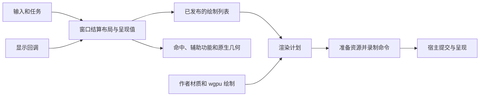

# Octara GPU 渲染架构

本文定义目标架构、实现边界和迁移顺序。当前实现与实测记录见[验收基线](#验收基线)。

**常用 UI 走可合批的直接绘制，作者的自定义材质与任意 wgpu pass 都能进入同一个窗口帧。** 一棵保留树管理布局和交互。窗口发布已结算的画面，绘制器编排批次、合成目标和纹理依赖，宿主持有窗口表面和呈现。作者可以替换普通组件的背景、描边和焦点环，也可以给一块视口接完整的 GPU 渲染器，或用画面的纹理定义自己的转场。

## 分层与所有权

| 层 | 拥有的状态与资源 |
| --- | --- |
| `octara-primitives` | 坐标、颜色、图元、裁剪及可交付的绘制数据。绘制记录表达位置、像素来源和作用范围，供不同绘制后端使用。 |
| `octara` | Signals、保留树、Taffy 布局、命中和辅助功能。窗口根据 App 时间结算呈现几何、绘制顺序和挂载身份，并发布对应的 `DisplayList`。 |
| `octara-render` | CPU 参考绘制和 wgpu 绘制。GPU 后端准备实例、图集、材质管线和纹理，将绘制列表编排为有顺序的命令。只读帧数据决定本次画什么。 |
| `octara-shell` 与平台适配器 | 显示回调、原生输入和原生视图。为窗口选择适配器，持有 `Surface` 的获取、重配、提交和呈现。绘制器和作者能力共享宿主选择的设备，资源按设备寿命管理。 |
| 应用与 Kit | 普通视图和组件的外观、状态与交互。作者可选用 wgpu 适配接口为组件提供绘制，Kit 通过相同的组合与样式机制提供默认实现。 |

依赖边界沿用现有方向。内核和基础包传递后端中立的绘制数据，绘制器消费这些数据。连接视图与设备的作者接口放在依赖两者的宿主侧，复用 `octara_render::wgpu` 的版本和宿主共享的设备。一个窗口移到不同显示器时，尺寸、缩放、可用区和像素格式由宿主报告。不同窗口可以共享设备资源，各自持有表面与呈现状态。[包边界](../ARCHITECTURE.md#从底层到应用) · [依赖检查](../../tools/check_layers.py) · [wgpu 再导出](../../crates/octara-render/src/lib.rs)

## 从 CPU 更新到 GPU 执行

窗口沿用现有的准备与提交协议。输入、任务和跨窗口反馈结清后，在实际 App 时间采样呈现值。发布时固定窗口身份、绘制修订、采样时刻、逻辑尺寸、比例和输入资源版本。绘制、命中和原生适配从同一次已结算的呈现几何取值。渲染阶段消费这份画面，后续事件可以独立推进窗口。需要保存旧画面时，保留其绘制数据或 GPU 输出及相应版本。[窗口准备](core.md) · [现有修订与提交](../../crates/octara/src/app/frame.rs#L121) · [应用时钟](../../crates/octara/src/app/time.rs)

`DisplayList` 保留绘制顺序和范围。相同节点的文字、图标或几何可保留局部绘制记录，帧只改变它们的位置、裁剪或者合成值。GPU 绘制器据此准备实例和资源，按需要生成帧内的渲染计划。计划记录 pass 的输入版本、写入目标、像素范围和其在绘制顺序中的位置。普通帧能合到一个直接写入窗口目标的 UI pass，附加 pass 由隔离层、纹理依赖和作者绘制产生。基于固定绘制顺序排定执行。跨帧效果选择已发布的历史纹理，GPU 队列保证生产命令先于读取命令执行。[绘制列表的数据](../../crates/octara-primitives/src/paint.rs#L280) · [当前 pass 边界](../../crates/octara-render/src/gpu.rs#L111)

准备阶段创建或复用管线，填写图集和实例数据。需要 compute、上传或复制的操作在合适的 pass 外录制。作者和默认绘制可以生成有顺序的命令缓冲，由宿主安排窗口帧的提交。一次绘制机会可以消费多个有依赖关系的命令缓冲，GPU 上的结果按队列顺序交给后续 pass。WebGPU 描述了内容、设备和队列的操作顺序。wgpu 跟踪资源用法并转到 Metal、Vulkan、DX12 等后端。[WebGPU 时间线](https://www.w3.org/TR/2026/CRD-webgpu-20261116/#timelines) · [wgpu 提交实现](https://github.com/gfx-rs/wgpu/blob/v30.0.2/wgpu-core/src/device/queue.rs#L1348-L1541)

`Queue::write_buffer` 的上传在下一次提交的绘制和计算命令前执行。多个 pass 依赖不同参数时，各自使用独立的缓冲区范围，或将按序的复制记录进 encoder。共享队列统一协调上传和提交，第三方渲染器使用该队列产生输出时也要明确提交顺序。这样多窗口可以共享图集和管线，同时保持各自的可见状态。中间纹理在 GPU 上直接传递。截图和反馈读取通过单独的捕获或异步回读操作安排。[wgpu 上传顺序](https://docs.rs/wgpu/30.0.2/wgpu/struct.Queue.html#method.write_buffer)

## 直接绘制的性能

常驻的矩形、图像、文字和材质使用同一绘制顺序。GPU 保留可复用的几何、实例布局、图集和管线。只有与当前绘制相关的资源参与准备。渲染器在布局裁剪和效果外扩范围内做可见性判断，先裁掉画面以外的绘制，再准备相应的 GPU 数据。

绘制器合并相容的实例。管线、纹理绑定、目标格式、混合、裁剪和前后顺序决定合批是否合法。同一材质的颜色、圆角和动画进度可以作为实例数据变化。重叠的透明内容按画家顺序合成，作者内联命令在所声明的位置中插入。运行时按设备、管线配置和着色器版本缓存管线，常用材质可在进入交互前准备。[Qt 的批处理与几何保留](https://doc.qt.io/qt-6/qtquick-visualcanvas-scenegraph-renderer.html#batching) · [Unity UI 材质的顶点参数](https://docs.unity.com/en-us/engine/6000.6/manual/whats-new/unity66) · [Impeller 的管线准备](https://docs.flutter.dev/perf/impeller)

| 变化 | 需要的工作 |
| --- | --- |
| 颜色、焦点或材质进度变化 | 更新对应绘制数据与 GPU 参数。依赖这些数据的效果重新录制或合成。 |
| 位置、透明度或滚动变化 | 保留有效的局部几何与绘制记录，更新呈现变换和裁剪。已缓存且有效的像素可以直接合成。 |
| 图片和作者输出换帧 | 使用新内容版本。固有尺寸、布局输入或裁剪范围变化时才重新准备对应阶段。 |
| 缩放、像素格式或设备变化 | 复核与目标相关的字形、纹理和管线。设备重建时重新初始化 GPU 资源，并接续已结算的画面。 |

绘制记录缓存、GPU 纹理池和像素缓存拥有各自的寿命。保留绘制记录可以减少 CPU 构建和上传。纹理池复用分配，像素缓存复用内容。合成静态像素时验证尺寸、比例、格式、内容和已经烘焙的裁剪版本。包含 GPU 回调的内容使用实际输入与输出版本判断复用条件。[Flutter 的重绘边界](https://api.flutter.dev/flutter/widgets/RepaintBoundary-class.html) · [Chromium 合成架构](https://developer.chrome.com/docs/chromium/renderingng-architecture) · [Rune 效果缓存回归](https://github.com/anomalyco/rune/blob/3686e94ae09545fd5f2a61e22aabfbeba1cd896f/crates/rune/tests/effect_slot.rs#L475-L510)

## 作者的 wgpu 绘制入口

背景、边框、轮廓、内容和子树效果沿用同一种组件绘制协议。作者指定绘制位置、局部范围和呈现参数，Octara 提供布局结果、裁剪和动作语义。绘制资源由现有节点挂载身份与其绘制位置关联，退出和重开可以同时持有不同版本。公开签名从普通组件和复杂画布的使用场景收敛。

| 作者需要 | 执行位置和获得的能力 |
| --- | --- |
| 背景、描边或焦点环的自定义材质 | 用 WGSL 定义像素，由常规绘制路径供应组件几何、混合、裁剪和各自参数。材质保持在其对应的绘制位置，相容的材质绘制进入同一批次。 |
| 在组件区域绘制 2D、3D 或运行 compute | 初始化使用框架提供的 `wgpu::Device`，作者可创建着色器、管线、顶点缓冲、存储纹理、深度与 MSAA 目标。帧回调借用 encoder 和输出目标，可录制多 pass，并将已解析的颜色结果交给框架合成。 |
| 使用已能画到纹理的第三方渲染器 | 在同一设备上交付带尺寸、颜色、alpha 约定、版本和队列顺序的 GPU 纹理。宿主协调写入提交与采样时序。一次已发布的结果在所有读取完成前保持可用。 |
| 在已有 UI pass 中插入自定义绘制 | 对适合当前附件和裁剪状态的高级绘制，可在指定位置借用 `RenderPass`。所需上传、compute 或其他 pass 在准备阶段记录。独立画布支持作者自有的附件和深度语义。 |

作者代码的资源工厂跟随设备，帧回调消费窗口已结算的数据。应用在共享设备创建前声明所需的 `Features` 和 `Limits`，宿主核对适配器能力，向作者提供实际启用的设备能力。作者可为 CPU 参考绘制、GPU 特性不足或设备恢复提供现有视图或绘制回退。着色器和资源验证按绘制位置报告，绘制失败时可选择该位置的回退内容。捕获记录实际像素来源。[wgpu 设备描述](https://docs.rs/wgpu/latest/wgpu/type.DeviceDescriptor.html) · [egui 自定义录制](https://docs.rs/egui-wgpu/latest/egui_wgpu/trait.CallbackTrait.html#command-submission) · [Vello 纹理入口](https://docs.rs/vello/latest/vello/struct.Renderer.html#method.render_to_texture)

独立目标的结果在合成时接受裁剪和组透明度。内联回调使用当前 pass 的目标、viewport、scissor 和裁剪数据，框架在回调之后恢复继续绘制所需的状态。需要额外遮罩或隔离的效果用局部目标合成。外伸光晕用绘制范围声明，需要改变命中形状或呈现位置时由视图树提供对应几何。[Qt 内联裁剪和状态](https://doc.qt.io/qt-6/qsgrendernode.html#render) · [Rune 内联裁剪](https://github.com/anomalyco/rune/blob/3686e94ae09545fd5f2a61e22aabfbeba1cd896f/crates/rune/src/render.rs#L884-L914)

### 组件材质与自定义效果

效果可以采样自己的子树、同一合成组中先前画好的内容，或者转场的新旧画面。申请时说明读取来源、顺序、区域和采样外延，输出按声明的绘制范围交还给窗口。宿主根据依赖准备纹理。羽化、卷页、折射等效果可以串联作者自己的 render、compute 和 copy 命令。

Rune 的 `effect` 提供了绘制位置、比例、裁剪和参数。普通回调借用已打开的 render pass。背景采样会结束 pass、复制已绘制内容并重开，作者在两次 pass 中间可以处理纹理。Octara 采用同样明确的执行时机，把挂载身份、裁剪和像素范围带进帧计划。Unity 的常规 UI 绘制也允许自定义着色器，背景滤镜则使用额外的合成路径。Unreal RDG 的资源读写和生命周期提供帧内编排参考。[Rune effect 源码](https://github.com/anomalyco/rune/blob/dev/crates/rune/src/el/effect.rs) · [Rune 背景阶段](https://github.com/anomalyco/rune/blob/3686e94ae09545fd5f2a61e22aabfbeba1cd896f/crates/rune/src/render/pass.rs#L99-L144) · [Unity UI pass 源码](https://github.com/Unity-Technologies/Graphics/blob/master/Packages/com.unity.render-pipelines.universal/Runtime/Passes/DrawScreenSpaceUIPass.cs) · [Unreal RDG](https://dev.epicgames.com/documentation/unreal-engine/render-dependency-graph-in-unreal-engine)

## 离屏纹理与合成

直接绘制时最终 pass 使用窗口表面。需要隔离组透明度或采样子树像素时，纹理尺寸按设备像素和实际绘制范围计算，包含抗锯齿、阴影及滤镜所需的外延。嵌套组的结果按原位置合成。颜色、目标格式和预乘 alpha 约定随目标提供，作者可以在自有 pass 内使用支持的格式，在交付边界转换到合成格式。已有 GPU 实现按有界尺寸复用纹理。[当前组透明度](../../crates/octara/src/kernel/paint.rs#L259) · [当前 pass 边界](../../crates/octara-render/src/gpu.rs#L123) · [Metal 附件读写成本](https://developer.apple.com/documentation/metal/setting-load-and-store-actions/)

背景采样读取所在合成组截至当前绘制位置的像素，分配时区分写入区域和采样范围。宿主为需要读取的目标安排可采样或可复制的纹理，并按设备能力选择表面路径。当前窗口纹理以渲染附件用途创建。原生视图的独立表面、系统层和候选窗由平台适配器持有，它们的像素只有在宿主明确提供同版本输入时才参加相关效果。[当前 Surface 配置](../../crates/octara-shell/src/platform.rs#L154) · [原生视图](native-island.md) · [WebGPU 资源用法](https://www.w3.org/TR/webgpu/#synchronization)

进退场从上一已发布画面的版本获得起始内容。保留版绘制可以按原坐标重放，作者 GPU 内容可保留最后一次有效输出。新分支在自己的挂载身份下绘制。作者获得可用的新旧纹理和窗口采样的过渡进度，决定如何合成。输入、焦点和辅助功能按当前生效的结构结算，旧画面与在途命令引用的资源按帧结束和 GPU 完成释放。[内核动画](../../crates/octara/src/kernel/anim.rs) · [Rune 退场回归](https://github.com/anomalyco/rune/blob/3686e94ae09545fd5f2a61e22aabfbeba1cd896f/crates/rune/tests/effect_data.rs#L126-L161) · [Web View Transitions](https://www.w3.org/TR/css-view-transitions-1/#rendering-model)

每次窗口重绘按当前输出目标计算正确的完整画面。划区更新若能减少实际 GPU 成本，可以使用具有已知内容版本的保留目标，连同透明混合与滤镜读取范围一起验证。纹理池按尺寸、格式和用法管理，区域失效或内存压力时可回收未使用的分配与缓存。

## 真实窗口的等待与帧率

App 的单调时钟用于任务、输入和动画。每个窗口由所在屏幕提供呈现机会。窗口有两种出帧需求。一次性的画面变更要求提交最新内容，持续的动画、滚动惯性或 GPU 画布要求跟随显示回调。一次呈现可以消化多次已结算的更新。共享 Signal 可以更新多个窗口，各窗口在自己的呈现机会消费准备好的版本。可见内容静止时停掉持续回调，任务和资源到期仍由相应的截止时间处理。缺少显示回调的宿主使用定时路径，无窗口测试可以明确推进采样时间。[现有期限](../../crates/octara/src/app/time.rs#L262) · [窗口帧时钟](../../crates/octara-shell/src/platform.rs#L438) · [ProMotion](https://developer.apple.com/documentation/quartzcore/optimizing-iphone-and-ipad-apps-to-support-promotion-displays)

每个表面的获取、重配、提交与呈现由一个执行者协调。第一阶段在宿主线程录制并提交。若实窗迹线显示 drawable 等待或命令录制拖延输入，则把相应工作移到宿主的工作线程，并交接固定的帧数据或已录制命令。交接有界，等待呈现的过期画面可由新画面取代，资源更新与退休继续有序处理。原生事务和视图位置由平台适配器按对应的帧同步。当前 `DisplayList` 复用局部 `Rc` 绘制段，跨线程使用可传递的帧数据或命令。[当前帧数据](../../crates/octara-primitives/src/paint.rs#L280) · [Metal 获取纹理](https://github.com/gfx-rs/wgpu/blob/v30.0.2/wgpu-hal/src/metal/surface.rs#L348-L380) · [Exact drawable 工作线程](https://github.com/expo/exact/blob/08c889a9de21a30b7c3b308422fc588cf1a480d3/gpu/src/acquire.rs) · [Rune overlay 提交](https://github.com/anomalyco/rune/blob/3686e94ae09545fd5f2a61e22aabfbeba1cd896f/crates/rune/src/overlay/frame.rs#L100-L140)

窗口尺寸、比例或表面发生变化时，宿主只提交匹配当前目标的帧。`Occluded` 等待再次可见，`Timeout` 让出本次机会，`Outdated` 重配，`Lost` 重新创建表面。设备丢失时重建设备及依赖资源，并用当前已结算帧恢复绘制。关闭时先结束该窗口的出帧需求，交还在用表面，回收剩余资源。跨设备或已过期的作者结果随原版本退休。[wgpu 状态契约](https://github.com/gfx-rs/wgpu/blob/v30.0.2/wgpu/src/api/surface_texture.rs#L44-L79) · [当前窗口处理](../../crates/octara-shell/src/platform.rs#L493)

## 帧证据与 Agent 反馈

观察接口分别报告应用布局和命中的准备版本、GPU 队列的提交、GPU 完成以及实际呈现。只有平台提供可对照的时间戳或像素时才报告实屏证据。捕获以一次已结算的画面为依据。绘制捕获可复用相符的 GPU 输出，或重录可重放的固定数据。显示捕获核对目标窗口、尺寸和提交版本。作者纹理、原生快照与备用内容报告各自的像素来源。[现有回执](agent-knowledge.md#inspector-protocol-and-checks) · [捕获协议](capture.md#捕获对应的帧)

每个实窗用例记录 UI 更新、绘制编排、录制、drawable 等待、GPU 耗时和实屏间隔。要定位重渲染，额外记录相关材质与绘制批次、离屏纹理尺寸、发生的背景复制和复用范围。在设备支持时，以 `wgpu::Features::TIMESTAMP_QUERY` 和异步读回观察 GPU pass。120 Hz 代表约 8.33 ms 的呈现机会，验收用可见窗口的 `presentedTime` 或对应平台的呈现回执，报告稳定段的帧间隔和漏刷情况。[当前 CPU trace](../../crates/octara-shell/src/trace.rs) · [wgpu GPU 时间戳](https://docs.rs/wgpu/30.0.2/wgpu/struct.Features.html#associatedconstant.TIMESTAMP_QUERY) · [Metal 上屏时间](https://developer.apple.com/documentation/metal/mtldrawable/presentedtime)

## 验收基线

当前 wgpu 基线为 `30.0.2`，官方提交 `2b38d994b38dd001157d31fd3321111103a8dd80`。本地参考源码在 `~/code/archive/reference/wgpu`，工作区锁定的 wgpu 后端组件和 Naga 同为该版本。[官方发布](https://github.com/gfx-rs/wgpu/releases/tag/v30.0.2) · [Cargo.lock](../../Cargo.lock)

- 组透明度已按绘制边界分配纹理。在 `1600×1200` 的嵌套层回归中，两块中间目标各分配 `64×64`。RGBA8 裸像素容量约为每块 16 KiB，之前窗口尺寸的单块容量约为 7.3 MiB。[有界层回归](../../crates/octara-render/src/gpu.rs)
- Metal 下通过 22 项渲染测试。CPU 和 GPU 像素对照覆盖 1×、2×、阴影、圆角裁剪、分数坐标和嵌套透明组，最大预乘通道偏差为两个级别。关闭 GPU feature 后的 12 项 CPU 测试通过。macOS 实窗用 Inspector 核对了浮层、缩放和 GPU 截图。[像素回归](../../crates/octara-render/tests/integration/gpu.rs) · [实窗验证](../../examples/live_primitives.py)
- 实际 Metal 探针在同一次提交中，由 compute 写入 `16×8` 纹理，再将它采样合成到 `32×24` 的目标。最终读回的内侧像素为 `[128, 64, 127, 255]`，外侧为 `[0, 0, 255, 255]`。应用内的作者接口将在迁移中验证。[官方纹理绘制例程](https://github.com/gfx-rs/wgpu/tree/v30.0.2/examples/features/src/render_to_texture)

### 120 Hz 离屏基线

2026-11-20 枚举到 `1920×1080 @ 120 Hz` 显示模式，测试开始时桌面为 `2560×1440 @ 60 Hz`。锁屏期间窗口测试取得零条显示时间戳，该次测量的实屏验收待完成。验收以 Metal drawable 的 `presentedTime` 为准。[Metal 呈现时间](https://developer.apple.com/documentation/metal/mtldrawable/presentedtime)

离屏测试复用工作区 dev 构建和真实 Metal 设备。以 120 Hz 显式推进 App 时钟，在 `800×600` 逻辑窗口运行本地「编辑设置」淡出原型和 10 万条消息的虚拟列表滚动。每组运行 720 帧，预热 120 帧，淡出只统计活动区间。GPU 列用每帧首个命令缓冲的 `GPUStartTime` 到末个的 `GPUEndTime`，完成列从预定帧起点算到观察到队列完成。复测在帧开始前校准唤醒时间，保留对 8.33 ms 处理预算的比较。[交互示例](../../examples/src/showcase/interaction.rs) · [虚拟列表](../../examples/src/apps.rs#L329) · [Metal GPU 计时](https://developer.apple.com/documentation/xcode/understanding-metal-performance-hud-metrics)

| 场景 | 设备像素 | CPU 更新与提交 P95 | GPU 区间 P95 | 完成 P95 | 8.33 ms 内完成 |
| --- | --- | --- | --- | --- | --- |
| 浮层淡出 | 800×600 | 0.96 ms | 1.26 ms | 3.32 ms | 219/219 |
| 虚拟列表滚动 | 800×600 | 1.51 ms | 0.20 ms | 2.57 ms | 600/600 |
| 浮层淡出 | 1600×1200 | 0.89 ms | 4.40 ms | 6.40 ms | 219/219 |
| 虚拟列表滚动 | 1600×1200 | 1.54 ms | 0.30 ms | 2.84 ms | 600/600 |
| 同一 Dialog 静止关闭工具面板并连续绘制 | 1600×1200 | 0.96 ms | 4.15 ms | 6.14 ms | 600/600 |
| 同一 Dialog 的工具面板完全打开并连续绘制 | 1600×1200 | 1.29 ms | 4.35 ms | 6.61 ms | 600/600 |

整个 Dialog 在静止时已有约 4.15 ms 的 GPU 区间。同一场景对照要继续用 pass 级计时定位高像素密度下的绘制成本。测试时淡出新建后，内核请求 16.667 ms 的下一次唤醒。离屏数据给出了处理预算，实屏验收还需要核对时钟、drawable 等待和实际呈现。[窗口帧时钟](../../crates/octara-shell/src/pace_mac.rs)

### 首轮迁移

- 窗口分别报告单次重绘和连续出帧需求，独立的任务和输入期限仍由 App 调度。macOS 优先使用窗口的显示回调，其余宿主使用显示器刷新率作为定时回退。窗口静止或不可见时暂停出帧。宿主按需取得已结算绘制的窗口、版本、采样时间、比例和绘制列表。[窗口发布](../../crates/octara/src/app/frame.rs) · [宿主调度](../../crates/octara-shell/src/platform.rs)
- 窗口持有录制后的命令并决定何时提交。绘制捕获在同一次提交中完成绘制和读回复制。显示捕获与 Inspector 同时核对绘制版本和表面代次。表面重配会使旧提交失效，原生视图位置随成功取得的 drawable 一起应用。[命令录制](../../crates/octara-render/src/gpu.rs) · [窗口提交](../../crates/octara-shell/src/platform.rs) · [捕获](../../crates/octara-shell/src/capture.rs)
- 无窗口测试以 60 Hz 和 120 Hz 推进动效及滚动，核对末帧发布、静止和关闭后的出帧需求。真实 Metal 回归通过 24 项，覆盖丢弃待提交指令、同次提交中的前后命令和设备失效后的捕获错误。CPU-only 回归通过 12 项。iOS 模拟器目标通过编译检查。[窗口回归](../../crates/octara/tests/integration/windows.rs) · [GPU 回归](../../crates/octara-render/tests/integration/gpu.rs)
- macOS 窗口验收通过多窗口缩放、关闭重开和 WKWebView 快照。锁屏期间的显示捕获回退到 GPU 绘制，`390×640` 逻辑像素在 2× 下得到 `780×1280` 的截图。后续需要实测可见窗口的 120 Hz 呈现间隔，并实现设备级资源重建。[窗口交互用例](../../examples/live_primitives.py) · [多窗口与原生快照](../../examples/live_inspect.py)

### 节点材质与作者画布

`El::paint(program, params)` 用同一个挂载节点的盒子承载 GPU 绘制。四个浮点参数支持普通属性绑定，更新时只使绘制失效。常规样式提供矩形、圆角和回退画法，节点保留布局、命中与辅助功能。内核只持有后端可识别的绘制数据，`octara-render` 提供 wgpu 程序。当前这一位置覆盖整个盒子，程序可以在盒子内定义自己的描边。[节点绑定](../../crates/octara/src/view/element.rs) · [绘制数据](../../crates/octara-primitives/src/paint.rs)

- `gpu::material` 接收返回 straight-alpha 颜色的 WGSL 函数。同一材质的相邻相容实例共享绘制批次，实例参数各自取样，绘制顺序跨材质、文字和其他节点保持一致。
- `gpu::canvas` 为作者提供共享设备、区域纹理与帧参数。作者可以在独立 encoder 中录制多条 compute、render 和 copy 命令。有效命令与 UI 同批提交，画布输出以预乘 alpha 在节点原位合成。画布在缩放后按设备像素取样，父级裁剪与组透明度继续作用。准备或录制验证失败时使用原位置的样式回退。作者持有的资源在提交时须保持有效，缓冲区须解除映射。

`window gpu_lab` 在同一个窗口里绘制共享材质色板、运行 compute 与合成 pass 的流场、普通工具栏与弹层。macOS 上通过 Inspector 核对了选择、焦点、滚动和原生缩放。2× Metal 绘制截图验证了色板 shader 输出、切换预设后的画布中心像素，以及缩放后弹层覆盖画布的像素。选中 Prism 时为 `2000×1400`，改选 Ember 后缩放至 `800×620` 逻辑像素，弹层截图为 `1600×1240`。该次采样在锁屏期间完成。[示例](../../examples/src/gpu_lab.rs) · [实窗回归](../../examples/live_inspect.py)

Metal 的 28 项渲染测试通过。材质测试断言参数不同的相邻实例合批，画布测试在 1× 和 2× 核对绘制顺序、裁剪及组透明度。准备与录制的错误写入渲染日志，测试分别验证错误的 WGSL 和错误的画布命令保留原位置的回退像素。CPU-only 的 13 项测试和关闭窗口后的绘制缓存释放回归通过。[GPU 测试](../../crates/octara-render/src/gpu.rs) · [帧缓存测试](../../crates/octara/tests/integration/display_list.rs)

## 迁移顺序与完成标准

| 步骤 | 对现有实现的改动 | 验收证据 |
| --- | --- | --- |
| 1. 窗口帧请求与发布 | 用随屏幕推进的窗口帧需求接管活动动效，保留宿主定时回退。把已准备画面的版本与绘制数据一起交付到宿主。 | 无窗口先用 60 Hz 和 120 Hz 时间序列核对持续请求、静止停止和版本更新。实窗核对滚动、动效的实际帧节奏及缩放后的设备像素尺寸。 |
| 2. 渲染计划、录制和提交 | 拆开 `GpuRenderer::draw` 的资源准备、命令录制和内部提交。宿主集中提交窗口帧，实窗与绘制捕获用同一份已发布画面构建计划。按 wgpu 的状态恢复表面。 | CPU 和 Metal 像素基线通过。帧版本、圆角裁剪、嵌套透明组、宿主缩放、表面失效和迟到捕获得到复核。 |
| 3. 节点材质与作者画布 | 用已有绘制位置承载材质和作者 GPU pass。先跑标准几何上的自定义材质，以及独立目标的原始 wgpu 绘制。根据两种用法收敛公开接口。 | 滚动一列共享材质、参数各异的按钮，检查合批、布局和焦点。复杂视口可做多 pass、深度及 compute，和常规工具栏、弹层一起裁剪、缩放与截图。 |
| 4. 背景采样与转场 | 接入显式的前序像素或新旧画面依赖，保留退出需要的资源，并按区域合成。 | 自定义 Dialog 转场覆盖嵌套裁剪、组透明度、局部背景采样和关闭途中重开。旧操作目标即时退休，画面和资源按原版本收尾。 |
| 5. 用迹线决定加速范围 | 给准备、提交、GPU 与实屏接入各自的计时。按实际消耗推进静态像素复用、pass 优化和工作线程交接。 | 在可见窗口对照相同分辨率、比例和用例，报告批次、临时纹理面积、CPU 和 GPU 尾延迟，以及高刷时的真实呈现间隔。 |

先完成窗口帧驱动与统一提交，再用共享材质列表和多 pass 视口检验接口。渲染表面、着色器、Atlas 和资源池的修改都通过同一组帧与截图证据复核。[迁移入口](../TODO.md) · [GPU 绘制代码](../../crates/octara-render/src/gpu.rs#L625)
