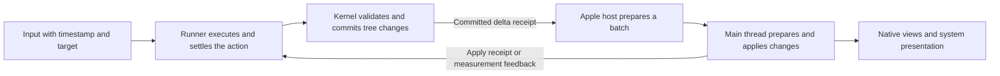

# Exact Architecture and Runtime Timing

This study focuses on the runtime, window settlement, and presentation timing. The companion overview covers the compiler, platforms, builds, updates, and Agent. [Exact architecture overview](exact-full-architecture.md)

This study uses Exact's `main` commit `2c2673b` as of November 22, 2026. It traces updates through the authoring API, Runner, layout kernel, and host against upstream regressions. Source was checked against a local checkout at `50b6af94b` and the upstream single-commit diff, which covers Windows selection contrast. [Exact revision](https://github.com/expo/exact/commit/2c2673b97fabce377a213a4db273894c8ce86348) · [Upstream diff](https://github.com/expo/exact/compare/50b6af94b519d50a9f7105f07606b4d96277c5c9...2c2673b97fabce377a213a4db273894c8ce86348)

**Define completion for app settlement, tree changes, host apply, and actual visibility.** Exact's compiler constrains app code, and its native host sees which objects each operation touches. Explicit permissions and read/write sets establish what must stay ordered and what can resume later. Octara can establish similar boundaries with Rust, Signals, and its retained tree, starting by untangling user callbacks and pure window projection in window preparation.

## How a Change Moves Through the Layers

The compiler turns views, state, actions, and external data contracts from `.contract` into a `Plan`. The native Runner executes the Plan and owns instance state, keys, and a clock it can advance. Kernel owns nodes and layout, uses Taffy, and integrates host text measurement. Apple applies batches through AppKit or UIKit. Android combines HWUI with native controls, and Linux and Windows use a shared renderer. The Web generates JS modules from the Plan and uses the browser for DOM, layout, and paint. TypeScript and Rust data sources use typed interfaces and access external capabilities through grants. [Exact layers and platform implementations](https://github.com/expo/exact/blob/2c2673b97fabce377a213a4db273894c8ce86348/README.md#L395-L419)

The same boundaries shape startup. Constants go into the Plan so the app can generate the first UI immediately. The Apple host starts the relevant data sources and platform capabilities after the first draw callback. For Octara, identify what the first frame requires and what can follow, especially the readiness conditions for custom GPU content, external requests, and native resources. [First-frame budget and design](https://github.com/expo/exact/blob/2c2673b97fabce377a213a4db273894c8ce86348/README.md#L80-L95) · [Apple startup handoff](https://github.com/expo/exact/blob/2c2673b97fabce377a213a4db273894c8ce86348/host/apple/Sources/ExactKit/SessionActivation.swift#L20-L83)

1. **Actions have explicit read and write rules.** An action reads the state at its start and applies writes together. If `count` starts at 0 and an action does `count = count + 1` before copying `count` into another state slot, the results are `1/0`. Compute a local value first to use the new value twice. Actions exclude loops and `await`, and `derive` dependencies must be acyclic. Runner checkpoints actions so specific recoverable errors can restore state slots and pending commands. A `then` block has its own commit boundary. These guarantees rely on the runner's control over writes. [Action rules](https://github.com/expo/exact/blob/2c2673b97fabce377a213a4db273894c8ce86348/docs/contract-for-humans.md#L278-L323) · [Checkpoints and failure handling](https://github.com/expo/exact/blob/2c2673b97fabce377a213a4db273894c8ce86348/runner/src/runner/commit.rs#L74-L163) · [Actions and follow-up commits](https://github.com/expo/exact/blob/2c2673b97fabce377a213a4db273894c8ce86348/runner/src/runner/commit.rs#L296-L325)
2. **The tree has its own commit receipt.** Kernel validates the entire structural batch against a staged view before changing the tree. Its receipt reports the current epoch, created, removed, and changed nodes, and layout invalidation. The Apple host builds or updates the native view mirror and orders children after their structure is in place. Some semantics updates leave nodes untouched and can skip a full layout and paint-order traversal. Native text and control measurement use estimates and bounded retries, with pending layout recorded explicitly. [Kernel batches and receipts](https://github.com/expo/exact/blob/2c2673b97fabce377a213a4db273894c8ce86348/kernel/src/txn.rs#L1-L87) · [Apple structural projection](https://github.com/expo/exact/blob/2c2673b97fabce377a213a4db273894c8ce86348/host/apple/src/commit.rs#L51-L134) · [Layout invalidation and no-op paths](https://github.com/expo/exact/blob/2c2673b97fabce377a213a4db273894c8ce86348/host/apple/src/commit.rs#L189-L224) · [Native measurement](https://github.com/expo/exact/blob/2c2673b97fabce377a213a4db273894c8ce86348/host/apple/src/layout.rs#L205-L274)
3. **Host apply has its own ordering.** The Apple main thread applies platform batches in a Core Animation transaction, then processes selected native feedback from the batch in order. When a batch adds many nodes, the system can retain the previous visible tree while Runner already holds new state. The transaction defines when native view changes take effect. Actual display timing requires separate evidence. [Apple apply transaction](https://github.com/expo/exact/blob/2c2673b97fabce377a213a4db273894c8ce86348/host/apple/Sources/ExactKit/Session.swift#L1153-L1189) · [Staged preparation and publication](https://github.com/expo/exact/blob/2c2673b97fabce377a213a4db273894c8ce86348/host/apple/Sources/ExactKit/StagedApply.swift#L11-L33)

## Authoring API, Component Identity, and External Data

Contract gives authors CSS-style nodes, layout, styles, and semantics. Ordinary components combine props, constrained state, actions, and subtrees. The compiler knows which fields can be written, which work may wait, and which source line produced a render node. Runner compares the state slots, derived values, and data readiness or error states read by expressions with their last settled values. It reuses unchanged results and reevaluates opaque dependencies. These language restrictions make the program analyzable enough to run the same Plan on multiple backends. [Component contract](https://github.com/expo/exact/blob/2c2673b97fabce377a213a4db273894c8ce86348/docs/contract-for-humans.md#L278-L323) · [Runner dependency comparison](https://github.com/expo/exact/blob/2c2673b97fabce377a213a4db273894c8ce86348/runner/src/runner/settlement.rs#L133-L198)

**Asynchronous behavior is part of the execution protocol.** A search field updates `query`, which can trigger another request for a `resource` parameterized by that value. A save goes to the data source via a `mutation`. A resource can retain its previous value while exposing error and pending states separately. Request identities prevent old answers from overwriting newer requests. Operations that must persist one at a time in order can use `queue`, while independent writes can use `parallel`. These rules establish which request owns a result. Writes already started by an external source have their own commit points. Fieldnotes adds a session version to the open note to keep replies for another document out of the current draft. [Search and save example](https://github.com/expo/exact/blob/2c2673b97fabce377a213a4db273894c8ce86348/docs/contract-for-humans.md#L580-L621) · [Request ordering and failure](https://github.com/expo/exact/blob/2c2673b97fabce377a213a4db273894c8ce86348/docs/contract-for-humans.md#L647-L704) · [Fieldnotes document sessions](https://github.com/expo/exact/blob/2c2673b97fabce377a213a4db273894c8ce86348/apps/fieldnotes/app.contract#L101-L126)

**Identity and layout are separate data.** Authors give dynamic rows business keys. Virtual lists require enumerable direct children in normal flow and a definite viewport size so they can prepare a range and keep scrolling stable. Kernel receipts reference nodes by generational key. Rebinding the same node address to a different mount can emit an explicit renew marker. The layout tree can export versioned node rows for the Agent and host to query geometry. Lookup names, mount identity, semantics, and layout measurements serve distinct purposes. [Virtual list structure](https://github.com/expo/exact/blob/2c2673b97fabce377a213a4db273894c8ce86348/docs/contract-for-humans.md#L443-L479) · [Changes and rebinding receipts](https://github.com/expo/exact/blob/2c2673b97fabce377a213a4db273894c8ce86348/kernel/src/txn.rs#L55-L92) · [Kernel exports](https://github.com/expo/exact/blob/2c2673b97fabce377a213a4db273894c8ce86348/kernel/src/kernel.rs#L903-L927)

**Native controls participate in layout and observation.** Apple text controls own the edit session and system IME. Exact's `input` reports composition changes with `isComposing`, and `change` corresponds to the end of editing. App values set during composition are held until it ends so per-keystroke formatting leaves Pinyin composition intact. Apps can use a native module with layout identity or access actual platform objects when they need deeper integration. For Octara, define which values the system and app own within a session and let the IME and candidate window query the same selection and anchor. Each editor contract defines when to report marked text to the app. [Composition and app values](https://github.com/expo/exact/blob/2c2673b97fabce377a213a4db273894c8ce86348/host/apple/Sources/ExactKit/FieldComposition.swift#L1-L28) · [Native extension APIs](https://github.com/expo/exact/blob/2c2673b97fabce377a213a4db273894c8ce86348/README.md#L97-L108)

## How the Apple Host Keeps Input Responsive

**Preparation can span frames with a single apply handoff.** Large batches prebuild only eligible plain box and text subtrees. Nodes under preparation take no part in hit testing, reads, or visibility. Native controls are applied at the end. The live path resumes at display opportunities and adjusts to actual preparation and draw costs. A batch records its `viewsEpoch` and cancels stale preparation when the session's view epoch changes. Native feedback such as press highlighting can still use the applied tree, with targets removed by the pending batch rejected. [Preparation scope](https://github.com/expo/exact/blob/2c2673b97fabce377a213a4db273894c8ce86348/host/apple/Sources/ExactKit/StagedApply.swift#L11-L33) · [Resumption and epochs](https://github.com/expo/exact/blob/2c2673b97fabce377a213a4db273894c8ce86348/host/apple/Sources/ExactKit/StagedApply.swift#L307-L352) · [Input entry point](https://github.com/expo/exact/blob/2c2673b97fabce377a213a4db273894c8ce86348/host/apple/Sources/ExactKit/StagedApply.swift#L557-L573)

**Batches can apply out of order when their operations commute.** While a large list is being prepared, a later batch can update existing nodes if it avoids the pending batch's structural changes, property updates, and native control reads and writes. Structural operations and commands that may depend on earlier objects remain ordered. An updated value can replace an animation sample for the same property. If a complete new style also contains fields from a pending batch, those fields must be withheld. The host bases these decisions on the generated platform operations and their scope. [Batch conflicts and style protection](https://github.com/expo/exact/blob/2c2673b97fabce377a213a4db273894c8ce86348/host/apple/Sources/ExactKit/StagedApply.swift#L219-L265) · [Operation scope](https://github.com/expo/exact/blob/2c2673b97fabce377a213a4db273894c8ce86348/host/apple/Sources/ExactKit/StagedApply.swift#L595-L640)

**Thread ownership still allows synchronous waits.** On Apple, a single process-wide `exact.owner` owns all Rust runtimes. Some work returns asynchronously to a session's publication queue. Synchronous calls still block the main thread awaiting a result. The wait loop services an agreed callback channel. After a callback returns to the main thread through that channel, reentering the runtime is rejected or triggers a contract failure. The source also records that synchronous runtime requests can queue behind data sources moved after the first frame. [Owner waits and reentrancy](https://github.com/expo/exact/blob/2c2673b97fabce377a213a4db273894c8ce86348/host/apple/Sources/ExactCore/Owner.swift#L100-L151) · [Post-first-frame activation](https://github.com/expo/exact/blob/2c2673b97fabce377a213a4db273894c8ce86348/host/apple/Sources/ExactKit/SessionActivation.swift#L90-L133)

**Session boundaries let windows do local work independently.** Each macOS document window holds its own session. External replies are checked against the session lifecycle and generation on return. Shared store writes and topic notifications propagate explicitly across windows, and certain Widget refreshes wait for every target session to finish. The example shows how to make shared ordering a visible protocol. Octara windows can share Signals directly, so Octara must define its own app dependency boundaries. [Window sessions](https://github.com/expo/exact/blob/2c2673b97fabce377a213a4db273894c8ce86348/host/apple/Sources/ExactMac/main.swift#L248-L286) · [Session generation checks](https://github.com/expo/exact/blob/2c2673b97fabce377a213a4db273894c8ce86348/host/apple/Sources/ExactCore/RuntimeCompletion.swift#L16-L64) · [Cross-session propagation](https://github.com/expo/exact/blob/2c2673b97fabce377a213a4db273894c8ce86348/host/apple/Sources/ExactKit/SessionStore.swift#L73-L118)

Ink uses the same principle for rendering. A newer frame supersedes an earlier queued frame's eligibility for presentation. Ordered resource work and retirement receipts continue. GPU acquisition state limits in-flight requests per acquisition object. Compare this boundary with Octara's per-window presentation and device submission protocols. [Ink submission and presentation](https://github.com/expo/exact/blob/2c2673b97fabce377a213a4db273894c8ce86348/host/ink/src/present.rs#L59-L94) · [GPU target acquisition](https://github.com/expo/exact/blob/2c2673b97fabce377a213a4db273894c8ce86348/gpu/src/acquire.rs#L187-L238) · [Octara rendering architecture](../design/v2/04-native-pipeline-render-host.md)

The Wayland caret is a smaller example. The editor provides current caret geometry, and the host uses desktop settings and last activity to determine opacity. During a fade it requests another frame. During steady bright or dark intervals it schedules only the next wakeup. After timeout, the caret stops waking the host. A general host interface can request a wakeup at a specific time or request another frame, leaving caret behavior to the platform. The Windows selection change also passes platform contrast colors to both custom-painted text and RichEdit to keep selection legible. [Caret scheduling and tests](https://github.com/expo/exact/blob/2c2673b97fabce377a213a4db273894c8ce86348/host/linux/src/window/caret.rs#L25-L118) · [Event loop](https://github.com/expo/exact/blob/2c2673b97fabce377a213a4db273894c8ce86348/host/linux/src/window.rs#L171-L209) · [Windows selection change](https://github.com/expo/exact/commit/2c2673b97fabce377a213a4db273894c8ce86348)

## Animation, Standard Hosts, and GPU Canvases

**Styles declare targets, and presentation samples them on its own clock.** A common representation carries ordinary CSS declarations to different executors. Browsers run CSS animations, and native hosts evaluate Rust timing functions at absolute times. Apple frame callbacks sample the target display time. Ordinary timed tasks advance through their clock entry points. Motion ticks and refill work needed for the current frame have their own in-flight checks. The last presented animation time also sets a lower bound for late app receipts. This makes timing across target updates, local animation, and asynchronous work traceable. [Motion representation and clocks](https://github.com/expo/exact/blob/2c2673b97fabce377a213a4db273894c8ce86348/motion/src/lib.rs#L1-L38) · [Frame callback](https://github.com/expo/exact/blob/2c2673b97fabce377a213a4db273894c8ce86348/host/apple/Sources/ExactKit/Frames.swift#L50-L111) · [Commit and motion timing](https://github.com/expo/exact/blob/2c2673b97fabce377a213a4db273894c8ce86348/host/apple/src/commit.rs#L150-L191)

**GPU canvases are loaded on demand.** Apple presents ordinary UI with platform views and Core Animation. A wgpu canvas has its own size, timing, frame cadence, and input lifecycle. An Apple canvas can retry when a drawable is released, preserving needed work while the host continues to handle other opportunities. This gives custom drawing a host-controlled surface. Octara wants authors to insert wgpu work into arbitrary component backgrounds, edges, and transitions. Rune's paint-order slots map more directly to that need. [Canvas context](https://github.com/expo/exact/blob/2c2673b97fabce377a213a4db273894c8ce86348/gpu/src/lib.rs#L78-L111) · [Target acquisition and wakeup](https://github.com/expo/exact/blob/2c2673b97fabce377a213a4db273894c8ce86348/gpu/src/acquire.rs#L185-L238) · [Canvas wait tracking](https://github.com/expo/exact/blob/2c2673b97fabce377a213a4db273894c8ce86348/host/apple/Sources/ExactKit/Frames.swift#L112-L146) · [Rune's paint extensions](rune-architecture.md#gpu-extensions)

## Failures and Verification

| Exact failure or verification limit | Check for Octara |
| --- | --- |
| Input once overtook a due change task that was waiting for a host apply receipt. Timestamped dispatch now preserves the input and its arrival time, advances work due first, and holds the input for resumption when the host must apply a batch. The current semantic test sequences two change actions, one click or text input, and a third action triggered by that input. [Issue record](https://github.com/expo/exact/blob/2c2673b97fabce377a213a4db273894c8ce86348/issues/closed/20261112-review-input-overtakes-change-task-yield.md#L3-L20) · [Ordering implementation](https://github.com/expo/exact/blob/2c2673b97fabce377a213a4db273894c8ce86348/runner/src/runner/advance/inputs.rs#L82-L139) · [Timing test](https://github.com/expo/exact/blob/2c2673b97fabce377a213a4db273894c8ce86348/semantics/corpus/timers/input-order.contract#L13-L40) | Deliver input after feedback starts and before it settles. Check the target, execution count, and order relative to visible geometry. Cover mount replacement and close/reopen so late events cannot reach a new instance with the same name. Use Octara's own input ordering contract. |
| Moving a node under an existing `display:none` subtree once left the old exported rectangle on the incremental path. A full rebuild produced empty geometry. [Issue record](https://github.com/expo/exact/blob/2c2673b97fabce377a213a4db273894c8ce86348/issues/closed/20260930-hidden-subtree-keeps-stale-frames.md#L3-L17) | Compare incremental and full projections of the same state for paint, hit testing, accessibility, and native placement. Cover hiding, unmounting, remounting, and scroll bounds. |
| The old Swift bridge held a shared module lock during background I/O, so the main thread's synchronous `native.call` had to wait for that lock. [Issue record](https://github.com/expo/exact/blob/2c2673b97fabce377a213a4db273894c8ce86348/issues/closed/20260927-swift-native-call-waits-on-a-later.md#L11-L36) | Document what the caller of each cross-owner interface waits for. Inject slow I/O, long callbacks, and late receipts, then measure input dispatch and the first correct visible frame separately. |
| The Lean 4 model defines executable semantics for actions, settlement, scheduling, and errors. Corpus and differential tests compare it with the implementation. The model also documents a timing difference in `testId` lookup. A timed task replacing a target with one of the same name falls outside its observation model. [Model and proof coverage](https://github.com/expo/exact/blob/2c2673b97fabce377a213a4db273894c8ce86348/semantics/README.md#L18-L47) · [Target identity limits](https://github.com/expo/exact/blob/2c2673b97fabce377a213a4db273894c8ce86348/semantics/README.md#L215-L228) | Pin down the execution protocol with small, repeatable timing and state tests. Use real windows to verify platform targets, IME, hit testing, and pixels. Use the same scenarios and verifiable identities at both levels. |

**Agent observations need explicit wait conditions.** Exact provides `testId` actions, a controllable clock, diagnostics, and build receipts through a shared driver. On Apple, a read requiring a complete batch synchronously drains pending preparation and publication. The code marks `CADisplayLink` callback intervals as a proxy metric. Octara should expose the version and source of app settlement, window snapshots, host acceptance, and system screenshots. A wait for the current stable version should report its pending condition. [Agent driver](https://github.com/expo/exact/blob/2c2673b97fabce377a213a4db273894c8ce86348/README.md#L71-L95) · [Stable reads](https://github.com/expo/exact/blob/2c2673b97fabce377a213a4db273894c8ce86348/host/apple/Sources/ExactKit/PublishedBatches.swift#L91-L114) · [Display proxy metric](https://github.com/expo/exact/blob/2c2673b97fabce377a213a4db273894c8ce86348/host/apple/Sources/ExactKit/FrameSampler.swift#L597-L605)

Debug-build source maps are bound to the Plan digest. Within the accepted build generation, the Agent can trace layout to declarations, component call sites, and effective styles. Frame diagnostics leave unavailable segments blank, distinguish elapsed time from thread CPU time, and document which stages proxy metrics cover. Tools and the runtime share these facts, while actual system behavior can be verified separately. [Diagnostics and source maps](https://github.com/expo/exact/blob/2c2673b97fabce377a213a4db273894c8ce86348/docs/contract-for-agents.md#L6240-L6267) · [Frame report coverage](https://github.com/expo/exact/blob/2c2673b97fabce377a213a4db273894c8ce86348/docs/contract-for-agents.md#L6210-L6218)

## Design Conclusions for Octara Phase 6

At the time of the study, `AppState::frame` advanced tasks, Signals, the window lifecycle, and per-window preparation in an app-wide turn. Window preparation processed focus, commands, and layout feedback, including callbacks that could write shared state. Window commit still checked pending app-wide work after preparation. The global barrier protected real feedback dependencies. Narrowing it requires distinguishing write-capable work from pure window projection. [App settlement and commit](../../crates/octara-runtime/src/cycle.rs) · [Window preparation and settlement](../../crates/octara-runtime/src/cycle.rs) · [Layout feedback authority](../../crates/octara-runtime/src/engine.rs)

1. **The app settles write-capable work in causal order.** Keep defined settlement boundaries for callbacks, Signal propagation, lifecycle requests, and layout feedback that needs to reach the app. Treat a pending callback that can write any Signal as potentially affecting every window. The previous turn's dynamic subscriptions describe past reads. An updated branch may write somewhere else.
2. **Pure window projection consumes settled, versioned data.** Remove the app-wide turn from this path incrementally. Schedule only framework operations that can be frozen and resumed on a per-window basis. Before committing, check the app version, window instance, viewport, and relevant resources. Route feedback that invokes app code back through the ordered protocol. Preserve the callback and `settle` semantics visible through current public entry points. Geometry, hit testing, accessibility, and native placement should derive from the same completed window version. [Window output and scenes](../../crates/octara-host-native/src/presentation.rs)
3. **Windows accept updates independently and observations refer to the same window version.** Pending settlement of a new version can leave the last accepted version on screen. An Agent request for current stable state should report a clear wait condition. Device completion, host acceptance, and system presentation should continue reporting separately so long-tail latency can be attributed. [Octara migration criteria](../design/architecture-v2.md)

A three-window acceptance test can distinguish the two causal boundaries. Windows A and B affect each other through Signals and layout feedback. If pending work is limited to projections for A and B, C can accept its own settled candidate. While user callbacks can still mutate shared state, C's last accepted frame keeps serving and a read of the current stable version waits for shared settlement. In a separate single-window case, combine Chinese text input, continuous scrolling, and dynamic content updates to verify input dispatch, stable observations, and actual display. Use measurements to decide which pure work merits staging or a background thread. Exact's Apple staging thresholds reflect its own native view costs.
