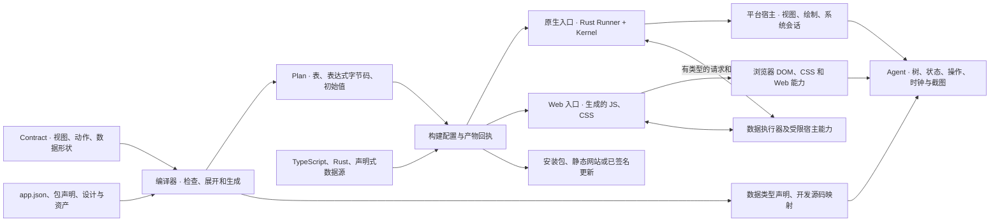

# Exact 完整架构研究

以 Exact 上游 `main` 的 `8b98f403` 为版本基线，核验日期为 2026 年 11 月 22 日。源码采用本地检出的 `50b6af94b` 和上游三笔提交的差异。本文覆盖公开仓库中的编译、运行、宿主、交付和验证。项目另有私有 LLP 设计记录。这一轮的证据来自源码、已有回归和上游测量口径。[上游版本](https://github.com/expo/exact/commit/8b98f403b1b29a58117de8c45e4cf46cb99a54af) · [与本地版本的差异](https://github.com/expo/exact/compare/50b6af94b519d50a9f7105f07606b4d96277c5c9...8b98f403b1b29a58117de8c45e4cf46cb99a54af) · [仓库与文档范围](https://github.com/expo/exact/blob/8b98f403b1b29a58117de8c45e4cf46cb99a54af/README.md#L596-L622)

**Exact 的核心是把应用行为编译成一个可检查、可交付的程序，由真实平台解释和呈现。** 同一个程序还为数据接口、可观察身份、测试和发布提供依据。它把跨平台的一致性放在行为和类型上，每个宿主负责实现自己的控件、输入及显示。

## 1. 从源码到应用的全图

| 要回答的问题 | 由谁掌握 |
| --- | --- |
| 什么界面能表达，一个动作能写哪项状态 | `contract/` 编译器和 `plan/` 程序格式 |
| 当前状态、实例、计时器和外部答案是什么 | 原生 `runner/`，或 Web 生成代码和 JS 运行时 |
| 哪些节点活着，布局和绘序如何变化 | 原生目标由 `kernel/` 和宿主测量决定。Web 目标由 DOM/CSS 完成 |
| 文件、网络、数据库和平台系统能力如何执行 | `data/`、`js/`、`logic/` 的数据接口，`grants/` 与宿主适配器 |
| 画面、键盘、焦点和原生控件属于谁 | Web、Apple、Android、painted 桌面和其他宿主分别承担 |
| 哪份代码、Plan 和资产允许一起运行，怎样证明 | `bake/`、`update/`、应用 CLI、Agent 驱动与验证 |

Plan 以内核属性的编号保存指令。编译器和 Runner 负责解释这些编号。Kernel 接受结构操作、实例化节点树并提供布局和回执。构建用的兼容性检查和 GPU 反射放在 `bake`，减少最小运行入口必须链接的代码。[Plan 的依赖边界](https://github.com/expo/exact/blob/8b98f403b1b29a58117de8c45e4cf46cb99a54af/plan/src/lib.rs#L1-L22) · [Runner 的入口](https://github.com/expo/exact/blob/8b98f403b1b29a58117de8c45e4cf46cb99a54af/runner/src/runner.rs#L1-L9) · [构建侧职责](https://github.com/expo/exact/blob/8b98f403b1b29a58117de8c45e4cf46cb99a54af/bake/src/lib.rs#L1-L6)

## 2. 作者模型与编译器

一个应用可有 `app.contract`、`app.json`、数据源、资产和 `*.test.contract`。Contract 用缩进表达组件与节点，用 CSS 词汇描述布局和外观。作者用 `shape`、props、`state`、`derive`、`resource`、`mutation`、`action` 和定时 `task` 表达行为。区域由条件、分支及带业务 key 的列表构成。平台默认控件、字体、间距和按压反馈可在作者省略时参与决定。组件库由组件、样式、数据形状和包声明组合。[Contract 语法](https://github.com/expo/exact/blob/8b98f403b1b29a58117de8c45e4cf46cb99a54af/contract/syntax/src/lib.rs#L1-L16) · [作者接口](https://github.com/expo/exact/blob/8b98f403b1b29a58117de8c45e4cf46cb99a54af/README.md#L237-L277) · [平台默认值原则](https://github.com/expo/exact/blob/8b98f403b1b29a58117de8c45e4cf46cb99a54af/rules/RULES.md#L43-L51)

编译分为几个可定位错误的阶段。

1. **加载并保留源位置。** 解析缩进、表达式及元素，解析 `use` 的组件、数据类型、样式及包导入。应用根决定 manifest、资产、字符串和 native/GPU 声明的来源。原始 `Span` 用于诊断与定位。[语法与原始范围](https://github.com/expo/exact/blob/8b98f403b1b29a58117de8c45e4cf46cb99a54af/contract/syntax/src/lib.rs#L1-L16) · [应用级检查入口](https://github.com/expo/exact/blob/8b98f403b1b29a58117de8c45e4cf46cb99a54af/contract/cli/src/lib.rs#L895-L944)
2. **类型、名字和约束检查。** 解析状态槽、动作参数、列表项与模式绑定，共用一套符号解析。检查组件使用时传入的 props、数据调用形状、动作读写和原生能力。之后 lower 将展开后的组件和表达式写成规范化表和字节码。[类型与名字](https://github.com/expo/exact/blob/8b98f403b1b29a58117de8c45e4cf46cb99a54af/contract/types/src/lib.rs#L1-L15) · [实际检查和 lower 调用](https://github.com/expo/exact/blob/8b98f403b1b29a58117de8c45e4cf46cb99a54af/contract/cli/src/lib.rs#L1067-L1106) · [lower 产出](https://github.com/expo/exact/blob/8b98f403b1b29a58117de8c45e4cf46cb99a54af/contract/lower/src/lib.rs#L1-L17)
3. **生成不同消费方的接口。** Plan 含节点模板、绑定、事件、状态、动作、计时器和数据表。字符串、代码与常量放在各自的池。Plan 格式由 `plan/tables/format.json` 生成，加载时验证引用及格式指纹。节点、样式和内核操作的词汇来自 `kernel/tables/schema.json`。数据形状可以生成 TypeScript 类型与 Rust 绑定。开发源码映射跟随 Plan digest，关联声明、调用点及最终使用的样式。[Plan 生成和校验](https://github.com/expo/exact/blob/8b98f403b1b29a58117de8c45e4cf46cb99a54af/plan/src/lib.rs#L1-L22) · [Kernel 词汇生成](https://github.com/expo/exact/blob/8b98f403b1b29a58117de8c45e4cf46cb99a54af/kernel/build.rs#L1-L13) · [编译输出与诊断](https://github.com/expo/exact/blob/8b98f403b1b29a58117de8c45e4cf46cb99a54af/contract/cli/src/build.rs#L301-L354) · [类型与源码工具](https://github.com/expo/exact/blob/8b98f403b1b29a58117de8c45e4cf46cb99a54af/README.md#L379-L391) · [源码映射使用约束](https://github.com/expo/exact/blob/8b98f403b1b29a58117de8c45e4cf46cb99a54af/docs/contract-for-agents.md#L6240-L6266)

这里的设计收益是作者输入、运行产物和诊断能互相解释。相应成本也集中在这条链上。增加一种控件或属性，除了 API 拼写，还需要处理类型、lower、平台可用性、语义角色和宿主投影。Exact 通过从词汇 schema 生成代码，以及为实际平台记录默认尺寸和控件角色，降低这部分漂移。[平台角色和尺寸证据](https://github.com/expo/exact/blob/8b98f403b1b29a58117de8c45e4cf46cb99a54af/docs/scale-measured.md#L1-L36) · [编译器的 native 声明检查](https://github.com/expo/exact/blob/8b98f403b1b29a58117de8c45e4cf46cb99a54af/contract/cli/src/lib.rs#L981-L997)

## 3. 原生运行时、布局和发布

**一个 Runner 持有一个 Plan、一个数据源和一个 Kernel。** 它持有状态槽、派生值、资源及实例索引，也负责请求、计时器、路由和系统命令。Plan 的依赖从表达式字节码预先扫描，按状态槽、派生值、资源状态、时钟和相对作用域编码。依赖没变化时可以跳过某些绑定和子树。不能证明可复用的路径会重新求值。[Runner 状态与所有权](https://github.com/expo/exact/blob/8b98f403b1b29a58117de8c45e4cf46cb99a54af/runner/src/runner.rs#L382-L450) · [依赖索引](https://github.com/expo/exact/blob/8b98f403b1b29a58117de8c45e4cf46cb99a54af/runner/src/instance/deps.rs#L1-L17) · [派生与资源结算](https://github.com/expo/exact/blob/8b98f403b1b29a58117de8c45e4cf46cb99a54af/runner/src/runner/settlement.rs#L133-L198)

一次有时间的输入大致按以下顺序执行。

1. Runner 接收目标与时间，推进在该入口约定先到期的工作。若某笔 change task 需宿主先应用回执，输入保留原时刻，等宿主推进后续做。[输入保序](https://github.com/expo/exact/blob/8b98f403b1b29a58117de8c45e4cf46cb99a54af/runner/src/runner/advance/inputs.rs#L82-L139)
2. Action 读取动作开始的状态，暂存写入。Runner 结算派生、请求参数与实例的变化，再产生树操作。可恢复拒绝使用检查点恢复其涵盖的运行状态。运行时内部污染后退出常规执行。已发出的外部 I/O 有自己的生命周期，业务上的撤销另行表达。[动作读写约定](https://github.com/expo/exact/blob/8b98f403b1b29a58117de8c45e4cf46cb99a54af/docs/contract-for-humans.md#L278-L323) · [检查点和失败处理](https://github.com/expo/exact/blob/8b98f403b1b29a58117de8c45e4cf46cb99a54af/runner/src/runner/commit.rs#L74-L163)
3. Kernel 验证整批结构操作，再改动列式节点 arena。带代次的 `NodeKey` 可区分槽位的先后对象。回执列出当前 epoch、创建、销毁、修改、布局失效、退场等事实。结构化操作与 EXWF 输入共用这一条写路径。宿主可读结构化节点行或 EXNODE 导出。[Kernel 事务与回执](https://github.com/expo/exact/blob/8b98f403b1b29a58117de8c45e4cf46cb99a54af/kernel/src/txn.rs#L1-L87) · [列式节点与身份](https://github.com/expo/exact/blob/8b98f403b1b29a58117de8c45e4cf46cb99a54af/kernel/src/arena.rs#L1-L12) · [内核观察出口](https://github.com/expo/exact/blob/8b98f403b1b29a58117de8c45e4cf46cb99a54af/kernel/src/kernel.rs#L903-L927)
4. Taffy 树是节点数据的布局投影，以宿主测量函数获取文字和特定控件的尺寸。布局输出受影响的几何和流布局变化。动画可另外采样。Apple 将这些信息整理成宿主批次，painted 目标可直接遍历 Kernel 树生成绘制。[布局出入口](https://github.com/expo/exact/blob/8b98f403b1b29a58117de8c45e4cf46cb99a54af/kernel/src/layout.rs#L1-L12) · [Apple 批次](https://github.com/expo/exact/blob/8b98f403b1b29a58117de8c45e4cf46cb99a54af/host/apple/src/commit.rs#L150-L224) · [Painted 投影](https://github.com/expo/exact/blob/8b98f403b1b29a58117de8c45e4cf46cb99a54af/host/painted/src/lib.rs#L1-L36)

**布局反馈带来源和条件。** Painted 对同一段文字用 Parley 的宽度相关排版同时测量和绘制。Taffy 的测量叶节点记录测量约束和待完成状态。虚拟列表只为视口附近所需的带 key 行创建节点。测量反馈可校正内容总高度并维持阅读锚点，旧宽度、字体或挂载代次的测量需要按原凭据验证。Taffy 是使用并维护补丁的依赖，裁剪、排版、虚拟化和宿主落地仍由 Exact 组合。[Parley 排版缓存](https://github.com/expo/exact/blob/8b98f403b1b29a58117de8c45e4cf46cb99a54af/host/painted/src/text.rs#L1-L16) · [叶节点测量](https://github.com/expo/exact/blob/8b98f403b1b29a58117de8c45e4cf46cb99a54af/kernel/src/layout/measurement.rs#L1-L56) · [列表锚点和反馈身份](https://github.com/expo/exact/blob/8b98f403b1b29a58117de8c45e4cf46cb99a54af/runner/src/instance/collection/index.rs#L1-L14) · [Taffy 补丁记录](https://github.com/expo/exact/blob/8b98f403b1b29a58117de8c45e4cf46cb99a54af/vendor/taffy/EXACT-PATCHES.md#L1-L25)

**区分动作结算、树提交、宿主应用和系统显示。** Runner 的动作结果可携带 Kernel 回执，把业务处理与本次树变更对应起来。宿主还需应用结果，系统呈现证据再说明像素何时可见。比如 Apple 的大型新增子树可以跨帧准备，在发布前继续以已应用的树服务输入。已知写集合与结构不冲突的宿主变更允许先应用。一个进程级 owner 串行管理 Apple 的多个 Rust 会话，主线程的同步请求依然可能等 owner，因此需要明确标出在哪条路径等待。[分批准备](https://github.com/expo/exact/blob/8b98f403b1b29a58117de8c45e4cf46cb99a54af/host/apple/Sources/ExactKit/StagedApply.swift#L11-L33) · [先应用的条件](https://github.com/expo/exact/blob/8b98f403b1b29a58117de8c45e4cf46cb99a54af/host/apple/Sources/ExactKit/StagedApply.swift#L219-L265) · [同步调用与重入](https://github.com/expo/exact/blob/8b98f403b1b29a58117de8c45e4cf46cb99a54af/host/apple/Sources/ExactCore/Owner.swift#L100-L137) · [运行时、窗口和故障案例](exact-architecture.md)

**路由和窗口是两种身份。** `route/` 维护位置、逐 tab 保留栈和每次访问的 id。宿主映射为浏览器历史、平台导航或实际窗口。macOS 文档窗和命名窗各有 `ExactSession`，窗口状态可以持久化，应用级共享存储与通知显式传播。标准 iOS 构建为单 scene，Web 的独立 tab 有自己的会话状态。[路由值和访问身份](https://github.com/expo/exact/blob/8b98f403b1b29a58117de8c45e4cf46cb99a54af/route/src/lib.rs#L1-L31) · [Mac 窗口和会话](https://github.com/expo/exact/blob/8b98f403b1b29a58117de8c45e4cf46cb99a54af/host/apple/Sources/ExactMac/main.swift#L248-L286) · [命名窗口入口](https://github.com/expo/exact/blob/8b98f403b1b29a58117de8c45e4cf46cb99a54af/host/apple/Sources/ExactMac/main.swift#L645-L712) · [共享存储通知](https://github.com/expo/exact/blob/8b98f403b1b29a58117de8c45e4cf46cb99a54af/host/apple/Sources/ExactKit/SessionStore.swift#L102-L125) · [Web 窗口持久化](https://github.com/expo/exact/blob/8b98f403b1b29a58117de8c45e4cf46cb99a54af/docs/contract-for-agents.md#L601-L607) · [iOS scene 配置](https://github.com/expo/exact/blob/8b98f403b1b29a58117de8c45e4cf46cb99a54af/host/apple/build.mjs#L422-L433)

## 4. 数据执行、存储和平台能力

`resource` 由参数和依赖决定何时请求，`mutation` 由动作主动发送。来源可以同步给出 `Answer::Now`，或给 `Later(Request)` 让宿主执行。请求包含相关目标和代次，宿主以 ticket 返还数据或错误，Runner 按声明 shape 验证并决定接纳。流用同一个 ticket 交付消息，具体来源可要求有序、不合并的交付。结果可以单独刷新，失败时可保留前一次有效值。[请求和应答类型](https://github.com/expo/exact/blob/8b98f403b1b29a58117de8c45e4cf46cb99a54af/runner/src/request.rs#L1-L49) · [请求归属与流语义](https://github.com/expo/exact/blob/8b98f403b1b29a58117de8c45e4cf46cb99a54af/runner/src/request.rs#L92-L142) · [失败与请求顺序](https://github.com/expo/exact/blob/8b98f403b1b29a58117de8c45e4cf46cb99a54af/docs/contract-for-humans.md#L647-L704)

| 来源 | 执行位置与交付 |
| --- | --- |
| 声明式 HTTP | 把请求与响应挑选写进 Contract。适合一个固定操作可表达的读取，构建可据此选择无需 Hermes 的原生入口。[声明式数据源](https://github.com/expo/exact/blob/8b98f403b1b29a58117de8c45e4cf46cb99a54af/docs/recipes/declared-source.md#L1-L37) |
| TypeScript | 构建时把应用模块打包为 Hermes 字节码，原生在数据阶段加载。Web 使用浏览器执行，并按配置选择工作线程等运行位置。数据模块可经宿主申请文件、SQLite 或网络。[Hermes 数据执行](https://github.com/expo/exact/blob/8b98f403b1b29a58117de8c45e4cf46cb99a54af/js/src/lib.rs#L1-L39) · [Web 工作线程实证](https://github.com/expo/exact/blob/8b98f403b1b29a58117de8c45e4cf46cb99a54af/apps/fieldnotes/README.md#L72-L82) |
| Rust | 可静态内置，或在受支持目标用版本化字节协议装载替换模块。模块接口对请求和结果设独立 ABI 与大小约束，宿主选择合适执行器。[Rust 数据模块](https://github.com/expo/exact/blob/8b98f403b1b29a58117de8c45e4cf46cb99a54af/logic/src/lib.rs#L1-L79) · [数据 ABI](https://github.com/expo/exact/blob/8b98f403b1b29a58117de8c45e4cf46cb99a54af/logic/abi/src/lib.rs#L1-L19) |
| 混合应用 | 在 source 名字上指定唯一实现。共享同一可写 Store 且有跨线程来源时，可以按共享的 Store 槽组织有序调用。独立 I/O 可由宿主 worker 并行执行。[混合来源所有权](https://github.com/expo/exact/blob/8b98f403b1b29a58117de8c45e4cf46cb99a54af/data/src/mixed.rs#L1-L59) · [I/O 执行队列](https://github.com/expo/exact/blob/8b98f403b1b29a58117de8c45e4cf46cb99a54af/host/executor/src/lib.rs#L1-L9) |

**业务一致性、数据形状和访问权限各自校验。** `DataSource` 规定计算和传输，shape 约束参数和应答，`grants` 规定可访问的网络来源、路径、存储槽和设备能力。构建还从声明生成相关的权限说明、entitlements 或平台配置。宿主对当前 I/O 路径再检查实际授权。包可交付有类型的动作和原生控件，例如相机包声明引用摄像轨的 view、属性与事件，具体实现由平台装配。系统授权、框架的 grants 和原生扩展本身的代码权限是不同层级。[授权模型和路径](https://github.com/expo/exact/blob/8b98f403b1b29a58117de8c45e4cf46cb99a54af/grants/src/lib.rs#L1-L18) · [路径解析边界](https://github.com/expo/exact/blob/8b98f403b1b29a58117de8c45e4cf46cb99a54af/grants/src/lib.rs#L57-L86) · [构建权限与 native 模块](https://github.com/expo/exact/blob/8b98f403b1b29a58117de8c45e4cf46cb99a54af/docs/recipes/native-module.md#L1-L24) · [相机包的声明](https://github.com/expo/exact/blob/8b98f403b1b29a58117de8c45e4cf46cb99a54af/packages/camera/exact.json#L42-L69)

平台扩展还分 **数据模块的系统调用、放在布局树中的原生 view、访问已有平台对象的 hatch**。原生 view 有自己的输入、尺寸和销毁协议，平台工厂创建实际对象，经传入的事件接口回到应用。能随 Agent 时钟驱动的工作使用宿主时钟，而依赖系统服务的路径要在相应平台验证。[原生控件的挂载与事件](https://github.com/expo/exact/blob/8b98f403b1b29a58117de8c45e4cf46cb99a54af/docs/recipes/native-views.md#L22-L70) · [hatch 与扩展入口](https://github.com/expo/exact/blob/8b98f403b1b29a58117de8c45e4cf46cb99a54af/README.md#L97-L106)

## 5. 平台宿主与呈现路线

| 目标 | 共用什么，自己实现什么 |
| --- | --- |
| **macOS、iOS** | Swift 的 ExactKit 通过 C ABI 获得以会话为单位的 Rust Runtime。Apple 宿主把 Runner 回执转为平台批次，由 Swift 读入并应用到 AppKit／UIKit 和 Core Animation。布局接入 CoreText 和控件测量。文本编辑、IME、系统导航与菜单所需的原生对象由宿主持有。[C ABI 入口](https://github.com/expo/exact/blob/8b98f403b1b29a58117de8c45e4cf46cb99a54af/host/apple/src/abi/exports.rs#L1-L21) · [Swift 批次读取](https://github.com/expo/exact/blob/8b98f403b1b29a58117de8c45e4cf46cb99a54af/host/apple/Sources/ExactCore/BatchReader.swift#L1-L23) · [Apple 事务](https://github.com/expo/exact/blob/8b98f403b1b29a58117de8c45e4cf46cb99a54af/host/apple/Sources/ExactKit/Session.swift#L1153-L1189) · [原生组词契约](https://github.com/expo/exact/blob/8b98f403b1b29a58117de8c45e4cf46cb99a54af/host/apple/Sources/ExactKit/FieldComposition.swift#L1-L28) |
| **Android** | Rust 共用 painted 运行和布局，Kotlin 通过 JNI 读取绘制帧，走 Canvas/HWUI `RenderNode`。系统编辑是 `EditText`，系统对话框和菜单可用 `Dialog`、`PopupWindow`，部分选择器使用 Compose。Android 的样式与平台能力逐项实现并验证。[Android JNI](https://github.com/expo/exact/blob/8b98f403b1b29a58117de8c45e4cf46cb99a54af/host/android/canvas/src/main/java/dev/exact/canvas/Native.kt#L39-L62) · [RenderNode 回放](https://github.com/expo/exact/blob/8b98f403b1b29a58117de8c45e4cf46cb99a54af/host/android/canvas/src/main/java/dev/exact/canvas/Player.kt#L847-L904) · [原生字段](https://github.com/expo/exact/blob/8b98f403b1b29a58117de8c45e4cf46cb99a54af/host/android/canvas/src/main/java/dev/exact/canvas/Fields.kt#L98-L130) · [Android 平台范围](https://github.com/expo/exact/blob/8b98f403b1b29a58117de8c45e4cf46cb99a54af/README.md#L539-L544) |
| **Linux** | painted 用同一 Kernel 来布局、命中、滚动和画图。Wayland 窗口路径可将像素交给 softbuffer，另有 DRM/KMS 直显及 GPU 路径，也能在无窗口环境生成图像。系统输入、桌面偏好和直显由 Linux 宿主接入。[Painted 结构](https://github.com/expo/exact/blob/8b98f403b1b29a58117de8c45e4cf46cb99a54af/host/painted/src/lib.rs#L1-L34) · [Wayland 窗口绘制](https://github.com/expo/exact/blob/8b98f403b1b29a58117de8c45e4cf46cb99a54af/host/linux/src/window.rs#L316-L355) · [KMS 目标选择](https://github.com/expo/exact/blob/8b98f403b1b29a58117de8c45e4cf46cb99a54af/host/linux/src/display.rs#L326-L357) · [新版 Ink 直显旋转](https://github.com/expo/exact/commit/8b98f403b1b29a58117de8c45e4cf46cb99a54af) |
| **Windows** | 主宿主以共享 painted 路线为基础，默认 DirectX 11 的 Ink，另有 CPU 路径和 IME、辅助功能、文件对话框的 Windows 接入。原生控件原型和主绘制路径各有进度，更新和验证功能以对应宿主的支持为准。[Windows 状态与绘制入口](https://github.com/expo/exact/blob/8b98f403b1b29a58117de8c45e4cf46cb99a54af/host/windows/src/window.rs#L36-L61) · [Windows 平台范围](https://github.com/expo/exact/blob/8b98f403b1b29a58117de8c45e4cf46cb99a54af/README.md#L546-L556) |
| **Web** | Plan 提前生成 ES 模块和 CSS，JS 运行时保留应用语义，浏览器负责 DOM、CSS、输入、排版和显示。游戏等特定构建使用 Wasm 路径。可选预渲染在服务器或构建时启动独立 Runner，在明确的匿名环境和预算内结算后输出 HTML 与 checkpoint，由客户端接上。[JS 后端入口](https://github.com/expo/exact/blob/8b98f403b1b29a58117de8c45e4cf46cb99a54af/host/web-js/src/main.rs#L1-L10) · [选择 JS 或 Wasm](https://github.com/expo/exact/blob/8b98f403b1b29a58117de8c45e4cf46cb99a54af/host/web/build.mjs#L318-L345) · [服务端渲染环境](https://github.com/expo/exact/blob/8b98f403b1b29a58117de8c45e4cf46cb99a54af/host/render/src/lib.rs#L1-L17) |
| **其他宿主** | 终端把 Kernel 树排到字符网格，复用 Agent 入口。tvOS、watchOS、Widget 等有专门的宿主和入口配置。Widget 快照用单独的组件入口和输入形状，可用能力按入口限定。[终端宿主](https://github.com/expo/exact/blob/8b98f403b1b29a58117de8c45e4cf46cb99a54af/host/terminal/src/lib.rs#L1-L22) · [平台矩阵](https://github.com/expo/exact/blob/8b98f403b1b29a58117de8c45e4cf46cb99a54af/README.md#L38-L49) · [Widget 入口编译](https://github.com/expo/exact/blob/8b98f403b1b29a58117de8c45e4cf46cb99a54af/contract/cli/src/snapshot/entry.rs#L1-L49) |

### 普通 Web 应用怎样构建和执行

在上游 `08bb92f3` 复核了构建器、运行时和可选 Rust 模块。

1. 作者用 Contract 声明 UI、状态和动作。Rust 编译器生成 `Plan`。原生 Runner 消费此产物，Web 的 `exact-web-js` 则把 Plan 事先生成 JavaScript 和 CSS。状态、派生、动作和带 key 的列表分别生成 JS 运行时调用，Web 构建再用 Rolldown 打包。[Web 目标分流](https://github.com/expo/exact/blob/08bb92f30d7932dcf25073a1a9dc280a10837168/host/web/build.mjs#L5-L20) · [Plan 生成器](https://github.com/expo/exact/blob/08bb92f30d7932dcf25073a1a9dc280a10837168/host/web-js/src/emit.rs#L1-L16) · [Web 构建](https://github.com/expo/exact/blob/08bb92f30d7932dcf25073a1a9dc280a10837168/host/web-js/build.mjs#L11-L24)
2. 页面上的应用语义由生成代码和 JS runtime 执行。它直接更新 DOM，布局、普通绘制和原生表单编辑由浏览器负责。有预渲染的页面可从 HTML 和 checkpoint 接上交互。键盘事件也保留浏览器的组成信息，显式动作可消费事件，普通输入继续应用浏览器默认行为。[页面挂载](https://github.com/expo/exact/blob/08bb92f30d7932dcf25073a1a9dc280a10837168/host/web-js/mount.js) · [键盘事件](https://github.com/expo/exact/blob/08bb92f30d7932dcf25073a1a9dc280a10837168/host/web-js/events.js#L165-L216)
3. 应用选用 Rust 数据模块时，Cargo 另外生成 `app.module.wasm`。JS 加载它和 `app.bind.plan`，通过版本化 ABI 调用声明的数据来源。可从已有首屏值启动时，模块可以延后装载。游戏使用独立的 Wasm 宿主路径，Rust Runner 和 Kernel 从树回执生成 DOM 批次，浏览器负责 CSS 布局。[Rust 模块装载](https://github.com/expo/exact/blob/08bb92f30d7932dcf25073a1a9dc280a10837168/host/web-js/rust-data.js#L74-L109) · [Web 构建入口](https://github.com/expo/exact/blob/08bb92f30d7932dcf25073a1a9dc280a10837168/host/web/build.mjs#L5-L15) · [Wasm 宿主](https://github.com/expo/exact/blob/08bb92f30d7932dcf25073a1a9dc280a10837168/host/web/src/lib.rs#L7-L25)

Octara 的作者输入是 Rust 视图函数和 Signals。Web 将应用编为 Wasm，经文档协议更新真实 DOM，并接纳浏览器测得的布局。可借鉴的是确定浏览器和 App 各自拥有的行为，以及把首屏必要能力与可延后能力分开。[Octara Web 启动](../design/v2/05-web-host.md) · [浏览器编辑边界](../design/v2/03-tree-microkernel.md)

**动画和 GPU 扩展位于呈现侧。** 样式给目标值，浏览器用 CSS 执行，原生宿主用 `exact-motion` 的显式时钟和闭式时间函数驱动采样。Apple 用显示目标时刻采样，业务定时任务仍有各自的入口。Canvas 2D、wgpu Canvas、文字流、Markdown 和游戏是可选能力。wgpu 画布有自己的输入绑定、尺寸、显示节奏、资源和可见性生命周期。Windows 的全窗游戏可直接组合 GPU 目标，很多混合情况仍走读回等适配路径。游戏引擎另有固定步进的 World 和输入队列，绘制插值已完成的 tick。[动画表示与时间](https://github.com/expo/exact/blob/8b98f403b1b29a58117de8c45e4cf46cb99a54af/motion/src/lib.rs#L1-L38) · [Apple 帧采样](https://github.com/expo/exact/blob/8b98f403b1b29a58117de8c45e4cf46cb99a54af/host/apple/Sources/ExactKit/Frames.swift#L50-L111) · [GPU Surface 边界](https://github.com/expo/exact/blob/8b98f403b1b29a58117de8c45e4cf46cb99a54af/gpu/src/lib.rs#L233-L279) · [Windows 画布组合条件](https://github.com/expo/exact/blob/8b98f403b1b29a58117de8c45e4cf46cb99a54af/gpu/README.md#L14-L32) · [游戏执行边界](https://github.com/expo/exact/blob/8b98f403b1b29a58117de8c45e4cf46cb99a54af/game/engine/README.md#L1-L15)

Apple 原生控件、Web DOM、Android 拟原生/原生混合与桌面绘制意味着功能一致性必须逐宿主验收。字体、输入法、窗口管理和导航是平台事实，配色、尺寸和媒体能力有平台特例。要求一个精确的「跨平台一致」时，要先说比较的是应用状态、可执行行为、布局还是最终像素。[当前平台范围与待补能力](https://github.com/expo/exact/blob/8b98f403b1b29a58117de8c45e4cf46cb99a54af/README.md#L525-L558)

## 6. 构建、首帧、热替换和生产交付

**构建期先组合应用需要的能力。** `scripts/app.mjs` 和各平台构建脚本从应用清单与依赖生成实际构建。bake 跟踪 Contract 的导入，把可准备的初值和资源结果与 Plan 一起编码，并生成入口、兼容性信息和产物图。数据类型、目标平台、能使用的模块能力及授权从实际构建得来。安装包可选择只链接使用到的能力。兼容性检查会比较候选 Plan 和模块的要求及已安装二进制的能力。[原生 bake 的实际入口](https://github.com/expo/exact/blob/8b98f403b1b29a58117de8c45e4cf46cb99a54af/bake/src/host.rs#L116-L172) · [按能力导出](https://github.com/expo/exact/blob/8b98f403b1b29a58117de8c45e4cf46cb99a54af/host/apple/src/abi/exports.rs#L1-L42) · [构建回执和产物图](https://github.com/expo/exact/blob/8b98f403b1b29a58117de8c45e4cf46cb99a54af/bake/src/receipt.rs#L593-L647) · [候选产物的兼容检查](https://github.com/expo/exact/blob/8b98f403b1b29a58117de8c45e4cf46cb99a54af/scripts/app.mjs#L1351-L1382)

**Apple 的可见启动先构造一帧，再激活可延迟工作。** 内置 Plan、可用的初值、占位值和宿主的启动状态足以发起首次绘制。第一次绘制回调带当前代次，之后才陆续装载应用数据模块、昂贵能力与相应原生视图。初帧、已能交互、数据源就绪和完整内容都有各自的时间。把首次绘制之后的计算移到 owner 仍会影响排在它之后的同步 Runtime 请求。上游目标是首个可交互帧 p50 100 ms，达标需要按应用、硬件和测量端点验证。[首帧与激活顺序](https://github.com/expo/exact/blob/8b98f403b1b29a58117de8c45e4cf46cb99a54af/host/apple/Sources/ExactKit/SessionActivation.swift#L20-L83) · [后续工作排队的实测记录](https://github.com/expo/exact/blob/8b98f403b1b29a58117de8c45e4cf46cb99a54af/host/apple/Sources/ExactKit/SessionActivation.swift#L90-L133) · [启动预算](https://github.com/expo/exact/blob/8b98f403b1b29a58117de8c45e4cf46cb99a54af/rules/RULES.md#L29-L41)

| 路径 | 怎样接纳变更 |
| --- | --- |
| **开发编译与驱动** | 原始驱动核对当前产物与源码。应用的 CLI 可以在运行前构建。只影响 Plan 或数据模块的部分编辑有候选产物快速路径。候选必须仍对应它产生时的源码和基础构建。[开发构建入口与校验](https://github.com/expo/exact/blob/8b98f403b1b29a58117de8c45e4cf46cb99a54af/scripts/agent-build.mjs#L1-L21) |
| **运行中的开发替换** | 候选 Plan 先准备，再提交。兼容状态按名字、类型和来源保留，数据模块改变时重问受影响资源，尚未送达的操作具有明确的退休规则。Apple 实现核对输入会话和组合区，应用级替换可协调已连接的会话。[可携带的状态和请求边界](https://github.com/expo/exact/blob/8b98f403b1b29a58117de8c45e4cf46cb99a54af/runner/src/runner/carry.rs#L1-L67) · [Apple 的候选接纳](https://github.com/expo/exact/blob/8b98f403b1b29a58117de8c45e4cf46cb99a54af/host/apple/Sources/ExactKit/Session.swift#L1050-L1068) |
| **生产 OTA** | 支持的二进制选择带更新 store 的宿主。签名头 `exact.json` 绑定应用、channel、兼容性 id、序号和文件摘要。签名校验后取得内容并核对摘要，组装完整条目。宿主准备并接纳后再变更选用记录。达到首次绘制并核对代次后，登记最后成功版本。故障恢复可回退至最后成功或内嵌版本。检查放在启动关键路径之后。[更新 store 与两阶段交接](https://github.com/expo/exact/blob/8b98f403b1b29a58117de8c45e4cf46cb99a54af/update/src/lib.rs#L1-L49) · [验签](https://github.com/expo/exact/blob/8b98f403b1b29a58117de8c45e4cf46cb99a54af/update/src/envelope.rs#L597-L623) · [序号与首绘确认](https://github.com/expo/exact/blob/8b98f403b1b29a58117de8c45e4cf46cb99a54af/update/src/store.rs#L648-L678) · [防回滚与序号绑定](https://github.com/expo/exact/blob/8b98f403b1b29a58117de8c45e4cf46cb99a54af/update/src/store.rs#L869-L902) |

这套架构把构建时的可用能力和运行时的更新目标关联起来。产物图能说清换 Plan、换受支持的数据模块与发新二进制的条件。Apple、Android 和 Linux 的生产模块选择不同，混合 TypeScript + Rust 一起更新有平台限制，当前 Windows 的生产路径以新二进制为主。开发阶段能替换的产物与安装包允许的产物，各自有信任和能力边界。[交付组成](https://github.com/expo/exact/blob/8b98f403b1b29a58117de8c45e4cf46cb99a54af/host/apple-update/src/lib.rs#L1-L21) · [平台和混合生产更新范围](https://github.com/expo/exact/blob/8b98f403b1b29a58117de8c45e4cf46cb99a54af/README.md#L537-L558)

## 7. Agent、设计工具和验证

**Agent 从同一处拿到可执行上下文。** 编译诊断提供稳定错误号、源码字节范围和跨组件关联位置。开发源码映射用 Plan digest 把节点、调用点、样式和源码对应起来。统一 driver 提供树、布局、状态、日志、输入、时钟、偏好、截图和性能数据。测试脚本复用这些操作，在真实宿主上也能选择由驱动推进时钟。捕获和系统输入能力仍受各宿主限制。[开发定位与操作面](https://github.com/expo/exact/blob/8b98f403b1b29a58117de8c45e4cf46cb99a54af/docs/contract-for-agents.md#L6240-L6267) · [Driver 平台入口](https://github.com/expo/exact/blob/8b98f403b1b29a58117de8c45e4cf46cb99a54af/README.md#L213-L234) · [Caltrain 的测试脚本](https://github.com/expo/exact/blob/8b98f403b1b29a58117de8c45e4cf46cb99a54af/apps/caltrain/app.test.contract#L1-L39)

**验证覆盖产物与应用结果。** `verify` 合成构建一致性、应用验收脚本、不同尺寸和主题、无障碍、最大字号、截图与重启恢复等检查，具体矩阵取决于宿主。仓库把短的阻塞检查与重型实机/差分验证分开，并记录覆盖范围和失败来自哪次改动。正式性能判断也需区分时钟驱动、CPU 持有时间、经过时间、回调抖动和实际显示。Apple 的 perf 报告明说空采样、显示回调与 GPU/输入延迟各自的边界。[verify 做什么](https://github.com/expo/exact/blob/8b98f403b1b29a58117de8c45e4cf46cb99a54af/scripts/verify.mjs#L1-L33) · [CI 检查与证据归属](https://github.com/expo/exact/blob/8b98f403b1b29a58117de8c45e4cf46cb99a54af/docs/testing.md#L40-L76) · [快慢验证分层](https://github.com/expo/exact/blob/8b98f403b1b29a58117de8c45e4cf46cb99a54af/rules/RULES.md#L7-L25) · [帧观测口径](https://github.com/expo/exact/blob/8b98f403b1b29a58117de8c45e4cf46cb99a54af/docs/contract-for-agents.md#L6210-L6218)

**语义模型、可移植回归和真实宿主互相补位。** Lean 4 写出动作、派生、计时器、路由、错误等规范，并以语料和随机测试对照实现。表达式 VM 还有从实际 Rust 代码抽取的精化证明，条件和覆盖面独立列出。若到期任务在输入处理中替换同名节点，模型和宿主在不同时刻查找目标。模型文档把它列为范围之外的情况。这类身份、系统交互及像素问题要由宿主回归补齐。[Lean 语义与差分](https://github.com/expo/exact/blob/8b98f403b1b29a58117de8c45e4cf46cb99a54af/semantics/README.md#L18-L47) · [VM 的证明范围](https://github.com/expo/exact/blob/8b98f403b1b29a58117de8c45e4cf46cb99a54af/semantics/vm-extract/README.md#L21-L43) · [同名替换的模型边界](https://github.com/expo/exact/blob/8b98f403b1b29a58117de8c45e4cf46cb99a54af/semantics/README.md#L210-L228)

**Forma 是独立的开发设计工具层。** 它用版本化 IR/协议表达 token、组件参数和设计调整。设计工具能和特定构建及源码映射关联，区分能即时试看的改变和需要重建的改变。这个接口跟实际开发产物相连，发布构建采用独立的生产能力集。它和 Agent 共用源码定位与状态证据，分别解决编辑设计和验证运行的任务。[Forma 的范围和版本](https://github.com/expo/exact/blob/8b98f403b1b29a58117de8c45e4cf46cb99a54af/docs/forma-protocol.md#L1-L32) · [预览、源码映射与重建](https://github.com/expo/exact/blob/8b98f403b1b29a58117de8c45e4cf46cb99a54af/docs/forma-protocol.md#L33-L68)

## 8. 用 Fieldnotes 从头走一遍

Fieldnotes 是实际包含笔记列表、搜索、文本编辑、SQLite 和备份的应用。它比计数器更能看出框架边界。

1. **构建。** `app.json` 声明窗口、平台配置、TypeScript worker 和 Rust 数据入口。Contract 声明 `Session`、数据形状、搜索和编辑动作。编译产出同一套行为描述，构建按平台装配对应的数据实现和宿主。Fieldnotes 自己的清单选择 `store=0`，所以它的常规构建可验证完整应用路径，签名 OTA 仍是另外的验收链路。[Fieldnotes 清单](https://github.com/expo/exact/blob/8b98f403b1b29a58117de8c45e4cf46cb99a54af/apps/fieldnotes/app.json#L1-L25) · [应用组成](https://github.com/expo/exact/blob/8b98f403b1b29a58117de8c45e4cf46cb99a54af/apps/fieldnotes/README.md#L35-L49)
2. **搜索与打开。** 系统文本输入交给 `search` 更新 `query`。Runner 按参数执行 `library(query, saveRevision, serviceRevision)`，TypeScript 通过宿主查 SQLite，结果只给列表所需的预览数据。点一行按 id 请求完整笔记，同时切到新的 `Session.version`。应用核对结果版本再展示。它把请求票号与用户正在编辑哪份笔记分别建模。[搜索、文档归属和派生](https://github.com/expo/exact/blob/8b98f403b1b29a58117de8c45e4cf46cb99a54af/apps/fieldnotes/app.contract#L101-L126) · [动作入口](https://github.com/expo/exact/blob/8b98f403b1b29a58117de8c45e4cf46cb99a54af/apps/fieldnotes/app.contract#L159-L189) · [查询实现](https://github.com/expo/exact/blob/8b98f403b1b29a58117de8c45e4cf46cb99a54af/apps/fieldnotes/app.ts#L123-L144)
3. **保存和反馈。** `saveNote` 由 TypeScript 执行 SQLite 写入。回包包含笔记身份、版本、保存快照及 Store 修订。应用通过派生值重算保存状态和列表。用户保存期间继续编辑的新草稿仍有独立归属。节点用笔记 id 组装，系统字段和窗内几何按相应宿主更新。[保存与回包](https://github.com/expo/exact/blob/8b98f403b1b29a58117de8c45e4cf46cb99a54af/apps/fieldnotes/app.ts#L145-L161) · [草稿和保存状态](https://github.com/expo/exact/blob/8b98f403b1b29a58117de8c45e4cf46cb99a54af/apps/fieldnotes/app.contract#L116-L126) · [编辑器与列表](https://github.com/expo/exact/blob/8b98f403b1b29a58117de8c45e4cf46cb99a54af/apps/fieldnotes/app.contract#L372-L407)
4. **备份换一种语言。** `Mixed` 把 `backupNotes` 交给 Rust，其余来源如 `saveNote` 和 `restoreNotes` 继续由 TypeScript 负责。Rust 通过便携存储请求实现备份。两边共享 `fieldnotes.revision`，按有序调用更新，并保留同一个 UI 和数据形状。备份使用单次 SQLite 快照。搜索为了限制载荷而分批查询，各批可以读到不同时间的数据。浏览器实际写入还会导出数据库。[混合来源和备份](https://github.com/expo/exact/blob/8b98f403b1b29a58117de8c45e4cf46cb99a54af/apps/fieldnotes/data/src/lib.rs#L30-L94) · [一致性和查询取舍](https://github.com/expo/exact/blob/8b98f403b1b29a58117de8c45e4cf46cb99a54af/apps/fieldnotes/README.md#L51-L90)
5. **验收。** Web 回归以 Agent 脚本输入 Unicode 多行文字、保存、执行 Rust 备份，再用 TypeScript 恢复，同时检查结构化答案和来源。Apple 的集成覆盖本地实际存储和模块配置。Caltrain 则用同一 Agent 协议检验一次导航、输入搜索、焦点和虚拟时钟。可以在同一个体系核对业务因果、不同宿主和像素证据。[Fieldnotes Web 回归](https://github.com/expo/exact/blob/8b98f403b1b29a58117de8c45e4cf46cb99a54af/apps/fieldnotes/app.test.mjs#L143-L193) · [Fieldnotes 原生验证范围](https://github.com/expo/exact/blob/8b98f403b1b29a58117de8c45e4cf46cb99a54af/apps/fieldnotes/README.md#L72-L97) · [Caltrain 宿主脚本](https://github.com/expo/exact/blob/8b98f403b1b29a58117de8c45e4cf46cb99a54af/apps/caltrain/app.test.contract#L11-L27)

这个应用揭示了 Exact 的核心复用单位。记录「用户保存了哪份草稿」「谁执行 SQLite」「什么版本可被 UI 接纳」时，信息都沿明确的表、请求和回执传播。浏览器输入、AppKit 控件与渲染后端有各自的职责。相同的用户操作和业务约束仍可由同一测试语法表达。

## 9. 已经遇到过的跨层故障

| 现场 | 暴露的架构问题与处理 |
| --- | --- |
| 原生构建通过，编辑器仍提示新数据源类型不存在 | 构建暂存目录的类型和源码旁的 `app.contract.d.ts` 曾走两条更新规则。Exact 把开发构建的编辑器声明刷新也接到构建，并记录各入口的行为。构建回执要能说明开发工具看到的是哪份类型。[生成类型过期问题](https://github.com/expo/exact/blob/8b98f403b1b29a58117de8c45e4cf46cb99a54af/issues/closed/20261113-native-builds-leave-app-contract-types-stale.md#L1-L39) |
| Apple 已首次绘制，数据请求却迟迟未发 | 首帧后串行做通知声明、模块初始化、数据就绪和首次 I/O，会把等待转移到内容完整之前。上游 Weatherlight 的十次 release 启动测到首帧至首个请求进入执行器中位数约 127 ms。后续加了分阶段观测，把可提前安排的工作沿相应线程推进，具体收益需按应用复测。[首帧后的等待与测量](https://github.com/expo/exact/blob/8b98f403b1b29a58117de8c45e4cf46cb99a54af/issues/closed/20261113-first-data-request-waits-for-module-after-first-pixel.md#L1-L41) · [当前激活路径](https://github.com/expo/exact/blob/8b98f403b1b29a58117de8c45e4cf46cb99a54af/host/apple/Sources/ExactKit/SessionActivation.swift#L90-L133) |
| 实际画出首帧，更新版本随后仍被当作坏版本隔离 | 首帧成功曾先写入进程记忆，再尝试持久化。落盘失败时内存状态会挡住重试。修正让持久化成功决定何时记作完成，且只确认当前运行代次。[首帧确认失败记录](https://github.com/expo/exact/blob/8b98f403b1b29a58117de8c45e4cf46cb99a54af/issues/closed/20261113-a-failed-first-pixel-blessing-is.md#L1-L24) · [更新确认实现](https://github.com/expo/exact/blob/8b98f403b1b29a58117de8c45e4cf46cb99a54af/update/src/store.rs#L650-L671) |
| 有 Widget 的 iOS 应用挂起后被系统结束 | 更新 store 的长生命周期文件锁曾放在 App Group 容器。上游从 TestFlight 日志和源码追到共享容器的系统挂起行为，将更新 store 移入应用私有目录。这个故障说明进程内正确性、持久化和 OS 生命周期需要各自验收。[iOS 文件锁问题](https://github.com/expo/exact/blob/8b98f403b1b29a58117de8c45e4cf46cb99a54af/issues/closed/20261113-update-store-lock-in-app-group-kills-suspended-ios-app.md#L1-L41) |

还有运行阶段的输入抢先、隐藏子树保留旧几何和同步调用等旧案例。[运行时失败样本](exact-architecture.md#值得保留的失败样本与验证方法)

## 10. 框架内部最重要的几种身份

| 事实 | 使用的身份或凭据 | 用来判断什么 |
| --- | --- | --- |
| 程序格式及观测来源 | Plan 格式指纹、Kernel schema digest、某份 Plan 的内容 digest | 能否读取程序、能否用这份 map 解释当前节点 |
| 视图生命周期 | 会话、节点 id 与代次、业务 key 和源位置 | 哪个实例仍可收输入，增量布局和离场动画还归谁 |
| 数据请求 | ticket、来源、目标及模块代次 | 当前结果是否应该落下，旧工作如何退出 |
| 宿主发布与视觉证据 | 批次顺序、会话／视图代次、显示采样来源 | 已提交的逻辑、原生树和实际可见何时对应 |
| 生产更新 | 应用、渠道、兼容性 id、序号、签名和文件摘要 | 哪个二进制能接纳哪份新产物，何时可以标记为可启动 |

这些标识分别服务于特定拥有者。业务名和显示名可以复用，发送者仍需证明目标是原来那一次挂载。版本信息多的成本是跨层协作时要有完整归属。收益是失败、重配、迟到和重放有明确解释。[会话与模块结果身份](https://github.com/expo/exact/blob/8b98f403b1b29a58117de8c45e4cf46cb99a54af/host/apple/Sources/ExactCore/RuntimeCompletion.swift#L3-L64) · [请求归属](https://github.com/expo/exact/blob/8b98f403b1b29a58117de8c45e4cf46cb99a54af/runner/src/request.rs#L92-L119) · [生产更新记录](https://github.com/expo/exact/blob/8b98f403b1b29a58117de8c45e4cf46cb99a54af/update/src/lib.rs#L8-L49)

## 11. 架构的取舍与对 Octara 的落点

| Exact 用机制解决了什么 | 它承担的成本 | 对 Octara 的价值 |
| --- | --- | --- |
| 编译器掌握行为，提前建立写权限、依赖和可定位错误 | 独立的语言、类型系统、编译后端、兼容格式和跨实现语义验证 | 让现有 Rust + Signals 的所有者、执行权限和失败时机可观察。用户回调可能跨窗口写入，保留相应结算边界 |
| 树、宿主和呈现分别交付 | 平台投影、布局与原生控件的反馈需要严格配对，分片必须证明能交换 | 给临时准备、稳定窗口版本和显示证据各自定义条件。复用已有场景和回执，受帧预算影响的部分按实际依赖续做 |
| 支持每个平台的原生行为 | 每种宿主要持续维护输入、辅助功能、控件与系统呈现的差异 | 保持 Octara 的 wgpu 绘序和作者自由度，把系统文本、焦点及原生控件的权限放在宿主接口 |
| 以程序和产物作为 Agent 的证据来源 | 要维护构建身份、源码、测试协议和观察口径 | 优先让 Agent 读取当前构建、可操作实例、触发的行为和匹配帧，从同一条路径得到可复现反馈 |
| 构建可裁剪、可替换、可验证 | 多种产物和平台组合要求精确的能力表及兼容门槛 | 让应用初始化最小化，留出日后可选工具和模块的清楚接入点。按真实首帧、速度和产物需求决定交付复杂度 |

这些机制依次约束了**应用能做的事、平台对外承诺的事、验证能证明的事**。对 Octara 当前阶段，最直接的借鉴是明确 App 可写回调与布局之间的因果，把兼容的已结算窗口工作交给宿主独立推进，并让 Agent 读到相同的证据。窗口时序与旧帧案例见 [运行时专项研究](exact-architecture.md#对-octara-第-6-阶段的设计结论)。作者组合接口和局部绘序扩展可继续对照 [Rune](rune-architecture.md)。
