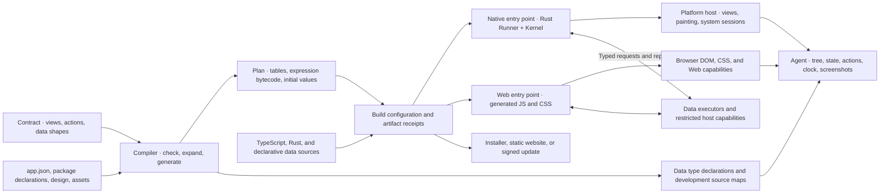

# Exact Architecture Overview

This study uses Exact upstream's `main` commit `8b98f403`, verified on November 22, 2026. It combines a local checkout at `50b6af94b` with the diff for three upstream commits. The scope covers compilation, execution, hosts, delivery, and verification in the public repository. Exact also maintains private LLP design notes. The evidence here comes from source, existing regressions, and upstream measurement definitions. [Upstream revision](https://github.com/expo/exact/commit/8b98f403b1b29a58117de8c45e4cf46cb99a54af) · [Diff from the local checkout](https://github.com/expo/exact/compare/50b6af94b519d50a9f7105f07606b4d96277c5c9...8b98f403b1b29a58117de8c45e4cf46cb99a54af) · [Repository and documentation scope](https://github.com/expo/exact/blob/8b98f403b1b29a58117de8c45e4cf46cb99a54af/README.md#L596-L622)

**Exact compiles application behavior into an inspectable, distributable program that real platforms execute and present.** The same program underpins data interfaces, observable identity, testing, and releases. Behavior and types stay consistent across platforms. Each host implements its own controls, input, and display.

## 1. From Source to Running App

| Question | Owner |
| --- | --- |
| What can the UI express, and which state can an action write? | The `contract/` compiler and `plan/` program format |
| What are the current state, instances, timers, and external answers? | Native `runner/`, or generated Web code and the JS runtime |
| Which nodes are live, and how do layout and paint order change? | `kernel/` and host measurement on native targets. DOM and CSS on the Web. |
| How do files, networking, databases, and platform services run? | Data interfaces in `data/`, `js/`, and `logic/`, plus `grants/` and host adapters |
| Who owns the display, keyboard, focus, and native controls? | The Web, Apple, Android, painted desktop, and other hosts each handle their own. |
| Which code, Plan, and assets can run together, and how can that be verified? | `bake/`, `update/`, the app CLI, and Agent driving and verification |

Plan encodes instructions using numeric Kernel property IDs. The compiler and Runner interpret those IDs. Kernel accepts structural operations, instantiates the node tree, and provides layout and receipts. Build-time compatibility checks and GPU reflection live in `bake`, reducing what the minimal runtime entry point must link. [Plan dependency boundary](https://github.com/expo/exact/blob/8b98f403b1b29a58117de8c45e4cf46cb99a54af/plan/src/lib.rs#L1-L22) · [Runner entry point](https://github.com/expo/exact/blob/8b98f403b1b29a58117de8c45e4cf46cb99a54af/runner/src/runner.rs#L1-L9) · [Build-time responsibilities](https://github.com/expo/exact/blob/8b98f403b1b29a58117de8c45e4cf46cb99a54af/bake/src/lib.rs#L1-L6)

## 2. Authoring Model and Compiler

An app can contain `app.contract`, `app.json`, data sources, assets, and `*.test.contract`. Contract uses indentation for components and nodes and CSS vocabulary for layout and appearance. Authors express behavior with `shape`, props, `state`, `derive`, `resource`, `mutation`, `action`, and timed `task` declarations. Conditions, branches, and lists keyed by business identity form regions. Omitted controls, fonts, spacing, and press feedback can use platform defaults. Component libraries combine components, styles, data shapes, and package declarations. [Contract syntax](https://github.com/expo/exact/blob/8b98f403b1b29a58117de8c45e4cf46cb99a54af/contract/syntax/src/lib.rs#L1-L16) · [Authoring API](https://github.com/expo/exact/blob/8b98f403b1b29a58117de8c45e4cf46cb99a54af/README.md#L237-L277) · [Platform defaults](https://github.com/expo/exact/blob/8b98f403b1b29a58117de8c45e4cf46cb99a54af/rules/RULES.md#L43-L51)

The compiler reports errors at the relevant stage and source location.

1. **Load and retain source locations.** Parse indentation, expressions, and elements, and resolve `use` imports for components, data types, styles, and packages. The app root determines where the manifest, assets, strings, and native or GPU declarations come from. Original `Span` values support diagnostics and source navigation. [Syntax and original spans](https://github.com/expo/exact/blob/8b98f403b1b29a58117de8c45e4cf46cb99a54af/contract/syntax/src/lib.rs#L1-L16) · [App-level check entry point](https://github.com/expo/exact/blob/8b98f403b1b29a58117de8c45e4cf46cb99a54af/contract/cli/src/lib.rs#L895-L944)
2. **Check types, names, and constraints.** Resolve state slots, action parameters, list items, and pattern bindings through a common symbol resolver. Verify component props, data call shapes, action reads and writes, and native capabilities. Lower the expanded components and expressions to normalized tables and bytecode. [Types and names](https://github.com/expo/exact/blob/8b98f403b1b29a58117de8c45e4cf46cb99a54af/contract/types/src/lib.rs#L1-L15) · [Check and lowering calls](https://github.com/expo/exact/blob/8b98f403b1b29a58117de8c45e4cf46cb99a54af/contract/cli/src/lib.rs#L1067-L1106) · [Lowering output](https://github.com/expo/exact/blob/8b98f403b1b29a58117de8c45e4cf46cb99a54af/contract/lower/src/lib.rs#L1-L17)
3. **Generate interfaces for each consumer.** Plan contains tables for node templates, bindings, events, state, actions, timers, and data. Strings, code, and constants have their own pools. The Plan format is generated from `plan/tables/format.json`. Loading validates references and the format fingerprint. `kernel/tables/schema.json` supplies the vocabulary for nodes, styles, and Kernel operations. Data shapes can produce TypeScript types and Rust bindings. Development source maps track the Plan digest and link declarations, call sites, and effective styles. [Plan generation and validation](https://github.com/expo/exact/blob/8b98f403b1b29a58117de8c45e4cf46cb99a54af/plan/src/lib.rs#L1-L22) · [Kernel vocabulary generation](https://github.com/expo/exact/blob/8b98f403b1b29a58117de8c45e4cf46cb99a54af/kernel/build.rs#L1-L13) · [Compiler outputs and diagnostics](https://github.com/expo/exact/blob/8b98f403b1b29a58117de8c45e4cf46cb99a54af/contract/cli/src/build.rs#L301-L354) · [Types and source tools](https://github.com/expo/exact/blob/8b98f403b1b29a58117de8c45e4cf46cb99a54af/README.md#L379-L391) · [Source-map constraints](https://github.com/expo/exact/blob/8b98f403b1b29a58117de8c45e4cf46cb99a54af/docs/contract-for-agents.md#L6240-L6266)

Author input, runtime artifacts, and diagnostics can explain one another. That coordination makes extensions more involved. A new control or property needs API syntax, typing, lowering, platform availability, semantic roles, and host projection. Exact reduces drift by generating code from the vocabulary schema and recording default sizes and control roles on real platforms. [Platform role and size evidence](https://github.com/expo/exact/blob/8b98f403b1b29a58117de8c45e4cf46cb99a54af/docs/scale-measured.md#L1-L36) · [Compiler checks for native declarations](https://github.com/expo/exact/blob/8b98f403b1b29a58117de8c45e4cf46cb99a54af/contract/cli/src/lib.rs#L981-L997)

## 3. Native Runtime, Layout, and Publication

**A Runner owns one Plan, one data source, and one Kernel.** It holds state slots, derived values, resources, and instance indexes and handles requests, timers, routes, and system commands. Expression bytecode is scanned in advance to encode dependencies on state slots, derived values, resource status, the clock, and relative scope. Unchanged dependencies can let Runner skip some bindings and subtrees. Paths where reuse cannot be established are reevaluated. [Runner state and ownership](https://github.com/expo/exact/blob/8b98f403b1b29a58117de8c45e4cf46cb99a54af/runner/src/runner.rs#L382-L450) · [Dependency index](https://github.com/expo/exact/blob/8b98f403b1b29a58117de8c45e4cf46cb99a54af/runner/src/instance/deps.rs#L1-L17) · [Derived value and resource settlement](https://github.com/expo/exact/blob/8b98f403b1b29a58117de8c45e4cf46cb99a54af/runner/src/runner/settlement.rs#L133-L198)

Timestamped input generally follows this order.

1. Runner receives the target and timestamp and advances the work scheduled to come first at that entry point. If a change task needs the host to apply a receipt first, Runner retains the input's original timestamp and resumes it after host progress. [Input ordering](https://github.com/expo/exact/blob/8b98f403b1b29a58117de8c45e4cf46cb99a54af/runner/src/runner/advance/inputs.rs#L82-L139)
2. An action reads the state at its start and stages writes. Runner settles changes to derived values, request parameters, and instances before emitting tree operations. A checkpoint restores the runtime state it covers after a recoverable rejection. A poisoned runtime leaves normal execution. External I/O already issued has its own lifecycle, and business-level undo is modeled separately. [Action read and write rules](https://github.com/expo/exact/blob/8b98f403b1b29a58117de8c45e4cf46cb99a54af/docs/contract-for-humans.md#L278-L323) · [Checkpoints and failure handling](https://github.com/expo/exact/blob/8b98f403b1b29a58117de8c45e4cf46cb99a54af/runner/src/runner/commit.rs#L74-L163)
3. Kernel validates the entire structural batch before mutating the columnar node arena. A generational `NodeKey` distinguishes successive occupants of a slot. Receipts list the current epoch, creations, removals, changes, layout invalidations, and exits. Structured operations and EXWF input use the same write path. Hosts can read structured node rows or the EXNODE export. [Kernel transactions and receipts](https://github.com/expo/exact/blob/8b98f403b1b29a58117de8c45e4cf46cb99a54af/kernel/src/txn.rs#L1-L87) · [Columnar nodes and identity](https://github.com/expo/exact/blob/8b98f403b1b29a58117de8c45e4cf46cb99a54af/kernel/src/arena.rs#L1-L12) · [Kernel observation APIs](https://github.com/expo/exact/blob/8b98f403b1b29a58117de8c45e4cf46cb99a54af/kernel/src/kernel.rs#L903-L927)
4. The Taffy tree projects node data into layout and uses host measurement functions for text and selected controls. Layout reports affected geometry and flow changes. Animations can be sampled separately. Apple packages the results into host batches, and painted targets can traverse the Kernel tree directly to produce paint commands. [Layout interfaces](https://github.com/expo/exact/blob/8b98f403b1b29a58117de8c45e4cf46cb99a54af/kernel/src/layout.rs#L1-L12) · [Apple batches](https://github.com/expo/exact/blob/8b98f403b1b29a58117de8c45e4cf46cb99a54af/host/apple/src/commit.rs#L150-L224) · [Painted projection](https://github.com/expo/exact/blob/8b98f403b1b29a58117de8c45e4cf46cb99a54af/host/painted/src/lib.rs#L1-L36)

**Layout feedback records what was measured and under which constraints.** The painted host uses the same width-dependent Parley layout to measure and draw text. Taffy's measurable leaf nodes track measurement constraints and pending status. A virtual list creates nodes only for the keyed rows needed near the viewport. Measurement feedback can correct the total content height and maintain the reading anchor. Measurements from an earlier width, font, or mount generation must be validated against their original provenance. Exact maintains patches to its Taffy dependency and integrates clipping, text layout, virtualization, and host projection itself. [Parley layout cache](https://github.com/expo/exact/blob/8b98f403b1b29a58117de8c45e4cf46cb99a54af/host/painted/src/text.rs#L1-L16) · [Leaf measurement](https://github.com/expo/exact/blob/8b98f403b1b29a58117de8c45e4cf46cb99a54af/kernel/src/layout/measurement.rs#L1-L56) · [List anchors and feedback identity](https://github.com/expo/exact/blob/8b98f403b1b29a58117de8c45e4cf46cb99a54af/runner/src/instance/collection/index.rs#L1-L14) · [Taffy patch history](https://github.com/expo/exact/blob/8b98f403b1b29a58117de8c45e4cf46cb99a54af/vendor/taffy/EXACT-PATCHES.md#L1-L25)

**Action settlement, tree commit, host apply, and system display each have their own completion point.** Runner can include a Kernel receipt with an action result, linking app behavior to the resulting tree changes. The host still has to apply them, and system presentation evidence shows when pixels become visible. Apple can prepare a large new subtree across frames, using the applied tree for input until publication. Host updates with known, nonconflicting writes and structural effects can apply first. A process-wide owner serializes Apple's Rust sessions, so synchronous main-thread requests can still wait for the owner. The waiting path needs to be explicit. [Staged preparation](https://github.com/expo/exact/blob/8b98f403b1b29a58117de8c45e4cf46cb99a54af/host/apple/Sources/ExactKit/StagedApply.swift#L11-L33) · [Conditions for earlier apply](https://github.com/expo/exact/blob/8b98f403b1b29a58117de8c45e4cf46cb99a54af/host/apple/Sources/ExactKit/StagedApply.swift#L219-L265) · [Synchronous calls and reentrancy](https://github.com/expo/exact/blob/8b98f403b1b29a58117de8c45e4cf46cb99a54af/host/apple/Sources/ExactCore/Owner.swift#L100-L137) · [Runtime, windows, and failure cases](exact-architecture.md)

**Routes and windows have distinct identities.** `route/` maintains locations, retained stacks per tab, and an ID per visit. Hosts map these to browser history, platform navigation, or actual windows. Each macOS document or named window has an `ExactSession`. Window state can persist, and app-wide shared storage and notifications propagate explicitly. The standard iOS build uses a single scene. Independent browser tabs have their own session state. [Route values and visit identity](https://github.com/expo/exact/blob/8b98f403b1b29a58117de8c45e4cf46cb99a54af/route/src/lib.rs#L1-L31) · [Mac windows and sessions](https://github.com/expo/exact/blob/8b98f403b1b29a58117de8c45e4cf46cb99a54af/host/apple/Sources/ExactMac/main.swift#L248-L286) · [Named window entry point](https://github.com/expo/exact/blob/8b98f403b1b29a58117de8c45e4cf46cb99a54af/host/apple/Sources/ExactMac/main.swift#L645-L712) · [Shared-store notifications](https://github.com/expo/exact/blob/8b98f403b1b29a58117de8c45e4cf46cb99a54af/host/apple/Sources/ExactKit/SessionStore.swift#L102-L125) · [Web window persistence](https://github.com/expo/exact/blob/8b98f403b1b29a58117de8c45e4cf46cb99a54af/docs/contract-for-agents.md#L601-L607) · [iOS scene configuration](https://github.com/expo/exact/blob/8b98f403b1b29a58117de8c45e4cf46cb99a54af/host/apple/build.mjs#L422-L433)

## 4. Data Execution, Storage, and Platform Capabilities

A `resource` requests data based on its arguments and dependencies. An action explicitly sends a `mutation`. A source can return `Answer::Now` synchronously or return `Later(Request)` for host execution. Requests carry the relevant target and generation. The host returns data or errors by ticket, and Runner validates the declared shape before deciding whether to accept the reply. Streams deliver messages on the same ticket. A source can require ordered delivery without coalescing. A result can be refreshed independently, and a failed refresh can retain the previous valid value. [Request and answer types](https://github.com/expo/exact/blob/8b98f403b1b29a58117de8c45e4cf46cb99a54af/runner/src/request.rs#L1-L49) · [Request ownership and stream semantics](https://github.com/expo/exact/blob/8b98f403b1b29a58117de8c45e4cf46cb99a54af/runner/src/request.rs#L92-L142) · [Failure and request ordering](https://github.com/expo/exact/blob/8b98f403b1b29a58117de8c45e4cf46cb99a54af/docs/contract-for-humans.md#L647-L704)

| Source | Execution and delivery |
| --- | --- |
| Declarative HTTP | Contract describes the request and selects fields from the response. This works for reads expressible as one fixed operation and allows the build to select a native entry point without Hermes. [Declarative data sources](https://github.com/expo/exact/blob/8b98f403b1b29a58117de8c45e4cf46cb99a54af/docs/recipes/declared-source.md#L1-L37) |
| TypeScript | The native build bundles app modules as Hermes bytecode and loads them in the data phase. The Web runs them in the browser and can use a worker according to configuration. Data modules can request file, SQLite, or network access from the host. [Hermes data execution](https://github.com/expo/exact/blob/8b98f403b1b29a58117de8c45e4cf46cb99a54af/js/src/lib.rs#L1-L39) · [Web worker example](https://github.com/expo/exact/blob/8b98f403b1b29a58117de8c45e4cf46cb99a54af/apps/fieldnotes/README.md#L72-L82) |
| Rust | Modules can be linked statically or loaded as replacements through a versioned byte protocol on supported targets. The interface defines separate ABI and size constraints for requests and results. The host chooses the executor. [Rust data modules](https://github.com/expo/exact/blob/8b98f403b1b29a58117de8c45e4cf46cb99a54af/logic/src/lib.rs#L1-L79) · [Data ABI](https://github.com/expo/exact/blob/8b98f403b1b29a58117de8c45e4cf46cb99a54af/logic/abi/src/lib.rs#L1-L19) |
| Mixed apps | Each source name identifies one implementation. Sources on different threads that share a writable Store can order calls by shared Store slot. Independent I/O can run in parallel on host workers. [Mixed source ownership](https://github.com/expo/exact/blob/8b98f403b1b29a58117de8c45e4cf46cb99a54af/data/src/mixed.rs#L1-L59) · [I/O execution queue](https://github.com/expo/exact/blob/8b98f403b1b29a58117de8c45e4cf46cb99a54af/host/executor/src/lib.rs#L1-L9) |

**Business consistency, data shapes, and access permissions have separate checks.** `DataSource` defines computation and transport, shapes constrain arguments and replies, and `grants` specify allowed network origins, paths, storage slots, and device capabilities. The build generates relevant permission descriptions, entitlements, or platform configuration from declarations. The host checks grants again at the point of I/O. Packages can ship typed actions and native controls. A camera package, for example, declares views, properties, and events that reference camera tracks, and the platform supplies the implementation. OS authorization, framework grants, and a native extension's code privileges are different layers. [Grant model and paths](https://github.com/expo/exact/blob/8b98f403b1b29a58117de8c45e4cf46cb99a54af/grants/src/lib.rs#L1-L18) · [Path resolution boundary](https://github.com/expo/exact/blob/8b98f403b1b29a58117de8c45e4cf46cb99a54af/grants/src/lib.rs#L57-L86) · [Build permissions and native modules](https://github.com/expo/exact/blob/8b98f403b1b29a58117de8c45e4cf46cb99a54af/docs/recipes/native-module.md#L1-L24) · [Camera package declarations](https://github.com/expo/exact/blob/8b98f403b1b29a58117de8c45e4cf46cb99a54af/packages/camera/exact.json#L42-L69)

Platform extensions include **system calls from data modules, native views in the layout tree, and hatches into existing platform objects**. A native view has its own input, measurement, and teardown contracts. A platform factory creates the actual object and sends events back to the app through the supplied interface. Work that the Agent clock can drive uses the host clock. Paths dependent on system services need verification on the corresponding platform. [Native control mounting and events](https://github.com/expo/exact/blob/8b98f403b1b29a58117de8c45e4cf46cb99a54af/docs/recipes/native-views.md#L22-L70) · [Hatches and extension APIs](https://github.com/expo/exact/blob/8b98f403b1b29a58117de8c45e4cf46cb99a54af/README.md#L97-L106)

## 5. Platform Hosts and Presentation Paths

| Target | Shared and host-specific implementation |
| --- | --- |
| **macOS and iOS** | Swift ExactKit accesses the per-session Rust Runtime through a C ABI. The Apple host converts Runner receipts to platform batches, which Swift reads and applies through AppKit or UIKit and Core Animation. Layout uses CoreText and native control measurement. The host owns the native objects for text editing, IME, system navigation, and menus. [C ABI entry point](https://github.com/expo/exact/blob/8b98f403b1b29a58117de8c45e4cf46cb99a54af/host/apple/src/abi/exports.rs#L1-L21) · [Swift batch decoding](https://github.com/expo/exact/blob/8b98f403b1b29a58117de8c45e4cf46cb99a54af/host/apple/Sources/ExactCore/BatchReader.swift#L1-L23) · [Apple transactions](https://github.com/expo/exact/blob/8b98f403b1b29a58117de8c45e4cf46cb99a54af/host/apple/Sources/ExactKit/Session.swift#L1153-L1189) · [Native composition contract](https://github.com/expo/exact/blob/8b98f403b1b29a58117de8c45e4cf46cb99a54af/host/apple/Sources/ExactKit/FieldComposition.swift#L1-L28) |
| **Android** | Rust provides the shared painted runtime and layout. Kotlin reads paint frames over JNI and uses Canvas or HWUI `RenderNode`. System editing uses `EditText`. System dialogs and menus can use `Dialog` or `PopupWindow`, and some pickers use Compose. Android styling and capabilities are implemented and verified individually. [Android JNI](https://github.com/expo/exact/blob/8b98f403b1b29a58117de8c45e4cf46cb99a54af/host/android/canvas/src/main/java/dev/exact/canvas/Native.kt#L39-L62) · [RenderNode replay](https://github.com/expo/exact/blob/8b98f403b1b29a58117de8c45e4cf46cb99a54af/host/android/canvas/src/main/java/dev/exact/canvas/Player.kt#L847-L904) · [Native fields](https://github.com/expo/exact/blob/8b98f403b1b29a58117de8c45e4cf46cb99a54af/host/android/canvas/src/main/java/dev/exact/canvas/Fields.kt#L98-L130) · [Android platform scope](https://github.com/expo/exact/blob/8b98f403b1b29a58117de8c45e4cf46cb99a54af/README.md#L539-L544) |
| **Linux** | The painted host uses the same Kernel for layout, hit testing, scrolling, and drawing. The Wayland window path can hand pixels to softbuffer. DRM/KMS direct display and GPU paths are also available, and the host can produce images headlessly. Linux owns system input, desktop preferences, and direct display integration. [Painted architecture](https://github.com/expo/exact/blob/8b98f403b1b29a58117de8c45e4cf46cb99a54af/host/painted/src/lib.rs#L1-L34) · [Wayland window rendering](https://github.com/expo/exact/blob/8b98f403b1b29a58117de8c45e4cf46cb99a54af/host/linux/src/window.rs#L316-L355) · [KMS target selection](https://github.com/expo/exact/blob/8b98f403b1b29a58117de8c45e4cf46cb99a54af/host/linux/src/display.rs#L326-L357) · [Updated Ink direct-display rotation](https://github.com/expo/exact/commit/8b98f403b1b29a58117de8c45e4cf46cb99a54af) |
| **Windows** | The main host uses the shared painted implementation, with DirectX 11 Ink by default and a CPU path as well. Windows integrates IME, accessibility, and file dialogs. Native-control prototypes and the main rendering path are at different stages. Update and verification features depend on the host's coverage. [Windows status and rendering entry point](https://github.com/expo/exact/blob/8b98f403b1b29a58117de8c45e4cf46cb99a54af/host/windows/src/window.rs#L36-L61) · [Windows platform scope](https://github.com/expo/exact/blob/8b98f403b1b29a58117de8c45e4cf46cb99a54af/README.md#L546-L556) |
| **Web** | Plan is compiled ahead of time to ES modules and CSS. The JS runtime implements app semantics, and the browser owns DOM, CSS, input, layout, and display. Specialized builds such as games use a Wasm path. Optional prerendering starts a separate Runner on the server or at build time, settles it in a defined anonymous environment within a budget, and emits HTML and a checkpoint for the client to resume. [JS backend](https://github.com/expo/exact/blob/8b98f403b1b29a58117de8c45e4cf46cb99a54af/host/web-js/src/main.rs#L1-L10) · [JS or Wasm selection](https://github.com/expo/exact/blob/8b98f403b1b29a58117de8c45e4cf46cb99a54af/host/web/build.mjs#L318-L345) · [Server rendering environment](https://github.com/expo/exact/blob/8b98f403b1b29a58117de8c45e4cf46cb99a54af/host/render/src/lib.rs#L1-L17) |
| **Other hosts** | The terminal lays out the Kernel tree on a character grid and reuses the Agent entry point. tvOS, watchOS, and widgets have dedicated hosts and entry configurations. A widget snapshot uses its own component entry point and input shape, and capabilities can be limited per entry point. [Terminal host](https://github.com/expo/exact/blob/8b98f403b1b29a58117de8c45e4cf46cb99a54af/host/terminal/src/lib.rs#L1-L22) · [Platform matrix](https://github.com/expo/exact/blob/8b98f403b1b29a58117de8c45e4cf46cb99a54af/README.md#L38-L49) · [Widget entry compilation](https://github.com/expo/exact/blob/8b98f403b1b29a58117de8c45e4cf46cb99a54af/contract/cli/src/snapshot/entry.rs#L1-L49) |

### How Standard Web Apps Build and Run

The build tool, runtime, and optional Rust modules were checked against upstream commit `08bb92f3`.

1. Authors declare UI, state, and actions in Contract. The Rust compiler emits a `Plan`, which the native Runner consumes. On the Web, `exact-web-js` compiles the Plan ahead of time to JavaScript and CSS. State, derived values, actions, and keyed lists generate corresponding JS runtime calls. The Web build then bundles with Rolldown. [Web target selection](https://github.com/expo/exact/blob/08bb92f30d7932dcf25073a1a9dc280a10837168/host/web/build.mjs#L5-L20) · [Plan code generation](https://github.com/expo/exact/blob/08bb92f30d7932dcf25073a1a9dc280a10837168/host/web-js/src/emit.rs#L1-L16) · [Web build](https://github.com/expo/exact/blob/08bb92f30d7932dcf25073a1a9dc280a10837168/host/web-js/build.mjs#L11-L24)
2. Generated code and the JS runtime execute app behavior on the page and update the DOM directly. The browser owns layout, ordinary paint, and native form editing. A prerendered page can resume interaction from HTML and a checkpoint. Keyboard events retain browser composition information. Explicit actions can consume events, and ordinary inputs continue to use browser defaults. [Page mounting](https://github.com/expo/exact/blob/08bb92f30d7932dcf25073a1a9dc280a10837168/host/web-js/mount.js) · [Keyboard events](https://github.com/expo/exact/blob/08bb92f30d7932dcf25073a1a9dc280a10837168/host/web-js/events.js#L165-L216)
3. If an app uses a Rust data module, Cargo also produces `app.module.wasm`. JS loads it alongside `app.bind.plan` and invokes declared data sources through a versioned ABI. Loading can be deferred when initial values are already available. Games use a separate Wasm host path. Rust Runner and Kernel produce DOM batches from tree receipts, and the browser handles CSS layout. [Rust module loading](https://github.com/expo/exact/blob/08bb92f30d7932dcf25073a1a9dc280a10837168/host/web-js/rust-data.js#L74-L109) · [Web build entry point](https://github.com/expo/exact/blob/08bb92f30d7932dcf25073a1a9dc280a10837168/host/web/build.mjs#L5-L15) · [Wasm host](https://github.com/expo/exact/blob/08bb92f30d7932dcf25073a1a9dc280a10837168/host/web/src/lib.rs#L7-L25)

Octara apps use Rust view functions and Signals. The Web build compiles the app to Wasm, updates the real DOM through the document protocol, and accepts browser measurements. Define which behavior the browser and app each own, and identify which capabilities the first screen needs immediately. [Octara Web startup](../design/v2/05-web-host.md) · [Browser editing boundaries](../design/v2/03-tree-microkernel.md)

**Animation and GPU extensions run on the presentation side.** Styles declare targets. The browser runs CSS animations, and native hosts sample `exact-motion` using its explicit clock and closed-form timing functions. Apple samples at the target display time. Business timers still have their own entry points. Canvas 2D, wgpu Canvas, text flow, Markdown, and games are optional capabilities. A wgpu canvas has its own input binding, size, display cadence, resources, and visibility lifecycle. A full-window game on Windows can composite the GPU target directly. Many mixed cases still use adapter paths such as readback. The game engine has a fixed-step World and input queue, and rendering interpolates between completed ticks. [Animation representation and time](https://github.com/expo/exact/blob/8b98f403b1b29a58117de8c45e4cf46cb99a54af/motion/src/lib.rs#L1-L38) · [Apple frame sampling](https://github.com/expo/exact/blob/8b98f403b1b29a58117de8c45e4cf46cb99a54af/host/apple/Sources/ExactKit/Frames.swift#L50-L111) · [GPU surface boundary](https://github.com/expo/exact/blob/8b98f403b1b29a58117de8c45e4cf46cb99a54af/gpu/src/lib.rs#L233-L279) · [Windows canvas compositing conditions](https://github.com/expo/exact/blob/8b98f403b1b29a58117de8c45e4cf46cb99a54af/gpu/README.md#L14-L32) · [Game execution boundary](https://github.com/expo/exact/blob/8b98f403b1b29a58117de8c45e4cf46cb99a54af/game/engine/README.md#L1-L15)

Apple native controls, Web DOM, Android's mix of emulated and native controls, and painted desktop rendering require per-host acceptance. Fonts, IMEs, window management, and navigation follow platform behavior. Colors, sizes, and media capabilities have platform-specific cases. Any cross-platform parity claim should specify whether it compares app state, executable behavior, layout, or final pixels. [Current platform scope and gaps](https://github.com/expo/exact/blob/8b98f403b1b29a58117de8c45e4cf46cb99a54af/README.md#L525-L558)

## 6. Builds, First Frame, Hot Replacement, and Production Delivery

**Builds assemble the capabilities an app uses.** `scripts/app.mjs` and platform build scripts use the app manifest and dependencies to create the actual build. The bake step tracks Contract imports, encodes available initial values and resource results alongside the Plan, and generates an entry point, compatibility metadata, and an artifact graph. Data types, targets, available module capabilities, and grants come from the actual build. Installers can link only the capabilities in use. Compatibility checks compare candidate Plan and module requirements with the installed binary's capabilities. [Native bake entry point](https://github.com/expo/exact/blob/8b98f403b1b29a58117de8c45e4cf46cb99a54af/bake/src/host.rs#L116-L172) · [Capability-specific exports](https://github.com/expo/exact/blob/8b98f403b1b29a58117de8c45e4cf46cb99a54af/host/apple/src/abi/exports.rs#L1-L42) · [Build receipts and artifact graph](https://github.com/expo/exact/blob/8b98f403b1b29a58117de8c45e4cf46cb99a54af/bake/src/receipt.rs#L593-L647) · [Candidate compatibility checks](https://github.com/expo/exact/blob/8b98f403b1b29a58117de8c45e4cf46cb99a54af/scripts/app.mjs#L1351-L1382)

**Apple draws an initial frame before activating deferrable work.** The embedded Plan, available initial values, placeholders, and host startup state can drive the first draw. The first draw callback carries the current generation. App data modules, expensive capabilities, and corresponding native views load afterward. The initial frame, interactivity, data readiness, and complete content have separate timings. Moving post-draw work to the owner can still delay subsequent synchronous Runtime requests. Upstream targets a p50 of 100 ms for the first interactive frame. Verify it per app, hardware, and measurement endpoints. [First frame and activation order](https://github.com/expo/exact/blob/8b98f403b1b29a58117de8c45e4cf46cb99a54af/host/apple/Sources/ExactKit/SessionActivation.swift#L20-L83) · [Measured post-draw queuing](https://github.com/expo/exact/blob/8b98f403b1b29a58117de8c45e4cf46cb99a54af/host/apple/Sources/ExactKit/SessionActivation.swift#L90-L133) · [Startup budget](https://github.com/expo/exact/blob/8b98f403b1b29a58117de8c45e4cf46cb99a54af/rules/RULES.md#L29-L41)

| Path | How changes are accepted |
| --- | --- |
| **Development builds and driver** | The underlying driver checks current artifacts against source. The app CLI can build before running. Edits limited to the Plan or a data module have a candidate artifact fast path. A candidate must still correspond to the source and base build used to produce it. [Development build entry point and validation](https://github.com/expo/exact/blob/8b98f403b1b29a58117de8c45e4cf46cb99a54af/scripts/agent-build.mjs#L1-L21) |
| **Live development replacement** | Prepare the candidate Plan, then commit it. Preserve compatible state by name, type, and source. When a data module changes, request affected resources again. Operations that have yet to be delivered follow explicit retirement rules. Apple's implementation checks the input session and composition range. App-wide replacement can coordinate connected sessions. [State carryover and request boundaries](https://github.com/expo/exact/blob/8b98f403b1b29a58117de8c45e4cf46cb99a54af/runner/src/runner/carry.rs#L1-L67) · [Apple candidate acceptance](https://github.com/expo/exact/blob/8b98f403b1b29a58117de8c45e4cf46cb99a54af/host/apple/Sources/ExactKit/Session.swift#L1050-L1068) |
| **Production OTA** | Supported binaries use a host with an update store. The signed `exact.json` header binds the app, channel, compatibility ID, sequence number, and file digests. After signature verification, the updater fetches content, checks digests, and assembles a complete entry. It changes the selected entry after host preparation and acceptance. After the first draw, the host checks the generation before recording the last successful version. Recovery can fall back to the last successful or embedded version. The update check runs after the startup critical path. [Update store and two-phase handoff](https://github.com/expo/exact/blob/8b98f403b1b29a58117de8c45e4cf46cb99a54af/update/src/lib.rs#L1-L49) · [Signature verification](https://github.com/expo/exact/blob/8b98f403b1b29a58117de8c45e4cf46cb99a54af/update/src/envelope.rs#L597-L623) · [Sequence and first-draw confirmation](https://github.com/expo/exact/blob/8b98f403b1b29a58117de8c45e4cf46cb99a54af/update/src/store.rs#L648-L678) · [Rollback protection and sequence binding](https://github.com/expo/exact/blob/8b98f403b1b29a58117de8c45e4cf46cb99a54af/update/src/store.rs#L869-L902) |

The build's available capabilities determine what it can update at runtime. The artifact graph records when to replace the Plan, replace a supported data module, or ship a new binary. Apple, Android, and Linux support different production module options. Joint TypeScript and Rust updates have platform limits, and Windows production delivery currently centers on new binaries. Development replacements and installed packages have separate trust and capability boundaries. [Delivery components](https://github.com/expo/exact/blob/8b98f403b1b29a58117de8c45e4cf46cb99a54af/host/apple-update/src/lib.rs#L1-L21) · [Platform and mixed production update scope](https://github.com/expo/exact/blob/8b98f403b1b29a58117de8c45e4cf46cb99a54af/README.md#L537-L558)

## 7. Agent, Design Tools, and Verification

**The Agent gets actionable context from one interface.** Compiler diagnostics provide stable error codes, source byte ranges, and related locations across components. Development source maps use the Plan digest to link nodes, call sites, styles, and source. A shared driver exposes tree, layout, state, logs, input, clock, preferences, screenshots, and performance data. Test scripts reuse those operations and can advance the clock through the driver on real hosts. Capture and system input still depend on host capabilities. [Development source navigation and actions](https://github.com/expo/exact/blob/8b98f403b1b29a58117de8c45e4cf46cb99a54af/docs/contract-for-agents.md#L6240-L6267) · [Driver platform entry points](https://github.com/expo/exact/blob/8b98f403b1b29a58117de8c45e4cf46cb99a54af/README.md#L213-L234) · [Caltrain test scripts](https://github.com/expo/exact/blob/8b98f403b1b29a58117de8c45e4cf46cb99a54af/apps/caltrain/app.test.contract#L1-L39)

**Verification covers both artifacts and app outcomes.** `verify` combines checks for build consistency, app acceptance scripts, sizes and themes, accessibility, maximum text size, screenshots, and restart recovery. The matrix depends on the host. The repository runs short blocking checks separately from heavier device and differential verification and records coverage and the revision associated with failures. Performance evaluations distinguish clock driving, CPU occupancy, elapsed time, callback jitter, and actual display. Apple's performance report documents how it handles missing samples and what its display callback, GPU, and input latency measurements cover. [Verification coverage](https://github.com/expo/exact/blob/8b98f403b1b29a58117de8c45e4cf46cb99a54af/scripts/verify.mjs#L1-L33) · [CI checks and evidence provenance](https://github.com/expo/exact/blob/8b98f403b1b29a58117de8c45e4cf46cb99a54af/docs/testing.md#L40-L76) · [Fast and slow verification tiers](https://github.com/expo/exact/blob/8b98f403b1b29a58117de8c45e4cf46cb99a54af/rules/RULES.md#L7-L25) · [Frame measurement definitions](https://github.com/expo/exact/blob/8b98f403b1b29a58117de8c45e4cf46cb99a54af/docs/contract-for-agents.md#L6210-L6218)

**The semantic model, portable regressions, and real hosts cover different cases.** Lean 4 specifies actions, derived values, timers, routes, and errors. Corpus and randomized tests compare the model with the implementation. The expression VM also has a refinement proof extracted from actual Rust code, with its own conditions and scope. When a due task replaces a same-named node during input handling, the model and host look up the target at different times. The model documents this case as outside its scope. Host regressions cover such identity, system interaction, and pixel behavior. [Lean semantics and differential tests](https://github.com/expo/exact/blob/8b98f403b1b29a58117de8c45e4cf46cb99a54af/semantics/README.md#L18-L47) · [VM proof scope](https://github.com/expo/exact/blob/8b98f403b1b29a58117de8c45e4cf46cb99a54af/semantics/vm-extract/README.md#L21-L43) · [Model limits for same-name replacement](https://github.com/expo/exact/blob/8b98f403b1b29a58117de8c45e4cf46cb99a54af/semantics/README.md#L210-L228)

**Forma is a separate development design tool.** Its versioned IR and protocol describe tokens, component parameters, and design adjustments. The tooling can tie changes to a particular build and source map, distinguishing live previews from changes that require a rebuild. This interface connects to actual development artifacts, while release builds use a separate production capability set. Forma and the Agent share source locations and state evidence for their respective design editing and runtime verification tasks. [Forma scope and versioning](https://github.com/expo/exact/blob/8b98f403b1b29a58117de8c45e4cf46cb99a54af/docs/forma-protocol.md#L1-L32) · [Preview, source maps, and rebuilds](https://github.com/expo/exact/blob/8b98f403b1b29a58117de8c45e4cf46cb99a54af/docs/forma-protocol.md#L33-L68)

## 8. Fieldnotes End to End

Fieldnotes includes a note list, search, text editing, SQLite, and backups. These features exercise more framework boundaries than a counter.

1. **Build.** `app.json` declares windows, platform configuration, a TypeScript worker, and Rust data entry points. Contract declares `Session`, data shapes, search, and editing actions. The compiler emits one behavior description, and the build chooses the data implementations and host for each platform. The Fieldnotes manifest sets `store=0`, so regular builds exercise the app flow while signed OTA has its own acceptance path. [Fieldnotes manifest](https://github.com/expo/exact/blob/8b98f403b1b29a58117de8c45e4cf46cb99a54af/apps/fieldnotes/app.json#L1-L25) · [App composition](https://github.com/expo/exact/blob/8b98f403b1b29a58117de8c45e4cf46cb99a54af/apps/fieldnotes/README.md#L35-L49)
2. **Search and open.** System text input invokes `search` to update `query`. Runner calls `library(query, saveRevision, serviceRevision)` with its arguments. TypeScript queries SQLite through the host and returns only the previews the list needs. Selecting a row requests the full note by ID and switches to a new `Session.version`. The app checks the reply's version before displaying it. Request tickets and the identity of the note currently being edited are modeled independently. [Search, document ownership, and derived values](https://github.com/expo/exact/blob/8b98f403b1b29a58117de8c45e4cf46cb99a54af/apps/fieldnotes/app.contract#L101-L126) · [Action entry points](https://github.com/expo/exact/blob/8b98f403b1b29a58117de8c45e4cf46cb99a54af/apps/fieldnotes/app.contract#L159-L189) · [Query implementation](https://github.com/expo/exact/blob/8b98f403b1b29a58117de8c45e4cf46cb99a54af/apps/fieldnotes/app.ts#L123-L144)
3. **Save and update.** TypeScript performs the SQLite write for `saveNote`. The reply includes note identity, version, the saved snapshot, and Store revision. The app recomputes save state and the list through derived values. Draft changes made while saving retain their own ownership. Nodes are keyed by note ID, and the host updates system fields and window geometry. [Save and reply](https://github.com/expo/exact/blob/8b98f403b1b29a58117de8c45e4cf46cb99a54af/apps/fieldnotes/app.ts#L145-L161) · [Draft and save state](https://github.com/expo/exact/blob/8b98f403b1b29a58117de8c45e4cf46cb99a54af/apps/fieldnotes/app.contract#L116-L126) · [Editor and list](https://github.com/expo/exact/blob/8b98f403b1b29a58117de8c45e4cf46cb99a54af/apps/fieldnotes/app.contract#L372-L407)
4. **Use another language for backups.** `Mixed` routes `backupNotes` to Rust, while TypeScript still handles other sources such as `saveNote` and `restoreNotes`. Rust uses portable storage requests to back up notes. Both sides share `fieldnotes.revision`, update it through ordered calls, and keep the same UI and data shapes. Backup uses a single SQLite snapshot. Search limits payload sizes with batches that can observe data at different times. Browser writes also export the database. [Mixed sources and backup](https://github.com/expo/exact/blob/8b98f403b1b29a58117de8c45e4cf46cb99a54af/apps/fieldnotes/data/src/lib.rs#L30-L94) · [Consistency and query trade-offs](https://github.com/expo/exact/blob/8b98f403b1b29a58117de8c45e4cf46cb99a54af/apps/fieldnotes/README.md#L51-L90)
5. **Verify.** A Web regression uses an Agent script to enter multiline Unicode text, save it, run a Rust backup, restore it through TypeScript, and check structured replies and their sources. Apple integration covers actual local storage and module configuration. Caltrain uses the same Agent protocol to test navigation, search input, focus, and the virtual clock. The same system can check application causality, host behavior, and pixel evidence. [Fieldnotes Web regression](https://github.com/expo/exact/blob/8b98f403b1b29a58117de8c45e4cf46cb99a54af/apps/fieldnotes/app.test.mjs#L143-L193) · [Fieldnotes native verification scope](https://github.com/expo/exact/blob/8b98f403b1b29a58117de8c45e4cf46cb99a54af/apps/fieldnotes/README.md#L72-L97) · [Caltrain host script](https://github.com/expo/exact/blob/8b98f403b1b29a58117de8c45e4cf46cb99a54af/apps/caltrain/app.test.contract#L11-L27)

Fieldnotes shows what Exact reuses. The saved draft identity, the source that executes SQLite, and the version the UI can accept all travel through explicit tables, requests, and receipts. Browser input, AppKit controls, and render backends have their own responsibilities. The same test syntax can still express the user actions and business constraints.

## 9. Cross-Layer Failures

| Symptom | Architectural issue and response |
| --- | --- |
| Native builds passed while the editor still reported a missing type for a new data source. | Types in the build staging directory and the `app.contract.d.ts` beside the source once refreshed by different rules. Exact integrated editor declaration refresh into development builds and documented each entry point. The build receipt needs to identify which types the editor sees. [Stale generated types](https://github.com/expo/exact/blob/8b98f403b1b29a58117de8c45e4cf46cb99a54af/issues/closed/20261113-native-builds-leave-app-contract-types-stale.md#L1-L39) |
| Apple's first draw completed, but the data request was slow to start. | Serial work after first draw covered notification declarations, module initialization, data readiness, and first I/O, shifting the wait to content completion. In 10 upstream Weatherlight release launches, the median from first draw to the first request entering the executor was about 127 ms. Later changes added per-stage measurements and advanced work on the appropriate threads when it could be scheduled earlier. Verify the gains per app. [Post-first-frame wait and measurements](https://github.com/expo/exact/blob/8b98f403b1b29a58117de8c45e4cf46cb99a54af/issues/closed/20261113-first-data-request-waits-for-module-after-first-pixel.md#L1-L41) · [Current activation path](https://github.com/expo/exact/blob/8b98f403b1b29a58117de8c45e4cf46cb99a54af/host/apple/Sources/ExactKit/SessionActivation.swift#L90-L133) |
| The first frame drew, but the updater later quarantined the version as bad. | First-frame success was previously recorded in process memory before persistence. If persistence failed, the in-memory state blocked retries. The fix marks completion only after successful persistence and confirms only the current running generation. [First-frame confirmation failure](https://github.com/expo/exact/blob/8b98f403b1b29a58117de8c45e4cf46cb99a54af/issues/closed/20261113-a-failed-first-pixel-blessing-is.md#L1-L24) · [Update confirmation implementation](https://github.com/expo/exact/blob/8b98f403b1b29a58117de8c45e4cf46cb99a54af/update/src/store.rs#L650-L671) |
| iOS terminated an app with a widget after suspension. | The update store held a long-lived file lock in the App Group container. Upstream traced TestFlight logs and source to the system's handling of suspension with the shared container and moved the store into the app's private directory. The failure calls for separate verification of process correctness, persistence, and OS lifecycle behavior. [iOS file lock issue](https://github.com/expo/exact/blob/8b98f403b1b29a58117de8c45e4cf46cb99a54af/issues/closed/20261113-update-store-lock-in-app-group-kills-suspended-ios-app.md#L1-L41) |

Earlier runtime cases include input overtaking pending work, hidden subtrees retaining old geometry, and synchronous calls. [Runtime failures](exact-architecture.md#failures-and-verification)

## 10. Framework Identities

| Fact | Identity or evidence | What it determines |
| --- | --- | --- |
| Program format and observation source | Plan format fingerprint, Kernel schema digest, and the content digest of a specific Plan | Whether the program can be read and whether this source map describes the current node |
| View lifecycle | Session, node ID and generation, business key, and source location | Which instance can still receive input and which instance owns incremental layout and exit animation |
| Data requests | Ticket, source, target, and module generation | Whether to apply the result and how to retire stale work |
| Host publication and visual evidence | Batch sequence, session or view generation, and source of display sampling | When committed logic, the native tree, and actual visibility correspond |
| Production updates | App, channel, compatibility ID, sequence number, signature, and file digests | Which binary can accept the new artifact and when to mark it bootable |

Each identifier belongs to a specific owner. Business and display names can be reused, so senders still need to establish that a target is the original mount. Cross-layer coordination must carry complete ownership information. That information explains failures, reconfiguration, late delivery, and replay. [Session and module result identity](https://github.com/expo/exact/blob/8b98f403b1b29a58117de8c45e4cf46cb99a54af/host/apple/Sources/ExactCore/RuntimeCompletion.swift#L3-L64) · [Request ownership](https://github.com/expo/exact/blob/8b98f403b1b29a58117de8c45e4cf46cb99a54af/runner/src/request.rs#L92-L119) · [Production update records](https://github.com/expo/exact/blob/8b98f403b1b29a58117de8c45e4cf46cb99a54af/update/src/lib.rs#L8-L49)

## 11. Architectural Trade-offs for Octara

| What Exact's design solves | Cost | Implications for Octara |
| --- | --- | --- |
| The compiler models behavior and establishes write permissions, dependencies, and source-located errors ahead of time. | A separate language, type system, compiler backends, compatibility format, and cross-implementation semantic verification | Make ownership, execution permissions, and failure timing observable in the existing Rust and Signals model. Preserve the settlement boundary for user callbacks that can write across windows. |
| Tree, host, and presentation have separate handoffs. | Platform projection, layout, and native control feedback need exact correspondence. Staging requires proof that affected operations can commute. | Define separate conditions for staged preparation, stable window versions, and presentation evidence. Reuse existing scenes and receipts. Resume frame-budgeted work according to actual dependencies. |
| Each platform supports its native behavior. | Each host must maintain support for differences in input, accessibility, controls, and system presentation. | Preserve Octara's wgpu paint order and author flexibility. Put authority for system text, focus, and native controls in host interfaces. |
| The program and artifacts provide evidence to the Agent. | Build identity, source, test protocols, and measurement definitions need maintenance. | Let the Agent read the current build, actionable instance, behavior triggered, and matching frame through one reproducible path. |
| Builds can trim capabilities, replace artifacts, and verify results. | Artifact and platform combinations require precise capability tables and compatibility checks. | Keep app initialization minimal and leave clear entry points for future optional tools or modules. Let measured first-frame and performance needs, as well as artifact requirements, determine delivery complexity. |

These mechanisms define **what an app can do, what the platform promises, and what verification can establish**. For Octara now, make causality explicit between write-capable app callbacks and layout, let hosts advance compatible settled window work independently, and expose the same evidence to the Agent. The runtime study covers window timing and older-frame cases. The Rune study covers authoring composition and local paint-order extensions. [Runtime study](exact-architecture.md#design-conclusions-for-octara-phase-6) · [Rune architecture](rune-architecture.md)
