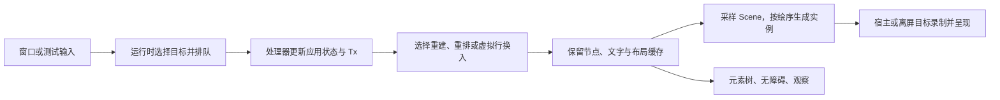

# Rune 架构调研

调研固定在 Anomaly 的 Rune `dev` 提交 `3f0d997`，2026 年 11 月 22 日。它是预发布的 Rust UI 框架。本文追踪源码中的实际入口和回归，对照上游测量的口径。[Rune 版本](https://github.com/anomalyco/rune/commit/3f0d9973526818bae62c89c483fbd144a2a19669) · [项目说明](https://github.com/anomalyco/rune/blob/3f0d9973526818bae62c89c483fbd144a2a19669/README.md#L1-L48)

**Rune 让编写界面的默认方式保持为普通 Rust 函数，再按已知条件缩小工作范围。** 作者可从一个状态结构体和一个返回 `El` 的函数开始。运行时持有有身份的树、布局缓存、输入会话与动效。变化可能触发视图重建，也可能只更新选定子树、虚拟窗口或呈现值。

## 作者接口和包边界

`AppSpec<S>` 提供初始化、`fn(&S, &mut Cx<S>) -> El`、可选的 `poll` 和命名测试场景。Hello 把开关的 key、角色、名称、选中态、焦点资格与 `on_press` 放在同一个实际元素上。外观由子节点和普通属性组成。点击直接改 `&mut S`，后一次构建声明新的目标位置，旋钮的轨迹由运行时产生。无窗口测试用同一个视图函数驱动开关。Kit 在同样的元素与回调之上提供组件。[AppSpec](https://github.com/anomalyco/rune/blob/3f0d9973526818bae62c89c483fbd144a2a19669/crates/rune/src/tooling.rs#L17-L59) · [Hello 源码与测试](https://github.com/anomalyco/rune/blob/3f0d9973526818bae62c89c483fbd144a2a19669/examples/hello/src/main.rs#L9-L58) · [Kit](https://github.com/anomalyco/rune/blob/3f0d9973526818bae62c89c483fbd144a2a19669/crates/rune-kit/README.md)

最新工作区把 `rune-core`、`rune-edit`、`rune-text`、`rune-motion` 和 `rune-gpu` 拆成独立包，`rune` 仍承担视图构建、交互、绘制和宿主编排。内部的 `RuntimeCore` 消费非泛型的读视图接口和可写应用接口。公开层依旧按 `S` 提供类型检查，重的内核逻辑可在库里编译一份。独立窗口工厂可为不同窗口安装不同的状态类型。队列先取出一批应用更新执行，再取窗口命令，在更新期间新排入的更新留给之后的 turn。[包依赖](https://github.com/anomalyco/rune/blob/3f0d9973526818bae62c89c483fbd144a2a19669/crates/rune/Cargo.toml#L84-L105) · [读写驱动](https://github.com/anomalyco/rune/blob/3f0d9973526818bae62c89c483fbd144a2a19669/crates/rune/src/runtime/driver.rs#L1-L69) · [窗口工厂](https://github.com/anomalyco/rune/blob/3f0d9973526818bae62c89c483fbd144a2a19669/crates/rune/src/tooling.rs#L195-L207) · [应用队列](https://github.com/anomalyco/rune/blob/3f0d9973526818bae62c89c483fbd144a2a19669/crates/rune/src/app/requests.rs#L246-L282)

## 一次输入如何得到正确的树

1. **排队输入保留抵达时间。** 一帧开始推进已在运行的动效，运行应用 poll 和到期工作，再处理排队操作。若更早的处理器打开了一个新字段，后到的键、IME、粘贴或拖入文件将在新树和新焦点确定后路由。已经结算的前置工作可以不绘制，最后统一采样本帧。这使“先让编辑器生效、再接收键”有明确边界。[时钟分段](https://github.com/anomalyco/rune/blob/3f0d9973526818bae62c89c483fbd144a2a19669/crates/rune/src/runtime/frame.rs#L86-L116) · [输入之前的结算](https://github.com/anomalyco/rune/blob/3f0d9973526818bae62c89c483fbd144a2a19669/crates/rune/src/runtime/frame.rs#L188-L295)
2. **身份来自路径。** 同级 key 在同一父节点下识别元素，当前路径对应保留节点的 id。key 可保护同级重排中的焦点、滚动与动效。移出树且无需保留状态的路径最终会被清理。Rune 对同级重复 key 补后缀并警告，保证布局节点可创建。这一策略保住了窗口可运行性，后缀依赖同级顺序，应用仍需确保唯一 key。[key 约定](https://github.com/anomalyco/rune/blob/3f0d9973526818bae62c89c483fbd144a2a19669/crates/rune/src/el.rs#L377-L399) · [路径分配与重复 key 诊断](https://github.com/anomalyco/rune/blob/3f0d9973526818bae62c89c483fbd144a2a19669/crates/rune/src/runtime/commit/measure.rs#L102-L107) · [建立虚拟树](https://github.com/anomalyco/rune/blob/3f0d9973526818bae62c89c483fbd144a2a19669/crates/rune/src/runtime/commit/measure.rs#L152-L165) · [路径退休规则](https://github.com/anomalyco/rune/blob/3f0d9973526818bae62c89c483fbd144a2a19669/crates/rune/src/runtime/commit/prune.rs#L1-L22)
3. **提交先测量，再更新保留状态。** 运行时判断能否只对原树重排、仅换入虚拟窗口的新行，或走完整的视图构建。布局读、focus 或 caret 有变化可再次测量，布局读有有限次数。Taffy 布局与 Parley 文字数据各有可复用的缓存，文字换色和宽度变化属于不同的失效条件。对滚动来说，测得的新行高度可调整锚点，预估不足时先补行再提交，避免露出估算导致的空白。[重排与行换入](https://github.com/anomalyco/rune/blob/3f0d9973526818bae62c89c483fbd144a2a19669/crates/rune/src/runtime/commit/relayout.rs#L54-L114) · [提交与复测](https://github.com/anomalyco/rune/blob/3f0d9973526818bae62c89c483fbd144a2a19669/crates/rune/src/runtime/commit.rs#L424-L467) · [有限的布局读反馈](https://github.com/anomalyco/rune/blob/3f0d9973526818bae62c89c483fbd144a2a19669/crates/rune/src/runtime/layout_read.rs#L483-L506) · [高度、锚点和补行](https://github.com/anomalyco/rune/blob/3f0d9973526818bae62c89c483fbd144a2a19669/crates/rune/src/runtime/commit/measure.rs#L120-L149) · [布局缓存说明](https://github.com/anomalyco/rune/blob/3f0d9973526818bae62c89c483fbd144a2a19669/crates/rune/README.md#L7-L23)

## 优化边界如何交给作者

| 用法 | 运行时能依赖的事实 | 代价与限制 |
| --- | --- | --- |
| 普通 `view(&S, &mut Cx<S>)` | 一次提交读当前结构体，任意函数、分支和 Rust 数据结构都可使用。保留树和布局在内部做 diff | 进入视图重建时，普通 helper 的参数已由 Rust 求值。复用布局也可能已经分配并构建了新的元素描述。[视图构建成本](https://github.com/anomalyco/rune/blob/3f0d9973526818bae62c89c483fbd144a2a19669/research/38-view-rerun-and-commit-cost.md#L3-L18) |
| `memo(id, version, …)` | 显式版本、系统环境和框架已记录的布局读兼容时，重用子树 | 处理器闭包和普通 Rust 值也会跟着缓存。闭包捕获可变索引、调色板或其他应用值时，版本须包含相关变化。稳定业务 id 更适合行操作。[memo 契约](https://github.com/anomalyco/rune/blob/3f0d9973526818bae62c89c483fbd144a2a19669/crates/rune/src/memo.rs#L9-L47) |
| `region`、`region_with` 与 `Tracked<T>` | `Tracked` 的读在区域构建期间登记，借出可写引用推进版本。区域也记录布局读，`region_with` 还可显式接收普通输入 | 它是局部子树的失效机制。调试版会重做一次被复用的区域，对比可观察的元素描述并报告第一个差异。比较省略处理器，闭包捕获仍要正确建模。[Tracked](https://github.com/anomalyco/rune/blob/3f0d9973526818bae62c89c483fbd144a2a19669/crates/rune-core/src/tracked.rs#L1-L18) · [region 与诊断](https://github.com/anomalyco/rune/blob/3f0d9973526818bae62c89c483fbd144a2a19669/crates/rune/src/memo/region.rs#L15-L69) · [比较范围](https://github.com/anomalyco/rune/blob/3f0d9973526818bae62c89c483fbd144a2a19669/crates/rune/src/memo/region.rs#L88-L97) |
| `Live`、固定布局的 `LiveText` 与 `Pixels` | 图形控件可只更新绑定的最新值，来源可被不同窗口共享，等值文本不额外唤醒 | 按已声明属性走专用路径。适合电平、时钟和画布输出。会改变折行或交互几何的文本仍应走对应的布局结算。[实时值与文本](https://github.com/anomalyco/rune/blob/3f0d9973526818bae62c89c483fbd144a2a19669/crates/rune-core/src/live.rs#L60-L101) · [与 memo 共存](https://github.com/anomalyco/rune/blob/3f0d9973526818bae62c89c483fbd144a2a19669/crates/rune/src/memo.rs#L20-L32) |

Rune 为具体场景给出优化条件与回退路径。在已知应用状态没变的滚动里，视口变化可以只调用新进入范围的行构造；若尺寸读被改变，仍会回到完整构建。上游曾尝试把被缓存的元素直接搬到新父路径，结果旧 id 跳过了退出动画清理，最终只在身份相同的路径搬移。复用优化需要分别证明 复用的内容兼容与挂载身份仍然相同。[局部虚拟行策略](https://github.com/anomalyco/rune/blob/3f0d9973526818bae62c89c483fbd144a2a19669/research/38-view-rerun-and-commit-cost.md#L20-L36) · [跨路径搬移的反例](https://github.com/anomalyco/rune/blob/3f0d9973526818bae62c89c483fbd144a2a19669/research/38-view-rerun-and-commit-cost.md#L89-L102)

## 文本编辑、输入法和动效

**模型与显示分开。** 应用通常持有 `TextEdit`。元素由 `text_input(&edit, style)` 生成，`on_edit` 提供修改实际模型的途径；单行是同一编辑入口的模式。编辑器保留正文、选区、撤销和富文本状态，preedit 独立保存，提交时才写进正文；产生光标和垂直移动的几何来自当前 Parley 布局。自绘元素维护交互语义，OS 输入接入仍需回答候选窗位置、组合和重转换的同步问题。[编辑模型](https://github.com/anomalyco/rune/blob/3f0d9973526818bae62c89c483fbd144a2a19669/crates/rune-edit/src/lib.rs#L1-L8) · [编辑器构造](https://github.com/anomalyco/rune/blob/3f0d9973526818bae62c89c483fbd144a2a19669/crates/rune/src/el/input.rs#L54-L101) · [候选定位和转发](https://github.com/anomalyco/rune/blob/3f0d9973526818bae62c89c483fbd144a2a19669/crates/rune/src/input/host_events.rs#L434-L471)

**平台负责协议。** macOS 路径借其 vendored winit 的 `NSTextInputClient` 发布文本与选区并取得重转换范围，Windows 补输入法细节，Wayland/X11 在该入口缺少 surrounding-text 和 reconversion。重转换范围先作为选择更新，再接 preedit/commit。Web 运行同一 Rust 视图和 Canvas 绘制，有 DOM/文本代理接浏览器输入和语义。Rune 关于单个宿主的验证应按这些能力逐项阅读。[平台 IME](https://github.com/anomalyco/rune/blob/3f0d9973526818bae62c89c483fbd144a2a19669/crates/rune/src/platform/ime.rs#L1-L60) · [重转换顺序](https://github.com/anomalyco/rune/blob/3f0d9973526818bae62c89c483fbd144a2a19669/crates/rune/src/input/host_events.rs#L434-L459) · [Web 渲染和输入](https://github.com/anomalyco/rune/blob/3f0d9973526818bae62c89c483fbd144a2a19669/WEB.md#L3-L12) · [浏览器编辑代理](https://github.com/anomalyco/rune/blob/3f0d9973526818bae62c89c483fbd144a2a19669/WEB.md#L215-L239)

**目标变化与每帧采样职责不同。** 视图在业务值变化时给出布局和动效意图。独立的 `rune-motion` 根据显式时钟计算位置、速度、透明度和 presence，支持保速度重定向、离场以及匹配几何。运行时把休眠或漏刷的间隔计到原有轨迹，当前输入才创建的目标从当前时刻开始。悬停与按下等纯视觉路径可只重定向轨迹。当前常规宿主仍用窗口线程推进 frame，`rune-motion` 的纯数学边界让采样可以按使用场景安排。[轨迹、presence 与时钟](https://github.com/anomalyco/rune/blob/3f0d9973526818bae62c89c483fbd144a2a19669/crates/rune-motion/src/lib.rs#L1-L16) · [旧轨迹与新输入时刻](https://github.com/anomalyco/rune/blob/3f0d9973526818bae62c89c483fbd144a2a19669/crates/rune/src/runtime/frame.rs#L86-L116) · [视图与悬停更新](https://github.com/anomalyco/rune/blob/3f0d9973526818bae62c89c483fbd144a2a19669/crates/rune/README.md#L3-L13)

## 渲染路径和线程

`FrameHost` 与一套可测试的纯状态转换定义了窗口、浮层、离屏和 Web 共用的帧顺序。普通帧先获 drawable，再走运行时和绘制。只有定时器叫醒的静止窗可以先结算，输出没变就跳过 drawable。重配要先归还旧目标，再尝试取新目标，拿不到也不会重复执行这轮业务。关闭、遮挡、等待系统槽位由宿主给出。状态机统一的是顺序约束，各宿主可使用各自的平台策略。[帧顺序与适配器](https://github.com/anomalyco/rune/blob/3f0d9973526818bae62c89c483fbd144a2a19669/crates/rune/src/frame/host_step.rs#L1-L9) · [分支条件](https://github.com/anomalyco/rune/blob/3f0d9973526818bae62c89c483fbd144a2a19669/crates/rune/src/frame/host_step.rs#L38-L59) · [重配与单步约束](https://github.com/anomalyco/rune/blob/3f0d9973526818bae62c89c483fbd144a2a19669/crates/rune/src/frame/host_step.rs#L188-L217)

- **常规桌面帧。** 宿主调用 `Surface::get_current_texture`，在取得目标后更新运行时，生成 GPU 实例与字形等资源，随后同一路径录制、提交并调用 `present`。macOS 有 native material 时在宿主的系统事务处理。普通窗口在准入处检查遮挡、节奏和表面有效性。Windows 在交换链名额满时登记一次就绪唤醒，空位到来后以更新后的输入建帧。[窗口门控](https://github.com/anomalyco/rune/blob/3f0d9973526818bae62c89c483fbd144a2a19669/crates/rune/src/window/host/draw.rs#L202-L250) · [取目标](https://github.com/anomalyco/rune/blob/3f0d9973526818bae62c89c483fbd144a2a19669/crates/rune/src/window/host/draw.rs#L434-L467) · [提交与呈现](https://github.com/anomalyco/rune/blob/3f0d9973526818bae62c89c483fbd144a2a19669/crates/rune/src/window/host/render.rs#L305-L381)
- **专用呈现工作线程。** 符合条件的 macOS wgpu overlay 将录制后的 `finish/submit/present` 交给 present worker。最多一件在途，宿主下一次获取、配置或释放前调用 `wait`。需要原生材质同步、视频或使用自有 Metal 的路径有各自的执行约束。这里能缩短特定回调的 CPU 占用，同时表面重用仍有等待边界。[Overlay 条件](https://github.com/anomalyco/rune/blob/3f0d9973526818bae62c89c483fbd144a2a19669/crates/rune/src/overlay/frame.rs#L261-L302) · [Worker 约束](https://github.com/anomalyco/rune/blob/3f0d9973526818bae62c89c483fbd144a2a19669/crates/rune/src/frame/present_worker.rs#L1-L6)
- **macOS 自有 Metal 后端。** 默认开启相应 feature 时，Rune 通过 `wgpu::custom` 提供自有 Metal 实现，作者和 frame loop 继续使用 wgpu 对象。普通一帧可由一个带 drawable 的 Metal command buffer 表达，常用着色器预编译。能力覆盖有限，额外 features 可触发标准 wgpu 回退；比如深度和多重采样这类工具能力要核对实际后端。资源回收还曾遇到 shared-event 已发信号但 command buffer 尚未完成的问题。最新记录要求在 GPU 真结束后才释放相关纹理、缓冲和 drawable。[后端选择](https://github.com/anomalyco/rune/blob/3f0d9973526818bae62c89c483fbd144a2a19669/crates/rune-gpu/src/backend.rs#L1-L30) · [Metal 实现与能力](https://github.com/anomalyco/rune/blob/3f0d9973526818bae62c89c483fbd144a2a19669/crates/rune-gpu/src/metal/mod.rs#L1-L30) · [资源寿命修正](https://github.com/anomalyco/rune/blob/3f0d9973526818bae62c89c483fbd144a2a19669/changelog/unreleased/2026-11-19-metal-resource-lifetime.md)
- **首帧有单独的完成条件。** Windows 有 CPU 首帧并保持窗口可用，GPU 准备好再交接，首帧机追踪打开、准备、等回执、揭示等状态。这解决的是首帧与就绪的关系，日常交互依然要看主线程结算、目标等待、编码和系统显示。Rune 的 GPU 研究区分普通窗口重提交与极简 HUD，CPU 瓶颈不同，绕开 wgpu 的收益也不同。[Windows 启动](https://github.com/anomalyco/rune/blob/3f0d9973526818bae62c89c483fbd144a2a19669/crates/rune/src/window/win32/cpu_frame.rs#L1-L20) · [首帧状态](https://github.com/anomalyco/rune/blob/3f0d9973526818bae62c89c483fbd144a2a19669/crates/rune/src/window/state/first_frame.rs#L1-L18) · [成本归因](https://github.com/anomalyco/rune/blob/3f0d9973526818bae62c89c483fbd144a2a19669/research/34-own-gpu-plan.md#L137-L156)

## GPU 作者扩展

**整帧扩展与元素绘序插槽是两个层次。** 整帧 `Compositor` 接收设备、队列、encoder、目标和可变 `Runtime<S>`，可以自行录制多个 pass，也可使用现有 Renderer 录制 UI。元素的 `El::effect(mark)` 声明绘序中的位置；使用 `Renderer::draw_with` 一类入口时，作者按 `EffectSite` 取得局部范围、变换、裁剪、颜色约定与可选背景读。离场和组透明可走现有隔离层；在普通 pass 自绘软边和圆角时，还需要使用对应裁剪数学。背景纹理携带插槽前已绘内容，读背景才需要复制。[Compositor 接口](https://github.com/anomalyco/rune/blob/3f0d9973526818bae62c89c483fbd144a2a19669/crates/rune/src/compose.rs#L9-L64) · [帧上下文](https://github.com/anomalyco/rune/blob/3f0d9973526818bae62c89c483fbd144a2a19669/crates/rune/src/compose.rs#L71-L109) · [效果插槽](https://github.com/anomalyco/rune/blob/3f0d9973526818bae62c89c483fbd144a2a19669/crates/rune/src/el/effect.rs#L21-L69) · [EffectSite 与回调阶段](https://github.com/anomalyco/rune/blob/3f0d9973526818bae62c89c483fbd144a2a19669/crates/rune/src/render.rs#L192-L246)

Rune 曾给每个窗装上可选 compositor，结果普通计时器唤醒会因为默认假定作者还绘制了别的内容，把静止界面完整重画。现有声明允许回报上次是否真的绘制自有内容、是否还需要动起来。给 Octara 的提示是把绘序位置、背景读、目标色彩和持续绘制需求写进作者绘制能力，才能让宿主继续做按需调度。独立的作者设备生命周期由明确的设备标识判断。[定时器复绘回归](https://github.com/anomalyco/rune/blob/3f0d9973526818bae62c89c483fbd144a2a19669/changelog/unreleased/2026-11-12-quiet-compositor.md) · [需求与设备标识](https://github.com/anomalyco/rune/blob/3f0d9973526818bae62c89c483fbd144a2a19669/crates/rune/src/compose.rs#L43-L64)

## Agent 和性能证据

命名场景、输入脚本、元素树、截图和多窗虚拟桌面运行同一个应用定义。时序脚本可携带虚拟时间、输入和标记。离屏和实窗复用帧状态机，这让输入、焦点、滚动和动效有可重复的逻辑回归。系统输入法、实际可见性和漏刷仍需要对应真实宿主的证据。[入口](https://github.com/anomalyco/rune/blob/3f0d9973526818bae62c89c483fbd144a2a19669/README.md#L39-L48) · [脚本事件时间](https://github.com/anomalyco/rune/blob/3f0d9973526818bae62c89c483fbd144a2a19669/crates/rune/src/tooling/headless_run.rs#L60-L75) · [离屏帧序](https://github.com/anomalyco/rune/blob/3f0d9973526818bae62c89c483fbd144a2a19669/crates/rune/src/tooling/headless.rs#L373-L412)

`FrameEncoded` 报告 CPU 构建和编码耗时，以及显示链接的目标时刻。macOS 跟踪可按 drawable 序号另外记录 Metal `presentedTime`。就绪、CPU 已提交、GPU 执行、系统可见需要分别读证据。Windows 新修的无物理键文本输入还说明，直接调用运行时编辑入口覆盖不到所有真实线路，原生消息与组合输入的协议需要自己的用例。[CPU 与目标时刻](https://github.com/anomalyco/rune/blob/3f0d9973526818bae62c89c483fbd144a2a19669/crates/rune/src/frame/encoded.rs#L43-L79) · [drawable 真实回执](https://github.com/anomalyco/rune/blob/3f0d9973526818bae62c89c483fbd144a2a19669/crates/rune/src/frame/present_time.rs#L371-L398) · [Windows 文本输入修复](https://github.com/anomalyco/rune/commit/3f0d9973526818bae62c89c483fbd144a2a19669)

对照 [Exact 完整架构](exact-full-architecture.md) 与 [Octara 的目标架构](../design/architecture-v2.md)。
