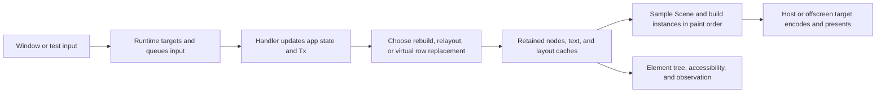

# Rune Architecture

This study uses Anomaly Rune's `dev` commit `3f0d997` as of November 22, 2026. Rune is a prerelease Rust UI framework. The study traces implementation entry points and regression tests against upstream measurement definitions. [Rune revision](https://github.com/anomalyco/rune/commit/3f0d9973526818bae62c89c483fbd144a2a19669) · [Project overview](https://github.com/anomalyco/rune/blob/3f0d9973526818bae62c89c483fbd144a2a19669/README.md#L1-L48)

**Rune builds UI with ordinary Rust functions and narrows the work when it can establish what changed.** An app can start with a state struct and a function that returns `El`. The runtime owns a tree with stable identities, layout caches, input sessions, and motion. A change may rebuild the view or update only selected subtrees, the virtualized range, or presentation values.

## Authoring API and Crate Boundaries

`AppSpec<S>` provides initialization, `fn(&S, &mut Cx<S>) -> El`, an optional `poll`, and named test scenarios. The Hello example puts the switch key, role, name, checked state, focus eligibility, and `on_press` on the same element. Children and ordinary properties define its appearance. A click mutates `&mut S` directly. The next build declares a new target position, and the runtime animates the thumb. A headless test drives the switch through the same view function. Kit components build on the same elements and callbacks. [AppSpec](https://github.com/anomalyco/rune/blob/3f0d9973526818bae62c89c483fbd144a2a19669/crates/rune/src/tooling.rs#L17-L59) · [Hello source and test](https://github.com/anomalyco/rune/blob/3f0d9973526818bae62c89c483fbd144a2a19669/examples/hello/src/main.rs#L9-L58) · [Kit](https://github.com/anomalyco/rune/blob/3f0d9973526818bae62c89c483fbd144a2a19669/crates/rune-kit/README.md)

The workspace has separate `rune-core`, `rune-edit`, `rune-text`, `rune-motion`, and `rune-gpu` crates. `rune` still handles view construction, interaction, paint, and host orchestration. The internal `RuntimeCore` uses nongeneric interfaces to read views and write app state. The public layer remains typed over `S`, and the library can compile the heavy runtime logic once. Independent window factories can install different state types per window. The queue runs one batch of app updates before extracting window commands. Updates queued during that batch wait for a later turn. [Crate dependencies](https://github.com/anomalyco/rune/blob/3f0d9973526818bae62c89c483fbd144a2a19669/crates/rune/Cargo.toml#L84-L105) · [Read and write drivers](https://github.com/anomalyco/rune/blob/3f0d9973526818bae62c89c483fbd144a2a19669/crates/rune/src/runtime/driver.rs#L1-L69) · [Window factories](https://github.com/anomalyco/rune/blob/3f0d9973526818bae62c89c483fbd144a2a19669/crates/rune/src/tooling.rs#L195-L207) · [App queue](https://github.com/anomalyco/rune/blob/3f0d9973526818bae62c89c483fbd144a2a19669/crates/rune/src/app/requests.rs#L246-L282)

## From Input to an Updated Tree

1. **Queued input retains its arrival time.** A frame advances existing animations, runs app polling and due work, then handles queued operations. If an earlier handler opens a field, later key, IME, paste, or file-drop input is routed after the new tree and focus are established. The runtime can settle preceding work without painting and sample the final state once for the frame. The editor is ready before it receives the keystroke. [Clock advancement](https://github.com/anomalyco/rune/blob/3f0d9973526818bae62c89c483fbd144a2a19669/crates/rune/src/runtime/frame.rs#L86-L116) · [Settlement before input](https://github.com/anomalyco/rune/blob/3f0d9973526818bae62c89c483fbd144a2a19669/crates/rune/src/runtime/frame.rs#L188-L295)
2. **Identity comes from paths.** A sibling key identifies an element under its parent, and the current path maps to a retained node ID. Keys preserve focus, scrolling, and motion across sibling reorders. Paths that leave the tree and no longer need retained state are eventually retired. Rune warns about duplicate sibling keys and adds suffixes so it can still create layout nodes. Those suffixes depend on sibling order, so apps still need unique keys. [Key contract](https://github.com/anomalyco/rune/blob/3f0d9973526818bae62c89c483fbd144a2a19669/crates/rune/src/el.rs#L377-L399) · [Path assignment and duplicate-key diagnostics](https://github.com/anomalyco/rune/blob/3f0d9973526818bae62c89c483fbd144a2a19669/crates/rune/src/runtime/commit/measure.rs#L102-L107) · [Virtual tree construction](https://github.com/anomalyco/rune/blob/3f0d9973526818bae62c89c483fbd144a2a19669/crates/rune/src/runtime/commit/measure.rs#L152-L165) · [Path retirement](https://github.com/anomalyco/rune/blob/3f0d9973526818bae62c89c483fbd144a2a19669/crates/rune/src/runtime/commit/prune.rs#L1-L22)
3. **Commit measures first, then updates retained state.** The runtime checks whether to relayout the existing tree, bring in only the new rows in the virtualized range, or rebuild the view. Changes to layout reads, focus, or the caret can trigger remeasurement, with a bound on layout read feedback. Taffy layout and Parley text data each have reusable caches. Text color and width changes have different invalidation conditions. As the user scrolls, measured row heights can adjust the anchor. If estimates leave a gap, Rune adds rows before committing. [Relayout and row replacement](https://github.com/anomalyco/rune/blob/3f0d9973526818bae62c89c483fbd144a2a19669/crates/rune/src/runtime/commit/relayout.rs#L54-L114) · [Commit and remeasurement](https://github.com/anomalyco/rune/blob/3f0d9973526818bae62c89c483fbd144a2a19669/crates/rune/src/runtime/commit.rs#L424-L467) · [Bounded layout read feedback](https://github.com/anomalyco/rune/blob/3f0d9973526818bae62c89c483fbd144a2a19669/crates/rune/src/runtime/layout_read.rs#L483-L506) · [Heights, anchors, and extra rows](https://github.com/anomalyco/rune/blob/3f0d9973526818bae62c89c483fbd144a2a19669/crates/rune/src/runtime/commit/measure.rs#L120-L149) · [Layout caches](https://github.com/anomalyco/rune/blob/3f0d9973526818bae62c89c483fbd144a2a19669/crates/rune/README.md#L7-L23)

## Authoring APIs for Narrowing Work

| API | What the runtime can rely on | Costs and limits |
| --- | --- | --- |
| Ordinary `view(&S, &mut Cx<S>)` | A commit reads the current struct. The author can use arbitrary functions, branches, and Rust data structures. The runtime diffs the retained tree and layout internally. | Rust evaluates ordinary helper arguments during a view rebuild. Even when Rune reuses layout, the view may already have allocated and built new element descriptions. [View construction cost](https://github.com/anomalyco/rune/blob/3f0d9973526818bae62c89c483fbd144a2a19669/research/38-view-rerun-and-commit-cost.md#L3-L18) |
| `memo(id, version, …)` | Reuses the subtree when the explicit version, system environment, and recorded layout reads are compatible. | Handler closures and ordinary Rust values are cached too. The version must cover changes to captured mutable indices, palettes, and other app values. Prefer stable business IDs for row actions. [Memo contract](https://github.com/anomalyco/rune/blob/3f0d9973526818bae62c89c483fbd144a2a19669/crates/rune/src/memo.rs#L9-L47) |
| `region`, `region_with`, and `Tracked<T>` | Reads of `Tracked` are recorded during region construction. Taking a mutable reference advances the version. Regions also record layout reads, and `region_with` accepts explicit ordinary inputs. | This invalidates local subtrees. Debug builds rebuild a reused region, compare observable element descriptions, and report the first difference. The comparison omits handlers, so closure captures still need to be modeled accurately. [Tracked](https://github.com/anomalyco/rune/blob/3f0d9973526818bae62c89c483fbd144a2a19669/crates/rune-core/src/tracked.rs#L1-L18) · [Regions and diagnostics](https://github.com/anomalyco/rune/blob/3f0d9973526818bae62c89c483fbd144a2a19669/crates/rune/src/memo/region.rs#L15-L69) · [Comparison coverage](https://github.com/anomalyco/rune/blob/3f0d9973526818bae62c89c483fbd144a2a19669/crates/rune/src/memo/region.rs#L88-L97) |
| `Live`, fixed-layout `LiveText`, and `Pixels` | Graphics controls can update only the latest bound value. Sources can be shared by windows, and equivalent text causes no extra wakeups. | Declared properties use a dedicated path suitable for levels, clocks, and canvas output. Text that affects wrapping or interaction geometry still needs layout settlement. [Live values and text](https://github.com/anomalyco/rune/blob/3f0d9973526818bae62c89c483fbd144a2a19669/crates/rune-core/src/live.rs#L60-L101) · [Use with memo](https://github.com/anomalyco/rune/blob/3f0d9973526818bae62c89c483fbd144a2a19669/crates/rune/src/memo.rs#L20-L32) |

Rune defines the conditions and fallback for each optimization. When app state is known to be unchanged during scrolling, a viewport change can construct only rows newly in range. Changed size reads still trigger a full build. An upstream attempt to move cached elements to a new parent path let old IDs bypass exit animation cleanup. Rune now restricts this reuse to paths with the same identity. Reuse requires both compatible content and unchanged mount identity. [Local virtual row updates](https://github.com/anomalyco/rune/blob/3f0d9973526818bae62c89c483fbd144a2a19669/research/38-view-rerun-and-commit-cost.md#L20-L36) · [Cross-path reuse regression](https://github.com/anomalyco/rune/blob/3f0d9973526818bae62c89c483fbd144a2a19669/research/38-view-rerun-and-commit-cost.md#L89-L102)

## Text Editing, IME, and Motion

**The edit model and its display have distinct responsibilities.** The app typically owns `TextEdit`. `text_input(&edit, style)` constructs the element, and `on_edit` provides a way to mutate the model. Single-line editing is a mode of the same API. The editor retains document text, selection, undo, and rich-text state. It stores preedit separately and writes it into the document on commit. The current Parley layout supplies caret geometry and vertical navigation. Custom-painted elements maintain interaction semantics. OS integration still needs to synchronize candidate-window placement, composition, and reconversion. [Edit model](https://github.com/anomalyco/rune/blob/3f0d9973526818bae62c89c483fbd144a2a19669/crates/rune-edit/src/lib.rs#L1-L8) · [Editor construction](https://github.com/anomalyco/rune/blob/3f0d9973526818bae62c89c483fbd144a2a19669/crates/rune/src/el/input.rs#L54-L101) · [Candidate placement and event forwarding](https://github.com/anomalyco/rune/blob/3f0d9973526818bae62c89c483fbd144a2a19669/crates/rune/src/input/host_events.rs#L434-L471)

**The host implements the platform input protocol.** On macOS, Rune exposes text and selection and obtains the reconversion range through `NSTextInputClient` in its vendored winit. Windows supplies its IME integration. The Wayland and X11 paths at this entry point lack surrounding-text and reconversion support. A reconversion range first updates selection, then receives preedit and commit events. The Web runs the same Rust view code and draws on Canvas, with a DOM text proxy for browser input and semantics. Evaluate Rune's verification coverage host by host and capability by capability. [Platform IME](https://github.com/anomalyco/rune/blob/3f0d9973526818bae62c89c483fbd144a2a19669/crates/rune/src/platform/ime.rs#L1-L60) · [Reconversion order](https://github.com/anomalyco/rune/blob/3f0d9973526818bae62c89c483fbd144a2a19669/crates/rune/src/input/host_events.rs#L434-L459) · [Web rendering and input](https://github.com/anomalyco/rune/blob/3f0d9973526818bae62c89c483fbd144a2a19669/WEB.md#L3-L12) · [Browser editor proxy](https://github.com/anomalyco/rune/blob/3f0d9973526818bae62c89c483fbd144a2a19669/WEB.md#L215-L239)

**View updates set targets, and frame sampling advances motion.** When app values change, the view declares layout and motion intent. The separate `rune-motion` crate uses an explicit clock to compute position, velocity, opacity, and presence. It supports velocity-preserving retargeting, exits, and matched geometry. The runtime advances existing trajectories through sleep or missed frames. Targets created by input start at the current time. Purely visual updates such as hover and press can retarget motion on their own. Standard hosts still advance frames on the window thread. The pure math in `rune-motion` lets callers choose when to sample it. [Trajectories, presence, and clock](https://github.com/anomalyco/rune/blob/3f0d9973526818bae62c89c483fbd144a2a19669/crates/rune-motion/src/lib.rs#L1-L16) · [Existing trajectories and new input](https://github.com/anomalyco/rune/blob/3f0d9973526818bae62c89c483fbd144a2a19669/crates/rune/src/runtime/frame.rs#L86-L116) · [View and hover updates](https://github.com/anomalyco/rune/blob/3f0d9973526818bae62c89c483fbd144a2a19669/crates/rune/README.md#L3-L13)

## Rendering Paths and Threads

`FrameHost` and testable pure state transitions define frame ordering for windows, overlays, offscreen targets, and the Web. A normal frame acquires a drawable before runtime and paint work. An idle window woken only by a timer can settle first and skip acquisition if its output is unchanged. Reconfiguration releases the old target before trying to acquire a new one. A failed acquisition does not rerun the current turn's app work. The host reports closure, occlusion, and waits for system slots. The shared state machine enforces ordering while each host applies its platform policy. [Frame order and adapters](https://github.com/anomalyco/rune/blob/3f0d9973526818bae62c89c483fbd144a2a19669/crates/rune/src/frame/host_step.rs#L1-L9) · [Branch conditions](https://github.com/anomalyco/rune/blob/3f0d9973526818bae62c89c483fbd144a2a19669/crates/rune/src/frame/host_step.rs#L38-L59) · [Reconfiguration and single-step constraints](https://github.com/anomalyco/rune/blob/3f0d9973526818bae62c89c483fbd144a2a19669/crates/rune/src/frame/host_step.rs#L188-L217)

- **Normal desktop frames.** The host calls `Surface::get_current_texture`. Once it obtains the target, it updates the runtime, builds GPU instances and resources such as glyphs, then encodes, submits, and calls `present` on the same path. When native materials are in use, macOS handles them in a host system transaction. Ordinary windows check occlusion, pacing, and surface validity before admitting a frame. When the swap chain is full, Windows registers a readiness wakeup and builds the frame with updated input once a slot opens. [Window admission](https://github.com/anomalyco/rune/blob/3f0d9973526818bae62c89c483fbd144a2a19669/crates/rune/src/window/host/draw.rs#L202-L250) · [Target acquisition](https://github.com/anomalyco/rune/blob/3f0d9973526818bae62c89c483fbd144a2a19669/crates/rune/src/window/host/draw.rs#L434-L467) · [Submission and presentation](https://github.com/anomalyco/rune/blob/3f0d9973526818bae62c89c483fbd144a2a19669/crates/rune/src/window/host/render.rs#L305-L381)
- **Dedicated presentation worker.** Eligible macOS wgpu overlays hand `finish/submit/present` to a present worker after recording. At most one job is in flight, and the host calls `wait` before the next acquire, configure, or release. Paths involving native material synchronization, video, or the custom Metal backend have their own constraints. This can shorten selected callbacks' CPU time, while surface reuse still requires synchronization. [Overlay eligibility](https://github.com/anomalyco/rune/blob/3f0d9973526818bae62c89c483fbd144a2a19669/crates/rune/src/overlay/frame.rs#L261-L302) · [Worker constraints](https://github.com/anomalyco/rune/blob/3f0d9973526818bae62c89c483fbd144a2a19669/crates/rune/src/frame/present_worker.rs#L1-L6)
- **Custom macOS Metal backend.** With the corresponding feature enabled by default, Rune supplies its own Metal implementation through `wgpu::custom`. Author code and the frame loop continue using wgpu objects. A normal frame can use one Metal command buffer with a drawable, and common shaders are precompiled. The backend supports a limited set of capabilities, and extra requested features can trigger fallback to standard wgpu. Check the actual backend for capabilities such as depth and multisampling. A resource retirement bug let a shared event signal before its command buffer finished. The current design releases the associated textures, buffers, and drawable only after GPU completion. [Backend selection](https://github.com/anomalyco/rune/blob/3f0d9973526818bae62c89c483fbd144a2a19669/crates/rune-gpu/src/backend.rs#L1-L30) · [Metal implementation and capabilities](https://github.com/anomalyco/rune/blob/3f0d9973526818bae62c89c483fbd144a2a19669/crates/rune-gpu/src/metal/mod.rs#L1-L30) · [Resource lifetime fix](https://github.com/anomalyco/rune/blob/3f0d9973526818bae62c89c483fbd144a2a19669/changelog/unreleased/2026-11-19-metal-resource-lifetime.md)
- **First-frame completion.** Windows uses a CPU-rendered first frame to keep the window usable and hands off when the GPU is ready. The state machine tracks opening, preparation, receipt, and reveal. Steady-state interaction still depends on main-thread settlement, target waits, encoding, and system presentation. Rune's GPU research reports different CPU bottlenecks and benefits from bypassing wgpu for heavy window submissions and a minimal HUD. [Windows startup](https://github.com/anomalyco/rune/blob/3f0d9973526818bae62c89c483fbd144a2a19669/crates/rune/src/window/win32/cpu_frame.rs#L1-L20) · [First-frame state](https://github.com/anomalyco/rune/blob/3f0d9973526818bae62c89c483fbd144a2a19669/crates/rune/src/window/state/first_frame.rs#L1-L18) · [Cost attribution](https://github.com/anomalyco/rune/blob/3f0d9973526818bae62c89c483fbd144a2a19669/research/34-own-gpu-plan.md#L137-L156)

## GPU Extensions

**Full-frame composition and element paint slots offer two levels of customization.** The full-frame `Compositor` receives the device, queue, encoder, target, and mutable `Runtime<S>`. It can record multiple passes or use the existing Renderer to record UI. `El::effect(mark)` declares a position in an element's paint order. Through an API such as `Renderer::draw_with`, the author gets local bounds, transforms, clipping, color conventions, and optional backdrop sampling from `EffectSite`. Exits and group opacity can use existing isolation layers. Custom soft edges and corners in an ordinary pass still need the corresponding clip math. The backdrop texture contains draws before the slot, and only backdrop reads require copying. [Compositor API](https://github.com/anomalyco/rune/blob/3f0d9973526818bae62c89c483fbd144a2a19669/crates/rune/src/compose.rs#L9-L64) · [Frame context](https://github.com/anomalyco/rune/blob/3f0d9973526818bae62c89c483fbd144a2a19669/crates/rune/src/compose.rs#L71-L109) · [Effect slot](https://github.com/anomalyco/rune/blob/3f0d9973526818bae62c89c483fbd144a2a19669/crates/rune/src/el/effect.rs#L21-L69) · [EffectSite and callback phases](https://github.com/anomalyco/rune/blob/3f0d9973526818bae62c89c483fbd144a2a19669/crates/rune/src/render.rs#L192-L246)

Rune once installed an optional compositor on every window. Timer wakeups then redrew idle UI because the runtime assumed authors might draw additional content. The current API can report whether it drew custom content on the previous frame and whether it needs another frame. For Octara, an author draw interface can describe paint position, backdrop reads, target color, and continuous frame demand so the host can schedule on demand. An explicit device identifier defines the author-owned resource lifetime. [Timer redraw regression](https://github.com/anomalyco/rune/blob/3f0d9973526818bae62c89c483fbd144a2a19669/changelog/unreleased/2026-11-12-quiet-compositor.md) · [Frame demand and device identity](https://github.com/anomalyco/rune/blob/3f0d9973526818bae62c89c483fbd144a2a19669/crates/rune/src/compose.rs#L43-L64)

## Agent and Performance Evidence

Named scenarios, input scripts, element trees, screenshots, and a multi-window virtual desktop all run the same app definition. Timing scripts can carry virtual time, input, and markers. Offscreen and real windows share the frame state machine, yielding repeatable regressions for input, focus, scroll, and motion. System IME, actual visibility, and missed refreshes still require evidence from the relevant real host. [Entry point](https://github.com/anomalyco/rune/blob/3f0d9973526818bae62c89c483fbd144a2a19669/README.md#L39-L48) · [Script event timing](https://github.com/anomalyco/rune/blob/3f0d9973526818bae62c89c483fbd144a2a19669/crates/rune/src/tooling/headless_run.rs#L60-L75) · [Offscreen frame order](https://github.com/anomalyco/rune/blob/3f0d9973526818bae62c89c483fbd144a2a19669/crates/rune/src/tooling/headless.rs#L373-L412)

`FrameEncoded` reports CPU build and encode durations and the display link's target time. macOS tracing can also record Metal `presentedTime` by drawable sequence number. Readiness, CPU submission, GPU execution, and system visibility each require their own evidence. A recent Windows fix for text input without a physical keystroke illustrates why direct runtime editing tests need to be complemented by tests of native messages and composition. [CPU timing and target time](https://github.com/anomalyco/rune/blob/3f0d9973526818bae62c89c483fbd144a2a19669/crates/rune/src/frame/encoded.rs#L43-L79) · [Drawable presentation receipt](https://github.com/anomalyco/rune/blob/3f0d9973526818bae62c89c483fbd144a2a19669/crates/rune/src/frame/present_time.rs#L371-L398) · [Windows text input fix](https://github.com/anomalyco/rune/commit/3f0d9973526818bae62c89c483fbd144a2a19669)

[Exact architecture overview](exact-full-architecture.md) · [Octara's target architecture](../design/architecture-v2.md)
