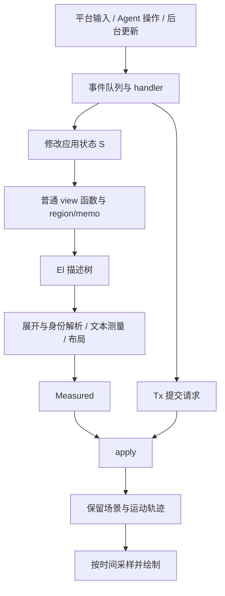

# Rune：函数组合之下的执行架构

2026-11-17，源码研究；不修改 Octara 生产实现。本轮未编译或运行 Rune。

## 范围与版本

这次研究沿执行链检查职责，不把 README 的目标当作实现。

- 本地参考仓库位于 `archive/reference/rune`（Octara 仓库外），版本为
  `3686e94ae09545fd5f2a61e22aabfbeba1cd896f`。
- 更新机制、提交、帧循环、身份解析、headless 和依赖关系重新读取固定版本
  `631e8a67cb3c40225efa3f6c4f57b80e7b18f190` 的官方源码。
  这是此前核对的 11 月 16 日版本，本轮没有重新确认最新分支头。
- App/Cx/Tx、编辑器和 kit 的补充证据仍取本地旧版本；下文明确区分。
  已有逐控件分析见 [独立架构审查](agent-rune-architecture-review.md)，
  新版本的变更和历史修复见 [collections and regions](collection-regions.md)。

## 1. 首先区分四种东西

| 对象 | 所有者与职责 | 不应混同的东西 |
| --- | --- | --- |
| `S` | 应用状态；handler/poll/update 修改，view 借用 | 不是每个函数一份组件实例 |
| `El` | 函数构造的 UI 描述，携带样式、语义、事件和 children | 不是所有持久状态的存储位置 |
| `Runtime<S>` 的 nodes、layout、focus、scroll 等 | 将描述落实为持续可交互的窗口内容 | 不是业务状态的第二份完整副本 |
| `Scene` 与运动轨迹 | 保持呈现过程，随时间采样 | 不要求每帧重新执行业务 view |

依据：[Runtime][runtime]、[El][el]、[frame loop][frame]。
Rune 的简洁之处在于应用大多只看见前两项；后三者之间仍存在缓存和同步契约。
因此“普通函数组合”不能推导为“没有 retained runtime”，也不能推导为“框架内部很小”。

图是职责图，不承诺每个事件恰好触发一次构建；测量和几何反馈可能要求重试。

## 2. 函数组合不要求组件协议

根入口是 `fn(&S, &mut Cx<S>) -> El`。普通 helper 返回 `El`，通过 children 组成树。
函数本身不需要 hook 顺序、组件 trait 或挂载实例。身份需要时落到元素 key 和缓存边界，
不是每一次 Rust 函数调用都分配身份。[Runtime 构造][runtime]、[El][el]。

旧版本 `Cx` 提供环境、几何读与构建设置；`Tx` 则是事件处理期间对焦点、滚动、动画、
窗口、剪贴板等提出的请求。二者的存在说明“普通函数”仍可以有明确执行上下文。
`Tx` 不等于数据库事务：handler 已修改 `S`，这里没有据此证明任意失败都能回滚。
见旧版 [Cx][cx-old]、[Tx][tx-old]。

**对 Octara：**借鉴普通函数作为默认组合单位，以及读取环境/提出动作的明确职责。
不需要为此引入第二套组件生命周期，也不需要复制一个包揽所有功能的公开 Tx。
Signals 的计算边界与 owner 仍应由实际响应式工作和资源存续需要决定。

## 3. 更新模型已经不只是手工 memo

固定新版本仍在 commit 时进入根 view，但有三类不同的更新承诺：

| 机制 | 失效依据 | 主要风险 |
| --- | --- | --- |
| `memo(id, version, build)` | 调用方版本，加环境/几何等内建依赖 | 漏掉输入或 callback 捕获 |
| `region(id, build)` / `region_with(id, inputs, build)` | 区域内 Tracked 读取，加显式外部输入及环境/几何读 | 未追踪字段或内部可变性遗漏 |
| Live 等共享呈现值 | 绑定对象变化，不需要构造整棵描述树 | 必须满足跳过业务构建的适用边界 |

`Tracked<T>` 在 Deref 时记录 cell/version，在 DerefMut 时增版本；可变借用即使没有改变值
也会保守失效。内部可变性需要 `touch`。把旧 Tracked 换出但继续保活也有失效限制。
它仍使用普通 Rust 数据，但并没有自动识别任意结构体所有字段的变化。
见 [Tracked][tracked]、[memo/region][memo]。

region 的 debug 检查会重新构造并比较描述，帮助发现漏依赖；比较不覆盖 handler，
所以相同画面不证明点击行为正确。缓存回调应捕获稳定 ID，位置和可变 payload 需要
正确的失效或重新读取机制。手工 memo 与自动 region 的追踪边界不能混为一谈。

**对 Octara：**我们的 Signals 已经承担失效判断；不再添加手工 version 协议。
可学的是可解释的依赖边界、重新计算对照验证，以及把回调正确性单独测试。

## 4. 最有价值的内部边界：测量不能发布呈现

新版本把构建布局划为 `Measurement`，完成后产生 `Measured`，再由 `apply` 消费。
`Measurement` 能访问文本/布局缓存、虚拟列表几何和只读 `S`，不持有 Scene、绘制实例、
增长/揭示轨迹或 `&mut S`。它并非完全纯函数：缓存和几何准备仍会修改。
这个边界禁止的是把试算当作场景提交。[commit][commit]。

实际 commit 会处理布局读稳定化、请求焦点、caret 变化；必要时丢弃测量结果并重新测量。
虚拟列表测量也有重试和强制路径。因此让测量阶段直接改变运动或触发业务副作用，
会使重试次数成为用户可观察行为。旧版 [apply][apply-old] 则显示场景、增长和揭示的变更
集中在接收 Measured 的阶段。

**对 Octara：**优先审查“试算是否可能发布副作用”，而非照搬 Rune 的全部 pass 类型。
如果现有 retained tree 可以局部求解，就不为了模仿它而强制重建；若阶段混用权限，
先收紧内部借用能力和输入类型，不新增公开原语。

## 5. 元素身份与缓存身份不是函数身份

flatten 按父路径与显式 key 生成路径；没有 key 时使用位置段。路径映射到 NodeId，
已有路径可复用身份。memo 又有自己的命名范围，嵌套 memo 的名字相对外层解释。
这些共同维持 focus、press、scroll、动画等连续性。[flatten][flatten]、[memo][memo]。

由此得到的约束是：动态列表需要稳定业务 key；普通函数可随意拆分不意味着树路径可
随意变动。把一行重排后仍保留旧 index 捕获，是缓存正确但业务行为错误的典型情形。

**对 Octara：**保留业务 key、节点实例身份、应用/窗口实例身份的区分。
Rune 的路径复用不能直接证明我们的 Agent 过期目标可以取消代次校验。
复用 identity 与刷新 row 输入必须一起成立。

## 6. 输入状态没有随着 UI 函数重跑而消失

旧版本应用持有 `TextEdit`，InputSpec 克隆展示数据，并通过 access 回到应用的真实编辑器。
运行时另外处理焦点、IME、选择路由。ComboboxState 包含搜索编辑器和 open/highlight 状态；
选项与当前业务选择从应用传入。见旧版 [InputSpec][input-old] 及
[已核对的控件调用链](agent-rune-architecture-review.md#发现-3rune-的编辑所有权与受控选择并不等于-octara-的受控值协议)。

这说明应删除的是没有独立职责的同步副本，不是所有 snapshot。
展示快照有明确发布/读取边界时合理；第二份可写选项列表靠 watch 追赶源列表则需要证明价值。
Octara 的文档编辑状态已有不同所有者，不宜再包一层 Rune 式 TextEdit 镜像。

## 7. 呈现更新与业务更新分开，但不要夸大线程结论

frame loop 区分逻辑时钟、运动推进、poll、事件处理、commit 与后续绘制。
旧轨迹先推进到当前时间，再被新事件重定向；调度一次 wake 不代表业务状态已改变。
`live_only` 等路径避免无关事件触发构建，同时 debug 路径检查这种承诺。
隐藏/遮挡窗口也有单独处理入口。[frame][frame]。

**修正旧笔记的表述：**应说“呈现状态可以不经过业务 view 重跑而推进”。
Runtime 实际持有 Scene；这些证据不足以宣称所有平台都有一个独立 render thread
独占整棵呈现树。线程部署与更新模型是不同问题，不把设计愿景当既成事实。

## 8. Agent 使用同一套运行时，但 headless 不是原生验证的替代品

headless 接受同样的 App 配置，使用 Runtime 和 Renderer，提供可控时间与离屏输出；
不是另写一套控件模拟逻辑。[headless][headless]。
这让“操作 → 帧推进 → 看树/看图 → 定位原因”成为可重复工作流。

共享执行链不能证明操作系统候选窗、系统菜单、真实焦点切换等均被覆盖。
Octara 应保留真实 OS 验证，同时让 Agent 从同一运行状态取得语义、几何、截图与失效原因。
没有必要另建 AI 自我改进调度层。

## 9. Rune 没有去掉 kit，也没有把所有底层能力拆成小 crate

新版本依赖是 rune-kit → rune；rune 依赖 rune-motion、rune-staging、rune-taffy 等。
核心内仍集成很多输入、文本、布局、渲染和工具模块。
旧版本 kit 是普通 builder，最终 `build(&Kit) -> El`，主题作为数据注入。
见 [core manifest][core-manifest]、[kit manifest][kit-manifest]、旧版 [kit][kit-old]。

因此不能用 Rune 证明“必须删除 kit”，也不能用它证明“必须保留独立 kit 层”。
它证明的是：控件组合可以是 core 之上的普通库，而不是第二个运行时。
Octara 是否保留包名，应服从行为复用与依赖方向，不由模仿决定。

## 10. 对当前瘦身工作的结论

| 选择 | 判断 |
| --- | --- |
| 普通函数组合 UI，不为每个 helper 建立组件实例 | 采用 |
| 从业务数据直接派生选项，去掉可写镜像和同步 watch | 继续当前第一阶段；保留必要交互协调 |
| 将测量、发布、事件权限落实到内部类型与借用边界 | 列为整体审查重点，先查实际越界再决定重构 |
| 保留稳定 key、刷新输入、淘汰旧回调目标的统一契约 | 必须保留，并用行为测试验证 |
| 把 Rune 的 memo/version/Tracked 再叠到 Signals 上 | 不采用；避免两套失效规则 |
| 因为面向 AI，就把焦点/IME/键盘状态机复制到应用 | 不采用；AI 需要可靠的共享执行机制 |
| 立即删除整个 kit 或照搬 Rune 的所有 crate 划分 | 证据不支持，逐项按职责收敛 |

下一次评审应逐项回答：谁拥有状态、什么使它失效、哪个阶段能修改、谁负责销毁、
Agent 如何观察和验证。答案相同的机制才考虑合并；职责不同的对象不能仅因名称多就删除。

[runtime]: https://github.com/anomalyco/rune/blob/631e8a67cb3c40225efa3f6c4f57b80e7b18f190/crates/rune/src/runtime.rs
[el]: https://github.com/anomalyco/rune/blob/631e8a67cb3c40225efa3f6c4f57b80e7b18f190/crates/rune/src/el.rs
[frame]: https://github.com/anomalyco/rune/blob/631e8a67cb3c40225efa3f6c4f57b80e7b18f190/crates/rune/src/runtime/frame.rs
[tracked]: https://github.com/anomalyco/rune/blob/631e8a67cb3c40225efa3f6c4f57b80e7b18f190/crates/rune/src/tracked.rs
[memo]: https://github.com/anomalyco/rune/blob/631e8a67cb3c40225efa3f6c4f57b80e7b18f190/crates/rune/src/memo.rs
[commit]: https://github.com/anomalyco/rune/blob/631e8a67cb3c40225efa3f6c4f57b80e7b18f190/crates/rune/src/runtime/commit.rs
[flatten]: https://github.com/anomalyco/rune/blob/631e8a67cb3c40225efa3f6c4f57b80e7b18f190/crates/rune/src/runtime/commit/flatten.rs
[headless]: https://github.com/anomalyco/rune/blob/631e8a67cb3c40225efa3f6c4f57b80e7b18f190/crates/rune/src/tooling/headless.rs
[core-manifest]: https://github.com/anomalyco/rune/blob/631e8a67cb3c40225efa3f6c4f57b80e7b18f190/crates/rune/Cargo.toml
[kit-manifest]: https://github.com/anomalyco/rune/blob/631e8a67cb3c40225efa3f6c4f57b80e7b18f190/crates/rune-kit/Cargo.toml
[cx-old]: https://github.com/anomalyco/rune/blob/3686e94ae09545fd5f2a61e22aabfbeba1cd896f/crates/rune/src/runtime/cx.rs
[tx-old]: https://github.com/anomalyco/rune/blob/3686e94ae09545fd5f2a61e22aabfbeba1cd896f/crates/rune/src/el/tx.rs
[apply-old]: https://github.com/anomalyco/rune/blob/3686e94ae09545fd5f2a61e22aabfbeba1cd896f/crates/rune/src/runtime/commit/apply.rs
[input-old]: https://github.com/anomalyco/rune/blob/3686e94ae09545fd5f2a61e22aabfbeba1cd896f/crates/rune/src/el/input.rs
[kit-old]: https://github.com/anomalyco/rune/blob/3686e94ae09545fd5f2a61e22aabfbeba1cd896f/crates/rune-kit/src/lib.rs
